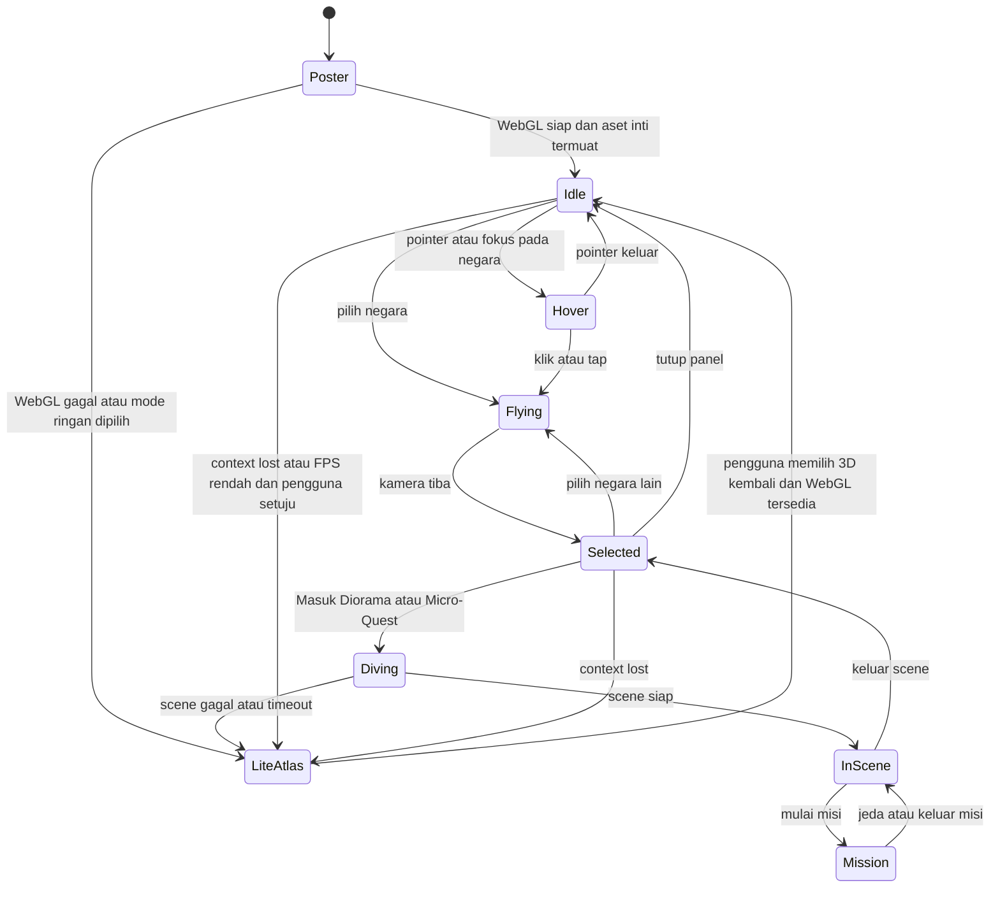
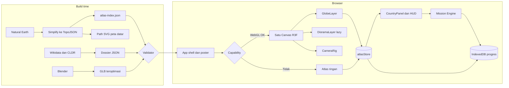
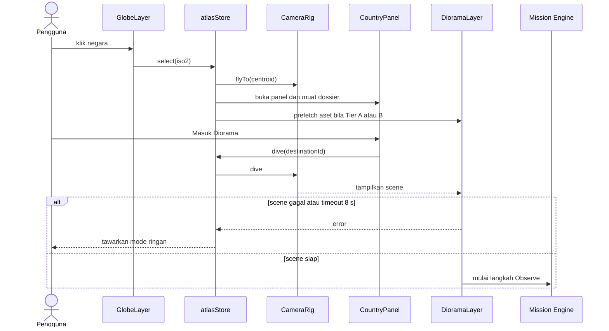

# Lingua Quest — Addendum A: World Atlas 3D (modul mandiri)

> Modul ini juga tertanam di `lingua-quest-prd2.md`. Rujukan ke ID v1.0 (FR-xx, NFR-xx, ARCH-xx, T-xx, R-03, PER-xx, G-xx) mengacu ke PRD v1.0.

## Addendum A — World Atlas 3D: Landing Page Interaktif Seluruh Dunia (Revisi v2.0)

> **Status dokumen:** Draft untuk keputusan tim · **Mengubah:** Executive Summary, Scope, NG-03, NG-11, FR-04, ARCH-02, ARCH-04, T-24, aturan pengurangan scope · **Prefix ID baru:** `WG-` (goal), `WA-US-` (user story), `WA-FR-` (functional), `WA-NFR-` (non-functional), `WA-ARCH-` (arsitektur), `R-W` (risiko), `OQ-W` (open question), `W-T` (task).
>
> Semua angka bertanda **(indikatif)** adalah target perencanaan yang harus divalidasi pada spike W-T01 dan pengujian perangkat. Semua teknologi bertanda **(asumsi)** belum dibekukan.

### A.1 Ringkasan revisi dan alasan

**Masalah pada PRD v1.0.** Beranda dan eksplorasi dunia hanya digambarkan sebagai "globe dengan rotasi terbatas" (FR-04, estimasi 4 PD, dikerjakan di F4) dengan dua destinasi. Pengalaman pertama pengguna—yang paling menentukan kesan juri—berada di prioritas rendah dan tidak memberi rasa "menjelajahi dunia" pada tema *Young Innovators, Global Explorers*.

**Perubahan utama v2.0.**

| # | Perubahan | Dampak |
| --- | --- | --- |
| 1 | Beranda `/` menjadi **World Atlas 3D**: globe layar penuh, seluruh negara dapat di-hover, di-klik, dicari, dan dibuka melalui daftar HTML setara. | Kesan pertama imersif; mendukung kriteria UI 30% dan Orisinalitas 30% pada Bab 9 guidebook |
| 2 | Cakupan dunia penuh dicapai dengan **model tiga tier** (A Playable, B Micro-Quest, C Atlas Fact), bukan dengan membuat 195 misi. | Seluruh dunia terasa "hidup" tanpa melanggar batas kapasitas dan keselamatan konten |
| 3 | Klik negara menghasilkan **rangkaian interaksi yang pasti**: kamera terbang → panel negara → (Tier A/B) masuk diorama 3D pada **kanvas yang sama** → misi. | Interaktivitas 3D nyata, bukan sekadar ornamen |
| 4 | **Blender** ditetapkan sebagai alat produksi aset (diorama, landmark, props) yang diekspor ke glTF/GLB dan dimuat Three.js/React Three Fiber; Blender tidak berjalan di browser. | Pipeline aset jelas, ukuran terkontrol, lisensi tercatat |
| 5 | **Atlas ringan** (peta datar SVG + daftar bisa dicari) menjadi jalur setara untuk perangkat tanpa WebGL, keyboard, dan pembaca layar. | Menjaga R-03 (risiko tertinggi) dan kriteria UX 30% (responsif di semua perangkat) |
| 6 | Atlas menjadi **permukaan progres**: negara yang selesai menerima stempel paspor langsung pada globe. | Menyatukan landing page dengan core loop (Paspor, Review) |

**Konsekuensi kapasitas (jujur).** Atlas Must menambah sekitar **+16 PD bersih** (20 PD Must dikurangi 4 PD T-24 yang diserap). Kapasitas PRD v1.0 sudah memiliki gap material (155 PD target vs. sekitar 72 person-day kalender). Karena itu v2.0 menetapkan: **Atlas MVP berprioritas di atas Kyoto (F5)**. Jika kedua tidak muat, Kyoto yang ditunda (lihat A.14).

**Pemetaan ke kriteria penilaian guidebook (Bab 9).**

| Kriteria | Bobot | Kontribusi Atlas | Bukti yang disiapkan |
| --- | --- | --- | --- |
| Orisinalitas | 30% | Konsep "dunia sebagai antarmuka belajar bahasa"; pipeline diorama dari aset buatan sendiri | Catatan riset, manifest aset, surat orisinalitas, daftar penggunaan AI |
| UI | 30% | Globe imersif, sistem tier visual, transisi kamera, konsistensi komponen | Screenshot proposal, video pitching, design token |
| UX | 30% | Responsif, mode ringan setara, poster-first loading, navigasi jelas | Hasil uji perangkat, catatan uji responsivitas (Bab 7 proposal) |
| Clean Code | 10% | Pemisahan data, renderer, engine; schema tervalidasi; README | Struktur repo, README, CI |

### A.2 Visi pengalaman landing page

> **"Satu dunia, satu klik, satu situasi bahasa."**

Pengguna membuka `/` dan melihat globe bergaya low-poly malam hari berputar pelan di tengah layar. Seluruh negara bereaksi saat disentuh. Mengklik negara membuat kamera terbang ke sana, panel negara muncul, dan—bila tersedia—pengguna "menyelam" masuk ke diorama 3D tempat misi bahasa berlangsung. Globe selalu menjadi peta orientasi: setiap stempel paspor yang diperoleh muncul sebagai penanda pada negara terkait.

**Lima lapisan pengalaman.**

| Lapisan | Nama | Isi | Dimuat |
| --- | --- | --- | --- |
| L0 | Globe shell | Samudra, atmosfer, bintang, graticule, pencahayaan | Eager (setelah poster) |
| L1 | Country layer | Poligon seluruh negara, hover, seleksi, pin entitas kecil | Eager |
| L2 | Country Dossier | Panel data negara, aksi sesuai tier | Lazy per negara |
| L3 | Destination Scene | Diorama 3D Tier A dan B | Lazy per destinasi |
| L4 | Mission | Mesin misi v1.0 (tidak berubah) | Lazy per misi |

**Prinsip desain.**

1. **Poster-first.** Halaman menampilkan poster globe statis (CSS/SVG, <40 KB) dalam hitungan detik; kanvas 3D menggantikan poster saat siap. Pengguna tidak pernah melihat layar kosong.
2. **Satu kanvas WebGL.** Globe dan diorama hidup pada satu `<Canvas>` agar transisi sinematik dan agar batas konteks WebGL pada perangkat mobile tidak terlampaui.
3. **Daftar HTML adalah jalur kanonik.** Globe adalah peningkatan, bukan satu-satunya pintu.
4. **Jujur soal cakupan.** Negara tanpa misi tidak berpura-pura memilikinya; tier ditampilkan jelas dan setiap tier memiliki tindakan yang berguna.
5. **Fakta, bukan stereotip.** Tier C hanya memuat fakta geografis dan linguistik bersumber; klaim budaya hanya pada konten yang berstatus ditinjau.

### A.3 Model tier cakupan dunia

| Tier | Nama | Cakupan target | Konten | Tindakan utama | Syarat status |
| --- | --- | --- | --- | --- | --- |
| **A** | Playable Expedition | 1 destinasi minimum (Indonesia—Yogyakarta); Jepang—Kyoto bersyarat | 3 misi penuh, diorama buatan tangan, audio dan transkrip | `Masuk Diorama` → `Mulai Misi` | `APP_TESTED` pada seluruh misi |
| **B** | Micro-Quest | **0–8 negara (indikatif)**, ditetapkan di OQ-W07 | 1 misi mikro 2–4 langkah (`Observe/Listen/Choose/Reflect`), ±2 menit; diorama dari Diorama Kit | `Coba Micro-Quest` | `APP_TESTED`, ditinjau bahasa dan konteks |
| **C** | Atlas Fact | **Seluruh negara lain** (target ±195 entri) | Dossier fakta bersumber: nama (id/en), wilayah, bahasa resmi/utama, aksara, kode ISO | `Bandingkan`, `Tambah ke Daftar Penasaran`, `Lihat Ekspedisi Tersedia` | Sumber tercatat; tanpa klaim budaya tak ditinjau |

**Aturan tier.**

- Tier tidak boleh dinaikkan ke B atau A sebelum seluruh konten `APP_TESTED`; negara yang gagal gerbang kembali ke tier di bawahnya otomatis (feature flag data, tanpa rebuild).
- Tier C **tidak** menampilkan kalimat tentang kebiasaan, etika, atau karakter masyarakat. Hanya fakta terstruktur bersumber.
- Aturan v1.0 "destinasi belum `APP_TESTED` disembunyikan, bukan 'segera hadir' tanpa tindakan berguna" tetap berlaku untuk **misi**. Atlas Fact bukan misi; ia dilabeli jujur sebagai `Atlas saja — misi belum tersedia` dan selalu menyediakan tindakan berguna.
- Sapaan/frasa pada dossier hanya tampil bila `reviewStatus = APPROVED` dan bersumber.

### A.4 Peta interaksi: apa yang terjadi saat diklik

| Objek | Hasil | Rute |
| --- | --- | --- |
| Negara Tier A | Kamera terbang → panel → `Masuk Diorama` → dive → scene → misi | `/atlas/:iso2` → `/destination/:id` → `/expedition/:id` |
| Negara Tier B | Kamera terbang → panel → `Coba Micro-Quest` | `/atlas/:iso2` → `/expedition/micro-:iso2` |
| Negara Tier C | Kamera terbang → panel dossier → `Bandingkan` / `Daftar Penasaran` / `Lihat Ekspedisi Tersedia` | `/atlas/:iso2` |
| Pin entitas kecil | Sama dengan negara terkait | `/atlas/:iso2` |
| Stempel paspor pada globe | Membuka panel negara dengan ringkasan capaian | `/atlas/:iso2` |
| Samudra/ruang kosong | Menutup panel; kamera tetap | `/` |
| Hotspot objek di diorama | Memulai langkah `Observe`/`Listen` pada mesin misi | `/expedition/:id` |
| Tombol `Paspor` | Membuka paspor | `/passport` |
| Logo/`Reset kamera` | Kamera kembali ke orbit awal | `/` |
| Pencarian atau daftar | Setara dengan klik negara | `/atlas/:iso2` |

**Rute (menggantikan sebagian ARCH-02).** `/` (World Atlas + bagian konten di bawah hero), `/atlas/:iso2` (deep link, panel terbuka), `/explore` (alias ke `/` untuk kompatibilitas), serta rute v1.0 lainnya tidak berubah.

### A.5 Mesin status Atlas



**Aturan transisi.**

- `Flying` dapat diinterupsi oleh pilihan baru; kamera mengambil target terakhir tanpa lompatan.
- `Diving` memiliki timeout **8 detik (indikatif)**. Setelah itu tampil `Lanjutkan dalam mode ringan` tanpa membatalkan pilihan negara.
- Perpindahan ke `LiteAtlas` mempertahankan negara terpilih, filter, dan progres; tidak membuat attempt misi baru (konsisten dengan FR-21).
- Saat reduced motion aktif: tidak ada auto-rotate dan tidak ada animasi terbang; kamera berpindah dengan cross-fade ≤150 ms atau langsung.

### A.6 Spesifikasi input dan kontrol

| Input | Perilaku |
| --- | --- |
| Mouse hover | Sorot negara (warna + outline), tooltip nama; auto-rotate berhenti |
| Klik | Seleksi + fly-to; klik area kosong menutup panel |
| Drag | Rotasi dengan inersia ringan; batas kutub dikunci |
| Roda/pinch | Zoom dengan batas jarak minimum dan maksimum |
| Tap (mobile) | Seleksi jika pergeseran jari <6 px dan durasi <300 ms **(indikatif)**; selain itu dianggap drag |
| Keyboard | `Tab` ke kontrol HUD dan daftar; `←→↑↓` memutar globe saat kanvas fokus; `Enter` memilih/masuk; `Esc` keluar/tutup; `/` fokus pencarian |
| Pembaca layar | Kanvas berperan `img` dengan label ringkas dan instruksi; seleksi diumumkan melalui live region (`aria-live="polite"`); daftar adalah jalur kanonik |
| Gestur scroll mobile | Default `touch-action: pan-y` agar halaman dapat di-scroll; tombol `Jelajahi globe` mengaktifkan interaksi penuh (`touch-action: none`) dan tombol `Selesai` mengembalikannya |

### A.7 Wireframe konseptual (untuk bahan First Draft)

**Desktop (≥1024 px).**

```
┌──────────────────────────────────────────────────────────────────────┐
│ [Logo] Lingua Quest      [Cari negara…  /]   [ID|EN] [Paspor] [⚙]    │
├──────────────────────────────────────────────────────────────────────┤
│                                                      ┌──────────────┐│
│   Explore the world.                                 │ Jepang  [A]  ││
│   Connect through language.                          │ Asia Timur   ││
│   [Mulai sebagai tamu] [Jelajahi dunia]              │ Bahasa: …    ││
│                                                      │ [Masuk       ││
│              ◜  GLOBE 3D  ◝                          │  Diorama]    ││
│             (hover, klik, drag)                      │ [Bandingkan] ││
│              ◟            ◞                          └──────────────┘│
│  Legenda: ◆ Playable  ● Micro-Quest  ○ Atlas   Mode warna: [Status▾] │
│  [Globe | Peta datar]   [Mode ringan]   [Reset kamera]               │
└──────────────────────────────────────────────────────────────────────┘
```

**Mobile (320–480 px).**

```
┌───────────────────────┐
│ ☰  Lingua Quest   [🔍] │
│  Explore the world.   │
│  [Mulai sebagai tamu] │
│        GLOBE          │
│   [Jelajahi globe]    │
├───────────────────────┤  ← bottom sheet (snap 40% / 90%)
│ ▔▔  Jepang   [Tier A] │
│  Bahasa · Aksara      │
│  [Masuk Diorama]      │
└───────────────────────┘
```

### A.8 Tujuan dan metrik Atlas

| ID | Tujuan | Target **(indikatif)** | Cara ukur |
| --- | --- | --- | --- |
| WG-01 | Penemuan interaksi | ≥4 dari 5 peserta uji memilih negara dari globe dalam ≤15 detik tanpa arahan | Uji usability terstruktur |
| WG-02 | Cakupan dunia | 100% entri dataset dapat dipilih melalui globe/pin, daftar, dan pencarian | Tes otomatis iterasi seluruh ISO |
| WG-03 | Kesetaraan jalur | 100% tindakan Atlas tersedia pada Atlas ringan | Checklist paritas + E2E |
| WG-04 | Performa mobile | Median ≥30 FPS pada 2 perangkat mobile uji; hover-to-highlight ≤100 ms desktop | Profiling terdokumentasi |
| WG-05 | Kecepatan awal | Poster terlihat ≤2,5 s dan globe interaktif ≤4 s pada koneksi 4G terkontrol | Lighthouse/WebPageTest + uji manual |
| WG-06 | Aksesibilitas | 0 defect kritis keyboard/fokus pada atlas; seluruh aksi dapat diselesaikan tanpa pointer | Audit FR-33 |
| WG-07 | Akurasi data | 0 ketidaksesuaian ISO↔nama↔geometri pada tes validasi; 100% entri memiliki sumber | Validator build |
| WG-08 | Stabilitas sumber daya | Pertumbuhan heap ≤10% dan tanpa kebocoran GPU setelah 20 siklus pilih→masuk→keluar | Uji memori manual + log |

### A.9 User stories Atlas

| ID | Pengguna | Cerita | Prioritas | FR |
| --- | --- | --- | --- | --- |
| WA-US-01 | Raka, pelajar visual (PER-02) | Sebagai pelajar visual, saya ingin memutar globe dan mengklik negara mana pun, sehingga saya merasa menjelajahi dunia. | Must | WA-FR-01–03 |
| WA-US-02 | Sinta, perangkat terbatas (PER-03) | Sebagai pengguna ponsel lama, saya ingin peta datar ringan dan daftar bisa dicari, sehingga saya tetap dapat memilih negara dan memulai misi. | Must | WA-FR-08–09 |
| WA-US-03 | Ayu, keyboard/pembaca layar (PER-05) | Sebagai pengguna keyboard, saya ingin mencari dan memilih negara lewat daftar serta mendengar pengumuman pilihan, sehingga saya tidak bergantung pada kanvas. | Must | WA-FR-06, WA-FR-14 |
| WA-US-04 | Bima, pengunjung pertama (PER-09) | Sebagai pengunjung baru, saya ingin memahami dalam beberapa detik apa yang bisa dilakukan dan apa yang terjadi saat negara diklik. | Must | WA-FR-01, WA-FR-05 |
| WA-US-05 | Raka (PER-02) | Sebagai pelajar yang menyukai 3D, saya ingin "menyelam" ke diorama negara dengan transisi mulus. | Should | WA-FR-07 |
| WA-US-06 | Nadia (PER-01) | Sebagai pelajar yang ragu, saya ingin tahu negara mana yang punya misi dan berapa lama, sehingga saya memilih dengan percaya diri. | Must | WA-FR-05 |
| WA-US-07 | Bu Maya (PER-06) | Sebagai guru, saya ingin melihat dengan jelas negara mana yang berisi misi tinjauan dan mana yang hanya fakta atlas. | Must | WA-FR-05, WA-FR-11 |
| WA-US-08 | Juri kompetisi | Sebagai juri, saya ingin landing page responsif dan stabil di perangkat apa pun saya membukanya. | Must | WA-FR-09, WA-NFR-P01–P05 |
| WA-US-09 | Dimas (PER-04) | Sebagai pelajar yang suka progres, saya ingin melihat stempel pada globe setelah menyelesaikan misi. | Should | WA-FR-16 |
| WA-US-10 | Pengguna perangkat bersama (PER-10) | Sebagai pengguna perangkat bersama, saya ingin preferensi atlas dan daftar penasaran dapat dihapus bersama progres. | Must | WA-FR-10 |

### A.10 Acceptance criteria utama

**AC-W01 — Klik negara (WA-US-01).**

- **Given** globe 3D aktif, **when** pengguna mengklik negara mana pun, **then** negara tersorot, kamera tiba dalam ≤1,5 detik **(indikatif)**, dan panel muncul dengan nama, tier, serta tindakan.
- **Given** pengguna mengklik negara lain saat kamera masih terbang, **when** klik diterima, **then** kamera beralih ke target baru tanpa lompatan dan panel hanya menampilkan negara terakhir.

**AC-W02 — Kesetaraan daftar (WA-US-03).**

- **Given** pengguna hanya memakai keyboard, **when** mengetik nama negara di pencarian lalu menekan `Enter`, **then** negara terpilih, panel menerima fokus, dan pembaca layar mengumumkan nama serta tier.
- **Given** WebGL dinonaktifkan, **when** halaman dimuat, **then** Atlas ringan tampil langsung dengan daftar seluruh negara dan seluruh tindakan sama.

**AC-W03 — Gestur mobile (WA-US-02).**

- **Given** ponsel dalam mode default, **when** pengguna menggeser jari vertikal pada area globe, **then** halaman ter-scroll dan globe tidak berputar.
- **Given** pengguna menekan `Jelajahi globe`, **when** menggeser jari, **then** globe berputar dan halaman tidak ter-scroll sampai `Selesai` ditekan.
- **Given** jari bergeser <6 px, **when** dilepas, **then** gestur dihitung sebagai tap seleksi.

**AC-W04 — Fallback saat gagal (WA-US-08).**

- **Given** konteks WebGL hilang saat panel terbuka, **when** kejadian `webglcontextlost` terdeteksi, **then** Atlas ringan tampil ≤3 detik dengan negara terpilih, filter, dan progres yang sama, serta pesan in-app menjelaskan penyebab.
- **Given** diorama tidak selesai dimuat dalam 8 detik, **when** timeout tercapai, **then** pengguna dapat memilih `Lanjutkan dalam mode ringan` tanpa kehilangan pilihan negara.

**AC-W05 — Tier C bermakna (WA-US-06/07).**

- **Given** pengguna memilih negara Tier C, **when** panel terbuka, **then** label `Atlas saja — misi belum tersedia` terlihat, dossier menampilkan fakta bersumber, dan minimal dua tindakan berguna tersedia.
- **Given** sebuah dossier tidak memiliki sumber, **when** build berjalan, **then** build gagal.

**AC-W06 — Reduced motion.**

- **Given** `prefers-reduced-motion: reduce`, **when** pengguna memilih negara, **then** tidak ada auto-rotate maupun animasi terbang; panel muncul dan kamera berpindah ≤150 ms.

**AC-W07 — Pembersihan sumber daya (WG-08).**

- **Given** pengguna melakukan 20 siklus pilih→masuk diorama→keluar, **when** profil memori dicek, **then** geometri/tekstur diorama sebelumnya dibuang dan pertumbuhan heap ≤10% **(indikatif)**.

### A.11 Functional Requirements Atlas

| ID | Requirement | Prioritas |
| --- | --- | --- |
| WA-FR-01 | **Beranda World Atlas.** Rute `/` harus menampilkan poster globe segera, lalu menggantinya dengan globe 3D interaktif layar penuh. Overlay memuat tagline, label simulasi fiktif, CTA `Mulai sebagai tamu`, CTA `Lanjutkan perjalanan` bila progres valid, CTA `Jelajahi dunia`, pencarian, pengaturan bahasa, dan akses Paspor. Di bawah hero tersedia bagian `Cara kerja`, `Tier`, `Tentang`, dan `Atribusi`. Memperluas FR-01 v1.0 tanpa meminta akun atau data identitas. | Must |
| WA-FR-02 | **Seluruh negara dapat dipilih.** Seluruh entri `atlas-index` (target ±195 entri ISO 3166-1 yang disetujui di OQ-W03) harus dapat dipilih melalui globe atau pin, daftar HTML, dan pencarian. Entitas yang terlalu kecil untuk diklik pada skala globe wajib memiliki pin atau hanya dapat diakses via daftar dan pencarian, dan hal ini diuji otomatis. | Must |
| WA-FR-03 | **Hover, fokus, dan seleksi.** Negara menampilkan state `default`, `hover/focus`, `selected`, `visited` (stempel), dan `unavailable-data`. Perbedaan state tidak boleh bergantung pada warna saja (gunakan outline, elevasi, atau pola). Tooltip menampilkan nama pada locale aktif. | Must |
| WA-FR-04 | **Fly-to dan Country Panel.** Seleksi memicu kamera menuju negara (durasi ≤1,5 s **(indikatif)**, interruptible). Panel muncul sebagai side panel (≥768 px) atau bottom sheet dengan snap 40%/90% (mobile). Fokus berpindah ke judul panel; `Esc` menutup dan mengembalikan fokus ke pemicu. | Must |
| WA-FR-05 | **Tier dan tindakan.** Setiap negara menampilkan badge tier dan tindakan sesuai A.3. Tier A/B menampilkan durasi, jumlah misi, mode tersedia, dan status konten. Tier C menampilkan label `Atlas saja — misi belum tersedia` dan minimal dua tindakan berguna. | Must |
| WA-FR-06 | **Pencarian, filter, dan daftar kanonik.** Atlas menyediakan pencarian toleran huruf besar/kecil dan diakritik (id/en, nama alternatif, kode ISO), filter wilayah dan tier, serta daftar HTML seluruh negara terurut dengan `Intl.Collator`. Pilihan pada daftar setara dengan klik globe, termasuk deep link `/atlas/:iso2`. | Must |
| WA-FR-07 | **Dive ke Destination Scene.** Untuk Tier A/B, `Masuk` memicu transisi pada kanvas yang sama: kamera mendekat, globe memudar, diorama muncul. Prefetch aset diorama dimulai saat negara dipilih (bukan saat hover) dan **tidak** dilakukan bila `saveData` aktif atau mode ringan dipilih. Timeout 8 s menawarkan mode ringan. | Should |
| WA-FR-08 | **Atlas ringan setara.** Mode ringan menampilkan peta datar SVG (proyeksi statis) dan daftar bisa dicari dengan seluruh tindakan WA-FR-04–06. Tidak memuat three.js maupun aset 3D. Perpindahan 3D↔ringan mempertahankan negara terpilih, filter, preferensi, dan progres. | Must |
| WA-FR-09 | **Capability, kualitas adaptif, dan pemulihan.** Aplikasi mendeteksi WebGL, `prefers-reduced-motion`, `saveData`, dan kelas perangkat kasar (tanpa fingerprinting; tidak disimpan atau dikirim). Tersedia tingkat kualitas `High/Medium/Low/Lite` (A.13.6). Konteks hilang atau FPS <20 selama ≥5 s menawarkan mode ringan; konteks hilang memindahkan otomatis. Tab tersembunyi menghentikan render. | Must |
| WA-FR-10 | **Persistensi atlas lokal.** Menyimpan `colorMode`, `viewMode`, negara terakhir, dan `wishlist` pada namespace lokal terversi, termasuk migrasi skema `v1→v2`. Seluruh data tercakup oleh penghapusan FR-28 dan transparansi FR-27. Tidak ada identifier persisten tambahan. | Must |
| WA-FR-11 | **Gerbang konten dossier.** Dossier harus memiliki sumber untuk setiap fakta, status review, dan locale `id`/`en`. Klaim budaya atau frasa hanya muncul bila `APPROVED`. Validator build menolak dossier tanpa sumber, ISO ganda, atau locale tidak lengkap. | Must |
| WA-FR-12 | **Kebijakan batas dan wilayah sengketa.** Atlas menggunakan satu dataset batas bersumber dan berversi, menampilkan disclaimer netral (`Batas pada peta bersifat ilustratif dan bukan pernyataan posisi politik`) pada `/about` dan info peta, serta mendukung `statusNote` netral per entitas. Keputusan akhir per entitas pada OQ-W03. | Must |
| WA-FR-13 | **Pin dan legenda.** Pin untuk entitas kecil serta penanda tier (bentuk berbeda per tier) dengan legenda terlihat dan tersedia sebagai teks. | Must |
| WA-FR-14 | **Penanganan input dan aksesibilitas.** Mengikuti A.6: tap-vs-drag, mode jelajah pada mobile, keyboard, live region, 44×44 CSS px, fokus terlihat, tanpa keyboard trap, dan tidak menghalangi scroll halaman (kelanjutan FR-04 v1.0). | Must |
| WA-FR-15 | **Mode warna.** `Status` (tier) wajib; `Wilayah` dan `Progres` opsional. Seluruh mode memiliki legenda dan tidak bergantung pada warna saja. | Should |
| WA-FR-16 | **Stempel paspor pada globe.** Negara dengan misi `COMPLETED` menampilkan stempel; opsional garis lengkung dari negara asal delegasi ke negara selesai. Stempel diturunkan dari data paspor (tanpa duplikasi sumber kebenaran). | Should |
| WA-FR-17 | **Toggle Globe/Peta datar.** Pengguna dapat berpindah antara globe 3D dan peta datar 3D/2D tanpa kehilangan state. | Could |
| WA-FR-18 | **Daftar penasaran.** Pengguna menandai negara untuk dipelajari kemudian; tersimpan lokal; tampil di Paspor. Aksi ini tidak mengklaim rekomendasi perjalanan (NG-11). | Could |
| WA-FR-19 | **Bandingkan dua negara.** Tabel perbandingan fakta linguistik/geografis dua negara. | Could |
| WA-FR-20 | **Diorama Kit.** Diorama Tier B dirakit dari kit modular dan resep data (A.13.7). | Could |
| WA-FR-21 | **Efek ambient opsional.** Terminator siang-malam dan audio ambient opt-in; tidak autoplay. | Could |

### A.12 Non-Functional Requirements Atlas

| ID | Kategori | Requirement | Target **(indikatif)** |
| --- | --- | --- | --- |
| WA-NFR-P01 | Performa | Poster-first: poster terlihat sebelum JS 3D dimuat. | Poster ≤2,5 s pada 4G terkontrol; poster <40 KB |
| WA-NFR-P02 | Performa | Globe interaktif setelah chunk 3D dan data inti dimuat. | ≤4 s pada 4G terkontrol; chunk 3D ≤600 KB gzip; geometri negara ≤150 KB gzip |
| WA-NFR-P03 | Performa | Frame rate scene aktif. | Median ≥30 FPS pada mobile uji; ≥55 FPS desktop GPU terintegrasi |
| WA-NFR-P04 | Performa | Latensi interaksi. | Hover→sorot ≤100 ms; seleksi→panel ≤300 ms; fly-to ≤1,5 s |
| WA-NFR-P05 | Performa | Render sesuai kebutuhan: `frameloop` on-demand saat idle tanpa auto-rotate; berhenti saat tab tersembunyi. | 0 frame render saat tab tersembunyi |
| WA-NFR-P06 | Aset | Anggaran aset 3D. | Diorama Tier A ≤2,5 MB; Kit ≤1,5 MB; total aset repo ≤25 MB agar tidak memerlukan Git LFS |
| WA-NFR-P07 | Memori | Pembersihan resource saat keluar scene dan kebocoran. | Heap ≤+10% setelah 20 siklus; tekstur GPU ≤64 MB mobile |
| WA-NFR-P08 | Baterai/data | Prefetch dibatasi. | Tidak ada prefetch saat `saveData` aktif; maksimal satu diorama diprefetch |
| WA-NFR-A01 | Aksesibilitas | Atlas dan HUD memenuhi WCAG 2.2 AA pada elemen DOM; canvas memiliki alternatif setara. | 0 defect kritis; kontras teks ≥4,5:1 |
| WA-NFR-A02 | Aksesibilitas | Reduced motion dan reduced data dihormati. | Tanpa auto-rotate/animasi terbang saat reduced motion |
| WA-NFR-C01 | Kompatibilitas | Chrome, Edge, Firefox (dua versi stabil terbaru) sesuai guidebook; Safari/iOS best-effort. | Matriks dibekukan pada OQ-W09 |
| WA-NFR-C02 | Responsif | Layout 320 px–desktop; tidak ada scroll horizontal. | Uji 320, 375, 768, 1024, 1440 px |
| WA-NFR-D01 | Data | Seluruh entri memiliki ISO, sumber, dan versi dataset. | Validator build 0 error |
| WA-NFR-D02 | Data | Nama negara dari `Intl.DisplayNames` dengan fallback dataset; urutan `Intl.Collator`. | 0 key mentah; tes id/en |
| WA-NFR-S01 | Keamanan/privasi | Tanpa API peta pihak ketiga (tile server), font, atau skrip eksternal runtime; CSP bila hosting mendukung; tanpa telemetry default. | Audit permintaan jaringan = same-origin |
| WA-NFR-R01 | Keandalan | Pemulihan konteks hilang. | Atlas ringan ≤3 s; state dipertahankan |
| WA-NFR-L01 | Lisensi | Seluruh sumber data dan aset tercatat di manifest (FR-31) dan atribusi di `/about`. | 100% aset memiliki provenance |
| WA-NFR-T01 | Pengujian | Unit untuk loader/validator/store; E2E untuk klik→panel→masuk, pencarian, fallback WebGL, context lost, reduced motion. | 100% critical path lulus pada release candidate |

### A.13 Arsitektur, data, dan pipeline aset

#### A.13.1 Pilihan teknologi

| ID | Lapisan | Pilihan **(asumsi)** | Catatan |
| --- | --- | --- | --- |
| WA-ARCH-01 | Rendering | Three.js + React Three Fiber + drei | Memperluas ARCH-04; satu `<Canvas>` untuk globe dan diorama |
| WA-ARCH-02 | Globe | **Opsi A (rekomendasi untuk kecepatan):** `three-globe` sebagai objek di dalam R3F. **Opsi B:** globe kustom dengan peta ID-warna. | Diputuskan pada spike W-T01 (A.13.2) |
| WA-ARCH-03 | Data geografi | Natural Earth (domain publik) → disederhanakan menjadi TopoJSON | Dibangun saat build; tanpa API runtime |
| WA-ARCH-04 | Peta datar ringan | `d3-geo` untuk menghasilkan path SVG saat build | Dikirim sebagai SVG/JSON statis |
| WA-ARCH-05 | Aset 3D | Blender → glTF/GLB → `gltf-transform` (meshopt atau Draco, tekstur WebP/KTX2) | Pipeline A.13.7 |
| WA-ARCH-06 | State | Zustand `atlasStore` terpisah dari store mesin misi | Mesin misi tidak mengimpor modul atlas |
| WA-ARCH-07 | Kamera | `CameraRig` berbasis spherical coordinates + easing; interruptible | Mendukung reduced motion |
| WA-ARCH-08 | Kualitas adaptif | Monitor performa runtime (mis. `PerformanceMonitor` drei) + DPR cap | Tanpa fingerprinting |

#### A.13.2 Gerbang keputusan spike (W-T01, maksimum 2 PD)

| Kriteria | Opsi A: `three-globe` di R3F | Opsi B: globe kustom ID-map |
| --- | --- | --- |
| Kecepatan implementasi | Cepat (poligon, hover, label tersedia) | Lambat (pipeline raster ID + shader) |
| Kontrol visual | Sedang | Tinggi |
| Performa seluruh negara | Diuji pada 2 perangkat mobile | Umumnya satu draw call; lebih ringan |
| Risiko pemeliharaan | Ketergantungan library | Kode milik tim |

**Aturan keputusan:** pilih Opsi A bila median ≥30 FPS pada kedua perangkat uji dengan seluruh negara aktif dan picking benar; jika tidak, beralih ke Opsi B hanya bila sisa kapasitas ≥8 PD, selain itu turunkan kualitas dan andalkan Atlas ringan.

#### A.13.3 Diagram komponen



#### A.13.4 Aliran klik → diorama



#### A.13.5 Model data

**atlas-index.json (dimuat eager, ukuran kecil)**

```ts
type AtlasTier = 'A_PLAYABLE' | 'B_MICRO_QUEST' | 'C_ATLAS_FACT';
type ReviewStatus = 'DRAFT' | 'IN_REVIEW' | 'APPROVED' | 'APP_TESTED' | 'PUBLISHED';

interface AtlasCountry {
  iso2: string;            // kunci utama, uppercase
  iso3: string;
  region: string;          // wilayah (skema geografi PBB, asumsi)
  subregion?: string;
  centroid: { lat: number; lng: number };
  tier: AtlasTier;         // dihitung dari status konten, dapat turun otomatis
  destinationIds?: string[];     // Tier A
  microQuestId?: string;         // Tier B
  pin?: boolean;                 // true bila terlalu kecil di globe
  statusNote?: string;           // catatan netral wilayah, kunci i18n
  datasetVersion: string;
}
```

**`dossier/{iso2}.json` (lazy)**

```ts
interface CountryDossier {
  iso2: string;
  names: { id?: string; en?: string };           // fallback bila Intl.DisplayNames tidak memadai
  languages: Array<{ code: string; role: 'OFFICIAL' | 'MAJOR'; sourceId: string }>;
  scripts: Array<{ code: string; sourceId: string }>;
  facts: Array<{ key: string; value: string; sourceId: string; locale: 'id' | 'en' }>;
  greeting?: { text: string; language: string; reviewStatus: ReviewStatus; sourceId: string };
  sources: Array<{ id: string; title: string; license: string; retrievedAt: string }>;
  reviewStatus: ReviewStatus;
}
```

**Penyimpanan lokal (tambahan, migrasi `v1→v2`).** `atlasPrefs { colorMode, viewMode, lastIso2 }` dan `wishlist: string[]` pada namespace yang sama dengan progres; masuk cakupan penghapusan FR-28 dan ekspor lokal bila tersedia. Stempel **diturunkan** dari data paspor, bukan disimpan ganda.

**Contoh struktur Tier C (nilai harus diverifikasi sebelum dipakai).**

```json
{
  "iso2": "BR",
  "languages": [{ "code": "pt", "role": "OFFICIAL", "sourceId": "wikidata" }],
  "scripts": [{ "code": "Latn", "sourceId": "cldr" }],
  "facts": [],
  "sources": [{ "id": "wikidata", "title": "Wikidata", "license": "CC0", "retrievedAt": "2026-10-xx" }],
  "reviewStatus": "APPROVED"
}
```

#### A.13.6 Tingkat kualitas

| Tingkat | Kondisi awal | DPR maks | Efek | Catatan |
| --- | --- | --- | --- | --- |
| High | Desktop dengan GPU memadai | 2 | Atmosfer, bintang, contact shadow, anti-aliasing | Default desktop |
| Medium | Mobile modern/laptop terbatas | 1,5 | Atmosfer sederhana, tanpa shadow | Default mobile |
| Low | FPS <30 berkelanjutan | 1 | Tanpa AA dan atmosfer, bintang statis | Turun otomatis |
| Lite | Tanpa WebGL, context lost, FPS <20 (≥5 s), atau pilihan pengguna | — | Atlas ringan HTML/SVG | Persetujuan pengguna kecuali context lost |

#### A.13.7 Pipeline Blender → web

| Langkah | Aturan | Bukti penerimaan |
| --- | --- | --- |
| 1. Pemodelan | Gaya low-poly konsisten; skala 1 unit = 1 m; **apply transforms** dan **modifiers** | Checklist model |
| 2. Penamaan | `LQ_<iso2>_<aset>_<varian>` untuk objek dan material | Linter nama |
| 3. Material | Maks 1–2 material per scene; atlas tekstur ≤2048 px (1024 px mobile); bake AO bila perlu | Laporan ukuran |
| 4. Hotspot | Objek interaktif berupa node bernama dengan `userData.hotspotId` yang dirujuk mesin misi | Validator referensi |
| 5. Ekspor | glTF 2.0 `.glb`; kamera dan lampu tidak diekspor; animasi hanya klip bernama | File `.glb` |
| 6. Optimasi | `gltf-transform` (dedup, prune, meshopt atau Draco, WebP/KTX2) | Ukuran ≤ anggaran WA-NFR-P06 |
| 7. Manifest | Sumber, pemilik, lisensi, pembuat, tanggal (FR-31) | Entri manifest lengkap |
| 8. Verifikasi | Muat di scene uji; cek FPS, tris, memori | Catatan uji perangkat |

**Anggaran model.** Props ≤2.000 tris; scene mobile ≤60.000 tris dan desktop ≤150.000 tris **(indikatif)**; instancing untuk objek berulang; dispose saat keluar scene.

**Diorama Kit (Could).** Sepuluh sampai lima belas props modular (pasar, stasiun, sekolah, plaza, pohon, rumah, lampu, papan) pada satu GLB ≤1,5 MB; scene Tier B dirakit dari `sceneRecipe` JSON (tata letak, palet, props). Resep tidak boleh memuat logika penilaian (konsisten dengan prinsip pemisahan mesin misi).

**Aturan orisinalitas.** Aset utama (Tier A, ikon, landmark) dibuat tim sendiri. Aset pihak ketiga hanya bila lisensinya mengizinkan, tercatat di manifest, dan tidak mengurangi klaim orisinalitas. Penggunaan AI untuk aset atau kode wajib dicatat di proposal (guidebook Bab 5) dan surat orisinalitas.

#### A.13.8 Struktur repositori yang disarankan (untuk penilaian Clean Code)

```
src/
  features/
    atlas/
      components/   AtlasCanvas, GlobeLayer, CountryPanel, AtlasHud, SearchBox, Legend, LiteAtlas
      scene/        CameraRig, countryStyle, pins, stamps, DioramaLayer, transitions
      state/        atlasStore.ts, selectors.ts
      data/         loadIndex.ts, loadDossier.ts, schema.ts
      hooks/        useCapability.ts, useQuality.ts, useGesture.ts, useReducedMotion.ts
    mission-engine/ (tidak berubah)
  assets/3d/        *.glb teroptimasi
scripts/            build-atlas-data, optimize-glb, validate-atlas
docs/               ATLAS.md, ASSET_PIPELINE.md, SOURCES.md
```

### A.14 Roadmap, gerbang, dan aturan pemotongan

#### A.14.1 Task breakdown Atlas

| ID | Task | Deliverable dan acceptance | Effort | Dependency | FR | Prioritas |
| --- | --- | --- | --- | --- | --- | --- |
| W-T01 | Spike stack dan keputusan | Prototipe globe + 177+ negara + picking pada 2 perangkat mobile; keputusan A.13.2 tercatat | 2 PD | T-06 | WA-ARCH-02 | Must |
| W-T02 | Pipeline data negara | Natural Earth → TopoJSON, `atlas-index`, dossier schema, validator, path SVG, manifest sumber | 3 PD | W-T01 | WA-FR-02, 11, 12; WA-NFR-D01–D02 | Must |
| W-T03 | Globe renderer dan picking | Globe, hover/seleksi, pin, kamera fly-to, auto-rotate, tap-vs-drag, dispose, kualitas adaptif | 5 PD | W-T01, W-T02 | WA-FR-03, 04, 09, 13, 14 | Must |
| W-T04 | UI Atlas | HUD, Country Panel/bottom sheet, pencarian, filter, daftar kanonik, deep link, locale id/en, state loading/error | 4 PD | W-T02, T-07 | WA-FR-01, 04–06, 10 | Must |
| W-T05 | Atlas ringan dan fallback | Peta datar SVG + daftar, deteksi capability, context lost, paritas tindakan; **menyerap T-24** | 3 PD | W-T02, W-T04 | WA-FR-08, 09 | Must |
| W-T06 | QA performa dan aksesibilitas Atlas | Matriks perangkat, keyboard/pembaca layar, reduced motion, memori 20 siklus, 320 px, laporan | 3 PD | W-T03–W-T05 | WA-NFR-P*, A*, C* | Must |
| W-T07 | Dive dan integrasi diorama Tier A | Transisi sinematik, prefetch, timeout, integrasi `DioramaLayer` dengan T-18 | 3 PD | W-T03, T-18 | WA-FR-07 | Should |
| W-T08 | Stempel, mode warna, arc | Stempel dari paspor, mode `Status/Wilayah/Progres`, garis lengkung opsional | 2 PD | W-T03, T-20 | WA-FR-15, 16 | Should |
| W-T09 | Diorama Kit | Kit modular ≤1,5 MB + `sceneRecipe` + validator | 5 PD | W-T07 | WA-FR-20 | Could |
| W-T10 | Micro-Quest Tier B | Per negara: 1 misi mikro + review; target hingga 8 negara | 4 PD | W-T09, reviewer | A.3 | Could |
| W-T11 | Toggle peta, daftar penasaran, bandingkan | Toggle Globe/Peta datar, wishlist lokal, tabel perbandingan | 3 PD | W-T04 | WA-FR-17–19 | Could |

**Rekonsiliasi effort.** Must = 2+3+5+4+3+3 = **20 PD**; Should = 3+2 = **5 PD**; Could = 5+4+3 = **12 PD**; total Atlas = **37 PD**. Dikurangi 4 PD (T-24 diserap W-T05), tambahan bersih Must = **+16 PD**; Must + Should = **+21 PD**. Estimasi **indikatif** dan diperbarui setelah W-T01.

#### A.14.2 Kalender Atlas (menyisip pada kalender v1.0)

| Tanggal tentatif | Checkpoint Atlas | Bukti | Keputusan bila gagal |
| --- | --- | --- | --- |
| 17–20 Oktober | W-T01 spike | Keputusan Opsi A/B; uji 2 perangkat | Pakai Opsi A dengan kualitas Low + Atlas ringan |
| 18 Oktober | Technical Meeting | Jawaban OQ-W01 tercatat | Revisi scope sesuai brief |
| 21–24 Oktober | W-T02, W-T03 | Globe memilih seluruh negara; validator hijau | Kurangi detail visual, bukan cakupan negara |
| 25–28 Oktober | W-T04, W-T05 | Panel, pencarian, Atlas ringan | Tunda Should |
| 29–31 Oktober | **Gerbang Atlas MVP** + W-T06 | Seluruh gerbang A.14.3 lulus; live URL | Bekukan Atlas pada fitur lulus; tunda W-T07+ |
| 1 November | First Draft | Proposal (wireframe A.7), repo, live URL | Gunakan scope MVP pada dokumen |
| 3–5 November | Gerbang Kyoto atau Tier B | Gerbang v1.0 + sisa kapasitas | Pilih salah satu; Kyoto tidak mengorbankan F6 |
| 6 November | Feature freeze | Hanya defect fix | Matikan fitur belum stabil via flag |

#### A.14.3 Gerbang Atlas MVP

| Gate | Kriteria |
| --- | --- |
| Cakupan | 100% entri `atlas-index` dapat dipilih via globe/pin, daftar, dan pencarian (tes otomatis) |
| Kesetaraan | Atlas ringan memiliki seluruh tindakan; WebGL disabled dan context lost lulus E2E |
| Performa | Median ≥30 FPS pada 2 perangkat mobile uji; anggaran muatan terpenuhi |
| Aksesibilitas | Keyboard-only, reduced motion, 320 px, fokus lulus; 0 defect kritis |
| Data | Validator 0 error; kebijakan batas dan atribusi terpasang |
| Core loop | Tier A (Yogyakarta) dapat dimulai dari klik globe hingga misi pertama |
| Rilis | Feature flag mematikan Should/Could tanpa rebuild; cadangan demo lokal berisi Atlas |

#### A.14.4 Aturan pemotongan (menggantikan butir 1–4 pada "Aturan pengurangan scope")

1. Tunda seluruh **Could** (W-T09–W-T11, WA-FR-17–21).
2. Turunkan Tier B menjadi nol; seluruh non-Tier A menjadi Tier C.
3. Sederhanakan **Should**: mode warna selain `Status` dan arc ditunda (W-T08 sebagian).
4. Ganti dive sinematik dengan cross-fade (W-T07).
5. Tunda **Kyoto (F5)** dan FR-17 v1.0 sebelum mengurangi Atlas MVP.
6. **Tidak boleh dipotong:** Atlas ringan, daftar kanonik dan pencarian, aksesibilitas, pemulihan context lost, validator data dan atribusi, manifest lisensi, kebijakan wilayah, serta pembersihan resource.

### A.15 Risiko Atlas

| ID | Risiko | Prob. | Dampak | Mitigasi | Pemilik |
| --- | --- | --- | --- | --- | --- |
| R-W01 | Scope dan kapasitas: Atlas menambah ±16–21 PD pada rencana yang sudah ketat. | Tinggi | Kritis | Tier model; gerbang Atlas MVP 31 Oktober; aturan pemotongan A.14.4; Kyoto dikorbankan lebih dulu | Product |
| R-W02 | Performa mobile: banyak poligon, atmosfer, dan diorama membuat FPS rendah. | Tinggi | Tinggi | Poster-first; kualitas adaptif; frameloop on-demand; Atlas ringan; anggaran aset | 3D/Performa |
| R-W03 | Kebenaran dan stereotip pada ±195 negara. | Sedang | Kritis | Tier C hanya fakta bersumber; klaim budaya hanya yang `APPROVED`; validator sumber | Konten |
| R-W04 | Batas dan wilayah sengketa menimbulkan kontroversi. | Sedang | Tinggi | WA-FR-12; satu dataset berversi; disclaimer netral; keputusan OQ-W03 | Product |
| R-W05 | Lisensi dan ukuran aset (repo publik, hosting gratis). | Sedang | Tinggi | Manifest FR-31; anggaran WA-NFR-P06; aset utama buatan sendiri | 3D/Performa |
| R-W06 | Gestur globe bentrok dengan scroll di mobile. | Tinggi | Sedang | Mode `Jelajahi globe` + `touch-action`; AC-W03 | Product/UI |
| R-W07 | Ketergantungan library globe atau perubahan API. | Sedang | Sedang | Pin versi; spike; Opsi B sebagai cadangan; adapter tipis | 3D/Performa |
| R-W08 | Terlalu banyak konteks WebGL pada mobile. | Sedang | Tinggi | Satu `<Canvas>`; tidak ada globe kedua | 3D/Performa |
| R-W09 | Entitas kecil tidak dapat diklik. | Tinggi | Sedang | Pin + daftar + pencarian; tes WA-FR-02 | 3D/Performa |
| R-W10 | Penggunaan AI/aset dianggap mengurangi orisinalitas. | Sedang | Tinggi | Aset utama buatan sendiri; catat penggunaan AI di proposal dan surat | Bersama |
| R-W11 | Brief/studi kasus Technical Meeting mengubah fokus. | Sedang | Tinggi | Tanya pada OQ-W01; Atlas bersifat modular dan tema-netral | Product |

### A.16 Open questions dan asumsi

| ID | Pertanyaan atau keputusan | Batas waktu |
| --- | --- | --- |
| OQ-W01 | **Technical Meeting (18 Okt):** apakah aset 3D buatan Blender, library pihak ketiga, dan aset berlisensi bebas diizinkan? Adakah batas ukuran, bahasa, atau studi kasus yang mengubah fokus? | 18 Okt |
| OQ-W02 | Opsi globe A atau B (hasil spike W-T01). | 20 Okt |
| OQ-W03 | Dataset batas (skala, versi) dan perlakuan entitas yang statusnya diperselisihkan; daftar akhir ±195 entri. | 24 Okt |
| OQ-W04 | Sumber dan lisensi bendera (SVG berlisensi terbuka) karena emoji bendera tidak tampil di semua OS. | 24 Okt |
| OQ-W05 | Negara asal delegasi untuk arc: tetap Indonesia atau dipilih pengguna. | 28 Okt |
| OQ-W06 | Hosting dan batas ukuran aset (GitHub Pages, Vercel, atau Netlify). | 20 Okt |
| OQ-W07 | Daftar Tier B (kriteria: keragaman wilayah, ketersediaan reviewer bahasa, kapasitas). | 3 Nov |
| OQ-W08 | Reviewer bahasa/konteks untuk dossier dan micro-quest. | 24 Okt |
| OQ-W09 | Matriks browser/perangkat uji yang dibekukan. | 22 Okt |

**Asumsi baru.** A-11: seluruh data Atlas dibangun saat build dan tidak memerlukan API runtime. A-12: tidak ada akun maupun telemetry pada Atlas fase kompetisi. A-13: Natural Earth, Wikidata, dan CLDR/`Intl` memadai untuk fakta Tier C tanpa lisensi berbayar.

### A.17 Definition of Done tambahan untuk task Atlas

1. Seluruh DoD v1.0 terpenuhi.
2. Perubahan diuji pada Atlas 3D **dan** Atlas ringan.
3. Anggaran muatan, FPS, dan memori terukur dan dicatat pada perangkat uji.
4. Resource Three.js (geometri, material, tekstur) dibuang saat keluar scene.
5. Validator data hijau; sumber dan atribusi diperbarui.
6. Keyboard, reduced motion, dan 320 px diperiksa.
7. Tidak ada permintaan jaringan ke domain pihak ketiga pada runtime.

### A.18 Daftar perubahan pada bagian PRD v1.0

| Bagian | Perubahan v2.0 |
| --- | --- |
| Judul dan riwayat | Tambah tabel revisi |
| Executive Summary | Menyebut World Atlas 3D seluruh negara |
| Scope target | Menambah Atlas Tier A/B/C pada target kompetisi |
| NG-03 | Diperjelas: Atlas adalah antarmuka seleksi, bukan open-world atau navigasi nyata |
| NG-11 | Diperjelas: Atlas adalah peta penemuan bahasa dan budaya, bukan peta wisata |
| A-02, A-11–A-13 | Stack diperluas dan asumsi Atlas ditambahkan |
| ARCH-02, ARCH-04 | Rute `/atlas/:iso2`, `/explore` alias; rendering Atlas |
| FR-01, FR-04 | Dirujuk ke WA-FR-01–WA-FR-14 |
| Aturan pengurangan scope | Ditambah butir Atlas; urutan pemotongan Atlas lebih tinggi dari Kyoto |
| Kalender | Ditambah gerbang Atlas MVP |
| T-24 | Diserap oleh W-T05 dan W-T03 |
