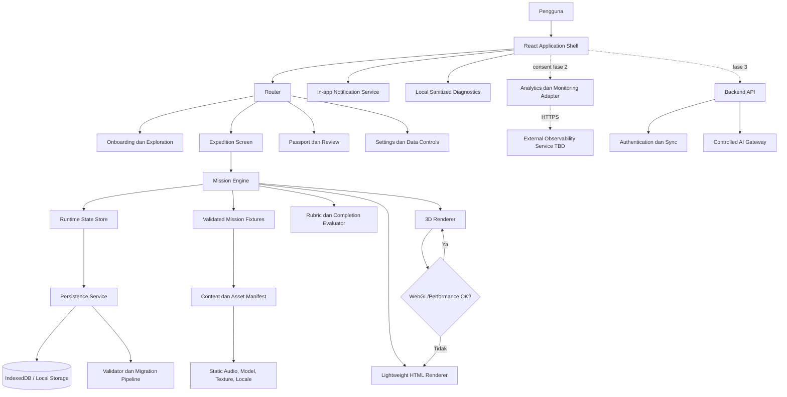
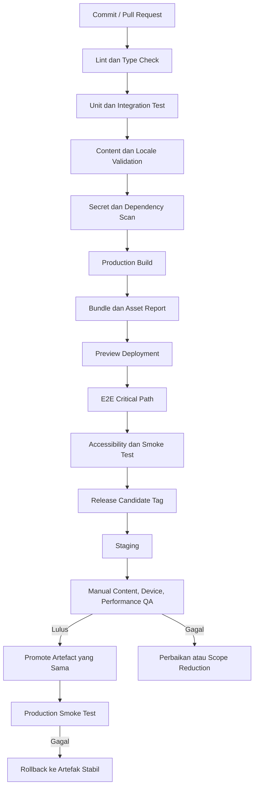
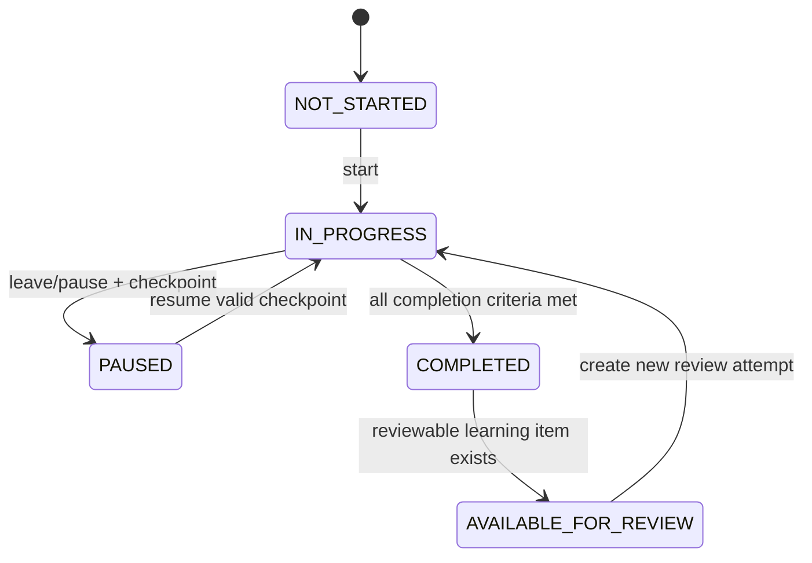
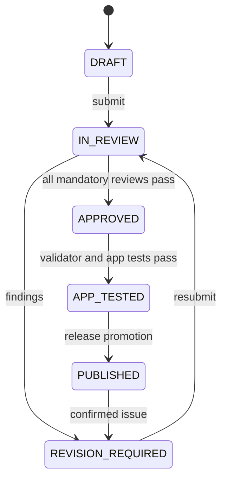
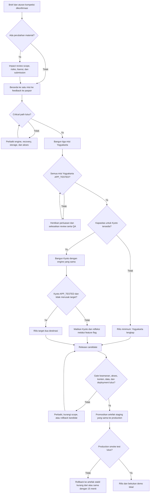
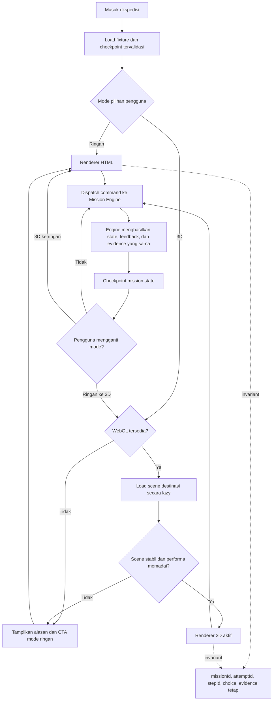
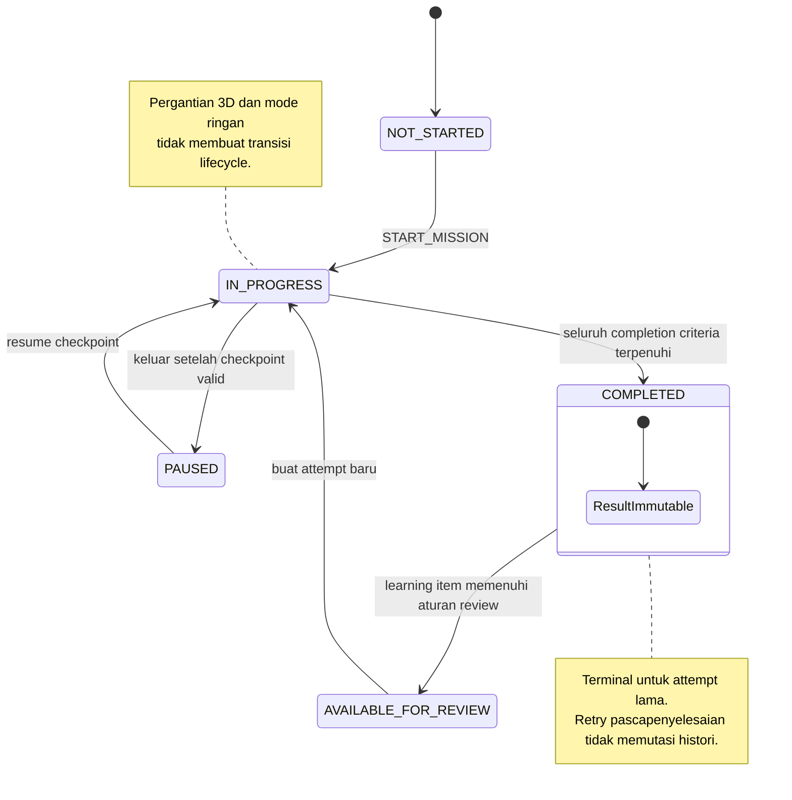
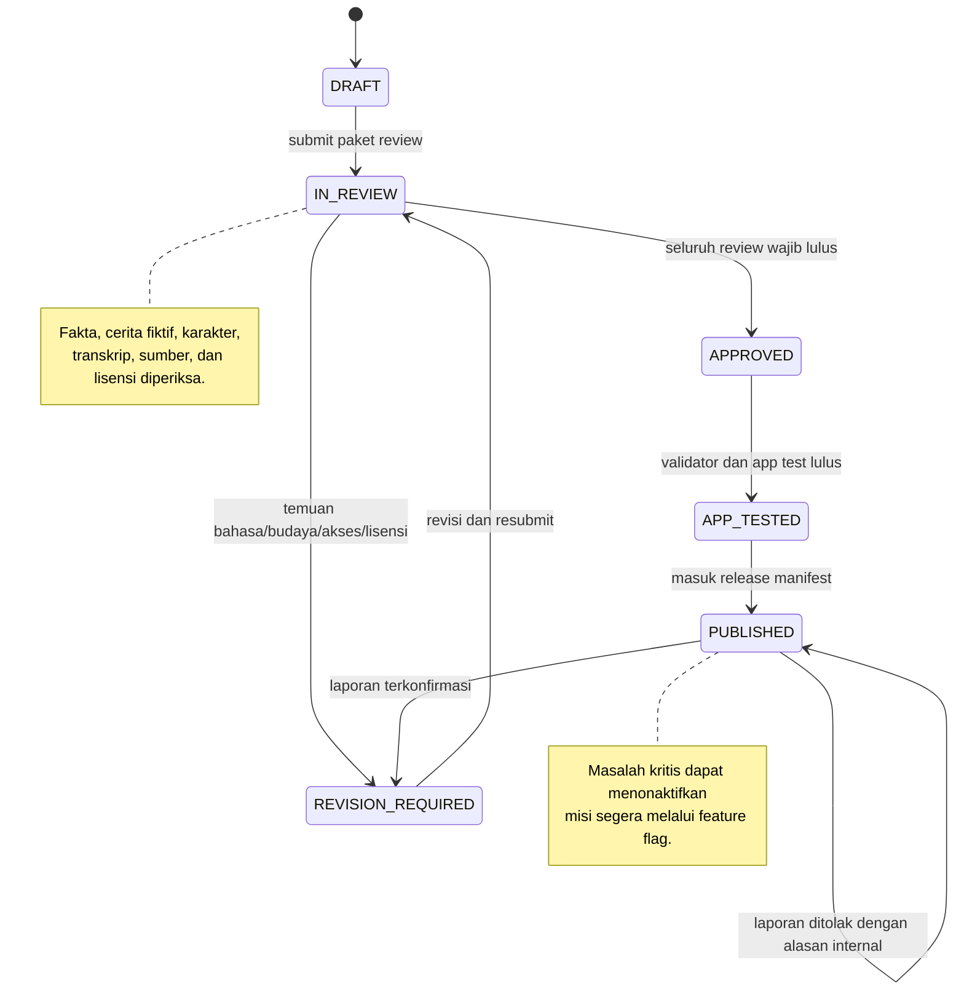
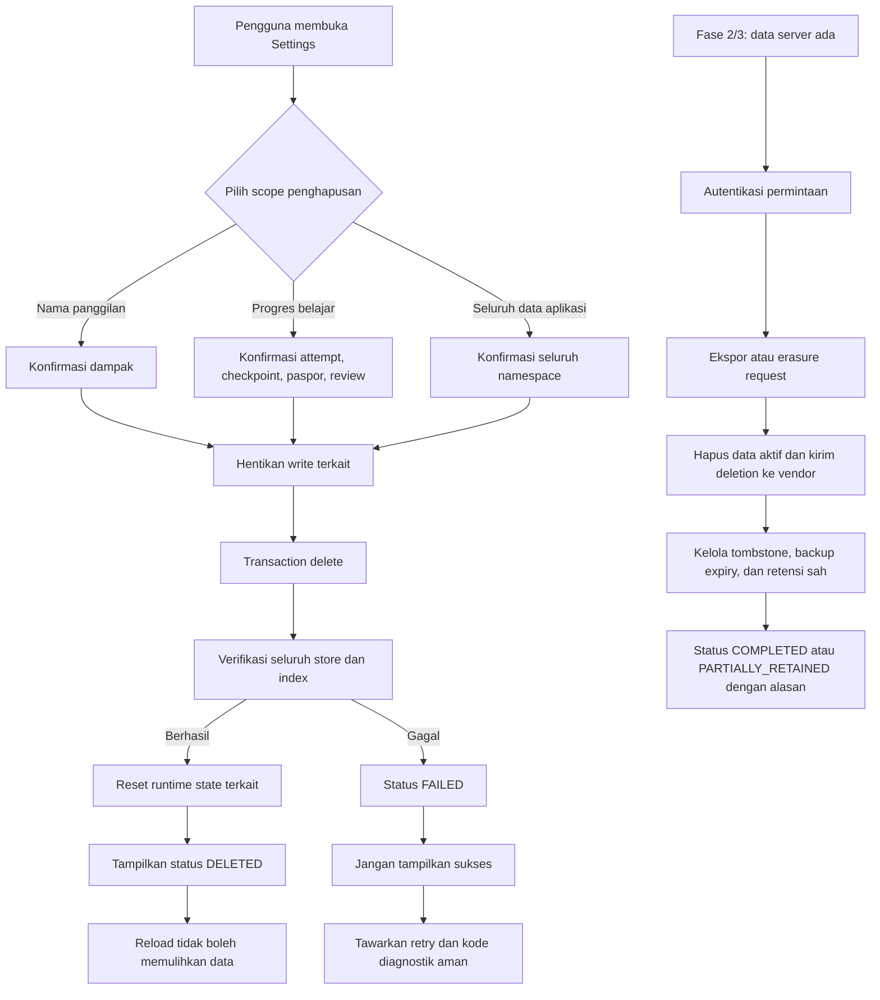
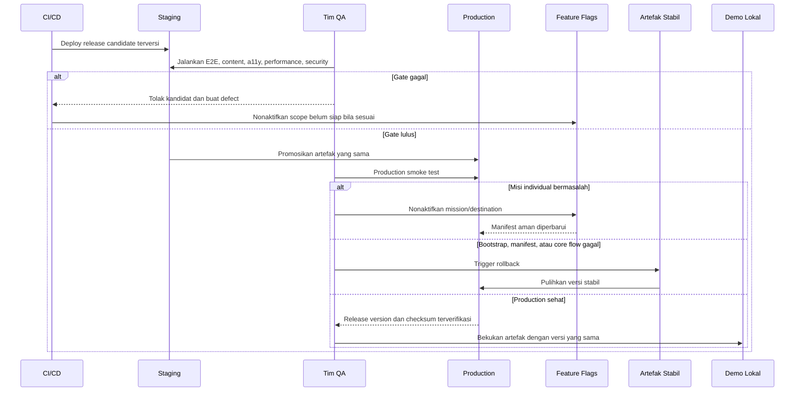

# Lingua Quest

## Executive Summary


**Lingua Quest** adalah platform pembelajaran bahasa dan budaya berbasis web yang menempatkan pelajar sebagai delegasi muda dalam program pertukaran internasional fiktif. Pengguna menjelajahi globe dan diorama destinasi, berbicara dengan karakter non-pemain atau **NPC**, mengumpulkan informasi, mempertimbangkan kebutuhan kelompok, mengambil keputusan, menerima konsekuensi yang dapat dipahami, lalu merefleksikan kemampuan yang telah dipraktikkan.

Tagline produk:

> **Explore the world. Connect through language.**

Produk ditujukan terutama bagi pelajar usia sekitar **15–18 tahun** yang telah mengenal bahasa Inggris dasar. Pengguna pendukung adalah guru atau pendamping yang ingin menggunakan ekspedisi sebagai aktivitas pembelajaran. Lingua Quest tidak diposisikan sebagai kursus lengkap, sertifikasi kemahiran, peta wisata, simulasi budaya yang sepenuhnya autentik, atau tes kepribadian dan kepemimpinan.

Masalah inti yang diselesaikan adalah kesenjangan antara **mengetahui kosakata atau pola kalimat** dan **mampu menggunakan bahasa dalam situasi yang memerlukan pemahaman konteks, klarifikasi, serta pertimbangan terhadap orang lain**. Lingua Quest mengubah pembelajaran dari latihan terpisah menjadi siklus tindakan:

`Amati situasi → Pahami informasi → Pilih atau susun respons → Lihat konsekuensi → Terima penjelasan → Coba variasi → Simpan capaian`

Dunia 3D berfungsi sebagai lapisan konteks pembelajaran, bukan sekadar dekorasi. Posisi karakter, objek interaktif, perubahan lingkungan, dan pilihan lokasi harus membantu pengguna memahami situasi atau melihat hasil tindakannya. Seluruh tujuan inti tetap dapat diselesaikan melalui **mode ringan berbasis HTML**, sehingga perangkat tanpa WebGL, perangkat berdaya rendah, pengguna keyboard, dan koneksi terbatas tidak kehilangan hasil belajar.

### Sasaran pengguna dan kebutuhan

| Segmen | Kebutuhan utama | Nilai Lingua Quest |
| --- | --- | --- |
| Pelajar usia 15–18 tahun dengan bahasa Inggris dasar | Berlatih merespons situasi tanpa takut gagal atau dipermalukan | Misi singkat, pilihan yang dapat diperbaiki, feedback kontekstual, transkrip, bantuan, dan latihan ulang |
| Pelajar dengan perangkat atau koneksi terbatas | Mengakses hasil belajar tanpa ketergantungan pada rendering 3D berat | Mode ringan setara, pemuatan aset sesuai kebutuhan, kualitas adaptif, serta pemulihan progres lokal |
| Pelajar yang membutuhkan aksesibilitas | Menyelesaikan misi melalui keyboard, teks, atau reduced motion | Struktur HTML, fokus terlihat, transkrip audio, kontrol gerakan, dan tidak ada batas waktu ketat |
| Guru atau pendamping | Menilai apakah materi bahasa, feedback, dan konteks sesuai untuk aktivitas pembelajaran | Tujuan misi eksplisit, rubrik perilaku sederhana, sumber materi, dan laporan evaluasi pilot; dashboard baru direncanakan pada fase 3 |
| Tim kompetisi dan penilai | Melihat orisinalitas, kesesuaian tema, kualitas UX, clean code, dan bukti pengujian | Pemisahan mesin misi, konten, UI, scene 3D, penyimpanan, dokumentasi riset, serta jejak penggunaan AI dalam pengembangan |

### Proposisi nilai utama

1. **Bahasa dipraktikkan dalam situasi, bukan hanya dihafalkan.** Pengguna mendengarkan, membaca, bertanya, menyusun respons, meminta klarifikasi, dan menjelaskan keputusan berdasarkan informasi yang tersedia.
2. **Kesalahan menjadi bagian dari pembelajaran.** Respons yang belum sesuai menghasilkan feedback, konsekuensi proporsional, dan jalur pemulihan; tidak ada percabangan yang mengunci pengguna dari penyelesaian.
3. **Budaya diperlakukan sebagai konteks yang perlu ditanyakan, bukan stereotip.** Cerita fiktif, fakta budaya, dan kebutuhan individual karakter dibedakan. Perilaku satu karakter tidak boleh digeneralisasikan menjadi sifat masyarakat atau negara.
4. **Leadership dinilai melalui perilaku dalam situasi.** Sistem mengamati apakah pengguna memeriksa kebutuhan, mempertimbangkan aksesibilitas, menjelaskan rencana, membagi peran, dan memperhitungkan keterbatasan waktu. Skor tidak diklaim sebagai penilaian kemampuan kepemimpinan umum.
5. **3D meningkatkan konteks tanpa menjadi hambatan akses.** Diorama menyediakan petunjuk visual dan dampak tindakan, sedangkan mode ringan mempertahankan tujuan, pilihan, feedback, progres, dan penyelesaian yang sama.
6. **Konten dipisahkan dari implementasi.** Mesin misi berbasis data memungkinkan Yogyakarta dan Kyoto menggunakan tipe langkah serta aturan validasi yang sama tanpa menanamkan logika penilaian di scene 3D.
7. **Privasi sesuai kebutuhan versi kompetisi.** Pengguna dapat mulai sebagai tamu, nama panggilan bersifat opsional, dan progres disimpan lokal. Akun, sinkronisasi, input suara, dan AI untuk pengguna tidak diperlukan pada pengalaman inti.

### Cakupan bertahap yang mengikat

Feature structure berikut menjadi batas perencanaan. Fitur fase berikutnya tidak boleh menghambat penyelesaian dan stabilisasi core loop fase 1.

| Fase | Area | Hasil produk |
| --- | --- | --- |
| Fase 1 | Onboarding dan Eksplorasi Dunia | Beranda, akses tamu, pilihan bahasa dan audio, briefing delegasi, globe dan daftar destinasi, pratinjau tujuan serta durasi, dan tutorial satu tindakan |
| Fase 1 | Mesin Misi Kontekstual | Langkah berbasis data `Observe`, `Listen`, `Choose`, `Arrange`, `Decide`, `Reflect`, dan `Complete`; percakapan bercabang; jalur pemulihan; audio dan transkrip; konsekuensi; feedback; serta rubrik leadership |
| Fase 1 | Ekspedisi Budaya dan Bahasa | Hingga tiga misi Yogyakarta dan tiga misi Kyoto, diorama interaktif, karakter fiktif dengan kebutuhan individual, serta refleksi perbandingan konteks |
| Fase 1 | Progres, Paspor, dan Ulasan | Penyimpanan lokal terversi, pemulihan dan migrasi, paspor capaian, antrean latihan ulang, frasa penting, dan refleksi terstruktur |
| Fase 1 | Aksesibilitas dan Pengalaman Adaptif | Mode ringan setara, keyboard dan fokus, mobile responsif, UI Indonesia–Inggris, transkrip, reduced motion, serta preferensi audio dan kualitas |
| Fase 2 | Tata Kelola Konten | Validasi struktur misi, workflow review bahasa dan budaya, status persetujuan, sumber dan lisensi, serta editor misi terkurasi |
| Fase 2 | Privasi, Analitik, dan Observabilitas | Consent analytics, penghapusan data, event penyelesaian dan bantuan, error/performance monitoring, dan laporan evaluasi pembelajaran |
| Fase 3 | Operasional dan Pengembangan Lanjutan | Penguatan pengujian otomatis, deployment serta cadangan demo, akun dan sinkronisasi, dashboard pendamping, dan petunjuk AI terkendali |

Walaupun observabilitas formal dan penguatan otomatisasi dikelompokkan pada fase 2–3, versi kompetisi tetap memerlukan pemeriksaan alur inti, pencatatan error minimum tanpa data sensitif, deployment yang dapat diulang, dan cadangan demo lokal. Hal tersebut merupakan syarat rilis, bukan fitur opsional.

### Scope target dan batas minimum

| Tingkat scope | Isi | Aturan keputusan |
| --- | --- | --- |
| Target kompetisi | Satu globe, dua destinasi, tiga misi per destinasi, enam misi selesai, percakapan bercabang, audio dan transkrip, bantuan, feedback, paspor, latihan ulang, mode ringan, penyimpanan lokal, UI Indonesia–Inggris, website live, dan dokumentasi | Dikerjakan hanya selama core loop stabil dan konten telah ditinjau |
| Minimum layak | Satu destinasi Yogyakarta dengan tiga misi lengkap dari onboarding hingga paspor, mobile berfungsi, keyboard berfungsi, dan mode ringan setara | Menjadi fallback resmi jika waktu, kualitas konten, atau performa menghambat destinasi kedua |
| Demo minimum | Beranda → tamu → destinasi → satu misi → feedback dan perbaikan → penyelesaian → paspor → mode ringan | Harus dapat dijalankan secara online dan dari cadangan lokal |
| Tidak boleh dikurangi | Jalur pemulihan, transkrip, penyimpanan progres, penghapusan progres, mode ringan, review konten, lisensi aset, dan tidak adanya masalah kritis | Persyaratan kualitas dan keselamatan, bukan fitur dekoratif |

### Alur nilai utama

`Buka beranda → Mulai sebagai tamu → Pilih bahasa dan audio → Terima briefing → Pilih destinasi melalui globe atau daftar → Tinjau tujuan dan durasi → Masuk ke diorama atau mode ringan → Amati konteks → Dengarkan/baca situasi → Pilih atau susun respons → Lihat reaksi dan feedback → Perbaiki bila diperlukan → Selesaikan misi → Buka capaian paspor → Ulangi frasa atau lanjutkan ekspedisi`

Pada kunjungan berikutnya:

`Progres lokal ditemukan → Pengguna memilih Lanjutkan → Data divalidasi dan dimigrasikan bila perlu → Misi dipulihkan pada langkah aman terakhir → Pengguna melanjutkan, mengulang, mengubah preferensi, atau menghapus progres`

### Model status inti

Lifecycle misi dikelola oleh mesin misi dan disimpan pada checkpoint penting:

`NOT_STARTED → IN_PROGRESS ↔ PAUSED → COMPLETED → AVAILABLE_FOR_REVIEW`

Aturan transisi:

- `NOT_STARTED → IN_PROGRESS` saat pengguna memulai misi.
- `IN_PROGRESS → PAUSED` saat pengguna meninggalkan ekspedisi setelah checkpoint tersimpan.
- `PAUSED → IN_PROGRESS` saat pengguna melanjutkan.
- `IN_PROGRESS → COMPLETED` hanya jika kriteria penyelesaian misi terpenuhi.
- `COMPLETED → AVAILABLE_FOR_REVIEW` jika misi dapat diulang atau memiliki learning item yang dijadwalkan.
- Latihan ulang membuat attempt baru; hasil attempt lama tidak dihapus.
- Data progres yang gagal validasi tidak boleh dimuat diam-diam. Sistem menawarkan pemulihan dari checkpoint kompatibel atau reset terarah setelah menjelaskan dampaknya.

Status konten mengikuti:

`DRAFT → IN_REVIEW → REVISION_REQUIRED → APPROVED → APP_TESTED → PUBLISHED`

Transisi tambahan:

- `IN_REVIEW → APPROVED` hanya setelah peninjauan bahasa, konteks budaya, transkrip, sumber, dan lisensi yang relevan.
- `APPROVED → APP_TESTED` setelah seluruh cabang lolos validasi struktural dan uji aplikasi.
- `APP_TESTED → PUBLISHED` melalui rilis yang ditetapkan tim.
- Konten yang telah dipublikasikan dapat kembali ke `REVISION_REQUIRED` jika ditemukan kesalahan faktual, bahasa, aksesibilitas, atau lisensi.
- Konten `DRAFT`, `IN_REVIEW`, atau `REVISION_REQUIRED` tidak boleh terlihat sebagai misi tersedia pada produksi publik.

### Onboarding dan keadaan tanpa data

Onboarding pertama harus dapat diselesaikan tanpa akun dan tanpa formulir panjang:

1. Beranda menjelaskan manfaat serta menunjukkan bahwa pengalaman adalah simulasi fiktif.
2. Pengguna memilih **Mulai sebagai tamu**.
3. Pengguna memilih bahasa UI, preferensi audio, gerakan, dan kualitas; default mengikuti locale dan preferensi perangkat jika dapat dideteksi tanpa menyimpan identitas.
4. Sistem menjelaskan bahwa progres disimpan pada perangkat dan dapat dihapus.
5. Nama panggilan ditawarkan sebagai pilihan, bukan syarat.
6. Briefing memperkenalkan peran delegasi, satu tujuan belajar, serta status karakter sebagai NPC.
7. Pengguna memilih destinasi melalui globe atau daftar HTML.
8. Tutorial menjelaskan satu tindakan pertama dan dapat dilewati setelah pernah diselesaikan.
9. Pengguna masuk ke misi tanpa kewajiban mengaktifkan audio atau 3D.

| Keadaan | Pesan dan tindakan wajib |
| --- | --- |
| Belum ada progres | Jelaskan cara memulai, tampilkan destinasi yang tersedia, dan tandai rekomendasi ekspedisi pertama |
| Belum ada destinasi yang dapat dibuka | Jelaskan prasyarat atau status konten; jangan menampilkan kartu tanpa tindakan |
| Paspor kosong | Jelaskan bahwa capaian muncul setelah misi pertama dan sediakan tombol `Mulai ekspedisi` |
| Antrean ulasan kosong | Jelaskan bahwa belum ada frasa yang perlu diulang dan sediakan akses ke misi selesai |
| Audio gagal dimuat | Tampilkan transkrip dan tombol coba lagi; penyelesaian tidak boleh terhalang |
| WebGL atau scene 3D gagal | Jelaskan kegagalan secara singkat dan tawarkan `Lanjutkan dalam mode ringan` dengan progres yang sama |
| Progres tidak valid | Tampilkan versi data, opsi pemulihan yang tersedia, ekspor diagnostik tanpa isi sensitif, dan reset setelah konfirmasi |
| Koneksi terputus setelah aset inti termuat | Pertahankan interaksi yang tersedia secara lokal; jelaskan aset mana yang belum dapat dimuat dan jangan kehilangan checkpoint |
| Bahasa terjemahan tidak tersedia | Gunakan locale fallback yang ditetapkan, tandai kegagalan untuk QA, dan jangan menampilkan key mentah kepada pengguna |

### Bahasa, budaya, keselamatan, dan moderasi

UI direncanakan dalam Bahasa Indonesia dan Inggris. Materi latihan utama adalah bahasa Inggris. Strategi lokalisasi harus memisahkan string UI dari konten misi, mendukung perluasan teks, menggunakan format tanggal dan angka berdasarkan locale, dan tidak menggabungkan teks melalui fragmen yang sulit diterjemahkan. Dukungan RTL belum termasuk fase kompetisi karena bahasa sasaran awal tidak memerlukannya.

Lingua Quest tidak memiliki konten publik atau komunikasi antarpengguna pada fase awal, sehingga moderasi komunitas dan appeal publik belum diperlukan. Namun, proses keselamatan konten tetap wajib:

- fakta budaya harus memiliki sumber dan dibedakan dari cerita fiktif;
- karakter harus direpresentasikan sebagai individu, bukan wakil tunggal budaya atau negara;
- konten diskriminatif, pelecehan, seksual eksplisit, kekerasan grafis, ujaran kebencian, atau stereotip merendahkan tidak boleh masuk ke materi untuk pengguna sasaran;
- kebutuhan aksesibilitas karakter tidak boleh digunakan sebagai hukuman atau bahan humor;
- laporan kesalahan konten pada fase kompetisi diarahkan ke kanal kontak proyek **(asumsi)** dan ditinjau oleh tim;
- koreksi konten menggunakan workflow revisi, menyimpan alasan perubahan, dan memperbarui sumber;
- jika editor misi fase 2 menerima kontribusi di luar tim, semua materi harus tetap berada dalam status nonpublik sampai lolos kurasi;
- kolaborasi pengguna pada roadmap pascakompetisi tidak boleh diluncurkan sebelum mekanisme pelaporan, pemblokiran, moderasi, perlindungan anak, dan appeal didefinisikan.

### Privasi dan operasi data

Versi kompetisi diasumsikan **tanpa akun dan tanpa backend pengguna**. Progres, preferensi, nama panggilan opsional, bantuan yang digunakan, serta hasil attempt disimpan pada perangkat.

Operasi data minimum:

- pemberitahuan jelas sebelum progres pertama disimpan;
- halaman pengaturan menampilkan kategori data lokal dan versi skema;
- pengguna dapat menghapus seluruh progres atau hanya nama panggilan;
- penghapusan memerlukan konfirmasi, selesai segera pada perangkat, dan menampilkan status berhasil/gagal;
- pengguna dapat mereset tutorial dan preferensi secara terpisah;
- analytics fase 2 bersifat opt-in dan tidak boleh mengirim nama panggilan, isi respons bebas, audio, atau identifier persisten yang tidak diperlukan;
- jika analytics diaktifkan, pengguna dapat mencabut consent dan menghentikan event berikutnya;
- ekspor data portabel menjadi wajib sebelum akun atau sinkronisasi diluncurkan pada fase 3; untuk versi lokal, ekspor JSON dapat disediakan jika kapasitas mengizinkan **(asumsi)**;
- right-to-erasure server-side belum relevan selama tidak ada data pengguna di server; kewajiban tersebut berubah saat analytics, akun, atau sinkronisasi diaktifkan;
- data riset pengguna disimpan terpisah dari aplikasi, dianonimkan, menggunakan persetujuan peserta/wali sesuai kebutuhan, dan memiliki masa retensi yang harus ditetapkan sebelum wawancara.

### Model bisnis dan pengendalian biaya

Versi kompetisi diasumsikan **gratis untuk digunakan dan tidak dimonetisasi**. Nilai langsungnya adalah pembuktian konsep, hasil kompetisi, portofolio tim, dan validasi bahwa pengalaman kontekstual dapat membantu latihan komunikasi. Model komersial pascakompetisi belum diputuskan.

Skenario monetisasi yang dapat dievaluasi setelah validasi—bukan keputusan saat ini—mencakup lisensi sekolah, paket konten tambahan, atau layanan pendamping pembelajaran. Tidak boleh ada pembayaran, iklan perilaku, penjualan data, atau klaim premium dalam versi kompetisi.

Biaya operasional utama mencakup hosting statis, penyimpanan dan transfer aset 3D/audio, pembuatan atau lisensi aset, domain bila digunakan, pengujian perangkat, dan observability opsional. Kontrol biaya meliputi:

- aplikasi statis dan penyimpanan lokal untuk menghindari backend yang belum diperlukan;
- lazy loading aset per destinasi;
- kompresi model, tekstur, dan audio;
- tidak memuat kedua destinasi sekaligus;
- mode ringan yang tidak mengunduh aset 3D yang tidak diperlukan;
- quota dan sampling telemetry jika observability eksternal diaktifkan;
- AI tidak digunakan pada runtime fase 1;
- fitur AI fase 3 harus memiliki rate limit, batas biaya per pengguna/periode, fallback terstruktur, dan kill switch.

### Dependensi dan asumsi utama

| ID | Dependensi atau asumsi | Implikasi |
| --- | --- | --- |
| A-01 | Produk dirilis sebagai web responsif dengan React, TypeScript, dan Vite **(asumsi)** | Pengalaman harus diuji pada browser sasaran dan tidak bergantung pada API browser eksperimental |
| A-02 | Three.js/React Three Fiber digunakan untuk 3D **(asumsi)** | WebGL harus dideteksi dan mode ringan menjadi fallback |
| A-03 | Versi kompetisi tidak memerlukan akun atau backend pengguna **(asumsi)** | Sinkronisasi lintas perangkat, reset jarak jauh, dan dashboard guru tidak tersedia |
| A-04 | Hosting statis dan domain akhir belum dipilih | Build harus dapat dipindahkan antarhosting yang mendukung SPA fallback dan aset statis |
| A-05 | Browser sasaran minimum dan daftar perangkat uji belum ditetapkan | Matriks kompatibilitas harus dibekukan sebelum QA final |
| A-06 | Sumber audio, pengisi suara, model 3D, font, dan musik belum final | Tidak ada aset yang boleh diterbitkan tanpa lisensi serta atribusi tercatat |
| A-07 | Konten akan ditinjau oleh minimal satu pihak yang kompeten dalam bahasa Inggris dan satu peninjau konteks budaya **(asumsi)** | Konten yang belum ditinjau ditahan dari produksi |
| A-08 | Analytics dan error monitoring tidak aktif secara default pada fase 1 **(asumsi)** | Target pilot dapat diukur melalui test log terstruktur sampai consent dan tooling tersedia |
| A-09 | Ketentuan Technical Meeting mengungguli roadmap ini | Scope, publikasi repository, penggunaan AI, aset, dan layanan eksternal harus disesuaikan tanpa merusak mesin misi inti |
| A-10 | Pengguna sasaran dapat mencakup anak di bawah umur | Pengumpulan data harus diminimalkan dan proses riset harus mengikuti persetujuan yang berlaku |

### Keunggulan kompetitif inti

Keunggulan Lingua Quest adalah kombinasi **situasi bahasa kontekstual, konsekuensi yang dapat diperbaiki, keputusan inklusif, dan akses setara antara pengalaman 3D serta mode ringan**. Produk tidak hanya menampilkan soal pilihan ganda di atas latar 3D. Setiap misi menghubungkan informasi lingkungan, kebutuhan karakter, tujuan komunikasi, respons pengguna, reaksi karakter, penjelasan, dan capaian paspor melalui mesin misi berbasis data yang dapat diuji.

Pemisahan antara fakta budaya, cerita fiktif, dan kebutuhan individual karakter juga menjadi diferensiasi penting. Produk mengajarkan pengguna untuk bertanya dan memeriksa konteks, bukan menghafalkan generalisasi tentang suatu negara.

### Target keberhasilan awal

| Target | Kriteria |
| --- | --- |
| Aktivasi | Minimal 80% peserta uji atau 4 dari 5 peserta menemukan tombol mulai, masuk sebagai tamu, dan memulai misi pertama tanpa arahan langsung **(indikatif)** |
| Core learning loop | Minimal 80% peserta uji atau 4 dari 5 peserta menyelesaikan misi pertama dan dapat menjelaskan satu perbaikan yang diminta oleh feedback **(indikatif)** |
| Keandalan progres | 100% skenario QA untuk refresh, perpindahan rute, pergantian mode, dan pemulihan checkpoint mempertahankan progres tervalidasi; nol kehilangan progres pada pengujian rilis |
| Kesetaraan akses | 100% tujuan dan kriteria selesai fase 1 dapat dicapai dalam mode ringan dan melalui keyboard tanpa memerlukan audio |
| Performa | Scene aktif menargetkan median sekitar 30 FPS pada perangkat mobile sasaran yang dicatat dan interaksi UI utama merespons dalam ≤200 ms saat aset telah termuat **(indikatif)** |
| Kualitas konten | 100% misi publik memiliki tujuan, feedback untuk setiap pilihan, transkrip untuk setiap audio, jalur selesai, sumber yang relevan, dan status `APP_TESTED` |

### Non-goals / Won’t-have pada versi kompetisi

| ID | Di luar ruang lingkup | Alasan |
| --- | --- | --- |
| NG-01 | Sertifikasi atau penentuan tingkat kemahiran bahasa | Enam misi tidak cukup untuk asesmen terstandar |
| NG-02 | Klaim peningkatan pembelajaran berskala luas | Pilot kecil hanya dapat menunjukkan hasil awal dengan keterbatasan yang dinyatakan |
| NG-03 | Open-world, kontrol avatar wajib, atau navigasi geografis nyata | Fokus pada situasi belajar singkat dan orientasi yang terkendali |
| NG-04 | Akun, login, sinkronisasi cloud, dan progres lintas perangkat | Ditunda ke fase 3 setelah kebijakan data dan keamanan siap |
| NG-05 | Dashboard guru dan penugasan kelas | Kebutuhan guru harus divalidasi sebelum membangun role dan pengolahan data siswa |
| NG-06 | Multiplayer atau komunikasi antarpengguna | Memerlukan moderasi, perlindungan anak, pelaporan, dan infrastruktur real-time |
| NG-07 | AI sebagai tutor utama atau penilai tunggal | Core loop harus deterministik, dapat dijelaskan, dan tetap berfungsi tanpa layanan eksternal |
| NG-08 | Pengenalan suara dan penyimpanan rekaman | Memerlukan evaluasi akurasi, consent, kebijakan audio, dan dukungan perangkat tambahan |
| NG-09 | Editor misi publik tanpa kurasi | Risiko kualitas bahasa, stereotip, konten berbahaya, dan pelanggaran lisensi |
| NG-10 | Simulasi lengkap budaya Yogyakarta atau Kyoto | Diorama dan cerita merupakan representasi terbatas yang harus diberi label ilustratif |
| NG-11 | Peta navigasi dunia nyata atau rekomendasi perjalanan | Produk berfokus pada pembelajaran bahasa dan pengambilan keputusan |
| NG-12 | Tes kepribadian atau skor kepemimpinan umum | Rubrik hanya mengukur perilaku yang ditampilkan dalam satu situasi |
| NG-13 | Pembayaran, iklan, subscription, dan penjualan data | Model bisnis belum divalidasi dan tidak diperlukan untuk kompetisi |
| NG-14 | Mode offline penuh yang dijamin pada seluruh browser | Pemulihan progres lokal wajib, tetapi strategi cache offline penuh belum ditetapkan |
| NG-15 | Dukungan seluruh browser dan perangkat lama | Matriks browser minimum harus ditetapkan berdasarkan riset perangkat dan kapasitas QA |
| NG-16 | Push notification atau email transaksi | Tidak ada akun atau kejadian async server pada fase kompetisi; komunikasi dilakukan di dalam aplikasi |


## Problem Statement


### Masalah inti

Pelajar yang telah mengenal kosakata dan struktur dasar bahasa Inggris belum tentu mampu menggunakannya ketika situasi menuntut mereka untuk:

- memahami apa yang sebenarnya dibutuhkan lawan bicara;
- merespons informasi yang baru diterima;
- mengajukan pertanyaan lanjutan yang relevan;
- meminta pengulangan atau klarifikasi tanpa takut salah;
- memahami petunjuk dan mengonfirmasi tujuan;
- mempertimbangkan kebutuhan beberapa orang sebelum memutuskan;
- menjelaskan alasan dan membagi tanggung jawab secara jelas.

Materi bahasa sering disajikan sebagai kosakata, tata bahasa, dialog statis, atau pertanyaan dengan satu jawaban benar. Format tersebut dapat melatih pengenalan bentuk bahasa, tetapi belum tentu memberi kesempatan kepada pelajar untuk menghubungkan **situasi, maksud komunikasi, kebutuhan orang lain, respons, dan konsekuensi**.

Masalah primer Lingua Quest adalah:

> **Belum tersedianya pengalaman belajar web yang mudah diakses dan memberi pelajar kesempatan berulang untuk menggunakan bahasa Inggris dalam situasi lintas budaya, menerima konsekuensi yang dapat dipahami, dan memperbaiki respons tanpa kehilangan kesempatan belajar.**

Pengalaman 3D hanya bernilai jika membantu pengguna membaca situasi dan melihat dampak tindakan. Jika 3D memperlambat perangkat, membingungkan navigasi, atau menjadi satu-satunya cara menyelesaikan misi, maka solusi justru menciptakan masalah akses baru.

### Pengguna yang mengalami masalah

| Persona | Pekerjaan yang ingin diselesaikan | Hambatan saat ini **(hipotesis)** | Dampak |
| --- | --- | --- | --- |
| Pelajar yang memahami bahasa Inggris dasar | Menggunakan bahasa dalam situasi sosial sederhana | Latihan lebih sering menguji jawaban terpisah daripada respons terhadap konteks | Mengetahui bentuk kalimat tetapi ragu memilih atau menyusun respons |
| Pelajar yang takut salah | Mencoba berbicara atau menjawab tanpa dipermalukan | Kesalahan sering diperlakukan sebagai hasil akhir, bukan kesempatan revisi | Menghindari latihan dan bergantung pada petunjuk |
| Pelajar visual atau eksploratif | Memahami siapa, di mana, dan mengapa sebuah ungkapan digunakan | Materi tidak selalu menghubungkan bahasa dengan lingkungan dan konsekuensi | Frasa sulit dipindahkan ke situasi baru |
| Pelajar dengan perangkat terbatas | Mengikuti pengalaman interaktif melalui ponsel atau koneksi tidak stabil | Media 3D dapat berat, lambat, atau tidak didukung | Tidak dapat mencapai tujuan belajar yang sama |
| Pengguna keyboard, reduced motion, atau tanpa audio | Menyelesaikan kegiatan tanpa kontrol pointer, animasi, atau suara | Pengalaman interaktif sering mengandalkan drag, hover, audio, dan visual bergerak | Sebagian atau seluruh misi tidak dapat diselesaikan |
| Guru atau pendamping | Memilih kegiatan yang mempunyai tujuan dan feedback yang dapat dijelaskan | Sulit memeriksa dasar penilaian pada pengalaman gamifikasi yang tertutup | Produk menarik secara visual tetapi sulit dipertanggungjawabkan sebagai aktivitas belajar |
| Tim pembuat konten | Menambahkan misi tanpa merusak alur atau menanamkan stereotip | Dialog, logic, media, dan penilaian dapat tercampur dalam kode | Cabang terputus, feedback tidak konsisten, dan review materi sulit dilakukan |

### Pain point dan akar masalah

| ID | Pain point | Akar masalah | Konsekuensi |
| --- | --- | --- | --- |
| P-01 | Pelajar mengetahui frasa tetapi tidak tahu kapan menggunakannya | Kosakata dan pola kalimat dipelajari terpisah dari tujuan komunikasi | Transfer ke situasi baru menjadi lemah |
| P-02 | Pelajar takut mencoba respons yang belum pasti | Sistem belajar sering memberi benar/salah tanpa jalur revisi | Pengguna menebak, berhenti, atau menunggu jawaban |
| P-03 | Satu jawaban dipaksakan untuk situasi yang memiliki beberapa respons layak | Penilaian tidak memodelkan tingkat kesesuaian dan kebutuhan konteks | Feedback terasa arbitrer dan tidak mendidik |
| P-04 | Pengguna mengambil keputusan sebelum memahami kebutuhan | Misi tidak mewajibkan observasi, pertanyaan, atau klarifikasi | Leadership direduksi menjadi memilih opsi yang tampak paling baik |
| P-05 | Konteks budaya berisiko menjadi trivia atau stereotip | Fakta, cerita fiktif, dan perilaku individual tidak dibedakan | Pengguna dapat menggeneralisasi satu karakter ke seluruh masyarakat |
| P-06 | 3D menarik tetapi tidak menjelaskan situasi | Scene dibuat sebagai dekorasi dan tidak terhubung ke logika misi | Biaya performa meningkat tanpa manfaat pembelajaran |
| P-07 | Navigasi 3D menambah beban kognitif | Kamera bebas, avatar wajib, atau kontrol tersembunyi | Pengguna gagal bukan karena materi bahasa, tetapi karena kontrol |
| P-08 | Perangkat dan koneksi beragam | Aset 3D/audio berukuran besar dan kemampuan WebGL berbeda | Waktu muat panjang, frame rate rendah, atau aplikasi tidak dapat digunakan |
| P-09 | Mode alternatif memiliki materi yang lebih sedikit | Mode ringan dianggap fallback visual, bukan pengalaman setara | Pengguna tertentu kehilangan kesempatan dan bukti capaian |
| P-10 | Audio menjadi hambatan | Tidak ada transkrip, audio gagal, atau suara aktif tanpa tindakan pengguna | Misi tidak dapat dipahami atau melanggar kebijakan autoplay |
| P-11 | Progres lokal dapat rusak setelah perubahan aplikasi | Data tidak terversi atau migrasi tidak divalidasi | Misi kembali ke awal atau hasil menjadi tidak konsisten |
| P-12 | Pengguna tidak memahami lokasi penyimpanan data | Progress lokal disimpan tanpa pemberitahuan dan kontrol | Kepercayaan menurun, terutama pada perangkat bersama |
| P-13 | Konten berkembang lebih cepat daripada review | Tidak ada status persetujuan dan validasi referensi | Kesalahan bahasa, cabang buntu, atau aset tanpa lisensi masuk ke produksi |
| P-14 | Rubrik leadership disalahartikan sebagai penilaian umum | Skor situasional tidak diberi batas interpretasi | Pelajar diberi label yang tidak didukung bukti |
| P-15 | Pengukuran keberhasilan hanya melihat completion | Tidak ada pre/post task, event bantuan, atau uji pemahaman feedback | Produk tidak dapat membedakan engagement dari pembelajaran |
| P-16 | Penggunaan analytics berisiko mengumpulkan data anak | Event dan identifier dikumpulkan tanpa consent atau minimisasi | Risiko privasi dan ketidakpatuhan |
| P-17 | Pengguna baru menghadapi banyak konsep sekaligus | Globe, misi, karakter, audio, paspor, dan mode kualitas dikenalkan bersamaan | Time-to-first-mission meningkat dan pengguna berhenti |
| P-18 | Website publik bergantung pada jaringan saat demo | Tidak ada build cadangan atau rollback | Presentasi gagal meskipun aplikasi sebenarnya berfungsi |

### Masalah primer dan sekunder

**Masalah primer**

1. Pelajar kekurangan ruang latihan yang menghubungkan bahasa, situasi, kebutuhan orang lain, dan konsekuensi.
2. Kesalahan belum selalu diperlakukan sebagai kesempatan untuk menerima penjelasan dan memperbaiki respons.
3. Materi lintas budaya berisiko lepas dari konteks atau berubah menjadi generalisasi.
4. Pengalaman interaktif yang berat dapat mengecualikan pengguna berdasarkan perangkat, koneksi, atau kebutuhan aksesibilitas.

**Masalah sekunder**

1. Guru belum memiliki bukti terstruktur tentang tujuan, feedback, dan keterbatasan hasil.
2. Tim konten memerlukan mesin dan validasi yang mencegah cabang buntu serta referensi aset hilang.
3. Progres lokal memerlukan versioning, migrasi, pemulihan, dan penghapusan yang dapat dipahami.
4. Pengukuran penggunaan dan pembelajaran memerlukan consent serta pemisahan data kuantitatif dari pendapat pengguna.
5. Deployment kompetisi memerlukan build yang stabil, rollback, dokumentasi, dan cadangan demo.
6. Konten Indonesia–Inggris memerlukan lokalisasi yang konsisten dan cukup ruang pada UI.
7. Destinasi kedua memberi nilai perbandingan, tetapi tidak boleh menurunkan kualitas destinasi pertama.

Masalah sekunder tidak boleh menggeser prioritas utama. Lingua Quest belum berhasil jika globe dan diorama terlihat menarik tetapi pengguna tidak memahami tujuan, misi dapat terjebak, feedback tidak menjelaskan perbaikan, atau mode ringan tidak setara.

### Kuantifikasi masalah dan baseline

Belum ada hasil riset pengguna aktual yang diberikan. Seluruh angka berikut merupakan hipotesis awal yang harus divalidasi melalui wawancara **5–8 pelajar**, wawancara **1–2 guru atau pendamping**, observasi perangkat, dan usability test. Data tidak boleh disajikan sebagai hasil yang telah dicapai.

| Indikator baseline | Hipotesis awal |
| --- | --- |
| Pelajar yang dapat mengenali frasa tetapi ragu menggunakannya dalam konteks baru | 40–70% dari peserta discovery **(indikatif)** |
| Peserta yang meminta kepastian “jawaban benar” sebelum merespons | 30–60% pada latihan situasional awal **(indikatif)** |
| Peserta yang melewatkan klarifikasi dan langsung memilih rencana | 30–50% pada skenario dengan kebutuhan tersembunyi **(indikatif)** |
| Peserta yang berhenti atau membutuhkan arahan untuk memulai pengalaman baru | 20–40% jika onboarding memuat lebih dari tiga keputusan sebelum misi **(indikatif)** |
| Perangkat peserta yang mengalami penurunan performa pada scene 3D awal | 20–40% sebelum optimasi pada sampel perangkat beragam **(indikatif)** |
| Waktu yang dapat diterima untuk satu ekspedisi | 8–12 menit berdasarkan target konsep, belum tervalidasi |
| Pengguna yang membutuhkan transkrip karena audio tidak dapat atau tidak ingin digunakan | 20–40% bergantung lingkungan penggunaan **(indikatif)** |
| Cabang misi yang berisiko tidak mencapai `Complete` tanpa validasi graph otomatis | Tidak diketahui; baseline harus dihitung pada seluruh file misi sebelum rilis |

Baseline discovery harus merekam:

- situasi komunikasi yang dirasa paling sulit;
- bentuk bantuan yang membuat peserta tetap mau mencoba;
- alasan berhenti memakai media belajar;
- persepsi manfaat atau beban 3D;
- perangkat, browser, ukuran layar, dan kualitas koneksi;
- pemahaman terhadap feedback;
- waktu untuk memulai dan menyelesaikan misi;
- jumlah bantuan, revisi, dan jalur pemulihan;
- kemampuan menjelaskan alasan keputusan setelah misi.

Kutipan riset hanya boleh digunakan setelah persetujuan, harus dianonimkan, dan tidak boleh memuat identitas sekolah atau informasi pribadi yang tidak diperlukan.

### Mengapa sekarang

- Pelajar semakin terbiasa dengan pengalaman digital interaktif, tetapi interaktivitas tidak selalu diterjemahkan menjadi praktik komunikasi yang bermakna.
- Teknologi web modern memungkinkan scene 3D dijalankan tanpa instalasi, sementara mode HTML dapat mempertahankan akses ketika 3D tidak didukung.
- Pembelajaran bahasa dan leadership dapat dihubungkan melalui perilaku konkret seperti mendengarkan, meminta klarifikasi, mempertimbangkan aksesibilitas, dan membagi peran.
- Kompetisi menyediakan konteks dan tenggat untuk menguji satu pengalaman end-to-end, mendokumentasikan proses desain, dan membuktikan bahwa visual, UX, materi, serta arsitektur saling mendukung.
- Peningkatan penggunaan AI dan media generatif membuat transparansi sumber, peninjauan manusia, serta pencatatan bantuan AI semakin penting.
- Risiko stereotip dan klaim pembelajaran yang berlebihan meningkat ketika produk budaya dirancang tanpa proses review dan evaluasi eksplisit.

### Risiko jika masalah tidak diselesaikan

| Risiko | Dampak | Tingkat awal |
| --- | --- | --- |
| Pengguna menghafal jawaban tanpa memahami tujuan komunikasi | Hasil belajar tidak berpindah ke situasi baru | Tinggi |
| Feedback hanya menyatakan salah | Pengguna kehilangan kepercayaan dan tidak tahu cara memperbaiki | Tinggi |
| Cabang dialog tidak memiliki jalan keluar | Misi terjebak dan progres tidak dapat diselesaikan | Kritis |
| 3D menjadi satu-satunya jalur | Pengguna pada perangkat lemah atau dengan kebutuhan akses tidak dapat belajar | Kritis |
| Konten budaya menyamaratakan kelompok | Kesalahpahaman, reputational harm, dan materi yang tidak etis | Tinggi |
| Audio tanpa transkrip | Sebagian pengguna tidak memperoleh informasi penting | Tinggi |
| Progres lokal rusak saat skema berubah | Capaian dan attempt pengguna hilang | Kritis |
| Data disimpan tanpa penjelasan atau penghapusan | Pelanggaran ekspektasi privasi, terutama pada perangkat bersama | Tinggi |
| Telemetry mengirim data siswa yang tidak diperlukan | Risiko privasi dan kepatuhan | Kritis |
| Rubrik dipresentasikan sebagai tes kepemimpinan | Klaim produk tidak didukung bukti | Tinggi |
| Aset tidak memiliki lisensi yang jelas | Konten harus ditarik atau pengumpulan melanggar aturan | Kritis |
| Destinasi kedua dipaksakan sebelum core loop stabil | Kualitas kedua destinasi rendah dan QA tidak selesai | Tinggi |
| Performa rendah pada mobile | Pengguna berhenti sebelum misi atau mengalami input yang salah | Tinggi |
| Deployment publik gagal saat penilaian | Produk tidak dapat didemonstrasikan | Kritis |
| Tim tidak dapat menjelaskan kode hasil AI | Risiko orisinalitas, keamanan, dan penilaian clean code | Tinggi |

### Kebutuhan validasi awal

| ID | Aktivitas | Sampel minimum | Bukti keluaran |
| --- | --- | --- | --- |
| V-01 | Wawancara pelajar | 5–8 pelajar sasaran | Ringkasan pola, kutipan berizin, dan daftar masalah prioritas |
| V-02 | Wawancara pendamping | 1–2 guru atau pendamping bahasa Inggris | Kriteria ketepatan materi, feedback, dan penggunaan kelas |
| V-03 | Observasi perangkat | Seluruh peserta discovery | Browser, viewport, input, koneksi, dan kendala audio/3D |
| V-04 | Usability onboarding | Minimal 5 peserta | Task success, waktu memulai, titik kebingungan, dan bantuan moderator |
| V-05 | Uji misi pertama | Minimal 5 peserta | Completion, retry, bantuan, pemahaman feedback, dan durasi |
| V-06 | Pre/post task setara | Minimal 10 peserta bila memungkinkan **(indikatif)** | Skor rubrik sebelum/sesudah serta keterbatasan sampel |
| V-07 | Perbandingan 3D dan mode ringan | Minimal 5 peserta per kondisi bila memungkinkan **(indikatif)** | Perbedaan pemahaman konteks, completion, waktu, dan persepsi |
| V-08 | Review bahasa dan budaya | Minimal satu reviewer relevan per dimensi **(asumsi)** | Checklist, temuan, keputusan revisi, dan status persetujuan |

Temuan yang bertentangan dengan hipotesis harus mengubah desain atau dicatat sebagai keputusan untuk tidak berubah beserta alasannya. Data pilot kecil tidak boleh digeneralisasi sebagai bukti efektivitas populasi.


## Goals & Success Metrics


### Prinsip pengukuran

Sebelum analytics fase 2 tersedia, metrik versi kompetisi diukur melalui **skrip usability test, lembar observasi terstruktur, rekaman hanya dengan persetujuan, hasil test otomatis, laporan audit konten, dan pengukuran performa browser**. Setelah consent analytics diterapkan, event anonim atau pseudonim dapat mengagregasi penggunaan tanpa mengirim nama panggilan, isi respons bebas, transkrip personal, atau data audio.

Event minimum yang direncanakan:

- `session_started`
- `guest_started`
- `onboarding_completed`
- `destination_previewed`
- `mission_started`
- `mission_step_completed`
- `help_opened`
- `choice_submitted`
- `feedback_viewed`
- `retry_started`
- `mission_completed`
- `review_completed`
- `passport_viewed`
- `mode_changed`
- `progress_restored`
- `progress_recovery_failed`
- `progress_deleted`
- `asset_load_failed`
- `webgl_fallback_shown`
- `runtime_error`

Setiap event hanya membawa atribut yang dibutuhkan, seperti versi aplikasi, ID konten nonpersonal, mode tampilan, locale, tipe perangkat kasar, durasi, dan status hasil. Event analytics harus dipisahkan dari diagnostic error log. Isi dialog yang dipilih dapat direpresentasikan dengan `choice_id`, bukan teks mentah.

### Business dan validation goals

| ID | Goal | KPI dan target | Cara pengukuran | Waktu evaluasi |
| --- | --- | --- | --- | --- |
| G-01 | Membuktikan bahwa masalah prioritas relevan bagi pengguna sasaran | Minimal 60% peserta discovery menyebut setidaknya satu kesulitan dalam merespons, meminta klarifikasi, atau menggunakan bahasa dalam konteks baru **(indikatif)** | Coding tematik dari wawancara 5–8 pelajar; dua anggota tim memeriksa ringkasan untuk mengurangi interpretasi sepihak | Sebelum scope misi dibekukan |
| G-02 | Membuktikan bahwa guru dapat menjelaskan nilai aktivitas | Minimal 1 dari 2 reviewer pendamping menyatakan tujuan, feedback, dan batas klaim misi dapat dipahami tanpa penjelasan lisan tambahan **(indikatif)** | Checklist review guru dan pertanyaan pemahaman setelah membaca preview serta hasil misi | Sebelum publikasi konten |
| G-03 | Menyelesaikan paket kompetisi yang dapat diverifikasi | 100% deliverable wajib tersedia dan tautannya dapat dibuka dari sesi browser baru; submission internal selesai ≥24 jam sebelum tenggat **(indikatif)** | Checklist rilis dengan pemeriksaan ganda untuk website, repository, proposal, video, surat, dan izin akses | Kandidat rilis final |
| G-04 | Menjaga scope agar kualitas destinasi pertama tidak dikorbankan | Yogyakarta tiga misi mencapai `APP_TESTED` sebelum pekerjaan produksi destinasi kedua melewati 50% **(indikatif)** | Status konten dan issue tracker; review scope pada setiap gerbang | Mingguan selama implementasi |
| G-05 | Menentukan kelayakan pengembangan pascakompetisi berdasarkan bukti | Minimal tiga kebutuhan berulang dari riset atau telemetry consented dipetakan ke roadmap; tidak ada fitur fase 3 dipromosikan sebagai tersedia | Repository keputusan produk yang menautkan temuan, keputusan, dan bukti | Setelah pilot/final kompetisi |
| G-06 | Menghindari biaya runtime yang tidak terkendali | Fase 1 tidak melakukan panggilan AI berbayar dan tidak memerlukan backend per pengguna; transfer aset dipantau per build | Analisis bundle, network log pada cold load, tagihan/kuota hosting bila tersedia, dan audit endpoint | Setiap release candidate |

### Product goals

| ID | Goal | KPI dan target | Cara pengukuran | Waktu evaluasi |
| --- | --- | --- | --- | --- |
| G-07 | Pengguna dapat mencapai misi pertama tanpa pendampingan | ≥80% atau minimal 4 dari 5 peserta menemukan CTA, memilih akses tamu, menyelesaikan briefing, dan memulai misi tanpa arahan moderator **(indikatif)** | Observasi task-based; event `guest_started`, `onboarding_completed`, dan `mission_started`; moderator mencatat bantuan | Setiap usability round |
| G-08 | Core loop dapat diselesaikan | ≥80% atau minimal 4 dari 5 peserta menyelesaikan misi pertama dalam ≤15 menit setelah misi dimulai **(indikatif)** | Timestamp `mission_started` dan `mission_completed`, ditambah catatan langkah terhenti | Sebelum feature freeze |
| G-09 | Feedback membantu pengguna memahami perbaikan | ≥80% peserta dapat menjelaskan dengan kata sendiri apa yang perlu diperbaiki setelah satu feedback; ≥70% berhasil pada attempt berikutnya **(indikatif)** | Pertanyaan recall setelah feedback, perbandingan `choice_id` antar-attempt, dan rubrik penilai | Setiap uji konten |
| G-10 | Misi mendukung beberapa respons layak tanpa penilaian palsu | 100% pilihan publik memiliki kategori kesesuaian, tujuan komunikasi, reaksi, penjelasan, dan next step; semua respons yang dinilai dapat diterima memiliki alasan terdokumentasi | Validator skema, audit file konten, dan checklist reviewer bahasa | Pada CI dan sebelum `APP_TESTED` |
| G-11 | Pengguna berlatih klarifikasi dan kebutuhan, bukan hanya memilih jawaban | Setiap destinasi memiliki minimal satu langkah meminta klarifikasi dan satu keputusan berbasis ≥2 kebutuhan karakter; ≥70% peserta mengenali kebutuhan utama setelah misi **(indikatif)** | Audit desain misi dan pertanyaan post-task dengan rubrik | Sebelum publikasi destinasi |
| G-12 | Durasi ekspedisi sesuai penggunaan singkat | Median durasi satu ekspedisi lengkap berada pada 8–12 menit; persentil ke-90 ≤18 menit, tidak termasuk jeda pengguna **(indikatif)** | Timestamp langkah aktif; pada pilot manual, stopwatch dan catatan jeda | Setelah minimal 10 completion |
| G-13 | Mode ringan setara secara pembelajaran | 100% tujuan, pilihan, feedback, rubrik, capaian, dan kriteria selesai dapat dicapai pada mode ringan; tidak ada learning item eksklusif 3D | Test matrix yang menjalankan mission fixture sama pada kedua renderer dan E2E mode ringan | Setiap release candidate |
| G-14 | Pengguna dapat berpindah mode tanpa kehilangan state | 100% dari minimal 20 skenario otomatis pergantian 3D↔ringan mempertahankan mission ID, step ID, attempt, pilihan tersimpan, dan preferensi | Integration test store/renderer serta E2E `mode_changed` | Setiap pull request relevan |
| G-15 | Progres dapat disimpan dan dipulihkan | 100% skenario refresh, tutup-buka tab, perpindahan rute, dan versi skema yang didukung memulihkan checkpoint; nol kehilangan progres pada QA rilis | Unit test serializer/migrator, integration test storage, dan E2E `progress_restored` | CI dan regression test |
| G-16 | Data yang rusak ditangani secara transparan | 100% fixture progres invalid menghasilkan pesan pemulihan dan tidak menyebabkan blank screen; reset hanya terjadi setelah konfirmasi | Property/fixture test parser, E2E corrupted storage, dan event `progress_recovery_failed` | CI dan sebelum rilis |
| G-17 | Paspor merepresentasikan bukti yang benar | 100% capaian paspor menautkan minimal satu mission ID dan learning objective yang benar; capaian tidak terbuka sebelum kriteria selesai | Unit test aturan unlock dan audit mapping konten | Setiap perubahan konten |
| G-18 | Latihan ulang menargetkan materi yang membutuhkan dukungan | 100% learning item dengan bantuan atau kategori “perlu klarifikasi/kurang sesuai” masuk antrean menurut aturan; completion yang berhasil memperbarui waktu ulasan tanpa menghapus histori attempt | Unit test scheduler dan E2E review queue | Sebelum rilis antrean ulasan |
| G-19 | UI Indonesia dan Inggris lengkap | 100% string UI rilis memiliki kedua locale; nol translation key mentah; overflow kritis nol pada viewport sasaran | Static locale parity test, screenshot regression, dan pseudo-localization bila tersedia | Setiap release candidate |
| G-20 | Audio tidak menjadi titik kegagalan | 100% audio memiliki transkrip yang telah diperiksa; seluruh misi dapat selesai dengan audio dimatikan atau gagal dimuat | Validator media, checklist transkrip, E2E audio-off dan network failure | CI dan content review |
| G-21 | Leadership disajikan secara proporsional | 100% hasil rubrik menjelaskan perilaku situasional dan tidak menggunakan label kepribadian; tiap dimensi hanya diberi skor jika ada bukti langkah | Audit template feedback dan unit test rule mapping | Sebelum publikasi |
| G-22 | Refleksi lintas destinasi bermakna | Setelah dua destinasi selesai, ≥70% peserta pilot dapat menyebut satu informasi yang perlu ditanyakan dan satu respons yang tetap berguna di kedua konteks **(indikatif)** | Pertanyaan refleksi terstruktur dan scoring rubric; event `review_completed` | Setelah Kyoto tersedia |
| G-23 | Pengguna memahami karakter dan batas simulasi | ≥90% peserta uji menyatakan karakter adalah NPC dan diorama adalah representasi ilustratif setelah onboarding **(indikatif)** | Pertanyaan pemahaman singkat, bukan analytics pasif | Uji onboarding |
| G-24 | Pengguna dapat mengendalikan data lokal | 100% skenario hapus progres menghapus namespace data aplikasi dan memperbarui UI dalam ≤1 detik pada dataset uji; tidak ada pemulihan otomatis setelah penghapusan | E2E `progress_deleted`, inspeksi storage, dan test dataset maksimum yang didukung | Setiap release candidate |

### Learning evaluation goals

| ID | Goal | KPI dan target | Cara pengukuran | Waktu evaluasi |
| --- | --- | --- | --- | --- |
| G-25 | Mengukur perubahan kemampuan tanpa mengklaim sertifikasi | Rata-rata skor post-task pada rubrik komunikasi ≥15% lebih tinggi daripada pre-task setara pada pilot minimal 10 peserta **(indikatif)** | Dua tugas setara dengan redaksi berbeda, urutan diseimbangkan jika memungkinkan, penilaian rubrik 0–2 oleh reviewer, jumlah peserta dan keterbatasan dilaporkan | Pilot evaluasi |
| G-26 | Mengukur kemampuan meminta klarifikasi | ≥70% peserta memilih atau menyusun klarifikasi yang sesuai pada post-task tanpa petunjuk langsung **(indikatif)** | Item pre/post terpisah dari dialog yang dihafalkan; scoring rubric konsisten | Pilot evaluasi |
| G-27 | Mengukur keputusan berbasis kebutuhan | ≥70% peserta memasukkan seluruh kebutuhan kritis skenario ke rencana akhir setelah misi **(indikatif)** | Checklist kebutuhan pada output keputusan dan perbandingan pre/post | Pilot evaluasi |
| G-28 | Memastikan feedback dinilai dapat dipahami | ≥80% feedback sampel dinilai jelas dan tidak menghakimi oleh peserta; tidak ada item dengan >30% peserta salah memahami tindakan perbaikan **(indikatif)** | Survei singkat per item, think-aloud, dan analisis per `feedback_id` | Setiap revisi besar konten |
| G-29 | Menguji manfaat tambahan konteks 3D secara jujur | Laporkan selisih completion, recall konteks, waktu, dan beban penggunaan antara 3D dan mode ringan; tidak ada klaim superioritas jika sampel atau hasil tidak memadai | Uji dua kondisi dengan tugas sama; catat perangkat dan urutan; laporkan ukuran sampel serta keterbatasan | Setelah mode setara stabil |
| G-30 | Menjaga ketepatan evaluasi konten | Kesepakatan antarpenilai ≥80% pada sampel minimal 20 respons/rubrik atau seluruh respons jika lebih sedikit **(indikatif)** | Dua penilai menggunakan rubric guide; disagreement dibahas dan aturan diperbarui | Sebelum laporan final |

### Technical, quality, and accessibility goals

| ID | Goal | KPI dan target | Cara pengukuran | Waktu evaluasi |
| --- | --- | --- | --- | --- |
| G-31 | Menjaga performa interaksi | Setelah scene termuat, respons visual untuk klik/tap/keyboard utama ≤200 ms pada persentil ke-95 di perangkat sasaran **(indikatif)** | Performance marks dari input ke update UI dan profiling perangkat nyata | QA performa |
| G-32 | Menjaga performa scene 3D | Median frame rate ≥30 FPS dan persentil ke-10 ≥24 FPS selama skenario 60 detik pada perangkat mobile sasaran yang dicatat **(indikatif)** | Frame sampling tanpa merekam identitas, profil scene standar, thermal state dicatat bila memungkinkan | Setiap scene final |
| G-33 | Mengendalikan waktu muat | Largest Contentful Paint ≤2,5 detik pada desktop dan ≤4 detik pada profil mobile jaringan lambat simulasi; preview tujuan tersedia sebelum aset 3D penuh **(indikatif)** | Audit performa build produksi, network throttling konsisten, dan browser performance trace | Release candidate |
| G-34 | Membatasi beban aset | Bundle awal tidak memuat aset kedua destinasi; seluruh model/audio destinasi diambil setelah pemilihan atau prefetch yang terkontrol | Analisis bundle dan waterfall network pada cold cache | Setiap build produksi |
| G-35 | Menjamin graph misi valid | 100% file misi memiliki ID unik, referensi valid, reachable start, minimal satu `Complete`, dan tidak memiliki dead-end nonterminal | Validator graph pada CI; build gagal jika validasi gagal | Setiap commit konten |
| G-36 | Menjamin ketahanan runtime | Crash-free completion ≥99% pada sesi pilot yang consented **(indikatif)** dan nol error kritis terbuka saat rilis | Error boundary lokal, error monitoring opt-in fase 2, issue tracker, serta denominator `mission_started` | Pilot dan rilis |
| G-37 | Menjamin akses keyboard | 100% core flow dari beranda hingga paspor dapat diselesaikan dengan keyboard; tidak ada focus trap yang tidak disengaja | E2E keyboard-only dan audit manual urutan fokus | Setiap release candidate |
| G-38 | Menjamin akses tanpa audio, warna, atau motion | 100% informasi penting tersedia sebagai teks; status tidak hanya melalui warna; reduced motion menonaktifkan transisi nonesensial | Automated accessibility scan ditambah audit manual audio-off, grayscale, dan prefers-reduced-motion | Setiap release candidate |
| G-39 | Menjaga target sentuh dan reflow | Semua kontrol utama memiliki area sentuh minimal 44×44 CSS px; tidak ada scroll horizontal untuk konten utama pada lebar 320 CSS px hingga zoom 200% **(indikatif)** | Computed-style test, viewport matrix, dan audit manual zoom | QA responsif |
| G-40 | Menjaga kualitas kode inti | ≥80% statement coverage dan ≥85% branch coverage untuk mesin misi, validasi, rubrik, migrasi, dan review scheduler **(indikatif)** | Laporan coverage unit/integration pada CI; generated files dan scene visual dikecualikan dengan alasan | Setiap pull request |
| G-41 | Melindungi core flow melalui E2E | Seluruh skenario akses tamu, penyelesaian misi, bantuan, retry, paspor, review, refresh, mode ringan, WebGL gagal, dan hapus progres lulus pada build kandidat | Suite E2E pada browser utama yang dipilih; artefak screenshot/trace disimpan saat gagal | CI terjadwal dan release candidate |
| G-42 | Menguji kapasitas penyimpanan dan konten | Dataset sintetis hingga 50 misi selesai dan 500 attempt tetap dapat dimuat, dimigrasikan, dan dihapus tanpa error; operasi lokal p95 ≤500 ms **(indikatif)** | Stress test serializer/storage pada perangkat sasaran dan browser profile | Sebelum perluasan konten |
| G-43 | Menjaga keamanan frontend | Nol secret dalam repository/build, seluruh input dirender sebagai teks aman, dependency kritis yang diketahui diselesaikan atau diberi mitigasi sebelum rilis | Secret scanning, dependency audit, CSP review bila hosting mendukung, dan test XSS pada input nama panggilan | CI dan release review |
| G-44 | Menjamin kesiapan deployment dan rollback | Build staging dan production berasal dari commit terversi; rollback ke build stabil terakhir dapat dilakukan ≤15 menit **(indikatif)** | CI/CD log, release tag, smoke test, dan simulasi rollback sebelum final | Sebelum submission |
| G-45 | Menjamin cadangan demo | Demo lokal pada perangkat presentasi menyelesaikan alur utama tanpa jaringan; aset dan route yang digunakan telah diuji dari build beku | Checklist rehearsal dengan mode pesawat dan checksum artefak build | Sebelum video dan final |
| G-46 | Menjaga observability tanpa data sensitif | 100% error event yang dikirim tidak memuat nama panggilan, teks respons, transcript personal, atau storage dump; consent dihormati | Test payload telemetry, schema allowlist, dan inspeksi sample event | Sebelum observability diaktifkan |
| G-47 | Memastikan kesiapan konten | 100% misi produksi berstatus `APP_TESTED`, seluruh audio cocok dengan transkrip, dan seluruh aset memiliki lisensi/atribusi | Content manifest, checklist reviewer, dan validator build | Setiap publikasi |
| G-48 | Mengendalikan regresi visual | Nol regresi severity tinggi pada dialog mobile, panel feedback, fokus, globe fallback, dan mode ringan | Screenshot regression pada viewport representatif serta review manusia | Setiap release candidate |

### Strategi pengujian yang mendukung sasaran

| Level | Cakupan | Target |
| --- | --- | --- |
| Unit | Transisi langkah, branching, scoring rubrik, completion criteria, review queue, serializer, migrasi, locale fallback, dan validator graph | Coverage sesuai G-40; seluruh edge case status terminal dan invalid reference diuji |
| Integration | Mesin misi dengan store, storage, audio fallback, renderer 3D/ringan, routing, passport unlock, dan penghapusan data | Setiap kontrak antarmodul memiliki success, failure, dan recovery case |
| End-to-end | Akses tamu, onboarding, satu misi lengkap, bantuan, retry, refresh, switch mode, audio gagal, WebGL gagal, paspor, review, dan hapus progres | 100% critical-path suite lulus pada release candidate |
| Accessibility | Keyboard, screen reader smoke test, fokus modal, zoom, kontras, reduced motion, audio-off, dan target sentuh | Tidak ada blocker; seluruh core flow dapat diselesaikan |
| Performance | Cold load, lazy loading destinasi, FPS scene, interaction latency, memory cleanup, dan tab inactive | Target G-31 sampai G-34 tercapai pada matriks perangkat yang disetujui |
| Load/stress | Parsing konten, 50 misi/500 attempt, pergantian scene berulang, dan quota storage mendekati batas | Tidak ada data corruption, memory leak tak terkendali, atau blank screen |
| Content QA | Bahasa, budaya, cabang, feedback, audio-transkrip, sumber, lisensi, dan klaim | Seluruh misi `APP_TESTED` sebelum produksi |
| User evaluation | Usability, pemahaman feedback, pre/post task, serta perbandingan 3D/ringan | Hasil dilaporkan bersama sampel dan keterbatasan; tidak mengubah pilot kecil menjadi klaim umum |

### Kriteria rilis berdasarkan metrik

Rilis versi kompetisi hanya dapat dilanjutkan jika:

- G-13, G-15, G-16, G-20, G-35, G-37, G-38, G-41, G-43, G-44, G-45, dan G-47 terpenuhi;
- tidak ada masalah severity kritis terbuka;
- masalah severity tinggi memiliki perbaikan atau keputusan pengurangan scope yang terdokumentasi;
- seluruh misi yang ditampilkan sebagai tersedia benar-benar dapat diselesaikan;
- destinasi atau fitur yang belum lolos gerbang disembunyikan atau diberi label jelas sebagai belum tersedia, bukan ditampilkan sebagai fungsi semu;
- hasil evaluasi dipresentasikan sebagai target atau hasil pilot sesuai status sebenarnya;
- build produksi dan demo lokal menggunakan versi konten serta commit yang sama;
- rollback terakhir telah diuji dan artefak rilis diberi tag.

Metrik yang tidak dapat diukur sebelum tenggat harus ditandai **belum tersedia**, bukan diisi dengan estimasi seolah-olah merupakan hasil aktual.

## User Personas


### Segmentasi dan prinsip persona

Persona berikut merupakan **hipotesis desain (asumsi)** sampai divalidasi melalui V-01 sampai V-08. Usia, perilaku, perangkat, serta kemampuan bahasa tidak boleh dianggap mewakili seluruh pelajar. Tim harus memperbarui persona berdasarkan pola riset yang berulang, bukan satu kutipan peserta.

Pengguna utama adalah pelajar usia sekitar 15–18 tahun. Karena sebagian pengguna dapat tergolong anak di bawah umur, pengalaman fase 1 harus dapat digunakan tanpa akun, tanpa identitas legal, tanpa komunikasi antarpengguna, dan tanpa pengumpulan data perilaku secara default.

### Persona utama

| ID | Persona | Profil dan konteks | Perilaku | Kebutuhan utama | Pain point | Kemampuan teknis | Implikasi produk |
| --- | --- | --- | --- | --- | --- | --- | --- |
| PER-01 | **Nadia — pelajar yang memahami dasar tetapi ragu merespons** | Usia 16 tahun; pelajar SMA; mengenal kosakata dan struktur bahasa Inggris dasar dari sekolah; memakai ponsel sebagai perangkat utama **(asumsi)** | Dapat memahami dialog tertulis sederhana, tetapi mencari kepastian tentang “jawaban benar”; cenderung memilih respons terpendek; takut terlihat salah di depan orang lain | Ruang latihan privat; feedback yang menjelaskan perbaikan; kesempatan mengulang tanpa penalti; tujuan misi yang jelas | Latihan benar/salah tidak menjelaskan konteks; dialog buku terasa jauh dari situasi penggunaan; kesalahan menurunkan kepercayaan diri | Dasar–menengah; terbiasa memakai aplikasi mobile tetapi tidak memahami istilah teknis | FR-01–FR-05 harus menghasilkan time-to-first-mission singkat. FR-09–FR-12 harus memberi kategori kesesuaian, penjelasan, dan retry tanpa mempermalukan pengguna |
| PER-02 | **Raka — pelajar visual dan eksploratif** | Usia 17 tahun; tertarik pada game, peta, atau media interaktif; memakai laptop atau ponsel kelas menengah **(asumsi)** | Senang mencoba objek dan lokasi sebelum membaca instruksi panjang; dapat melewatkan teks; tertarik pada perubahan visual akibat tindakan | Lingkungan yang membantu membaca situasi; kontrol sederhana; hubungan jelas antara objek, informasi, keputusan, dan konsekuensi | Media belajar terasa statis; eksplorasi yang terlalu bebas membuat kehilangan arah; visual dekoratif dapat mengalihkan perhatian | Menengah; nyaman dengan kontrol klik/tap dan aplikasi 3D ringan | FR-04, FR-15, dan FR-17 harus menghubungkan eksplorasi dengan tujuan belajar. Kamera dibatasi, indikator lokasi terlihat, dan tidak ada avatar wajib |
| PER-03 | **Sinta — pelajar dengan perangkat atau koneksi terbatas** | Usia 15 tahun; mengakses melalui ponsel lama, memori terbatas, atau koneksi tidak konsisten **(asumsi)** | Menghindari aplikasi yang lama dimuat; sering berpindah jaringan; dapat menutup tab sebelum aset selesai; menghemat audio dan data | Mode ringan yang benar-benar setara; preview tersedia sebelum aset besar; progres lokal; pemulihan setelah refresh; pesan kegagalan yang dapat ditindaklanjuti | WebGL tidak stabil; aset 3D/audio besar; aplikasi memuat ulang dari awal; fallback sering menghilangkan fitur | Dasar; dapat memakai browser dan pengaturan sederhana, tetapi tidak diharapkan memahami WebGL atau cache | FR-21–FR-25 wajib menjaga kesetaraan hasil belajar. Kegagalan 3D atau audio tidak boleh menghalangi penyelesaian |
| PER-04 | **Dimas — pelajar yang ingin tantangan dan progres terlihat** | Usia 17–18 tahun; cukup percaya diri menggunakan bahasa Inggris dasar; mencari aktivitas singkat yang tidak terasa seperti soal sekolah **(asumsi)** | Menyelesaikan tugas cepat; tertarik mencoba pilihan alternatif; mengharapkan bukti progres; dapat bosan jika harus mengulang materi identik | Variasi respons yang layak; refleksi singkat; paspor; antrean ulasan yang menargetkan bagian yang memerlukan bantuan | Sistem sederhana terasa repetitif; badge tanpa bukti terasa tidak bermakna; feedback generik tidak membantu peningkatan | Menengah–tinggi; nyaman berpindah perangkat, tetapi fase 1 tidak menyediakan sinkronisasi | FR-18–FR-20 harus menautkan capaian ke mission ID dan learning objective. Attempt baru tidak boleh menimpa histori sebelumnya |
| PER-05 | **Ayu — pelajar yang membutuhkan akses keyboard, teks, atau reduced motion** | Usia 15–18 tahun; dapat memakai keyboard, pembaca layar, zoom tinggi, transkrip, atau preferensi reduced motion; kebutuhan dapat bersifat permanen, sementara, atau situasional | Menghindari kontrol drag-only, hover-only, audio-only, atau kamera bergerak; menggunakan tab dan fokus untuk memahami urutan antarmuka | Struktur HTML semantik; fokus terlihat; transkrip; kontrol gerakan; target sentuh memadai; tidak ada batas waktu ketat | Scene 3D sering tidak dapat dinavigasi; modal kehilangan fokus; informasi hanya disampaikan melalui warna, audio, atau motion | Bervariasi; produk tidak boleh mengasumsikan kemampuan memakai kontrol 3D | FR-21–FR-26 wajib memungkinkan seluruh core flow dengan keyboard dan mode ringan. Tidak ada learning item yang hanya tersedia melalui audio atau 3D |

### Persona pendukung dan edge

| ID | Persona | Profil dan konteks | Perilaku dan tujuan | Kebutuhan utama | Pain point/risiko | Kemampuan teknis | Implikasi produk |
| --- | --- | --- | --- | --- | --- | --- | --- |
| PER-06 | **Bu Maya — guru atau pendamping bahasa Inggris** | Pengajar atau pendamping yang menilai apakah ekspedisi layak menjadi aktivitas pembelajaran; tidak menjadi pengguna operasional harian pada fase 1 **(asumsi)** | Memeriksa tujuan, ketepatan bahasa, feedback, durasi, dan keterbatasan klaim; dapat meminta siswa menggunakan aplikasi secara mandiri | Learning objective eksplisit; dasar feedback dapat dijelaskan; materi dapat ditinjau; transkrip; ringkasan hasil pilot | Gamifikasi sering menarik tetapi sulit dipertanggungjawabkan; skor tertutup dapat disalahartikan sebagai asesmen formal | Menengah; mampu menggunakan dashboard web, tetapi tidak diharapkan mengelola kode atau skema misi | FR-06, FR-11, FR-12, FR-30–FR-34 mendukung transparansi. Dashboard pendamping tetap fase 3 dan tidak boleh dipresentasikan sebagai tersedia |
| PER-07 | **Rani — penulis dan reviewer konten** | Anggota tim yang menulis dialog, feedback, learning item, sumber budaya, dan transkrip; dapat bekerja melalui file data sebelum editor tersedia | Membuat cabang, meninjau semua pilihan, memperbaiki temuan reviewer, dan memastikan setiap jalur selesai | Skema bertipe; validator graph; preview; status konten; referensi sumber; daftar lisensi; diff yang dapat ditinjau | Logika tertanam dalam scene; ID duplikat; cabang buntu; feedback hilang; fakta budaya dan cerita fiktif tercampur | Menengah–tinggi untuk struktur konten; tidak selalu mampu mengubah komponen React | FR-07–FR-13 dan FR-30–FR-34 memisahkan konten dari renderer. Editor terkurasi FR-35 tidak boleh menjadi dependensi penerbitan fase 1 |
| PER-08 | **Arif — pengembang dan operator rilis kompetisi** | Anggota tim yang mengintegrasikan UI, mesin misi, penyimpanan, scene, test, deployment, dan dokumentasi | Bekerja dengan tenggat ketat; membutuhkan build yang dapat diulang; harus mendemonstrasikan produk online dan melalui cadangan lokal | Kontrak modul; fixture konten; test otomatis; staging; feature flag; release tag; rollback; log error minimum | Scope bertambah; regresi lintas mode; aset besar; build live berbeda dari demo; dependency atau secret masuk repository | Tinggi | FR-36–FR-39 serta target G-40–G-48 menjadi syarat rilis. Pengurangan scope harus menyembunyikan fitur belum siap, bukan menampilkan fungsi semu |
| PER-09 | **Bima — pengguna pertama kali tanpa pendampingan** | Pengunjung yang membuka tautan dari kompetisi, sekolah, atau demo; belum memahami istilah delegasi, destinasi, paspor, NPC, atau mode ringan | Memindai halaman, mencari CTA, dan berhenti jika diminta banyak keputusan sebelum mencoba | Manfaat ringkas; CTA tunggal; akses tamu; default aman; tutorial satu tindakan; empty state yang menunjukkan langkah berikutnya | Onboarding panjang; jargon; formulir identitas; terlalu banyak preferensi sebelum melihat nilai produk | Dasar–menengah | FR-01–FR-05 harus memungkinkan ≥80% atau 4 dari 5 peserta memulai misi tanpa arahan sesuai G-07 |
| PER-10 | **Pengguna perangkat bersama atau sangat peduli privasi** | Pelajar yang menggunakan komputer sekolah, perangkat keluarga, atau browser bersama; mungkin tidak ingin nama panggilan dan progres tersimpan | Memeriksa apa yang disimpan; ingin menghapus nama atau seluruh progres; dapat menggunakan mode privat browser | Pemberitahuan penyimpanan lokal; nama opsional; kontrol hapus; tidak ada akun atau analytics default | Progres terlihat oleh pengguna perangkat berikutnya; data tersimpan tanpa penjelasan; reset tidak benar-benar menghapus namespace aplikasi | Dasar–menengah | FR-27–FR-29 wajib menyediakan kontrol data yang konkret. Penghapusan harus selesai dan tercermin di UI dalam ≤1 detik pada dataset uji sesuai G-24 |
| PER-11 | **Reviewer bahasa dan konteks budaya** | Pihak yang kompeten menilai bahasa Inggris dan/atau representasi konteks Yogyakarta atau Kyoto **(asumsi)** | Memeriksa fakta, nuansa, sumber, karakter, ungkapan lokal, feedback, dan risiko stereotip | Paket review per misi; pemisahan fakta, cerita, dan kebutuhan individual; sumber serta alasan revisi | Review dilakukan terlambat; satu karakter digeneralisasikan; sumber tidak terlacak; koreksi tidak masuk build | Menengah; tidak harus dapat menjalankan tool pengembangan | FR-31–FR-34 harus menahan konten yang belum `APP_TESTED` dari produksi. Persetujuan tidak boleh sekadar field yang dapat dilewati |

### Jobs-to-be-done utama

| ID | Persona terkait | Ketika… | Pengguna ingin… | Agar… | Fitur pendukung |
| --- | --- | --- | --- | --- | --- |
| JTBD-01 | PER-01, PER-09 | Saya pertama kali membuka Lingua Quest | Memahami manfaat dan langsung mencoba tanpa membuat akun | Saya dapat menilai pengalaman sebelum memberikan data apa pun | FR-01–FR-05 |
| JTBD-02 | PER-01, PER-04 | Saya menerima situasi dalam bahasa Inggris | Membaca atau mendengarkan informasi lalu memberikan respons | Saya belajar menghubungkan bahasa dengan maksud komunikasi | FR-08–FR-12 |
| JTBD-03 | PER-01, PER-04 | Respons saya belum lengkap atau kurang sesuai | Mengetahui apa yang perlu diperbaiki dan mencoba kembali | Kesalahan menjadi latihan, bukan jalan buntu | FR-09–FR-11 |
| JTBD-04 | PER-02, PER-05 | Saya menjelajahi destinasi | Mengetahui lokasi dan objek mana yang relevan tanpa tersesat | Eksplorasi membantu pemahaman, bukan menambah beban kontrol | FR-04, FR-15, FR-17, FR-21 |
| JTBD-05 | PER-03, PER-05 | 3D, audio, atau jaringan saya gagal | Beralih ke representasi yang lebih ringan dengan state yang sama | Saya tetap dapat mencapai tujuan dan capaian yang sama | FR-21–FR-25 |
| JTBD-06 | PER-04 | Saya telah menyelesaikan misi | Melihat kemampuan yang dipraktikkan dan materi yang perlu diulang | Progres memiliki bukti dan langkah berikutnya | FR-18–FR-20 |
| JTBD-07 | PER-10 | Saya selesai memakai perangkat bersama | Menghapus nama, progres, atau seluruh data aplikasi | Pengguna berikutnya tidak melihat data saya | FR-27–FR-29 |
| JTBD-08 | PER-06, PER-11 | Saya menilai kelayakan materi | Melihat tujuan, dialog, feedback, sumber, dan keterbatasan skor | Saya dapat mempertanggungjawabkan penggunaan materi | FR-12, FR-30–FR-34 |
| JTBD-09 | PER-07, PER-08 | Saya menambah atau mengubah misi | Memvalidasi struktur dan seluruh jalur sebelum publikasi | Perubahan konten tidak menciptakan dead-end atau regresi | FR-07, FR-13, FR-30–FR-34 |
| JTBD-10 | PER-08 | Saya menyiapkan penilaian atau demo | Menggunakan build terversi dan cadangan lokal yang setara | Kegagalan hosting tidak menggagalkan demonstrasi | FR-36–FR-39 |


## Glossary


| Istilah | Definisi operasional |
| --- | --- |
| **Lingua Quest** | Platform web pembelajaran bahasa dan budaya yang menggunakan eksplorasi, situasi komunikasi, keputusan, feedback, refleksi, dan latihan ulang. Lingua Quest bukan kursus lengkap, sertifikasi kemahiran, atau simulasi budaya komprehensif. |
| **Global Youth Exchange** | Program pertukaran internasional fiktif yang menjadi kerangka naratif. Program ini bukan organisasi atau layanan pertukaran nyata. |
| **Delegasi** | Peran fiktif pengguna dalam cerita. Istilah ini tidak menunjukkan afiliasi resmi, status hukum, atau partisipasi dalam program pertukaran sebenarnya. |
| **Destinasi** | Paket konten tingkat tinggi, misalnya Yogyakarta atau Kyoto, yang mencakup preview, diorama atau mode ringan, karakter, misi, aset, sumber, dan refleksi terkait. |
| **Ekspedisi** | Satu rangkaian pengalaman pada destinasi, biasanya terdiri dari beberapa misi dan ditargetkan selesai dalam sekitar 8–12 menit per unit aktivitas yang didefinisikan **(indikatif)**. |
| **Diorama** | Representasi 3D ilustratif dengan kamera terbatas, lokasi inti, karakter, dan objek interaktif. Diorama bukan peta navigasi dunia nyata dan tidak boleh menjadi satu-satunya jalur penyelesaian. |
| **Mode ringan** | Renderer berbasis HTML yang tidak membutuhkan scene WebGL. Mode ini memakai mission fixture, completion criteria, feedback, rubrik, progres, dan capaian yang sama dengan mode 3D. |
| **NPC** | *Non-player character* atau karakter fiktif yang dikendalikan sistem. NPC tidak boleh dipresentasikan sebagai manusia nyata atau pengguna lain. |
| **Misi** | Unit pembelajaran berbasis tujuan yang terdiri dari langkah terstruktur, pilihan atau tindakan, feedback, kriteria selesai, dan learning objective. |
| **Mesin misi** | Modul deterministik yang memvalidasi dan menjalankan langkah, transisi, pilihan, feedback, rubrik, checkpoint, dan penyelesaian secara terpisah dari UI 3D maupun mode ringan. |
| **Step/Langkah** | Node terkecil dalam graph misi. Tipe fase 1 adalah `Observe`, `Listen`, `Choose`, `Arrange`, `Decide`, `Reflect`, dan `Complete`. |
| **Observe** | Langkah untuk memperoleh informasi dari objek, teks, karakter, atau petunjuk lingkungan. Informasi penting juga harus tersedia dalam struktur HTML. |
| **Listen** | Langkah audio yang selalu memiliki transkrip. Audio boleh gagal atau dimatikan tanpa menghalangi kelanjutan misi. |
| **Choose** | Langkah memilih satu respons atau tindakan dari opsi yang tersedia. Pilihan dinilai berdasarkan kesesuaian terhadap tujuan komunikasi, bukan selalu benar/salah tunggal. |
| **Arrange** | Langkah menyusun potongan frasa atau pesan. Harus memiliki alternatif keyboard/tap dan tidak boleh bergantung pada drag-and-drop saja. |
| **Decide** | Langkah menetapkan tindakan dengan mempertimbangkan dua atau lebih informasi, constraint, atau kebutuhan karakter. |
| **Reflect** | Langkah untuk memahami alasan, dampak, perbaikan, atau perbandingan konteks. Refleksi tidak boleh mengklaim diagnosis kemampuan atau kepribadian. |
| **Complete** | Langkah terminal yang memverifikasi completion criteria, menyimpan attempt, membuka capaian yang sah, dan menentukan tindak lanjut. Mencapai node ini tanpa memenuhi kriteria tidak boleh otomatis memberi capaian. |
| **Mission fixture** | Representasi data tervalidasi dari satu misi yang digunakan secara sama oleh renderer 3D, mode ringan, preview, test, dan validator. |
| **Choice** | Respons atau tindakan yang memiliki ID stabil, tujuan komunikasi, kategori kesesuaian, reaksi karakter, feedback, dampak rubrik, dan referensi ke langkah berikutnya. |
| **Sesuai konteks** | Kategori choice ketika respons memenuhi tujuan komunikasi dan informasi penting pada situasi tersebut. Bukan klaim bahwa hanya respons ini yang benar secara universal. |
| **Dapat diterima, tetapi perlu dilengkapi** | Respons layak yang belum memuat satu atau lebih informasi penting. Pengguna menerima penjelasan dan kesempatan melengkapi. |
| **Perlu klarifikasi** | Respons atau keadaan ketika informasi belum cukup untuk mengambil tindakan dengan aman atau sesuai tujuan. Sistem mendorong pertanyaan lanjutan. |
| **Kurang sesuai dengan tujuan percakapan** | Respons yang tidak mendukung tujuan langkah, melewatkan kebutuhan kritis, atau menimbulkan kesalahpahaman. Konsekuensinya tetap proporsional dan memiliki recovery path. |
| **Feedback kontekstual** | Penjelasan yang merujuk pada tujuan, respons, dan informasi situasi tertentu, serta menyebutkan tindakan perbaikan. Feedback tidak hanya menyatakan “benar” atau “salah”. |
| **Konsekuensi** | Perubahan respons NPC, informasi, pilihan, rencana, atau kondisi visual setelah tindakan pengguna. Konsekuensi harus dapat dipahami dan tidak menghukum pengguna secara tidak proporsional. |
| **Recovery path** | Jalur dari respons kurang sesuai atau error menuju informasi tambahan, retry, alternatif respons, atau penyelesaian. Setiap node nonterminal harus memiliki jalur seperti ini. |
| **Learning objective** | Kemampuan spesifik yang dilatih dan dapat dibuktikan melalui tindakan dalam misi, misalnya meminta klarifikasi atau mengonfirmasi lokasi. |
| **Learning item** | Unit yang dapat ditinjau ulang, seperti frasa, maksud komunikasi, arti, konteks penggunaan, audio, dan sumbernya. |
| **Rubrik leadership** | Aturan skor situasional 0–2 untuk mendengarkan, inklusivitas, kejelasan, dan tanggung jawab. Rubrik memilih feedback dan bukan tes kepribadian atau penilaian kepemimpinan umum. |
| **Paspor** | Ringkasan internal produk yang mencatat destinasi, misi, learning objective, frasa, dan refleksi yang benar-benar telah dipraktikkan. Paspor bukan sertifikat resmi. |
| **Capaian** | Pernyataan seperti “Saya dapat meminta informasi diulang” yang hanya terbuka setelah completion criteria terkait terpenuhi dan ditautkan ke mission ID serta learning objective. |
| **Attempt** | Satu pelaksanaan misi atau latihan ulang dari titik mulai yang ditetapkan sampai selesai, dibatalkan, atau dijeda. Retry atau review membuat attempt baru; histori sebelumnya tidak ditimpa. |
| **Checkpoint** | Snapshot state tervalidasi setelah langkah penting. Checkpoint mencakup versi skema, mission ID, step ID, attempt, pilihan relevan, penggunaan bantuan, dan mode; bukan state animasi per frame. |
| **Antrean latihan ulang** | Daftar learning item yang dijadwalkan berdasarkan bantuan, respons kurang sesuai, atau aturan review sederhana. Antrean fase 1 tidak boleh disebut personalisasi AI. |
| **Bantuan** | Petunjuk terstruktur yang dapat dibuka pengguna, misalnya transkrip, pengulangan, penjelasan kata, atau pengingat tujuan. Penggunaan bantuan boleh memengaruhi antrean ulasan, tetapi tidak mempermalukan atau mengunci capaian. |
| **Progres lokal** | Data misi, attempt, paspor, antrean ulasan, dan preferensi yang disimpan pada browser/perangkat pengguna tanpa akun fase 1. Progres tidak tersinkron ke perangkat lain. |
| **Schema version** | Nomor versi format data konten atau progres. Perubahan tidak kompatibel memerlukan migrasi atau alur pemulihan yang eksplisit. |
| **Locale** | Konfigurasi bahasa dan format antarmuka. Fase 1 mendukung Bahasa Indonesia dan Inggris; materi latihan utama tetap bahasa Inggris. |
| **Fakta budaya** | Informasi yang dimaksudkan sebagai klaim faktual dan harus memiliki sumber serta review. Fakta budaya harus dibedakan dari cerita fiktif dan preferensi individual karakter. |
| **Cerita fiktif** | Detail naratif yang dibuat untuk misi dan tidak boleh disajikan sebagai fakta tentang komunitas atau negara. |
| **Sumber** | Referensi yang mendukung fakta, ungkapan, aset, atau materi tertentu, termasuk URL atau identitas karya, pemilik, jenis lisensi, tanggal akses bila relevan, dan status review. |
| **Analytics consent** | Persetujuan terpisah dan dapat dicabut untuk mengirim event penggunaan fase 2. Tidak diperlukan untuk menggunakan core flow dan tidak mencakup nama panggilan atau isi respons bebas. |
| **Diagnostic log** | Catatan teknis error atau performa yang dipisahkan dari analytics. Payload harus menggunakan allowlist dan tidak boleh berisi nama panggilan, teks respons, audio, atau dump storage. |
| **NOT_STARTED** | Status misi sebelum attempt pertama dimulai. Transisi yang diizinkan: `NOT_STARTED → IN_PROGRESS`. |
| **IN_PROGRESS** | Status attempt aktif pada langkah nonterminal. Dapat bertransisi ke `PAUSED` atau `COMPLETED` setelah kriteria tervalidasi. |
| **PAUSED** | Status ketika pengguna meninggalkan misi setelah checkpoint disimpan. Dapat kembali ke `IN_PROGRESS`; state tidak boleh dianggap selesai. |
| **COMPLETED** | Status terminal untuk satu attempt yang telah memenuhi completion criteria. Histori attempt tidak boleh dimutasi untuk mengubah hasil masa lalu. |
| **AVAILABLE_FOR_REVIEW** | Status turunan setelah misi selesai dan memiliki learning item yang dapat diulang. Memulai review membuat attempt baru. |
| **DRAFT** | Status konten yang masih ditulis dan tidak boleh tersedia pada produksi publik. |
| **IN_REVIEW** | Status konten yang sedang diperiksa untuk bahasa, budaya, feedback, transkrip, sumber, dan lisensi. |
| **REVISION_REQUIRED** | Status konten yang memiliki temuan wajib diperbaiki. Konten tidak boleh dipublikasikan. |
| **APPROVED** | Status setelah review konten selesai, tetapi belum membuktikan bahwa seluruh cabang berfungsi dalam aplikasi. |
| **APP_TESTED** | Status setelah konten `APPROVED` lulus validator, seluruh cabang diuji dalam aplikasi, dan acceptance criteria terpenuhi. |
| **PUBLISHED** | Status konten `APP_TESTED` yang dimasukkan ke release produksi tertentu. Konten dapat dikembalikan ke `REVISION_REQUIRED` jika ditemukan masalah. |
| **Severity kritis** | Masalah yang membuat aplikasi tidak dapat diakses, misi terjebak, data rusak/hilang, jalur akses utama tidak tersedia, atau konten berbahaya diterbitkan. Rilis ditahan. |
| **Severity tinggi** | Fitur utama gagal pada perangkat atau mode sasaran tanpa workaround yang layak. Harus diperbaiki atau scope terkait disembunyikan sebelum rilis. |
| **Feature flag** | Konfigurasi build/runtime yang mengontrol ketersediaan destinasi atau fitur. Fitur belum siap harus dimatikan dan tidak ditampilkan sebagai fungsi aktif. |

### Ringkasan state machine misi

`NOT_STARTED → IN_PROGRESS ↔ PAUSED → COMPLETED → AVAILABLE_FOR_REVIEW`

Aturan tambahan:

- `COMPLETED` adalah terminal untuk satu attempt.
- Review atau pengulangan membuat attempt baru dan tidak mengubah attempt lama.
- Data invalid tidak boleh diam-diam dipetakan ke `NOT_STARTED`.
- Reset progres hanya dilakukan setelah konfirmasi pengguna.
- Perpindahan 3D dan mode ringan tidak mengubah status misi atau membuat attempt baru.

### Ringkasan state machine konten

`DRAFT → IN_REVIEW → REVISION_REQUIRED → IN_REVIEW → APPROVED → APP_TESTED → PUBLISHED`

Aturan tambahan:

- `IN_REVIEW → APPROVED` hanya setelah seluruh review wajib selesai.
- `APPROVED → APP_TESTED` memerlukan validasi graph dan uji aplikasi.
- Hanya `APP_TESTED` yang dapat dipromosikan menjadi `PUBLISHED`.
- `PUBLISHED → REVISION_REQUIRED` dilakukan jika terdapat masalah faktual, bahasa, aksesibilitas, keselamatan, atau lisensi.
- Build produksi harus menolak konten dengan status selain `PUBLISHED`.


## Feature List & Prioritization


### Kerangka prioritas

| Prioritas | Definisi untuk Lingua Quest |
| --- | --- |
| **Must** | Diperlukan untuk menyelesaikan core loop, menjaga kesetaraan akses, melindungi progres, atau memenuhi syarat kualitas dan keselamatan rilis. Jika tidak selesai, scope harus dikurangi atau rilis ditahan. |
| **Should** | Memberi nilai tinggi dan mendukung pengukuran atau tata kelola, tetapi versi minimum masih dapat digunakan dengan proses manual yang terdokumentasi. |
| **Could** | Berguna setelah core loop tervalidasi; memiliki ketergantungan, risiko privasi, atau effort yang tidak sesuai dengan tenggat kompetisi. |
| **Won’t** | Secara eksplisit tidak dibangun dalam versi kompetisi. Item hanya dapat dipertimbangkan kembali setelah prasyaratnya terpenuhi. |

Estimasi effort bersifat relatif untuk tim tiga orang dan belum menggantikan task breakdown: **S** ≤2 hari kerja efektif, **M** 3–5 hari, **L** 6–10 hari, dan **XL** >10 hari atau membutuhkan backend/kebijakan baru **(indikatif)**. Pembuatan konten, review, dan aset dapat berjalan paralel, tetapi tidak mengurangi gerbang kualitas.

### Must-have — versi kompetisi dan minimum rilis

| ID | Area/fitur | Fase | Deskripsi dan acceptance ringkas | Effort | Justifikasi prioritas |
| --- | --- | --- | --- | --- | --- |
| FR-01 | Beranda dan akses tamu | Fase 1 | Menampilkan proposisi nilai, label simulasi fiktif, CTA `Mulai sebagai tamu`, opsi lanjutkan jika progres ditemukan, serta akses ke pengaturan dan informasi proyek. Tidak meminta akun atau identitas legal. | M | Pintu masuk wajib untuk G-07; mengurangi hambatan dan risiko data anak |
| FR-02 | Preferensi first-run | Fase 1 | Pengguna dapat memilih atau menerima default locale, audio, reduced motion, dan kualitas. Nama panggilan opsional serta dapat dilewati. Maksimal tiga keputusan wajib sebelum briefing **(indikatif)**. | M | Menyesuaikan pengalaman tanpa formulir panjang; mendukung PER-03, PER-05, dan PER-10 |
| FR-03 | Briefing delegasi interaktif | Fase 1 | Menjelaskan peran fiktif, tujuan pertama, NPC, batas representasi budaya, dan penyimpanan lokal dalam ≤90 detik baca normal **(indikatif)**; dapat dilewati setelah pernah selesai. | M | Pengguna perlu memahami konteks dan batas simulasi sesuai G-23 |
| FR-04 | Globe dan daftar destinasi | Fase 1 | Menyediakan globe dengan rotasi terbatas dan daftar HTML setara. Keduanya menampilkan status destinasi, progres, serta CTA yang sama. Jika WebGL gagal, daftar tetap berfungsi. | L | Eksplorasi merupakan pilar produk, tetapi akses tidak boleh bergantung pada 3D |
| FR-05 | Preview ekspedisi dan tutorial tindakan pertama | Fase 1 | Preview menampilkan tujuan, kemampuan, estimasi durasi, mode, dan status konten. Tutorial hanya mengajarkan satu tindakan pertama, dapat dilewati, serta dapat direset. | M | Mengurangi beban onboarding dan mendukung time-to-first-mission |
| FR-06 | Tujuan dan status misi | Fase 1 | Setiap misi menampilkan learning objective, progres langkah, status, serta aksi lanjut/jeda/keluar. `COMPLETED` hanya diberikan setelah completion criteria terpenuhi. | M | Membuat pembelajaran dan progres dapat dijelaskan |
| FR-07 | Langkah misi berbasis data | Fase 1 | Mesin mendukung `Observe`, `Listen`, `Choose`, `Arrange`, `Decide`, `Reflect`, dan `Complete` melalui schema bertipe; logika tidak ditanamkan dalam scene. | L | Fondasi reusable untuk seluruh misi dan clean code |
| FR-08 | Percakapan bercabang | Fase 1 | Choice memakai ID stabil, kategori kesesuaian, reaksi NPC, feedback, dampak, dan next step. Beberapa respons dapat diterima jika memiliki alasan terdokumentasi. | L | Inti latihan komunikasi kontekstual dan target G-10 |
| FR-09 | Recovery path dan retry | Fase 1 | Setiap node nonterminal memiliki next step valid; respons kurang sesuai membuka feedback dan retry/informasi tambahan. Tidak ada cabang buntu. | M | Mencegah kegagalan belajar dan severity kritis |
| FR-10 | Audio, transkrip, dan kontrol pemutaran | Fase 1 | Audio dimulai setelah tindakan pengguna, dapat diulang/dimatikan, dan seluruh audio memiliki transkrip yang ditinjau. Kegagalan jaringan otomatis mempertahankan transkrip. | M | Audio tidak boleh menjadi titik kegagalan; wajib untuk G-20 |
| FR-11 | Feedback dan konsekuensi kontekstual | Fase 1 | Setiap choice menampilkan alasan, informasi yang terlewat, dan tindakan berikutnya. Konsekuensi dapat mengubah respons NPC, opsi, rencana, atau kondisi scene tanpa hukuman permanen. | L | Mewujudkan pembelajaran melalui tindakan dan feedback |
| FR-12 | Rubrik keputusan leadership | Fase 1 | Menghitung bukti situasional 0–2 untuk mendengarkan, inklusivitas, kejelasan, dan tanggung jawab; hanya dimensi yang memiliki bukti langkah yang dinilai. UI menyatakan bahwa hasil bukan tes umum. | M | Mendukung subtema leadership tanpa klaim berlebihan |
| FR-13 | Validator graph dan referensi misi | Fase 1 minimum; tooling diperluas fase 2 | Build gagal jika ID duplikat, start tidak dapat dicapai, referensi hilang, dead-end nonterminal, tidak ada `Complete`, feedback kosong, atau audio tanpa transkrip. | L | Menjamin G-35 dan mencegah konten rusak masuk rilis |
| FR-14 | Misi Yogyakarta lengkap | Fase 1 | Menyediakan `Meet Your Team`, `Find the Meeting Point`, dan `Plan an Inclusive Welcome`; masing-masing memiliki tujuan, recovery path, mode ringan, review bahasa/budaya, dan status minimal `APP_TESTED`. | XL | Batas minimum produk yang tetap layak dan prioritas sebelum destinasi kedua |
| FR-15 | Diorama Yogyakarta interaktif | Fase 1 | Maksimal satu scene aktif; tiga lokasi inti; kamera isometrik terbatas; indikator objek; perubahan lingkungan terkait progres; resource dibersihkan saat keluar. | L | Membuktikan nilai kontekstual 3D tanpa open-world |
| FR-16 | Misi Kyoto lengkap | Fase 1 target; dapat dipotong jika gerbang Yogyakarta belum lulus | Menyediakan tiga misi Kyoto memakai mesin yang sama, dengan karakter individual, review relevan, mode ringan, dan status `APP_TESTED`. | XL | Memberi perbandingan lintas konteks, tetapi tidak boleh mengorbankan kualitas destinasi pertama |
| FR-17 | Refleksi perbandingan konteks | Fase 1 target | Terbuka setelah kedua destinasi selesai; meminta pengguna mengidentifikasi informasi yang perlu ditanyakan, perubahan konteks, dan respons yang tetap berguna. | M | Menghubungkan pengalaman antar-destinasi dan mendukung G-22 |
| FR-18 | Penyimpanan progres lokal terversi | Fase 1 | Menyimpan checkpoint setelah langkah penting, bukan per frame; data mencakup schema version, mission, step, attempt, bantuan, paspor, review, dan preferensi. Write harus atomik sejauh API browser memungkinkan. | L | Kontinuitas penggunaan dan G-15 bergantung pada fitur ini |
| FR-19 | Pemulihan dan migrasi progres | Fase 1 | Data divalidasi sebelum dimuat; versi yang didukung dimigrasikan; data rusak memunculkan opsi pemulihan/reset terarah. Tidak ada reset diam-diam atau blank screen. | L | Kehilangan progres merupakan risiko kritis dan target G-16 |
| FR-20 | Paspor, frasa, dan antrean latihan ulang | Fase 1 | Paspor menampilkan capaian yang tertaut ke bukti; learning item dengan bantuan atau respons kurang sesuai masuk antrean; review membuat attempt baru dan menyimpan histori. Empty state menyediakan CTA ke ekspedisi. | L | Menutup core loop `Reflect` dan `Revisit` |
| FR-21 | Mode ringan setara | Fase 1 | Semua tujuan, choice, feedback, rubrik, capaian, serta completion criteria dapat dicapai melalui HTML. Perpindahan renderer mempertahankan state dan tidak mengunduh aset 3D yang tidak dibutuhkan. | XL | Syarat akses dan target G-13; tidak boleh dipotong meskipun scope konten dikurangi |
| FR-22 | Navigasi keyboard dan fokus | Fase 1 | Core flow dapat diselesaikan tanpa pointer; fokus terlihat; modal mengembalikan fokus; tidak ada keyboard trap; `Arrange` memiliki kontrol non-drag. | L | Persyaratan akses wajib dan target G-37 |
| FR-23 | Antarmuka mobile responsif | Fase 1 | Mendukung lebar mulai 320 CSS px, target sentuh 44×44 CSS px, zoom 200%, panel dialog mobile, orientasi berubah, dan pencegahan tap tidak sengaja setelah panel ditutup. | L | Mobile merupakan platform utama bagi sebagian persona |
| FR-24 | Lokalisasi Indonesia–Inggris | Fase 1 | Seluruh string UI dipisahkan dari konten, memiliki parity kedua locale, fallback terdefinisi, format lokal, serta tidak menampilkan key mentah. Materi latihan utama tetap bahasa Inggris. | L | Cakupan eksplisit produk dan target G-19 |
| FR-25 | Preferensi audio, motion, dan kualitas | Fase 1 | Preferensi persisten; `prefers-reduced-motion` dihormati; kualitas adaptif dapat menurunkan resolusi render; audio tidak autoplay; pengguna selalu dapat pindah ke mode ringan. | M | Mengurangi kegagalan perangkat dan kebutuhan akses |
| FR-26 | Loading, empty, success, dan failure states | Fase 1 | Semua rute utama memiliki skeleton/status pemuatan, empty state dengan tindakan, success confirmation, dan error recovery. Kegagalan audio, aset, locale, WebGL, serta storage memiliki pesan khusus. | L | Mencegah blank screen dan membuat failure mode dapat dipulihkan |
| FR-27 | Transparansi penyimpanan lokal | Fase 1 | Sebelum penyimpanan pertama, aplikasi menjelaskan kategori data, lokasi pada perangkat, keterbatasan sinkronisasi, dan cara menghapusnya. | S | Minimum privasi untuk pengguna muda dan perangkat bersama |
| FR-28 | Penghapusan progres dan nama panggilan | Fase 1 | Pengguna dapat menghapus nama saja, progres belajar, atau seluruh namespace aplikasi setelah konfirmasi. UI diperbarui dalam ≤1 detik pada dataset uji dan data tidak dipulihkan otomatis. | M | Operasi data konkret untuk G-24, bukan sekadar klaim privasi |
| FR-29 | Pengaturan dan reset terarah | Fase 1 | Pengguna dapat mengubah locale, audio, motion, kualitas, reset tutorial, dan reset data secara terpisah; dampak setiap tindakan dijelaskan. | M | Menghindari reset berlebihan dan mendukung kontrol pengguna |
| FR-30 | Review minimum bahasa, budaya, aksesibilitas, dan lisensi | Fase 1 sebagai proses wajib | Setiap misi publik memiliki checklist dan bukti review; fakta budaya dibedakan dari cerita; kategori terlarang seperti stereotip merendahkan, ujaran kebencian, seksual eksplisit, dan kekerasan grafis ditolak. | L | Keselamatan konten dan G-47 tidak dapat ditunda ke tooling fase 2 |
| FR-31 | Manifest sumber, aset, dan atribusi | Fase 1 minimum; platform fase 2 | Mencatat sumber, pemilik, lisensi, penggunaan, reviewer, dan status untuk audio, model, musik, font, ilustrasi, serta klaim budaya. Build menolak referensi aset wajib yang hilang. | M | Mencegah penarikan konten dan pelanggaran aturan kompetisi |
| FR-32 | Fondasi test otomatis core logic | Fase 1 minimum; diperkuat fase 3 | Unit/integration mencakup mesin misi, validator, rubrik, storage, migrasi, dan review queue dengan target G-40; E2E critical path harus lulus pada release candidate. | L | Keandalan rilis tidak boleh menunggu fase 3 meskipun perluasan suite ditempatkan di sana |
| FR-33 | Pemeriksaan aksesibilitas dan performa rilis | Fase 1 | Menjalankan audit keyboard, fokus, audio-off, reduced motion, mobile, WebGL failure, cold load, FPS, input latency, dan bundle waterfall pada matriks perangkat yang ditetapkan. | L | Diperlukan untuk G-31–G-39 dan kesetaraan pengalaman |
| FR-34 | Deployment terversi dan cadangan demo | Fase 1 minimum; dioperasionalkan fase 3 | Staging dan production dibangun dari commit/tag yang sama, memiliki smoke test, rollback ≤15 menit **(indikatif)**, dan build lokal beku untuk demo tanpa jaringan. | M | Kegagalan deployment adalah risiko kritis kompetisi |
| FR-35 | Dokumentasi produk, teknis, dan penggunaan AI | Fase 1 | README memuat setup, build, test, struktur, penambahan misi, environment, keterbatasan, sumber, lisensi, serta catatan bagian yang dibantu AI dan cara review-nya. | M | Deliverable kompetisi dan bukti clean code/orisinalitas |
| FR-36 | Proteksi keamanan frontend | Fase 1 | Secret scanning, dependency audit, rendering teks aman, pembatasan input nama panggilan, CSP bila hosting mendukung, dan tidak ada credential pada repository/build. | M | Website publik dan repository terbuka memerlukan baseline keamanan |
| FR-37 | Pesan in-app transaksional | Fase 1 | Menampilkan status checkpoint tersimpan, progres dipulihkan, penghapusan selesai/gagal, misi selesai, aset gagal, dan perubahan mode. Pesan tidak hanya mengandalkan warna dan dapat dibaca teknologi bantu. | M | Mengonfirmasi kejadian lokal penting tanpa email/push yang tidak diperlukan |

### Should-have — nilai tinggi setelah core loop stabil

| ID | Area/fitur | Fase | Deskripsi dan acceptance ringkas | Effort | Justifikasi prioritas |
| --- | --- | --- | --- | --- | --- |
| FR-38 | Workflow status konten terstruktur | Fase 2 | Menegakkan `DRAFT → IN_REVIEW → REVISION_REQUIRED → APPROVED → APP_TESTED → PUBLISHED`, menyimpan reviewer, waktu, temuan, dan alasan perubahan. | L | Mengurangi risiko review manual, tetapi fase 1 dapat memakai manifest dan checklist terversi |
| FR-39 | Preview dan laporan validasi konten | Fase 2 | Menyediakan laporan seluruh cabang, choice tanpa feedback, sumber hilang, audio/transkrip, aset, dan coverage learning objective sebelum publikasi. | L | Mempercepat QA konten saat jumlah misi bertambah |
| FR-40 | Consent analytics terpisah | Fase 2 | Analytics default nonaktif; consent menjelaskan tujuan dan kategori event; penolakan tidak mengurangi fungsi; consent dapat dicabut dan menghentikan event berikutnya. | M | Diperlukan untuk pengukuran skala lebih besar, tetapi bukan syarat core loop lokal |
| FR-41 | Event analytics terminimalkan | Fase 2 | Mengirim event yang telah didefinisikan dengan `choice_id`, content version, mode, locale, durasi, dan hasil; tidak mengirim nama panggilan, teks mentah, audio, atau identifier persisten yang tidak perlu. | L | Memungkinkan pengukuran G-07–G-24 tanpa mengumpulkan isi belajar |
| FR-42 | Error dan performance monitoring opt-in | Fase 2 | Diagnostic payload menggunakan schema allowlist, redaction, sampling, dan pemisahan dari analytics; mendukung alert untuk lonjakan `runtime_error`, `asset_load_failed`, dan gagal restore. | L | Meningkatkan observability produksi dengan risiko privasi yang terkendali |
| FR-43 | Laporan evaluasi pembelajaran | Fase 2 | Menggabungkan hasil pre/post task, rubrik, sampel, kesepakatan penilai, keterbatasan, serta perbandingan mode; tidak mengubah pilot kecil menjadi klaim umum. | M | Mendukung pembuktian manfaat setelah data tersedia |
| FR-44 | Ekspor data lokal portabel | Fase 2 | Pengguna dapat mengunduh JSON tervalidasi berisi progres, attempt, paspor, review, preferensi, dan versi skema tanpa diagnostic log. | M | Meningkatkan kontrol data dan mempersiapkan sinkronisasi, tetapi belum wajib selama data hanya lokal |
| FR-45 | Kanal laporan kesalahan konten | Fase 2 | Halaman about menyediakan mekanisme melaporkan kesalahan bahasa, budaya, atau aksesibilitas tanpa otomatis melampirkan progres atau storage. Tim mencatat status dan hasil koreksi. | M | Mendukung koreksi pascapublikasi; kanal manual cukup untuk fase kompetisi |
| FR-46 | Penguatan regression suite dan load/stress | Fase 3 | Menjalankan E2E lintas browser terjadwal, screenshot regression, dataset 50 misi/500 attempt, pergantian scene berulang, dan storage mendekati kuota. | L | Diperlukan untuk skala konten, tetapi minimum release testing telah ditangani FR-32–FR-34 |

### Could-have — pascakompetisi dengan prasyarat

| ID | Area/fitur | Fase | Deskripsi dan acceptance ringkas | Effort | Justifikasi prioritas |
| --- | --- | --- | --- | --- | --- |
| FR-47 | Editor misi terkurasi | Fase 2 | Editor untuk anggota berwenang dengan schema validation, preview, versioning, dan workflow review; tidak mempublikasikan langsung tanpa `APP_TESTED`. | XL | Mengurangi hambatan authoring, tetapi terlalu besar dan tidak diperlukan untuk enam misi |
| FR-48 | Akun dan sinkronisasi progres | Fase 3 | Memerlukan autentikasi, verifikasi email bila email digunakan, reset kredensial, session management, ekspor, erasure server-side, conflict resolution, dan kebijakan retensi sebelum diluncurkan. | XL | Nilai lintas perangkat ada, tetapi memperluas keamanan dan kepatuhan secara signifikan |
| FR-49 | Notifikasi akun dan kejadian async | Fase 3 | Jika akun/backend tersedia, email hanya untuk verifikasi, reset, keamanan, atau kejadian pembelajaran yang dipilih pengguna; unsubscribe tersedia untuk pesan nonkeamanan. Push tidak aktif default. | L | Tidak ada kejadian async server pada fase 1, sehingga email/push belum memberi nilai sebanding kompleksitas |
| FR-50 | Dashboard pendamping pembelajaran | Fase 3 | Menampilkan penugasan dan ringkasan capaian setelah kebutuhan guru, model consent siswa, akses wali/sekolah, RBAC, retensi, dan interpretasi skor disetujui. | XL | Berpotensi bernilai tinggi tetapi memproses data siswa dan belum tervalidasi |
| FR-51 | Petunjuk AI terkendali | Fase 3 | AI hanya memberi petunjuk tambahan dengan retrieval materi terbatas, label AI, jawaban fallback, rate limit, budget, moderasi, prompt-injection defense, dan kill switch; bukan penilai tunggal. | XL | Risiko kualitas, biaya, keamanan, dan privasi tidak diperlukan untuk core loop deterministik |
| FR-52 | Evaluasi kualitas AI | Fase 3 | Sebelum FR-51 dirilis, benchmark minimal 100 prompt representatif **(indikatif)** mengukur relevansi, kesesuaian materi, keselamatan, citation accuracy bila sumber digunakan, dan fallback rate; dievaluasi setiap perubahan model/prompt. | L | AI tidak boleh diluncurkan tanpa bukti terukur dan regression gate |
| FR-53 | Destinasi tambahan | Pascakompetisi | Destinasi baru hanya menggunakan mesin yang sama, memiliki reviewer relevan, sumber, mode ringan, dan seluruh status sampai `APP_TESTED`. | XL per destinasi | Menambah variasi setelah proses review dapat dipertahankan |
| FR-54 | Rekomendasi latihan berbasis aturan | Pascakompetisi | Mengurutkan learning item berdasarkan histori bantuan, kategori respons, waktu review, dan variasi situasi; logika dapat dijelaskan dan dinonaktifkan. | L | Berguna setelah data penggunaan cukup; fase 1 hanya memerlukan antrean sederhana |
| FR-55 | Dukungan RTL dan locale tambahan | Pascakompetisi | Menambahkan direction-aware layout, font, screenshot regression, formatting, serta review bahasa per locale. | L per locale | Arsitektur harus siap, tetapi Bahasa Indonesia dan Inggris tidak membutuhkan RTL |
| FR-56 | Cache offline terkontrol | Pascakompetisi | Service worker mem-cache shell dan paket misi tertentu, memberi indikator versi/cache, serta mencegah konflik antara konten lama dan schema baru. | L | Membantu koneksi lemah, tetapi offline penuh belum dapat dijamin lintas browser pada kompetisi |

### Won’t-have — eksplisit di luar scope versi kompetisi

| ID | Fitur di luar scope | Status | Alasan dan batas |
| --- | --- | --- | --- |
| NG-01 | Sertifikasi kemahiran bahasa | Won’t | Enam misi dan rubrik situasional tidak memenuhi validitas asesmen terstandar |
| NG-02 | Klaim efektivitas pembelajaran berskala luas | Won’t | Pilot kecil hanya menghasilkan bukti awal dengan sampel dan keterbatasan yang dilaporkan |
| NG-03 | Open-world, avatar wajib, atau kamera bebas | Won’t | Menambah beban kontrol, performa, dan scope tanpa memperkuat learning objective |
| NG-04 | Akun, login, dan sinkronisasi pada versi kompetisi | Won’t | Membutuhkan backend, keamanan, operasi data, serta kebijakan pengguna muda; tercakup sebagai FR-48 fase 3 |
| NG-05 | Dashboard guru pada versi kompetisi | Won’t | Kebutuhan, izin akses data siswa, dan interpretasi capaian belum tervalidasi |
| NG-06 | Multiplayer atau komunikasi antarpengguna | Won’t | Membutuhkan moderasi, pelaporan, pemblokiran, perlindungan anak, dan infrastruktur real-time |
| NG-07 | AI tutor utama atau AI sebagai penilai tunggal | Won’t | Core loop harus deterministik dan tetap berfungsi tanpa vendor eksternal; AI hanya kandidat FR-51 |
| NG-08 | Pengenalan suara dan penyimpanan rekaman | Won’t | Memerlukan consent audio, evaluasi akurasi, kebijakan retensi, akses microphone, dan fallback tambahan |
| NG-09 | Editor misi publik tanpa kurasi | Won’t | Risiko konten berbahaya, stereotip, kesalahan bahasa, dan pelanggaran lisensi |
| NG-10 | Simulasi budaya Yogyakarta atau Kyoto secara lengkap | Won’t | Diorama merupakan representasi ilustratif terbatas, bukan pengganti pengalaman atau pengetahuan budaya menyeluruh |
| NG-11 | Peta perjalanan dunia nyata | Won’t | Produk tidak memberikan navigasi, visa, keselamatan perjalanan, atau rekomendasi wisata |
| NG-12 | Tes kepribadian atau skor leadership umum | Won’t | Rubrik hanya mengukur perilaku yang tampak dalam satu situasi |
| NG-13 | Pembayaran, iklan, subscription, dan penjualan data | Won’t | Versi kompetisi gratis dan model komersial belum divalidasi |
| NG-14 | Jaminan offline penuh seluruh browser | Won’t | Cadangan demo lokal wajib, tetapi cache offline publik memerlukan strategi versioning tambahan |
| NG-15 | Dukungan semua browser dan perangkat lama | Won’t | Matriks minimum harus dibekukan berdasarkan observasi perangkat dan kapasitas QA |
| NG-16 | Push notification atau email transaksi pada fase 1 | Won’t | Tidak ada akun atau kejadian async server; status lokal disampaikan melalui FR-37 |
| NG-17 | Social feed, leaderboard publik, dan ranking antarpelajar | Won’t | Tidak mendukung tujuan inti dan menambah risiko privasi, kompetisi tidak sehat, serta moderasi |
| NG-18 | Input respons bebas yang dipublikasikan | Won’t | Tidak ada kebutuhan UGC publik; respons terstruktur lebih dapat dijelaskan dan diuji |
| NG-19 | Generasi misi otomatis langsung ke produksi | Won’t | Seluruh konten harus melalui review manusia, validator, dan status `APP_TESTED` |
| NG-20 | Penyimpanan nama legal, sekolah, lokasi presisi, atau tanggal lahir | Won’t | Tidak diperlukan untuk pengalaman tamu dan bertentangan dengan minimisasi data |
| NG-21 | Geolokasi pengguna atau pelacakan perjalanan | Won’t | Pemilihan destinasi bersifat naratif dan tidak membutuhkan lokasi perangkat |
| NG-22 | Unggahan foto, video, dokumen, atau rekaman pengguna | Won’t | Tidak diperlukan untuk hasil belajar fase kompetisi dan memperluas risiko moderasi serta data pribadi |

### Aturan pengurangan scope

Jika kapasitas atau kualitas tidak mencukupi, pengurangan dilakukan dalam urutan berikut:

1. Tunda FR-16 dan FR-17, sehingga rilis minimum hanya memuat tiga misi Yogyakarta.
2. Kurangi kompleksitas visual FR-15 tanpa mengurangi informasi dan completion criteria.
3. Kurangi variasi animasi, audio tambahan, atau aset dekoratif.
4. Tunda seluruh fitur **Should** dan **Could**.
5. Jangan mengurangi FR-09, FR-10, FR-13, FR-18, FR-19, FR-21, FR-22, FR-28, FR-30, FR-32, FR-34, atau FR-36 karena fitur tersebut menjaga penyelesaian, akses, data, keselamatan, dan kesiapan rilis.
6. Destinasi atau misi yang belum `APP_TESTED` harus disembunyikan melalui feature flag, bukan ditampilkan sebagai “segera hadir” tanpa tindakan yang berguna.

## User Stories


### Cerita pengguna utama

| ID | Persona | User story | Prioritas | Requirement terkait |
| --- | --- | --- | --- | --- |
| US-01 | Pelajar baru (PER-09) | Sebagai pelajar yang baru membuka Lingua Quest, saya ingin memahami manfaat produk dan mulai sebagai tamu tanpa membuat akun, sehingga saya dapat mencoba pengalaman belajar tanpa menyerahkan identitas pribadi. | Must | FR-01, FR-03, FR-27 |
| US-02 | Pelajar baru (PER-09) | Sebagai pelajar baru, saya ingin menerima default bahasa, audio, gerakan, dan kualitas yang aman tetapi tetap dapat mengubahnya, sehingga saya dapat memulai misi tanpa konfigurasi panjang. | Must | FR-02, FR-25, FR-29 |
| US-03 | Pengguna privat (PER-10) | Sebagai pengguna perangkat bersama, saya ingin melewati nama panggilan dan mengetahui bahwa progres disimpan pada perangkat, sehingga saya dapat menggunakan produk tanpa meninggalkan identitas yang tidak diperlukan. | Must | FR-02, FR-27, FR-28 |
| US-04 | Pelajar baru (PER-01) | Sebagai delegasi baru, saya ingin briefing singkat menjelaskan peran, tujuan, NPC, dan batas simulasi, sehingga saya memahami bahwa pengalaman ini fiktif dan bukan percakapan dengan manusia nyata. | Must | FR-03 |
| US-05 | Pelajar eksploratif (PER-02) | Sebagai pelajar visual, saya ingin memilih destinasi melalui globe dan melihat pin serta lokasi aktif, sehingga eksplorasi membantu saya memahami perjalanan. | Must | FR-04, FR-15 |
| US-06 | Pengguna keyboard atau perangkat lemah (PER-03, PER-05) | Sebagai pengguna yang tidak dapat memakai globe 3D, saya ingin memilih destinasi melalui daftar HTML setara, sehingga saya dapat memulai ekspedisi yang sama. | Must | FR-04, FR-21, FR-22 |
| US-07 | Pelajar baru (PER-09) | Sebagai pelajar, saya ingin melihat tujuan, kemampuan yang dilatih, durasi, mode, dan status ekspedisi sebelum memulai, sehingga saya dapat memahami komitmen aktivitas. | Must | FR-05, FR-06 |
| US-08 | Pelajar baru (PER-09) | Sebagai pelajar, saya ingin tutorial hanya mengajarkan tindakan pertama dan dapat dilewati setelah dipahami, sehingga saya tidak dibebani instruksi panjang. | Must | FR-05, FR-29 |
| US-09 | Pelajar (PER-01) | Sebagai pelajar, saya ingin mendengarkan atau membaca situasi, mengamati petunjuk, lalu memilih atau menyusun respons, sehingga saya berlatih menggunakan bahasa dalam konteks. | Must | FR-07, FR-08, FR-10 |
| US-10 | Pelajar yang takut salah (PER-01) | Sebagai pelajar yang ragu menjawab, saya ingin menerima penjelasan yang tidak menghakimi dan mencoba kembali, sehingga kesalahan menjadi bagian dari pembelajaran. | Must | FR-09, FR-11 |
| US-11 | Pelajar (PER-01) | Sebagai pelajar, saya ingin mengetahui mengapa respons saya sesuai, perlu dilengkapi, memerlukan klarifikasi, atau kurang sesuai, sehingga saya memahami tindakan perbaikannya. | Must | FR-08, FR-11 |
| US-12 | Pelajar (PER-01) | Sebagai pelajar, saya ingin meminta pengulangan atau membuka transkrip tanpa kehilangan kesempatan menyelesaikan misi, sehingga keterbatasan mendengar tidak diperlakukan sebagai kegagalan. | Must | FR-09, FR-10, FR-20 |
| US-13 | Pelajar (PER-04) | Sebagai pelajar, saya ingin mencoba respons lain yang juga layak, sehingga saya memahami bahwa situasi komunikasi tidak selalu mempunyai satu kalimat benar. | Must | FR-08, FR-09, FR-11 |
| US-14 | Pelajar (PER-01) | Sebagai pelajar, saya ingin mengumpulkan kebutuhan beberapa karakter sebelum memilih rencana, sehingga saya berlatih mendengarkan dan menghindari asumsi. | Must | FR-07, FR-12, FR-14, FR-16 |
| US-15 | Pelajar (PER-04) | Sebagai pelajar, saya ingin menjelaskan rencana, alasan, waktu, dan pembagian peran, sehingga saya berlatih komunikasi kepemimpinan dalam situasi tertentu. | Must | FR-12, FR-14, FR-16 |
| US-16 | Pelajar (PER-04) | Sebagai pelajar, saya ingin melihat feedback berdasarkan perilaku yang saya tunjukkan tanpa diberi label kepribadian, sehingga saya memahami hasil tanpa menganggapnya sebagai tes kepemimpinan umum. | Must | FR-12 |
| US-17 | Pelajar (PER-02) | Sebagai pelajar visual, saya ingin objek dan lingkungan berubah sesuai progres misi, sehingga konsekuensi tindakan saya dapat dipahami melalui konteks visual. | Must | FR-11, FR-15 |
| US-18 | Pelajar (PER-01) | Sebagai pelajar, saya ingin menyelesaikan tiga misi Yogyakarta dari perkenalan sampai perencanaan kegiatan inklusif, sehingga saya menjalani satu ekspedisi bahasa yang utuh. | Must | FR-14, FR-15 |
| US-19 | Pelajar (PER-01) | Sebagai pelajar, saya ingin menyelesaikan misi Kyoto dengan karakter dan kebutuhan individual, sehingga saya dapat berlatih memeriksa konteks tanpa menggeneralisasikan satu karakter ke seluruh budaya. | Must untuk target dua destinasi | FR-16, FR-30 |
| US-20 | Pelajar (PER-04) | Sebagai pelajar yang telah menyelesaikan dua destinasi, saya ingin membandingkan informasi yang perlu ditanyakan, hal yang berubah, dan respons yang tetap berguna, sehingga saya dapat merefleksikan perbedaan konteks. | Must untuk target dua destinasi | FR-17 |
| US-21 | Pelajar (PER-04) | Sebagai pelajar yang menyelesaikan misi, saya ingin melihat capaian, frasa, dan refleksi yang didukung oleh tindakan saya, sehingga paspor menjadi bukti internal yang bermakna. | Must | FR-18, FR-20 |
| US-22 | Pelajar (PER-04) | Sebagai pelajar yang pernah menggunakan bantuan atau memberikan respons kurang sesuai, saya ingin materi tersebut masuk antrean latihan ulang, sehingga saya dapat memperbaikinya dalam attempt baru. | Must | FR-20 |
| US-23 | Pelajar kembali (PER-01) | Sebagai pengguna yang kembali, saya ingin melanjutkan dari checkpoint aman terakhir, sehingga refresh atau penutupan tab tidak menghapus pekerjaan saya. | Must | FR-18, FR-19 |
| US-24 | Pengguna mode ringan (PER-03, PER-05) | Sebagai pengguna mode ringan, saya ingin memperoleh tujuan, pilihan, feedback, rubrik, capaian, dan kriteria selesai yang sama dengan mode 3D, sehingga keterbatasan perangkat tidak mengurangi hasil belajar. | Must | FR-21 |
| US-25 | Pengguna keyboard (PER-05) | Sebagai pengguna keyboard, saya ingin menyelesaikan seluruh alur tanpa pointer atau drag-only interaction, sehingga saya tidak terhalang oleh kontrol 3D. | Must | FR-22, FR-23 |
| US-26 | Pengguna mobile (PER-03) | Sebagai pengguna ponsel, saya ingin panel dialog, daftar misi, target sentuh, dan perubahan orientasi tetap berfungsi, sehingga saya tidak membuat pilihan tidak sengaja atau kehilangan konteks. | Must | FR-23 |
| US-27 | Pengguna tanpa audio atau motion (PER-05) | Sebagai pengguna yang mematikan audio atau animasi, saya ingin seluruh informasi penting tetap tersedia sebagai teks, sehingga saya dapat menyelesaikan misi tanpa suara atau gerakan. | Must | FR-10, FR-25 |
| US-28 | Pengguna bilingual | Sebagai pengguna, saya ingin mengganti UI antara Bahasa Indonesia dan Inggris tanpa mereset misi, sehingga saya dapat memakai bahasa antarmuka yang paling membantu. | Must | FR-24, FR-29 |
| US-29 | Pengguna saat terjadi kegagalan (PER-03) | Sebagai pengguna yang mengalami kegagalan audio, WebGL, aset, locale, atau penyimpanan, saya ingin melihat penyebab singkat dan tindakan pemulihan, sehingga saya tidak menghadapi blank screen atau kehilangan progres. | Must | FR-19, FR-21, FR-26, FR-37 |
| US-30 | Pengguna privat (PER-10) | Sebagai pengguna perangkat bersama, saya ingin menghapus nama panggilan, progres belajar, atau seluruh data aplikasi secara terpisah, sehingga pengguna berikutnya tidak melihat data saya. | Must | FR-27, FR-28, FR-29 |
| US-31 | Penulis konten (PER-07) | Sebagai penulis konten, saya ingin mendefinisikan misi melalui schema bertipe dan ID stabil, sehingga misi dapat dijalankan oleh renderer 3D maupun mode ringan tanpa duplikasi logika. | Must | FR-07, FR-13 |
| US-32 | Reviewer konten (PER-11) | Sebagai reviewer bahasa atau budaya, saya ingin memeriksa tujuan, dialog, feedback, fakta, sumber, karakter, dan transkrip sebelum publikasi, sehingga konten yang salah atau stereotip tidak masuk produksi. | Must | FR-30, FR-31, FR-38, FR-39 |
| US-33 | Pengembang rilis (PER-08) | Sebagai pengembang, saya ingin build gagal ketika graph misi rusak, feedback hilang, atau audio tidak memiliki transkrip, sehingga pengguna tidak menerima misi yang terjebak. | Must | FR-13, FR-31, FR-32 |
| US-34 | Operator rilis (PER-08) | Sebagai operator rilis, saya ingin staging, production, dan demo lokal berasal dari commit serta versi konten yang sama, sehingga demonstrasi dapat dipulihkan ketika hosting gagal. | Must | FR-34, FR-35 |
| US-35 | Pengembang (PER-08) | Sebagai pengembang, saya ingin error teknis dapat didiagnosis tanpa merekam nama panggilan, respons, atau dump progres, sehingga masalah dapat diperbaiki tanpa memperluas risiko privasi. | Must minimum; diperluas fase 2 | FR-35, FR-36, FR-42 |
| US-36 | Pengguna fase 2 | Sebagai pengguna, saya ingin analytics tetap nonaktif sampai saya memberi persetujuan terpisah dan dapat mencabutnya, sehingga penggunaan inti tidak mensyaratkan pelacakan. | Should | FR-40, FR-41 |
| US-37 | Pengguna fase 2 | Sebagai pengguna, saya ingin mengekspor progres lokal dalam format portabel, sehingga saya dapat menyimpan salinan data yang dapat dibaca mesin. | Should | FR-44 |
| US-38 | Pelapor kesalahan konten | Sebagai pengguna atau pendamping, saya ingin melaporkan kesalahan bahasa, budaya, atau aksesibilitas tanpa otomatis mengirim progres saya, sehingga konten dapat dikoreksi dengan aman. | Should | FR-45 |
| US-39 | Pengguna akun fase 3 | Sebagai pengguna yang memilih membuat akun, saya ingin memverifikasi alamat email dan memulihkan akses secara aman, sehingga progres lintas perangkat tidak dapat diambil alih dengan mudah. | Could | FR-48, FR-49 |
| US-40 | Pelajar fase 3 | Sebagai pelajar yang meminta petunjuk AI, saya ingin petunjuk dibatasi pada materi, diberi label, dan memiliki fallback, sehingga saya tidak bergantung pada jawaban yang tidak tervalidasi. | Could | FR-51, FR-52 |
| US-41 | Moderator atau editor fase 2 | Sebagai pengelola konten, saya ingin menolak konten yang melanggar kebijakan dan mencatat alasan serta revisinya, sehingga keputusan publikasi dapat diaudit dan diperbaiki. | Should | FR-38, FR-45, FR-47 |
| US-42 | Guru atau pendamping fase 3 (PER-06) | Sebagai pendamping, saya ingin melihat tujuan dan ringkasan capaian siswa hanya setelah izin dan akses disetujui, sehingga data siswa tidak dibuka kepada pihak yang tidak berwenang. | Could | FR-48, FR-50 |

### Acceptance criteria untuk cerita kompleks dan berisiko

#### US-01 — akses tamu dan onboarding

- **Given** pengguna membuka aplikasi tanpa progres lokal, **when** beranda selesai dimuat, **then** sistem menampilkan manfaat, label simulasi fiktif, CTA `Mulai sebagai tamu`, serta akses ke pengaturan tanpa meminta email, nama legal, sekolah, lokasi, atau tanggal lahir.
- **Given** pengguna memilih akses tamu, **when** pengguna melewati nama panggilan, **then** onboarding tetap dapat diselesaikan dan misi pertama dapat dimulai.
- **Given** preferensi perangkat dapat dibaca, **when** onboarding dimulai, **then** locale, reduced motion, dan kualitas diberi default yang aman tetapi tetap dapat diubah.
- **Given** pengguna telah menyelesaikan tutorial sebelumnya, **when** kembali ke aplikasi, **then** tutorial dapat dilewati dan dapat diaktifkan kembali melalui pengaturan.

#### US-10 — feedback, recovery, dan retry

- **Given** pengguna memilih respons kurang sesuai, **when** respons dikirim, **then** sistem menampilkan kategori kesesuaian, alasan yang merujuk pada konteks, informasi yang terlewat, dan tindakan perbaikan.
- **Given** choice tidak memenuhi completion criteria, **when** feedback selesai dibaca, **then** pengguna dapat mencoba kembali, meminta informasi tambahan, atau mengikuti cabang pemulihan yang valid.
- **Given** pengguna melakukan retry, **when** choice baru dikirim, **then** attempt atau riwayat respons sebelumnya tetap tersimpan sesuai aturan dan tidak ditimpa secara diam-diam.
- **Given** sebuah node nonterminal tidak mempunyai jalur ke `Complete` atau retry, **when** validator dijalankan, **then** build gagal.

#### US-16 — rubrik kepemimpinan

- **Given** misi hanya mengandung bukti untuk dua dari empat dimensi rubrik, **when** hasil dihitung, **then** hanya dua dimensi tersebut dinilai dan dimensi lain ditandai belum diamati, bukan diberi nilai nol.
- **Given** pengguna memperoleh nilai situasional, **when** ringkasan ditampilkan, **then** UI menjelaskan perilaku yang diamati dan menyatakan bahwa hasil bukan tes kepribadian atau penilaian kepemimpinan umum.
- **Given** aturan rubrik yang sama dan input yang sama, **when** evaluasi dijalankan ulang, **then** hasil deterministik dan identik.

#### US-23 — penyimpanan, migrasi, dan pemulihan progres

- **Given** pengguna menyelesaikan langkah penting, **when** checkpoint disimpan, **then** snapshot memuat schema version, mission ID, step ID, attempt ID, pilihan relevan, bantuan, status, dan preferensi yang diperlukan.
- **Given** pengguna melakukan refresh setelah checkpoint berhasil, **when** aplikasi dibuka kembali, **then** progres kembali ke checkpoint tervalidasi terakhir tanpa membuat attempt baru.
- **Given** progres memakai schema lama yang masih didukung, **when** data dimuat, **then** migrasi dilakukan, hasil divalidasi, dan data lama tidak ditimpa sampai hasil migrasi siap disimpan.
- **Given** progres rusak atau versinya tidak didukung, **when** aplikasi mencoba memuatnya, **then** aplikasi tidak menampilkan blank screen dan menawarkan pemulihan yang tersedia, ekspor diagnostik aman, atau reset setelah konfirmasi.
- **Given** penyimpanan gagal karena kuota atau API browser, **when** checkpoint tidak dapat ditulis, **then** pengguna diberi pesan bahwa progres terbaru belum tersimpan dan dapat mencoba kembali tanpa status sukses palsu.

#### US-24 — kesetaraan mode ringan

- **Given** pengguna berada pada langkah aktif di mode 3D, **when** pengguna beralih ke mode ringan, **then** mission ID, step ID, attempt, choice, bantuan, dan status tetap sama.
- **Given** WebGL tidak tersedia atau scene gagal dimuat, **when** fallback ditawarkan, **then** pengguna dapat melanjutkan melalui mode ringan tanpa memulai ulang misi.
- **Given** mission fixture yang sama, **when** seluruh jalur diuji pada kedua renderer, **then** tujuan, feedback, rubrik, completion criteria, dan capaian yang tersedia identik.
- **Given** mode ringan dipilih sebelum destinasi dimuat, **when** ekspedisi dimulai, **then** aset 3D yang tidak diperlukan tidak diunduh.

#### US-29 — kegagalan layanan atau aset lokal

- **Given** audio gagal dimuat, **when** langkah `Listen` dibuka, **then** transkrip tetap tersedia, tombol coba lagi muncul, dan penyelesaian tidak terhalang.
- **Given** aset dekoratif gagal dimuat, **when** informasi tersebut tidak diperlukan untuk tujuan belajar, **then** misi tetap berjalan dan kegagalan dicatat tanpa data sensitif.
- **Given** aset menyimpan informasi wajib, **when** aset gagal dimuat, **then** representasi teks setara ditampilkan atau pengguna dialihkan ke mode ringan.
- **Given** locale tertentu gagal dimuat, **when** fallback digunakan, **then** pengguna melihat locale fallback yang lengkap dan tidak melihat translation key mentah.

#### US-30 — penghapusan data lokal

- **Given** pengguna memilih penghapusan nama panggilan saja, **when** konfirmasi diberikan, **then** nama dihapus tetapi progres, paspor, dan preferensi lain tetap tersedia.
- **Given** pengguna memilih penghapusan progres belajar, **when** konfirmasi diberikan, **then** attempt, checkpoint, paspor, serta antrean ulasan dihapus dan UI kembali ke empty state.
- **Given** pengguna memilih seluruh data aplikasi, **when** konfirmasi diberikan, **then** seluruh namespace aplikasi dihapus, UI diperbarui dalam ≤1 detik pada dataset uji, dan data tidak dipulihkan otomatis.
- **Given** operasi penghapusan gagal, **when** sistem tidak dapat memverifikasi hasilnya, **then** UI tidak menyatakan sukses dan memberikan instruksi retry.
- **Given** analytics fase 2 pernah disetujui, **when** consent dicabut, **then** event baru berhenti dikirim; penghapusan event server lama mengikuti kebijakan retensi dan erasure yang harus ditetapkan sebelum analytics diluncurkan.

#### US-32 dan US-41 — review, moderasi, dan publikasi konten

- **Given** konten masih `DRAFT`, `IN_REVIEW`, atau `REVISION_REQUIRED`, **when** build produksi dibuat, **then** konten tidak dapat dimasukkan sebagai misi publik.
- **Given** misi memuat fakta budaya tanpa sumber atau karakter yang menggeneralisasikan kelompok, **when** review dilakukan, **then** status menjadi `REVISION_REQUIRED` dengan temuan dan alasan.
- **Given** konten mengandung ujaran kebencian, stereotip merendahkan, pelecehan, seksual eksplisit, kekerasan grafis, atau kebutuhan aksesibilitas sebagai bahan hukuman/humor, **when** konten diperiksa, **then** publikasi ditolak.
- **Given** temuan telah diperbaiki, **when** reviewer mengulang pemeriksaan, **then** status hanya dapat menuju `APPROVED` setelah review bahasa, budaya, transkrip, sumber, lisensi, dan aksesibilitas yang berlaku selesai.
- **Given** konten `APPROVED`, **when** seluruh cabang lulus validator dan test aplikasi, **then** konten dapat menjadi `APP_TESTED`; hanya konten `APP_TESTED` yang dapat dipromosikan menjadi `PUBLISHED`.
- **Given** konten publik dilaporkan bermasalah, **when** temuan dikonfirmasi, **then** konten dapat dikembalikan ke `REVISION_REQUIRED`, dinonaktifkan melalui feature flag, dan pelapor menerima hasil melalui kanal yang tersedia jika informasi kontak diberikan secara sukarela.

#### US-34 — deployment dan rollback

- **Given** release candidate telah dibuat, **when** dipromosikan ke production, **then** artefak berasal dari commit, lockfile, content manifest, dan release tag yang sama dengan staging.
- **Given** smoke test production gagal atau masalah kritis ditemukan, **when** rollback dipicu, **then** versi stabil terakhir dapat dipulihkan dalam ≤15 menit **(indikatif)**.
- **Given** hosting tidak tersedia saat demonstrasi, **when** demo lokal dibuka pada perangkat presentasi, **then** alur beranda → misi → feedback → paspor → mode ringan tetap dapat diselesaikan tanpa jaringan.

#### US-36 — consent analytics fase 2

- **Given** pengguna belum memberi consent, **when** core flow digunakan, **then** event analytics tidak dikirim dan seluruh fungsi inti tetap tersedia.
- **Given** dialog consent ditampilkan, **when** pengguna membaca penjelasan, **then** tujuan, kategori event, kategori data yang tidak dikumpulkan, retensi, dan cara mencabut consent dijelaskan.
- **Given** pengguna menolak atau menutup dialog, **when** melanjutkan, **then** keputusan tersebut tidak mengurangi fungsi dan tidak menghasilkan identifier analytics persisten.
- **Given** consent dicabut, **when** interaksi berikutnya terjadi, **then** event analytics berikutnya tidak dikirim.

#### US-39 — akun dan pemulihan akses fase 3

- **Given** akun berbasis email tersedia, **when** pengguna mendaftar, **then** email harus diverifikasi sebelum sinkronisasi lintas perangkat aktif.
- **Given** pengguna meminta reset kredensial, **when** permintaan diterima, **then** respons tidak mengungkap apakah email terdaftar dan token reset hanya sekali pakai serta kedaluwarsa.
- **Given** tautan verifikasi atau reset digunakan ulang, diubah, atau kedaluwarsa, **when** server memvalidasinya, **then** tindakan ditolak dan pengguna dapat meminta tautan baru dengan rate limit.
- **Given** progres lokal dan cloud berubah secara paralel, **when** sinkronisasi terjadi, **then** sistem tidak menimpa data diam-diam dan menerapkan kebijakan conflict resolution yang ditetapkan sebelum FR-48 diluncurkan.

#### US-40 — petunjuk AI fase 3

- **Given** pengguna meminta petunjuk AI, **when** request diproses, **then** output diberi label AI, dibatasi pada materi misi, dan tidak menjadi satu-satunya dasar capaian.
- **Given** dokumen atau konten misi mengandung instruksi untuk mengubah kebijakan sistem, **when** retrieval dilakukan, **then** instruksi tersebut diperlakukan sebagai data tidak tepercaya dan tidak dapat mengubah guardrail, tool, atau system prompt.
- **Given** provider gagal, batas biaya tercapai, moderation menolak request, atau confidence tidak memadai, **when** petunjuk tidak dapat diberikan, **then** sistem menggunakan petunjuk terstruktur yang telah ditinjau.
- **Given** benchmark FR-52 belum mencapai gerbang kualitas atau keselamatan, **when** release disiapkan, **then** fitur AI tetap dinonaktifkan melalui kill switch.


## Functional Requirements


### Onboarding dan eksplorasi dunia — fase 1

| ID | Requirement |
| --- | --- |
| FR-01 | **Beranda dan akses tamu.** Sistem harus menyediakan rute `/` dengan proposisi nilai, tagline, label bahwa pengalaman merupakan simulasi fiktif, CTA utama `Mulai sebagai tamu`, CTA `Lanjutkan perjalanan` jika progres valid ditemukan, serta akses ke pengaturan dan informasi proyek. Fase 1 tidak boleh meminta akun, email, nama legal, sekolah, tanggal lahir, lokasi presisi, atau data identitas lain. |
| FR-02 | **Preferensi first-run.** Sistem harus menawarkan locale UI, audio, reduced motion, dan kualitas render dengan default dari locale/preferensi perangkat bila tersedia. Nama panggilan bersifat opsional, dirender sebagai teks aman, dibatasi maksimal 40 karakter Unicode **(indikatif)**, dipangkas dari spasi awal/akhir, dan tidak boleh dibutuhkan untuk melanjutkan. Pengguna menghadapi maksimal tiga keputusan wajib sebelum briefing **(indikatif)**. |
| FR-03 | **Briefing delegasi interaktif.** Briefing harus menjelaskan program `Global Youth Exchange` sebagai program fiktif, peran delegasi, tujuan belajar pertama, NPC, batas representasi budaya, penyimpanan progres lokal, dan cara keluar/pindah mode. Target waktu baca normal ≤90 detik **(indikatif)**. Briefing dapat dilewati setelah selesai sekali dan dapat direset melalui pengaturan. |
| FR-04 | **Globe dan daftar destinasi.** Rute `/explore` harus menyediakan globe berotasi terbatas serta daftar HTML setara. Keduanya harus menampilkan nama, status ketersediaan, progres, dan CTA destinasi yang sama. Input klik/tap tidak boleh menghalangi scroll halaman. Kegagalan WebGL harus langsung mempertahankan daftar sebagai jalur aktif. |
| FR-05 | **Preview dan tutorial.** `/destination/:id` harus menampilkan judul, representasi ilustratif, tujuan, kemampuan, estimasi durasi, prasyarat, jumlah misi, mode tersedia, status konten, dan tombol mulai/lanjut. Tutorial hanya mengajarkan tindakan pertama, dapat dilewati, tidak muncul kembali setelah selesai kecuali direset, dan tidak boleh bergantung pada animasi atau audio. |
| FR-06 | **Tujuan dan status misi.** Setiap misi harus menampilkan learning objective, progres langkah yang dapat dipahami, status `NOT_STARTED`, `IN_PROGRESS`, `PAUSED`, `COMPLETED`, atau `AVAILABLE_FOR_REVIEW`, serta aksi lanjut, jeda, keluar, dan bantuan. `COMPLETED` hanya diberikan setelah completion criteria tervalidasi; mencapai node `Complete` saja tidak cukup jika kriterianya belum terpenuhi. |

### Mesin misi kontekstual — fase 1

| ID | Requirement |
| --- | --- |
| FR-07 | **Langkah berbasis data.** Mesin misi harus menjalankan tipe `Observe`, `Listen`, `Choose`, `Arrange`, `Decide`, `Reflect`, dan `Complete` dari mission fixture bertipe. Setiap step harus mempunyai ID unik, tipe, isi ber-locale, aturan masuk, outcome, dan referensi next step. Renderer tidak boleh menyimpan logika penilaian yang berbeda dari mesin misi. |
| FR-08 | **Percakapan bercabang.** Setiap `Choice` harus memiliki ID stabil, teks, tujuan komunikasi, kategori kesesuaian, reaksi NPC, feedback, perubahan state/rubrik, dan next step. Kategori minimum adalah `sesuai konteks`, `dapat diterima tetapi perlu dilengkapi`, `perlu klarifikasi`, dan `kurang sesuai dengan tujuan percakapan`. Beberapa choice boleh diterima jika setiap penilaian mempunyai alasan terdokumentasi. |
| FR-09 | **Recovery path dan retry.** Setiap node nonterminal harus memiliki jalur valid menuju retry, informasi tambahan, atau `Complete`. Respons yang belum memenuhi kriteria tidak boleh mengunci misi atau menghapus capaian sebelumnya. Retry setelah feedback harus mempertahankan histori respons dan mencatat apakah bantuan digunakan. Siklus tanpa keluar hanya boleh ada jika memiliki batas iterasi eksplisit dan aksi kembali. |
| FR-10 | **Audio, transkrip, dan frasa.** Audio hanya boleh mulai setelah tindakan pengguna; harus dapat dijeda, diulang, dan dimatikan. Setiap audio wajib mempunyai transkrip yang telah ditinjau dan learning item terkait bila digunakan sebagai materi. Timeout atau kegagalan audio harus mempertahankan transkrip serta menyediakan retry. Audio tidak boleh menjadi syarat penyelesaian. |
| FR-11 | **Feedback dan konsekuensi.** Setiap choice harus menjelaskan hubungan antara respons, tujuan komunikasi, informasi relevan, dan tindakan perbaikan. Konsekuensi dapat mengubah reaksi NPC, informasi, opsi, rencana, atau kondisi visual, tetapi tidak boleh memberikan hukuman permanen, mempermalukan pengguna, atau menciptakan dead-end. Panel feedback harus dapat dibaca ulang sebelum pengguna melanjutkan. |
| FR-12 | **Rubrik kepemimpinan.** Mesin harus mendukung skor deterministik 0–2 untuk `mendengarkan`, `inklusivitas`, `kejelasan`, dan `tanggung jawab`. Dimensi hanya dinilai jika mission fixture memiliki evidence mapping. Hasil harus menyebut perilaku yang diamati, tidak menghasilkan label kepribadian, dan tidak dipresentasikan sebagai asesmen kepemimpinan umum. |
| FR-13 | **Validator graph.** Validator build harus menolak ID duplikat, start step hilang, referensi step/choice/aset tidak valid, node nonterminal tanpa jalan keluar, misi tanpa reachable `Complete`, siklus tanpa batas, choice tanpa feedback, learning objective kosong, audio tanpa transkrip, serta completion criteria yang tidak dapat dievaluasi. Laporan harus mencantumkan file, path field, ID, dan severity. |

### Ekspedisi budaya dan bahasa — fase 1

| ID | Requirement |
| --- | --- |
| FR-14 | **Ekspedisi Yogyakarta.** Sistem harus menyediakan `Meet Your Team`, `Find the Meeting Point`, dan `Plan an Inclusive Welcome`. Ketiganya harus mempunyai tujuan, kriteria selesai, minimal satu kesempatan meminta klarifikasi, recovery path, mode ringan, sumber relevan, review bahasa/budaya, dan status minimal `APP_TESTED` sebelum ditampilkan sebagai tersedia. Ini merupakan batas minimum rilis. |
| FR-15 | **Diorama Yogyakarta.** Sistem harus memuat maksimal satu scene aktif, kamera isometrik terbatas, maksimal tiga lokasi inti, indikator objek interaktif, dan perubahan lingkungan yang terhubung ke state misi. Sistem harus membersihkan geometry, material, texture, audio, listener, serta animation loop ketika scene dilepas. Informasi wajib dari objek harus tersedia sebagai HTML. |
| FR-16 | **Ekspedisi Kyoto.** Target dua destinasi harus menyediakan `Meet Your Host`, `Read the Situation`, dan `Organize a Shared Activity` menggunakan mesin yang sama. Karakter harus fiktif dan mempunyai kebutuhan individual; teks tidak boleh menyatakan perilaku satu karakter sebagai sifat masyarakat Jepang. Destinasi harus disembunyikan jika salah satu misi yang ditampilkan belum `APP_TESTED`. |
| FR-17 | **Refleksi perbandingan.** Setelah seluruh misi Yogyakarta dan Kyoto selesai, sistem harus membuka refleksi yang meminta pengguna mengidentifikasi minimal satu informasi yang perlu ditanyakan, satu perbedaan konteks, dan satu respons yang tetap berguna. Jika Kyoto dipotong dari scope, refleksi lintas destinasi harus disembunyikan, bukan ditampilkan sebagai fungsi kosong. |

### Progres, paspor, dan ulasan — fase 1

| ID | Requirement |
| --- | --- |
| FR-18 | **Penyimpanan progres lokal terversi.** Sistem harus menyimpan checkpoint setelah transisi penting, choice terkonfirmasi, completion, perubahan paspor, dan perubahan pengaturan—bukan setiap frame. Record minimum memuat schema version, app/content version, mission ID, step ID, attempt ID, status, choice/evidence relevan, bantuan, paspor, antrean review, dan timestamp perangkat. Write harus memakai pola temporary record lalu commit sejauh API browser memungkinkan. |
| FR-19 | **Pemulihan dan migrasi.** Semua data harus divalidasi sebelum digunakan. Migrasi harus berurutan per versi, idempotent, diuji dengan fixture, dan tidak menimpa record lama sebelum hasil baru valid. Data rusak atau versi tidak didukung harus menghasilkan halaman pemulihan dengan penjelasan, opsi kembali ke checkpoint kompatibel bila ada, ekspor diagnostik yang telah disanitasi, dan reset setelah konfirmasi. Reset diam-diam dilarang. |
| FR-20 | **Paspor dan antrean latihan ulang.** `/passport` harus menampilkan destinasi, misi, capaian, learning objective, frasa, dan refleksi yang benar-benar didukung evidence. `/review` harus memasukkan learning item yang memakai bantuan atau memiliki respons `perlu klarifikasi`/`kurang sesuai`, mengatur waktu review sederhana, dan membuat attempt baru saat latihan dimulai. Empty state harus menjelaskan bahwa belum ada materi yang perlu diulang serta menyediakan CTA ke misi selesai. |

### Aksesibilitas dan pengalaman adaptif — fase 1

| ID | Requirement |
| --- | --- |
| FR-21 | **Mode ringan setara.** Mode ringan harus menggunakan mission fixture, state, feedback, rubrik, completion criteria, paspor, dan antrean review yang sama dengan 3D. Perpindahan mode tidak boleh membuat attempt baru atau mengubah step. Jika mode ringan dipilih, aset 3D nonwajib tidak boleh diunduh. WebGL crash, context loss, atau performa di bawah batas yang ditetapkan harus menawarkan perpindahan mode. |
| FR-22 | **Keyboard dan fokus.** Seluruh core flow harus dapat diselesaikan dengan keyboard. Fokus harus terlihat; modal/panel harus menerima fokus awal yang logis, menahan fokus hanya ketika benar-benar modal, dan mengembalikannya ke pemicu saat ditutup. `Arrange` harus menyediakan tombol pilih, pindah, dan urutkan tanpa drag. Shortcut tidak boleh menggantikan kontrol berlabel. |
| FR-23 | **Mobile responsif.** UI harus berfungsi pada lebar 320 CSS px sampai desktop, zoom 200%, perubahan orientasi, dan target sentuh minimal 44×44 CSS px. Diorama dapat berada di area atas dan dialog di bottom sheet/layar khusus. Penutupan panel harus mencegah click-through atau tap yang langsung mengaktifkan objek di bawahnya. |
| FR-24 | **Lokalisasi Indonesia–Inggris.** String UI harus dipisahkan dari konten misi dan mempunyai parity `id`/`en`. Fallback harus ditetapkan ke locale rilis yang disepakati **(asumsi: Bahasa Indonesia)** tanpa menampilkan key mentah. Format angka dan tanggal mengikuti locale. Concatenated string yang merusak tata bahasa harus dihindari. Layout harus menoleransi ekspansi teks minimal 30% **(indikatif)**. |
| FR-25 | **Preferensi audio, gerakan, dan kualitas.** Pengaturan harus mematuhi `prefers-reduced-motion`, mencegah autoplay, menyediakan audio on/off, reduced motion, kualitas otomatis/rendah/tinggi, dan tombol mode ringan. Perubahan berlaku tanpa mereset misi dan disimpan secara lokal. Kualitas otomatis boleh menurunkan resolusi render tetapi tidak boleh menghapus informasi belajar. |
| FR-26 | **Loading, empty, success, dan failure state.** Setiap rute utama harus mempunyai state eksplisit. Skeleton tidak boleh menyerupai kontrol aktif. Empty state harus memberi penjelasan dan CTA. Error audio, aset, WebGL, locale, storage, route, dan content fixture harus mempunyai pesan spesifik serta tindakan retry, kembali, atau mode ringan. Error boundary harus mencegah blank screen aplikasi penuh. |
| FR-27 | **Transparansi data lokal.** Sebelum penyimpanan progres pertama, sistem harus menjelaskan kategori data, bahwa data berada di browser/perangkat, tidak tersinkron, dapat hilang ketika storage browser dibersihkan, dan dapat dihapus melalui pengaturan. Pemberitahuan tidak boleh menggunakan pola persetujuan palsu karena penyimpanan progres lokal diperlukan untuk fungsi yang dipilih pengguna. |
| FR-28 | **Penghapusan data.** Pengaturan harus menyediakan penghapusan nama panggilan, progres belajar, atau seluruh namespace aplikasi secara terpisah. Tindakan memerlukan konfirmasi yang menyebut dampak, harus diverifikasi setelah eksekusi, dan memperbarui UI dalam ≤1 detik pada dataset uji. Data yang dihapus tidak boleh dipulihkan dari cache aplikasi tanpa tindakan impor eksplisit. |
| FR-29 | **Pengaturan dan reset terarah.** `/settings` harus menyediakan locale, audio, motion, kualitas, mode, reset tutorial, penghapusan nama, penghapusan progres, dan reset seluruh data. Setiap tindakan destruktif harus dipisahkan secara visual dari pengaturan biasa dan tidak boleh dipicu oleh satu klik tanpa konfirmasi. |
| FR-37 | **Pesan in-app.** Sistem harus memberi notifikasi in-app untuk checkpoint tersimpan/gagal, progres dipulihkan, mode berubah, misi selesai, penghapusan berhasil/gagal, fallback WebGL, dan aset penting gagal. Pesan harus tersedia untuk assistive technology, tidak hanya dibedakan dengan warna, tidak menutup kontrol penting, dan tetap dapat ditemukan bila membutuhkan tindakan. Email dan push tidak digunakan pada fase 1. |

### Tata kelola, keselamatan, dan kualitas konten

| ID | Requirement |
| --- | --- |
| FR-30 | **Review minimum dan moderasi konten.** Setiap misi publik harus ditinjau untuk bahasa, konteks budaya, aksesibilitas, feedback, fakta, transkrip, serta lisensi. Konten diskriminatif, ujaran kebencian, stereotip merendahkan, pelecehan, seksual eksplisit, kekerasan grafis, atau penghinaan terhadap kebutuhan aksesibilitas harus ditolak. Fakta, cerita fiktif, dan preferensi individual karakter harus diberi tipe berbeda dalam model konten. |
| FR-31 | **Manifest sumber dan aset.** Setiap fakta atau aset yang memerlukan atribusi harus menyimpan identitas karya/sumber, pemilik, lisensi, URL atau referensi, tanggal akses bila relevan, penggunaan dalam produk, reviewer, dan status. Build harus menolak aset wajib yang hilang atau lisensinya belum dipastikan. Halaman `/about` harus menampilkan atribusi yang diwajibkan lisensi. |
| FR-32 | **Test otomatis minimum.** Unit dan integration test harus mencakup mesin misi, validator, rubrik, serializer, migrasi, passport unlock, review queue, locale fallback, dan penghapusan. E2E release candidate harus mencakup akses tamu, satu misi utuh, retry, refresh, switch mode, audio gagal, WebGL gagal, paspor, review, dan hapus progres. |
| FR-33 | **Audit aksesibilitas dan performa.** Release candidate harus menjalani keyboard-only, focus, screen-reader smoke test, audio-off, reduced motion, zoom, mobile, WebGL failure, cold load, FPS, interaction latency, memory cleanup, dan waterfall aset. Hasil, perangkat, browser, build, serta temuan harus didokumentasikan. |
| FR-34 | **Deployment dan demo cadangan.** Staging dan production harus berasal dari artefak atau commit terversi yang sama, melewati smoke test, mendukung rollback ke build stabil terakhir dalam ≤15 menit **(indikatif)**, serta menghasilkan build lokal beku yang dapat menjalankan demo inti tanpa jaringan. Destinasi belum siap harus dinonaktifkan melalui feature flag. |
| FR-35 | **Dokumentasi.** Repository harus mendokumentasikan masalah, pengguna, fitur, stack, setup, build, test, struktur modul, penambahan misi, environment tanpa secret, live URL, keterbatasan, sumber, lisensi, keputusan desain, dan bantuan AI dalam pengembangan beserta proses review manusia. |
| FR-36 | **Keamanan frontend.** Pipeline harus menjalankan secret scan dan dependency audit. Semua input pengguna harus dirender sebagai teks, bukan HTML tidak tepercaya. Tidak boleh ada API key atau credential dalam source, history yang dipublikasikan, build, source map publik, atau diagnostic payload. CSP dan security header harus diterapkan jika platform hosting mendukung. |

### Tata kelola konten — fase 2

| ID | Requirement |
| --- | --- |
| FR-38 | **Workflow status konten.** Sistem/proses harus menegakkan `DRAFT → IN_REVIEW → REVISION_REQUIRED → IN_REVIEW → APPROVED → APP_TESTED → PUBLISHED`. Setiap transisi menyimpan content version, aktor, waktu, alasan, checklist, dan temuan. Hanya `APP_TESTED` yang dapat dipromosikan menjadi `PUBLISHED`; konten publik bermasalah dapat dikembalikan ke `REVISION_REQUIRED`. |
| FR-39 | **Preview dan laporan validasi.** Tooling harus menghasilkan preview seluruh step dan laporan reachable path, choice tanpa feedback, sumber/aset hilang, audio/transkrip, completion criteria, locale parity, serta coverage learning objective. Laporan harus dapat ditautkan pada pull request atau paket review. |
| FR-47 | **Editor misi terkurasi.** Editor hanya tersedia untuk anggota berwenang, menggunakan schema yang sama dengan runtime, menyediakan preview, versioning, validation error per field, serta submit ke review. Editor tidak boleh mempublikasikan langsung atau melewati `APP_TESTED`. Konflik edit harus dideteksi sebelum save final. |

### Privasi, analytics, observability, dan operasi data — fase 2

| ID | Requirement |
| --- | --- |
| FR-40 | **Consent analytics.** Analytics harus nonaktif secara default. Consent terpisah harus menjelaskan tujuan, kategori event, data yang dilarang, retensi, pemroses eksternal jika ada, dan cara pencabutan. Penolakan tidak boleh mengurangi core flow. Consent harus terversi agar perubahan material meminta persetujuan baru. |
| FR-41 | **Event analytics terminimalkan.** Event hanya boleh menggunakan schema allowlist dan ID konten nonpersonal. Payload dapat memuat app/content version, mission/step/choice ID, mode, locale, kelas perangkat kasar, durasi, dan status hasil. Nama panggilan, teks respons, transkrip personal, audio, storage dump, sekolah, lokasi presisi, serta fingerprint tidak boleh dikirim. |
| FR-42 | **Error dan performance monitoring.** Diagnostic telemetry harus terpisah dari analytics, menggunakan redaction, sampling, rate limit, dan schema allowlist. Sistem harus memantau `runtime_error`, `asset_load_failed`, WebGL failure, restore failure, route failure, dan metrik performa yang disetujui. Diagnostic export manual harus menampilkan payload untuk diperiksa sebelum dibagikan jika memungkinkan. |
| FR-43 | **Laporan evaluasi pembelajaran.** Laporan harus menyebut jumlah peserta, metode, instrumen, skor pre/post, agreement penilai, completion, bantuan, hasil per mode, temuan kualitatif, dan keterbatasan. Laporan tidak boleh mengklaim sertifikasi atau efektivitas populasi dari pilot kecil. |
| FR-44 | **Ekspor data lokal.** Pengguna harus dapat mengunduh JSON tervalidasi yang mencakup schema version, progres, attempt, paspor, review queue, dan preferensi. Ekspor tidak boleh berisi diagnostic log, consent identifier yang tidak diperlukan, atau data pihak lain. File harus diberi timestamp dan dapat divalidasi sebelum impor didukung. |
| FR-45 | **Laporan kesalahan konten.** `/about` harus menyediakan kanal laporan bahasa, budaya, aksesibilitas, atau lisensi. Pengiriman tidak boleh otomatis melampirkan progres, storage, screenshot, atau identitas. Tim harus mencatat kategori, severity, status, keputusan, koreksi, dan tanggal publikasi perbaikan. Laporan yang ditolak harus mempunyai alasan internal; jika appeal diajukan, reviewer berbeda harus memeriksa bila kapasitas memungkinkan **(asumsi)**. |
| FR-46 | **Regression dan stress suite.** Suite fase 3 harus menjalankan E2E lintas browser terjadwal, screenshot regression, parsing hingga 50 misi, 500 attempt, pergantian scene berulang, storage mendekati kuota, corrupted record, serta cleanup resource. Kegagalan data integrity atau critical path harus memblokir rilis. |

### Operasional dan pengembangan lanjutan — fase 3

| ID | Requirement |
| --- | --- |
| FR-48 | **Akun dan sinkronisasi.** Sebelum diluncurkan, autentikasi harus menyediakan verifikasi email bila email digunakan, reset kredensial, proteksi session, rate limit, logout seluruh perangkat, ekspor, erasure server-side, kebijakan retensi, dan conflict resolution. Sinkronisasi harus idempotent dan tidak boleh menimpa attempt paralel secara diam-diam. Fitur tidak boleh aktif sebelum model pengguna muda dan consent disetujui. |
| FR-49 | **Notifikasi akun.** Email hanya boleh digunakan untuk verifikasi, reset akses, peringatan keamanan, atau kejadian pembelajaran yang dipilih pengguna. Pesan nonkeamanan harus memiliki opt-out; pesan keamanan tidak boleh menyertakan data belajar sensitif. Token verifikasi/reset harus sekali pakai, berumur terbatas, disimpan dalam bentuk aman, dan rate-limited. Push harus default nonaktif. |
| FR-50 | **Dashboard pendamping.** Dashboard hanya boleh diluncurkan setelah kebutuhan guru, dasar akses data siswa, consent, RBAC, retensi, koreksi, ekspor, dan interpretasi capaian ditetapkan. Pendamping hanya boleh melihat peserta yang secara sah terhubung ke kelas/kelompoknya. Rubrik situasional tidak boleh diubah menjadi ranking atau diagnosis. |
| FR-51 | **Petunjuk AI terkendali.** AI hanya boleh memberi petunjuk tambahan, diberi label, dibatasi pada materi terkurasi, dan memiliki fallback deterministik. Implementasi harus mempunyai server-side secret, authentication bila relevan, moderation, input/output limit, rate limit, budget per pengguna/periode, prompt-injection defense, audit metadata, timeout, dan kill switch. AI tidak boleh menjadi penilai tunggal atau membuka tool eksternal. |
| FR-52 | **Evaluasi kualitas AI.** Sebelum FR-51 aktif, benchmark minimal 100 prompt representatif **(indikatif)** harus mengukur relevansi petunjuk, kesesuaian learning objective, factual/citation accuracy bila sumber digunakan, keselamatan, kebocoran prompt/data, refusal yang benar, dan fallback rate. Evaluasi harus dijalankan ulang pada perubahan model, system prompt, retrieval, atau kebijakan; release gate numeriknya harus ditetapkan sebelum implementasi. |
| FR-53 | **Destinasi tambahan.** Setiap destinasi baru harus memakai engine dan schema yang sama, mempunyai reviewer relevan, mode ringan, sumber, aset berlisensi, seluruh locale wajib, dan status `APP_TESTED` sebelum publikasi. |
| FR-54 | **Rekomendasi latihan berbasis aturan.** Sistem dapat mengurutkan learning item berdasarkan bantuan, kategori respons, waktu review, dan variasi situasi. Aturan harus dapat dijelaskan, diuji deterministik, dapat dinonaktifkan, dan tidak disebut personalisasi AI. |
| FR-55 | **Locale tambahan dan RTL.** Locale baru harus mempunyai terjemahan lengkap, review bahasa, format tanggal/angka, fallback, font, direction-aware layout, screenshot regression, dan audit komponen 3D/HTML. RTL tidak boleh dinyatakan didukung sebelum seluruh core flow lulus pengujian arah kanan-ke-kiri. |
| FR-56 | **Cache offline terkontrol.** Jika service worker ditambahkan, sistem harus menampilkan versi cache, melakukan atomic activation, menghindari pencampuran shell dan content schema yang tidak kompatibel, menyediakan refresh terarah, serta membersihkan cache usang. Offline penuh tidak boleh dijanjikan sampai matriks browser dan update recovery lulus uji. |


## Non-Functional Requirements


| ID | Category | Requirement | Target/Batas |
| --- | --- | --- | --- |
| NFR-P01 | Performance | Respons visual terhadap klik, tap, atau keyboard utama setelah layar aktif harus diukur dari input sampai perubahan UI yang terlihat. | p95 ≤200 ms pada perangkat sasaran **(indikatif)**; kegagalan target harus dicatat per perangkat dan build. |
| NFR-P02 | Performance | Halaman beranda harus menampilkan konten utama sebelum aset destinasi atau 3D diunduh. | LCP ≤2,5 detik desktop dan ≤4 detik pada profil mobile jaringan lambat simulasi **(indikatif)**. |
| NFR-P03 | Performance | Preview destinasi dan tujuan harus dapat digunakan sebelum scene 3D selesai dimuat. | Kontrol preview interaktif ≤4 detik pada profil mobile yang disetujui **(indikatif)**; scene dimuat lazy. |
| NFR-P04 | Performance | Scene standar harus menjaga frame rate yang memadai tanpa mengubah hasil belajar. | Median ≥30 FPS dan persentil ke-10 ≥24 FPS selama skenario 60 detik pada perangkat mobile sasaran **(indikatif)**. |
| NFR-P05 | Performance | Sistem harus mengurangi kualitas atau menawarkan mode ringan jika performa berkelanjutan berada di bawah batas. | Peringatan/fallback setelah FPS <20 selama ≥5 detik **(indikatif)**; tidak boleh memindahkan mode tanpa persetujuan pengguna kecuali context WebGL hilang. |
| NFR-P06 | Performance | Parsing, validasi, pemuatan, migrasi, dan penghapusan progres lokal tidak boleh membekukan UI. | p95 ≤500 ms pada dataset 50 misi/500 attempt **(indikatif)**; operasi lebih lama menampilkan status progres. |
| NFR-P07 | Performance | Aset destinasi harus dimuat sesuai kebutuhan dan resource scene dilepas setelah keluar. | Aset destinasi lain tidak muncul pada cold-load waterfall; tidak ada pertumbuhan heap berkelanjutan setelah 10 kali masuk/keluar scene **(indikatif)**. |
| NFR-P08 | Performance | Aktivitas render dan audio nonesensial harus dijeda ketika tab tidak aktif. | Animation loop dan audio berhenti maksimal 1 detik setelah `document.hidden`; state misi tidak berubah. |
| NFR-SC01 | Scalability | Struktur konten dan penyimpanan harus tetap berfungsi ketika jumlah konten bertambah tanpa perubahan engine per misi. | Minimal 50 misi, 500 attempt, dan 2 locale dapat divalidasi, dimuat, dimigrasikan, diekspor, dan dihapus tanpa corruption **(indikatif)**. |
| NFR-SC02 | Scalability | Bundle awal tidak boleh bertambah secara linear karena semua aset destinasi dimasukkan ke entry bundle. | Code splitting per rute/destinasi; aset 3D/audio di-load setelah pilihan atau prefetch terkontrol. |
| NFR-SC03 | Scalability | Hosting statis harus dapat melayani lonjakan akses kompetisi tanpa state server per pengguna. | Core fase 1 tidak memerlukan backend pengguna; batas traffic dan transfer mengikuti quota hosting yang belum dipilih dan harus diverifikasi sebelum publikasi. |
| NFR-SC04 | Scalability | Jika analytics fase 2 aktif, event harus dibatasi dan dapat disampling tanpa menghilangkan error kritis. | Maksimal satu event per transisi bermakna; tidak ada event per frame, pointer movement, atau audio progress tick. |
| NFR-SEC01 | Security | Semua input lokal, termasuk nama panggilan dan metadata impor, harus diperlakukan sebagai data tidak tepercaya. | Tidak ada penggunaan HTML mentah tanpa sanitizer yang ditinjau; test XSS mencakup tag, event handler, URL berbahaya, dan Unicode edge case. |
| NFR-SEC02 | Security | Repository, build, source map, log, dan dokumentasi publik tidak boleh memuat credential. | Secret scanning pada setiap pull request/release; nol secret terdeteksi pada kandidat rilis. |
| NFR-SEC03 | Security | Dependency harus dikunci dan diaudit; temuan harus dinilai berdasarkan eksploitabilitas produk. | Lockfile wajib; nol kerentanan kritis yang diketahui tanpa mitigasi tertulis sebelum rilis. |
| NFR-SEC04 | Security | Aplikasi publik harus menggunakan transport terenkripsi dan header proteksi yang didukung hosting. | HTTPS wajib; CSP, `X-Content-Type-Options`, referrer policy, dan frame policy dikonfigurasi sebelum production bila platform mendukung. |
| NFR-SEC05 | Security | Dynamic route/content ID tidak boleh digunakan untuk mengakses path aset arbitrer. | Semua ID divalidasi terhadap manifest allowlist; traversal dan malformed identifier ditolak. |
| NFR-SEC06 | Security | File progres impor pada fase 2 harus divalidasi sebelum digunakan dan tidak boleh mengeksekusi konten. | Batas ukuran file ditetapkan sebelum rilis impor; JSON schema validation 100%; unknown field tidak memperoleh hak khusus. |
| NFR-SEC07 | Security | Fitur AI fase 3 harus menganggap prompt, content fixture, retrieval document, dan output model sebagai tidak tepercaya. | Prompt injection tidak dapat mengubah system policy, meminta secret, mengaktifkan tool, atau melewati moderation pada security regression set. |
| NFR-SEC08 | Security | Akun fase 3 harus terlindung dari enumerasi, replay token, session fixation, brute force, dan CSRF sesuai arsitektur autentikasi. | Respons reset tidak mengungkap keberadaan akun; token sekali pakai dan kedaluwarsa; rate limit serta session rotation wajib sebelum launch. |
| NFR-SEC09 | Security | Penggunaan AI coding agent tidak boleh menghilangkan review manusia. | Setiap perubahan agent melalui diff review, test relevan, dan pencatatan bantuan AI; tim harus dapat menjelaskan kode yang dirilis. |
| NFR-A01 | Availability & DR | Core fase 1 harus tetap dapat digunakan tanpa backend akun atau AI. | Kegagalan layanan analytics/monitoring tidak boleh menghalangi onboarding, misi, paspor, atau penghapusan data. |
| NFR-A02 | Availability & DR | Production harus memiliki build stabil terakhir yang dapat dipulihkan. | Rollback ≤15 menit **(indikatif)**; simulasi rollback dilakukan sebelum final submission. |
| NFR-A03 | Availability & DR | Demo lokal harus melindungi presentasi dari kegagalan hosting atau jaringan. | Alur demo minimum berfungsi dalam mode pesawat pada perangkat presentasi; checksum/version artefak dicatat. |
| NFR-A04 | Availability & DR | Error pada scene, audio, locale, atau satu mission fixture tidak boleh menjatuhkan seluruh aplikasi. | Error boundary per area; route lain dan pengaturan tetap dapat dibuka; misi rusak disembunyikan atau dinonaktifkan. |
| NFR-A05 | Availability & DR | Cache offline masa depan tidak boleh menyajikan campuran build dan content schema. | Aktivasi cache atomik dan rollback cache wajib sebelum FR-56 dirilis. |
| NFR-DI01 | Data Integrity | State misi hanya boleh berubah melalui transisi yang didefinisikan oleh engine. | 100% transisi invalid ditolak pada unit test; renderer tidak dapat menulis status terminal langsung. |
| NFR-DI02 | Data Integrity | `COMPLETED` harus bersifat terminal untuk satu attempt dan histori tidak boleh dimutasi. | Retry/review selalu membuat attempt baru; audit test memastikan attempt lama tetap identik. |
| NFR-DI03 | Data Integrity | Checkpoint harus mempunyai schema version, content version, dan identifier stabil. | Record tanpa field wajib ditolak atau dipulihkan secara eksplisit; tidak dipetakan diam-diam ke `NOT_STARTED`. |
| NFR-DI04 | Data Integrity | Migrasi harus deterministik, berurutan, dan dapat diulang tanpa mengubah hasil kedua kali. | 100% fixture versi didukung lulus migration/idempotency test. |
| NFR-DI05 | Data Integrity | Penghapusan data harus diverifikasi terhadap seluruh key, object store, atau cache namespace aplikasi yang berlaku. | Nol record progres tersisa setelah `hapus seluruh data` pada test matrix; cache shell nonpersonal boleh dipertahankan hanya jika dijelaskan. |
| NFR-DI06 | Data Integrity | Content build harus menjaga konsistensi antara graph, media, sumber, locale, dan completion criteria. | 100% misi produksi lulus validator; build gagal pada error severity tinggi/kritis. |
| NFR-DI07 | Data Integrity | Timestamp perangkat tidak boleh dijadikan satu-satunya dasar urutan atau konflik sinkronisasi fase 3. | Conflict resolution harus memakai revision/version server dan idempotency key sebelum FR-48 diluncurkan. |
| NFR-UX01 | Accessibility & UX | Core flow harus memenuhi WCAG 2.2 level AA sejauh berlaku untuk aplikasi web **(target)**. | Nol blocker aksesibilitas; pengecualian terdokumentasi, memiliki alternatif setara, dan tidak mengenai tujuan belajar. |
| NFR-UX02 | Accessibility & UX | Seluruh alur beranda sampai paspor dan penghapusan data harus dapat diselesaikan dengan keyboard. | 100% critical path lulus keyboard E2E dan audit manual; nol focus trap tidak disengaja. |
| NFR-UX03 | Accessibility & UX | Fokus, nama aksesibel, role, state, dan pesan dinamis harus tersedia bagi assistive technology. | Semua kontrol memiliki accessible name; notifikasi penting memakai live region yang tidak berulang berlebihan. |
| NFR-UX04 | Accessibility & UX | Informasi penting tidak boleh disampaikan hanya melalui warna, audio, motion, posisi 3D, atau hover. | 100% indikator status memiliki teks/ikon/semantik alternatif; seluruh audio memiliki transkrip. |
| NFR-UX05 | Accessibility & UX | UI harus tetap terbaca pada layar sempit dan pembesaran. | Tidak ada scroll horizontal pada konten utama di 320 CSS px dan zoom 200%; target sentuh utama ≥44×44 CSS px. |
| NFR-UX06 | Accessibility & UX | Reduced motion harus menonaktifkan gerakan nonesensial dan transisi panjang harus dapat dilewati. | Preferensi OS dihormati saat first-run; tidak ada animasi kamera terus-menerus atau flashing berisiko. |
| NFR-UX07 | Accessibility & UX | Latihan inti tidak boleh memiliki batas waktu ketat. | Tidak ada auto-fail karena waktu; timeout teknis tidak menghapus state atau choice yang telah dikonfirmasi. |
| NFR-UX08 | Accessibility & UX | Pesan error harus menyebut apa yang gagal, dampak pada progres, dan tindakan berikutnya. | Nol pesan generik tanpa aksi pada critical path; tidak menampilkan stack trace kepada pengguna. |
| NFR-UX09 | Accessibility & UX | Empty state harus memberi tindakan yang relevan. | `/explore`, `/passport`, `/review`, dan state tanpa progres masing-masing memiliki penjelasan serta minimal satu CTA yang dapat dijalankan. |
| NFR-C01 | Compatibility | Browser minimum harus dibekukan berdasarkan V-03 dan kapasitas QA; sebelum itu target awal adalah versi stabil terbaru dan satu versi sebelumnya dari browser berbasis Chromium serta Firefox **(asumsi)**. | Matriks final wajib dicatat sebelum feature freeze; browser di luar matriks mendapat mode ringan atau pesan dukungan, bukan kegagalan diam-diam. |
| NFR-C02 | Compatibility | Aplikasi harus mendeteksi dukungan WebGL/context loss dan tidak menganggap GPU selalu tersedia. | 100% skenario WebGL disabled/context lost menawarkan mode ringan dengan state yang sama. |
| NFR-C03 | Compatibility | Layout harus mendukung pointer, touch, keyboard, perubahan orientasi, dan viewport browser mobile. | Critical path diuji pada minimal satu desktop dan dua kelas perangkat mobile sasaran **(indikatif)**. |
| NFR-C04 | Compatibility | Penyimpanan lokal mungkin dibatasi, dinonaktifkan, atau dibersihkan oleh browser. | Feature detection wajib; kegagalan write menghasilkan pesan tanpa crash; aplikasi tetap dapat digunakan dalam sesi dengan peringatan bahwa progres tidak persisten. |
| NFR-C05 | Compatibility | Hosting harus mendukung SPA fallback dan path aset yang konsisten. | Deep-link ke seluruh rute konseptual tidak menghasilkan 404 pada production. |
| NFR-PR01 | Privacy & Compliance | Fase 1 harus menerapkan minimisasi data dan tidak membuat akun pengguna. | Hanya preferensi, nickname opsional, progres, attempt, bantuan, paspor, dan review queue yang disimpan lokal. |
| NFR-PR02 | Privacy & Compliance | Karena pengguna dapat berusia di bawah 18 tahun, pengumpulan telemetry dan riset harus memerlukan dasar persetujuan yang sesuai yurisdiksi dan aturan kompetisi. | Analytics tetap nonaktif sampai kebijakan, wording consent, retensi, dan kebutuhan persetujuan wali ditetapkan. |
| NFR-PR03 | Privacy & Compliance | Pengguna harus dapat memahami dan menghapus data lokal tanpa menghubungi tim. | Alur FR-27–FR-29 tersedia dari pengaturan; penghapusan selesai ≤1 detik pada dataset uji. |
| NFR-PR04 | Privacy & Compliance | Ekspor data portabel harus tersedia sebelum akun/sinkronisasi atau pemrosesan server atas progres diluncurkan. | JSON tervalidasi dengan schema version; tidak mencakup diagnostic data yang tidak relevan. |
| NFR-PR05 | Privacy & Compliance | Right-to-erasure server-side, koreksi, pembatasan pemrosesan, dan retensi harus dioperasionalkan sebelum analytics beridentitas, akun, atau dashboard diluncurkan. | Request dapat diautentikasi, dilacak, dan diselesaikan dalam batas hukum yurisdiksi yang dipilih; target internal belum ditetapkan dan wajib diputuskan sebelum fase tersebut. |
| NFR-PR06 | Privacy & Compliance | Pencabutan consent analytics harus menghentikan pemrosesan berikutnya; penghapusan histori server mengikuti kebijakan yang dijelaskan. | Tidak ada event baru setelah pencabutan; status dan waktu permintaan erasure tercatat tanpa mempertahankan data belajar yang dihapus. |
| NFR-PR07 | Privacy & Compliance | Data riset harus dipisahkan dari aplikasi, dianonimkan, dan hanya mengumpulkan informasi yang diperlukan. | Kutipan memerlukan izin; identitas sekolah dan data pribadi yang tidak perlu dihapus; retensi ditetapkan sebelum pengumpulan. |
| NFR-PR08 | Privacy & Compliance | Vendor analytics, monitoring, email, autentikasi, AI, atau hosting belum dipilih dan tidak boleh dianggap disetujui. | Data processing terms, lokasi pemrosesan, subprocessor, quota, retensi, security, dan mekanisme penghapusan ditinjau sebelum integrasi. |
| NFR-M01 | Moderation & Safety | Konten publik harus melewati review bahasa, budaya, aksesibilitas, keselamatan, sumber, dan lisensi. | 100% misi publik berstatus `APP_TESTED` sebelum `PUBLISHED`. |
| NFR-M02 | Moderation & Safety | Kategori terlarang untuk audiens sasaran mencakup ujaran kebencian, diskriminasi, stereotip merendahkan, pelecehan, seksual eksplisit, kekerasan grafis, serta penghinaan terhadap disabilitas atau kebutuhan akses. | Nol temuan kategori terlarang pada kandidat rilis; temuan publik memicu unpublish/feature flag sesuai severity. |
| NFR-M03 | Moderation & Safety | Karakter harus dipresentasikan sebagai individu fiktif dan fakta budaya harus dibedakan dari cerita. | 100% content review memeriksa label fakta/fiksi/karakter dan generalisasi kelompok. |
| NFR-M04 | Moderation & Safety | Kanal laporan fase 2 tidak boleh mengunggah data lokal secara default dan harus mendukung koreksi serta appeal terbatas. | Lampiran otomatis = nol; laporan memiliki ID/status; appeal diperiksa pihak berbeda bila tersedia **(asumsi)**. |
| NFR-O01 | Observability | Logging lokal harus menggunakan level, kode error stabil, app/content version, route, dan component boundary tanpa data sensitif. | Nama panggilan, choice text, transcript, audio, dan storage dump dilarang dalam log. |
| NFR-O02 | Observability | Event analytics dan diagnostic event harus memiliki schema serta tujuan berbeda. | Tidak ada penggunaan identifier lintas kedua sistem kecuali dasar dan consent-nya disetujui secara eksplisit. |
| NFR-O03 | Observability | Dashboard fase 2 harus mengukur aktivasi, completion, bantuan, retry, fallback mode, restore failure, asset failure, dan crash-free completion. | Metrik berasal dari event yang didefinisikan; denominator dan content version wajib tercantum. |
| NFR-O04 | Observability | Alert harus fokus pada kegagalan yang menghambat pembelajaran, bukan noise individual. | Alert untuk lonjakan runtime error, restore failure, asset failure, atau penurunan completion; threshold ditetapkan setelah baseline pilot tersedia. |
| NFR-O05 | Observability | Release harus dapat ditelusuri ke source dan content manifest. | Setiap event/log yang diizinkan memuat release version; setiap build production memiliki tag dan checksum artefak. |
| NFR-O06 | Observability | Telemetry harus memiliki kill switch dan tidak boleh memblokir UI. | Kegagalan endpoint dibuang atau diantrekan secara terbatas tanpa retry tak berujung; core flow tetap berjalan. |
| NFR-T01 | Testing Strategy | Unit test harus mencakup transition, branching, completion, rubrik, validator, serializer, migration, locale fallback, passport, review queue, dan deletion. | ≥80% statement dan ≥85% branch coverage untuk modul inti **(indikatif)**; seluruh transisi terminal/invalid wajib diuji. |
| NFR-T02 | Testing Strategy | Integration test harus memeriksa kontrak engine–store–storage–renderer–routing–audio. | Setiap kontrak mempunyai success, failure, timeout/corruption, dan recovery case. |
| NFR-T03 | Testing Strategy | E2E harus melindungi seluruh jalur kritis. | 100% suite akses tamu, onboarding, misi, feedback, retry, refresh, switch mode, audio failure, WebGL failure, paspor, review, dan deletion lulus pada release candidate. |
| NFR-T04 | Testing Strategy | Accessibility test harus menggabungkan otomatisasi dan pemeriksaan manual. | Automated scan tidak memiliki blocker; keyboard, screen reader smoke test, zoom, reduced motion, grayscale, audio-off, dan focus order diperiksa manual. |
| NFR-T05 | Testing Strategy | Performance test harus memakai build produksi dan profil perangkat/jaringan yang terdokumentasi. | NFR-P01–NFR-P08 diukur pada setiap scene final dan release candidate. |
| NFR-T06 | Testing Strategy | Load/stress test lokal harus mencakup skala konten, attempt, storage, migrasi, dan scene lifecycle. | 50 misi/500 attempt, storage mendekati quota, 10 pergantian scene, dan corrupted record tidak menghasilkan data corruption atau blank screen **(indikatif)**. |
| NFR-T07 | Testing Strategy | Content QA harus menguji seluruh cabang, feedback, sumber, transkrip, locale, dan completion criteria. | 100% reachable path tervalidasi otomatis; seluruh outcome penting ditinjau manusia sebelum `APP_TESTED`. |
| NFR-T08 | Testing Strategy | Regression AI fase 3 harus mencakup kualitas dan keamanan. | Benchmark ≥100 prompt representatif **(indikatif)** dijalankan setiap perubahan model/prompt/retrieval; release diblokir bila gate yang ditetapkan gagal. |
| NFR-T09 | Testing Strategy | Defect harus diklasifikasikan dan mempunyai aturan rilis. | Severity kritis memblokir rilis; severity tinggi harus diperbaiki atau fitur terkait disembunyikan; keputusan exception terdokumentasi. |
| NFR-I01 | i18n/l10n | Bahasa Indonesia dan Inggris harus mempunyai parity string UI dan fallback terdefinisi. | 100% key rilis tersedia pada kedua locale; nol key mentah pada UI. |
| NFR-I02 | i18n/l10n | Konten misi dan string UI harus dapat diterjemahkan tanpa perubahan scene atau logic. | Tidak ada branching berdasarkan teks terjemahan; seluruh referensi memakai ID stabil. |
| NFR-I03 | i18n/l10n | Format angka, tanggal, durasi, plural, dan tanda baca harus mengikuti locale. | API lokalisasi terpusat digunakan; tidak ada format tanggal hard-coded pada UI. |
| NFR-I04 | i18n/l10n | Layout harus menoleransi ekspansi teks dan perubahan baris. | Ekspansi 30% tidak menutup CTA, feedback, atau dialog **(indikatif)**; diuji melalui pseudo-localization atau fixture panjang. |
| NFR-I05 | i18n/l10n | RTL belum termasuk fase kompetisi, tetapi komponen tidak boleh bergantung pada `left/right` untuk makna ketika logical property tersedia. | Dukungan RTL baru boleh diklaim setelah FR-55 lulus seluruh regression test. |
| NFR-R01 | Release & Deployment | Lingkungan minimal adalah development, preview/staging, dan production. | Production hanya dipromosikan dari kandidat yang telah melewati CI, content validation, test kritis, dan smoke test. |
| NFR-R02 | Release & Deployment | CI harus menjalankan lint/type-check, unit/integration, content validator, locale parity, secret scan, dependency audit, dan build. | Seluruh job wajib lulus sebelum merge ke branch rilis; bypass harus dicatat dan tidak diizinkan untuk error kritis. |
| NFR-R03 | Release & Deployment | Feature flag harus mengontrol destinasi atau fitur yang belum siap. | Konten non-`PUBLISHED`, AI, analytics, akun, dan dashboard tidak terlihat sebagai fitur aktif ketika flag mati. |
| NFR-R04 | Release & Deployment | Rollback tidak boleh bergantung pada pembangunan ulang source yang mungkin berubah. | Artefak atau deployment stabil terakhir dipertahankan; rollback diuji sebelum final dan target ≤15 menit **(indikatif)**. |
| NFR-R05 | Release & Deployment | Database migration belum berlaku pada fase lokal, tetapi perubahan schema progres harus mempunyai migrator dan backup logis. | Tidak ada perubahan schema tanpa fixture versi sebelumnya dan recovery path. |
| NFR-CO01 | Cost & Dependencies | Fase 1 tidak boleh memerlukan panggilan AI berbayar atau backend per pengguna. | Biaya runtime terbatas pada hosting statis, storage/transfer aset, domain opsional, dan observability bila diaktifkan. |
| NFR-CO02 | Cost & Dependencies | Aset 3D/audio harus dikompresi dan di-load per destinasi untuk mengendalikan transfer. | Bundle/network budget numerik harus ditetapkan setelah audit scene pertama; tidak boleh memuat kedua destinasi pada initial load. |
| NFR-CO03 | Cost & Dependencies | Vendor hosting, monitoring, analytics, email, authentication, dan AI belum diputuskan. | Quota, biaya overage, retensi, SLA, lokasi data, export, deletion, dan lock-in dinilai sebelum pemilihan; tidak ada vendor dianggap final. |
| NFR-CO04 | Cost & Dependencies | AI fase 3 harus memiliki kontrol biaya teknis. | Rate limit, token/output limit, budget per pengguna/periode, caching aman bila relevan, fallback, monitoring penggunaan, dan kill switch wajib sebelum launch. |
| NFR-CO05 | Cost & Dependencies | Lisensi aset dan library harus kompatibel dengan publikasi repository serta penggunaan kompetisi. | 100% aset produksi tercatat pada manifest; aset tanpa lisensi jelas ditahan atau diganti. |
| NFR-CO06 | Cost & Dependencies | Ketentuan Technical Meeting mengungguli asumsi roadmap. | Perubahan aturan dicatat sebagai keputusan, dipetakan ke scope/risiko, dan diterapkan tanpa melemahkan aksesibilitas, integritas progres, atau review konten minimum. |

## System Architecture


### Ringkasan arsitektur

Lingua Quest fase 1 menggunakan arsitektur **client-side, static-hosted, local-first**. Core flow—onboarding, eksplorasi, misi, feedback, paspor, latihan ulang, pengaturan, pemulihan progres, dan penghapusan data—harus dapat berjalan tanpa akun, backend pengguna, layanan AI, atau koneksi persisten.

Stack awal berikut konsisten dengan roadmap, tetapi pilihan library yang belum dibekukan tetap ditandai sebagai asumsi.

| ID | Lapisan | Pilihan teknologi | Status | Tanggung jawab |
| --- | --- | --- | --- | --- |
| ARCH-01 | Web application | React, TypeScript, Vite **(asumsi)** | Fase 1 | Shell aplikasi, routing, rendering UI, lifecycle, dan build statis |
| ARCH-02 | Routing | React Router atau router setara **(asumsi)** | Fase 1 | Rute `/`, `/explore`, `/destination/:id`, `/expedition/:id`, `/passport`, `/review`, `/settings`, dan `/about` |
| ARCH-03 | State runtime | Zustand atau state store setara **(asumsi)** | Fase 1 | State sesi, mesin misi, preferensi, progres aktif, status media, dan notifikasi lokal |
| ARCH-04 | Rendering 3D | Three.js, React Three Fiber, dan utilitas pendukung sesuai kebutuhan **(asumsi)** | Fase 1 | Globe, diorama, kamera terbatas, indikator objek, animasi sederhana, dan lifecycle resource |
| ARCH-05 | Renderer ringan | React/HTML semantik | Fase 1 | Menjalankan mission fixture yang sama tanpa WebGL atau aset 3D nonwajib |
| ARCH-06 | Styling | Tailwind CSS atau CSS Modules **(belum diputuskan)** | Fase 1 | Design token, layout responsif, fokus, motion preference, dan state komponen |
| ARCH-07 | Validasi data | Schema runtime bertipe **(indikatif)** | Fase 1 | Memvalidasi konten, progres, migrasi, event, manifest aset, dan konfigurasi |
| ARCH-08 | Penyimpanan lokal | IndexedDB direkomendasikan; local storage hanya untuk preferensi kecil **(rekomendasi)** | Fase 1 | Checkpoint, attempt, paspor, antrean review, preferensi, dan metadata migrasi |
| ARCH-09 | Pengujian | Vitest dan Playwright atau alat setara **(asumsi)** | Fase 1 | Unit, integration, E2E, aksesibilitas, dan regression |
| ARCH-10 | Hosting | Static hosting dengan HTTPS dan SPA fallback; vendor belum dipilih | Fase 1 | Menyajikan shell, chunk JavaScript, locale, media, model, dan content bundle |
| ARCH-11 | Analytics/monitoring | Vendor belum dipilih | Fase 2 | Event consented, diagnostic event tersanitasi, dashboard, dan alert |
| ARCH-12 | Backend akun | Teknologi belum dipilih | Fase 3 | Autentikasi, sinkronisasi, erasure, conflict resolution, dan dashboard pendamping |
| ARCH-13 | AI gateway | Server-side service; provider belum dipilih | Fase 3 | Menyimpan secret, menerapkan batas, moderation, retrieval terkurasi, fallback, dan kill switch |

### Batas arsitektur berdasarkan fase

| Fase | Boundary yang aktif | Boundary yang tidak boleh diasumsikan aktif |
| --- | --- | --- |
| Fase 1 | Browser SPA, content bundle tervalidasi, renderer 3D, renderer ringan, local persistence, audio/media, test pipeline, static hosting | Akun, sinkronisasi cloud, email, push, telemetry default, AI runtime, dashboard guru, UGC, komunikasi antarpengguna |
| Fase 2 | Tooling tata kelola konten, consent analytics, event analytics, diagnostic monitoring, ekspor lokal, kanal laporan konten | Identitas siswa wajib, sinkronisasi progres, AI tutor, akses data siswa oleh sekolah |
| Fase 3 | Akun opsional, sinkronisasi, dashboard pendamping setelah consent/RBAC, dan petunjuk AI terkendali | Multiplayer, social feed, sertifikasi, speech recognition, atau editor publik tanpa kurasi |

### Diagram komponen dan aliran data



### Kontrak modul utama

| ID | Modul | Input | Output | Invariant dan kegagalan yang ditangani | Requirement terkait |
| --- | --- | --- | --- | --- | --- |
| ARCH-14 | Application Shell | URL, locale perangkat, kemampuan browser | Rute aktif, error boundary, global navigation | Error satu scene atau rute tidak boleh menjatuhkan aplikasi penuh | FR-01, FR-26, NFR-A04 |
| ARCH-15 | Content Registry | Content manifest dan feature flag | Daftar destinasi/misi `PUBLISHED` | Konten nonpublik, referensi rusak, atau versi tidak kompatibel tidak didaftarkan | FR-13, FR-31, FR-38, NFR-DI06 |
| ARCH-16 | Mission Engine | Fixture tervalidasi dan action pengguna | State baru, feedback, effect, checkpoint intent | Hanya engine yang dapat mengubah status misi; transisi deterministik | FR-07–FR-12, NFR-DI01 |
| ARCH-17 | Completion Evaluator | State, evidence, completion rule | `met`, `unmet_reasons`, evidence references | Node `Complete` tidak cukup tanpa seluruh kriteria wajib | FR-06, FR-13 |
| ARCH-18 | Rubric Evaluator | Evidence event dan mapping rubrik | Skor 0–2 atau `NOT_OBSERVED` per dimensi | Dimensi tanpa bukti tidak diberi nol; hasil deterministik | FR-12, NFR-DI02 |
| ARCH-19 | Renderer Adapter | Read-only mission view model dan dispatch action | UI 3D atau HTML | Renderer tidak memiliki penilaian sendiri dan tidak menulis status terminal | FR-07, FR-21 |
| ARCH-20 | Persistence Service | Checkpoint tervalidasi | Commit lokal atau error terstruktur | Write lama tidak dihapus sebelum record baru tervalidasi dan terverifikasi | FR-18, FR-19, NFR-DI03–NFR-DI05 |
| ARCH-21 | Migration Service | Record versi lama | Record versi aktif atau recovery result | Migrasi berurutan, idempotent, dan tidak mereset diam-diam | FR-19, NFR-DI04 |
| ARCH-22 | Review Scheduler | Attempt/evidence dan learning item | Review queue terversi | Retry membuat attempt baru; histori tidak dimutasi | FR-20, NFR-DI02 |
| ARCH-23 | Audio Service | Asset ID, playback command, preference | Status playback dan error | Tidak autoplay; transkrip tidak bergantung pada keberhasilan audio | FR-10, FR-25 |
| ARCH-24 | Capability Service | WebGL, storage, motion, viewport, performance | Capability profile dan fallback recommendation | Deteksi kemampuan tidak digunakan untuk fingerprinting | FR-21, FR-25, NFR-C02 |
| ARCH-25 | Notification Service | Domain event lokal | Toast, live region, persistent action notice | Pesan aksi penting tidak hilang hanya karena timeout toast | FR-37, NFR-UX03 |
| ARCH-26 | Telemetry Adapter | Event allowlist dan consent state | Batched/sampled payload atau no-op | Default no-op; tidak memblokir UI dan tidak menerima data terlarang | FR-40–FR-42, NFR-O01–NFR-O06 |
| ARCH-27 | Asset Lifecycle Manager | Destination/scene ID | Loaded resources dan cleanup handle | Hanya satu scene aktif; resource dilepas saat unmount | FR-15, NFR-P07 |
| ARCH-28 | Locale Service | Locale, message key, parameters | String dan format lokal | Fallback lengkap, tidak ada raw key, tidak ada branching berdasarkan teks | FR-24, NFR-I01–NFR-I04 |

### Aliran core loop

1. `Content Registry` hanya membuka destinasi dan misi yang diizinkan feature flag serta lolos status publikasi.
2. Pengguna memulai misi; `Mission Engine` membuat `attempt_id` baru dan state `IN_PROGRESS`.
3. Renderer membaca view model yang sama, terlepas dari mode 3D atau ringan.
4. Tindakan pengguna dikirim sebagai command bertipe, misalnya `SUBMIT_CHOICE`, bukan mutasi store langsung.
5. Engine memvalidasi action terhadap step aktif, menerapkan effect, membuat evidence, memilih feedback, dan menentukan step berikutnya.
6. Jika transisi merupakan checkpoint, `Persistence Service` menulis snapshot sementara, membacanya kembali, memvalidasi, lalu mempromosikannya sebagai checkpoint aktif.
7. `Review Scheduler` menambahkan learning item jika bantuan digunakan atau outcome memerlukan perbaikan.
8. `Completion Evaluator` memeriksa seluruh kriteria. Jika terpenuhi, attempt menjadi `COMPLETED`, paspor diperbarui, dan event penyelesaian lokal dibuat.
9. Jika WebGL gagal atau performa di bawah NFR-P05, aplikasi menawarkan mode ringan dengan mission state yang sama.
10. Pada fase 2, event yang telah diminimalkan hanya dikirim jika consent aktif dan schema allowlist lulus.

### Pemisahan engine dan renderer

`Mission Engine` harus bersifat independen dari React Three Fiber, DOM, audio player, dan route. Kontrak minimum dapat direpresentasikan sebagai berikut:

```ts
type MissionCommand =
  | { type: "START_MISSION"; missionId: string; attemptId: string }
  | { type: "OBSERVE"; stepId: string; objectId: string }
  | { type: "SUBMIT_CHOICE"; stepId: string; choiceId: string }
  | { type: "SUBMIT_ARRANGEMENT"; stepId: string; tokenIds: string[] }
  | { type: "SUBMIT_DECISION"; stepId: string; optionIds: string[] }
  | { type: "OPEN_HELP"; stepId: string; helpId: string }
  | { type: "CONTINUE"; stepId: string }
  | { type: "PAUSE" }
  | { type: "RESUME" };

type MissionTransitionResult = {
  accepted: boolean;
  state: MissionRuntimeState;
  feedbackId?: string;
  evidenceCreated: EvidenceRecord[];
  checkpointRequired: boolean;
  errorCode?: string;
};
```

Aturan kontrak:

- `stepId` pada command harus sama dengan step aktif, kecuali command pemulihan yang didefinisikan terpisah.
- Command duplikat dengan `command_id` yang sama harus menghasilkan hasil yang sama atau ditolak sebagai replay.
- Renderer menerima `MissionViewModel`; renderer tidak menerima akses tulis ke persistence.
- Teks terjemahan bukan identifier dan tidak boleh memengaruhi branching.
- Pergantian renderer hanya mengubah `presentation_mode`, bukan `attempt_id`, `mission_id`, atau `active_step_id`.

### Penyimpanan lokal dan atomicity

IndexedDB direkomendasikan dibanding hanya `localStorage` karena attempt, evidence, checkpoint, serta ekspor dapat bertambah. Namun, pemilihan final bergantung pada waktu implementasi **(asumsi)**.

Pola penyimpanan checkpoint:

`Build snapshot → Runtime schema validation → Write pending record dalam transaction → Read-back verification → Set active checkpoint pointer → Mark old checkpoint superseded → Cleanup tertunda`

Ketentuan:

- Jika transaksi gagal, checkpoint lama tetap aktif.
- UI hanya menyatakan “tersimpan” setelah read-back verification berhasil.
- Satu tab tidak boleh menimpa checkpoint tab lain secara diam-diam. `revision` dibandingkan sebelum commit.
- Jika ditemukan revision conflict, tab menahan write, menjelaskan adanya sesi lain, dan menawarkan memuat state terbaru atau membuat salinan attempt.
- Event `storage` atau `BroadcastChannel` dapat digunakan untuk koordinasi antartab **(indikatif)**.
- Jika storage tidak tersedia, aplikasi boleh berjalan untuk sesi aktif dengan banner bahwa progres tidak persisten.
- Tidak ada isi progres yang dikirim ke server pada fase 1.

### Pemuatan konten dan aset

| Paket | Waktu dimuat | Isi | Batas |
| --- | --- | --- | --- |
| Initial shell | Kunjungan awal | Layout, routing, locale awal, onboarding minimum | Tidak berisi model/audio semua destinasi |
| Exploration | Saat `/explore` | Data destinasi, globe minimal bila didukung | Daftar HTML harus tersedia tanpa menunggu globe |
| Destination manifest | Setelah destinasi dipilih | Metadata, mission list, thumbnail, asset references | Tidak memuat semua audio/model sebelum diperlukan |
| Expedition core | Saat misi dimulai | Fixture misi, renderer ringan, UI dialog, transkrip | Harus memungkinkan mode ringan segera |
| 3D scene | Hanya jika mode 3D aktif | Model, tekstur, animasi, environment | Maksimal satu scene aktif |
| Audio | Saat langkah terkait atau prefetch terbatas | Audio per karakter/step | Transkrip telah ada sebelum request audio |
| Destination kedua | Setelah dipilih atau prefetch eksplisit | Paket Kyoto | Tidak boleh berada pada initial bundle |

Budget byte numerik belum dapat ditetapkan sebelum audit scene pertama. CI harus tetap menghasilkan bundle report, dan budget final harus dibekukan sebelum feature freeze sesuai NFR-CO02.

### Keamanan aplikasi

| Area | Kontrol |
| --- | --- |
| Input lokal | Nama panggilan dan metadata impor dirender sebagai text node; batas panjang dan schema validation diterapkan |
| Dynamic route | `destinationId`, `missionId`, `assetId`, dan locale hanya diselesaikan melalui manifest allowlist |
| Aset | Tidak ada path arbitrer dari input pengguna; source dan lisensi dicatat |
| Secrets | Tidak ada secret pada fase 1; secret scan berjalan pada pull request dan release |
| Dependency | Lockfile wajib, audit dependency, dan evaluasi kerentanan kritis sebelum rilis |
| Browser policy | HTTPS; CSP, MIME sniffing protection, referrer policy, dan frame policy jika hosting mendukung |
| Import fase 2 | JSON saja, batas ukuran sebelum launch, parse tanpa eval, schema validation, dan preview sebelum commit |
| Telemetry | Payload allowlist, redaction, rate limit, sampling, consent, dan kill switch |
| AI fase 3 | Secret server-side, prompt isolation, retrieval allowlist, moderation, timeout, quota, output limit, benchmark, dan deterministic fallback |
| Akun fase 3 | Secure session, anti-enumeration, token sekali pakai, rate limit, session rotation, CSRF control sesuai metode auth |

### Aksesibilitas dalam boundary teknis

- Mode ringan menggunakan elemen HTML semantik dan menjadi jalur utama ketika WebGL tidak tersedia.
- Objek 3D wajib mempunyai padanan action dalam daftar atau panel HTML.
- Dialog, feedback, status, transkrip, dan objective tidak dirender hanya sebagai tekstur canvas.
- Global focus manager mengembalikan fokus setelah modal atau bottom sheet ditutup.
- Live region memprioritaskan error, hasil simpan, fallback, dan completion tanpa membacakan setiap perubahan dekoratif.
- `prefers-reduced-motion` diproses sebelum scene membuat animasi awal.
- Kamera, audio, dan animation loop dihentikan saat tab tidak aktif.
- Scene tidak boleh menyembunyikan kontrol browser zoom atau scroll halaman.

### Observability dan analytics

#### Fase 1

- Console logging produksi dibatasi pada kode error stabil, release version, content version, route, capability class, dan component boundary.
- Nama panggilan, choice text, transkrip, isi checkpoint, dan storage dump dilarang.
- Error boundary menyediakan kode diagnostik yang dapat disalin pengguna tanpa data belajar.
- Pengukuran KPI kompetisi dilakukan melalui test log, usability worksheet, dan artefak CI karena analytics default nonaktif.

#### Fase 2

| Stream | Tujuan | Contoh event | Data yang dilarang |
| --- | --- | --- | --- |
| Product analytics | Aktivasi, completion, bantuan, retry, dan penggunaan mode | `mission_started`, `help_opened`, `mission_completed`, `mode_changed` | Nama panggilan, teks respons, sekolah, lokasi presisi, fingerprint |
| Diagnostic monitoring | Runtime error, restore failure, asset failure, dan performa | `runtime_error`, `progress_recovery_failed`, `asset_load_failed` | Storage dump, transkrip, audio, choice text |
| Content evaluation | Membandingkan hasil berdasarkan content version | ID misi/step/choice dan outcome category | Respons bebas atau identitas legal |

Event memiliki `event_id`, `occurred_at`, `release_version`, `content_version`, dan schema version. Endpoint harus menerima batch terbatas, menolak field di luar allowlist, dan tidak menghambat core flow saat gagal.

Alert ditetapkan setelah baseline pilot. Sebelum baseline tersedia, hanya kondisi berikut yang layak menjadi alert langsung:

- lonjakan error yang membuat aplikasi gagal bootstrap;
- kegagalan memuat content manifest produksi;
- kenaikan restore failure yang mengindikasikan migrasi rusak;
- peningkatan kegagalan aset wajib;
- penurunan tajam completion setelah release baru.

### Lingkungan dan deployment topology

| Environment | Sumber build | Data/konten | Akses | Tujuan |
| --- | --- | --- | --- | --- |
| Development | Working branch lokal | Fixture development yang jelas diberi label | Tim | Implementasi, unit test, visual development |
| Preview | Pull request/branch build | Konten nonpublik boleh digunakan jika tidak dapat ditemukan publik **(bergantung aturan kompetisi)** | Tim/reviewer terbatas bila platform mendukung | Review UI, konten, dan perangkat |
| Staging | Release candidate commit/tag | Content manifest kandidat | Tim dan reviewer | E2E, content QA, performance, accessibility, rollback rehearsal |
| Production | Artefak release yang sama dengan staging | Hanya konten `PUBLISHED` | Publik | Pengalaman kompetisi |
| Demo lokal | Artefak production beku | Paket demo dan aset minimum lokal | Perangkat presentasi | Cadangan saat hosting/jaringan gagal |

### Pipeline CI/CD



Gerbang wajib sebelum produksi:

- lint dan type-check lulus;
- coverage modul inti memenuhi NFR-T01;
- validator graph, media, sumber, dan locale lulus;
- seluruh E2E critical path lulus;
- secret scan bersih;
- tidak ada kerentanan kritis tanpa mitigasi;
- hanya konten `PUBLISHED` masuk manifest produksi;
- smoke test staging lulus;
- masalah kritis nol;
- demo lokal berasal dari release/content version yang sama.

### Release, feature flag, dan rollback

| Kontrol | Ketentuan |
| --- | --- |
| Release identity | Setiap build memiliki `release_version`, commit SHA, content manifest version, build timestamp, dan checksum |
| Promotion | Artefak staging dipromosikan; production tidak dibangun ulang dari source berbeda |
| Feature flag | Mengontrol Kyoto, refleksi lintas destinasi, analytics, AI, akun, dashboard, dan misi individual |
| Flag default | Fitur fase 2/3 dan konten nonpublik default `false` |
| Rollback | Mengalihkan production ke artefak stabil terakhir tanpa menjalankan build baru |
| Target rollback | ≤15 menit **(indikatif)** sesuai G-44/NFR-R04 |
| Data rollback | Schema progres baru harus tetap dapat dibaca build stabil atau memiliki compatibility gate; release tidak boleh memutus progres tanpa recovery |
| Kill switch | Analytics dan AI memiliki kill switch independen dari deployment aplikasi |
| Scope reduction | Kyoto dan refleksi dapat dimatikan tanpa memengaruhi Yogyakarta, paspor, atau mode ringan |

### Pengujian arsitektur

| Level | Fokus arsitektur | Target |
| --- | --- | --- |
| Unit | Reducer/transisi engine, completion evaluator, rubrik, parser, migrator, scheduler, locale fallback | ≥80% statement dan ≥85% branch coverage untuk modul inti **(indikatif)** |
| Integration | Engine–store, store–persistence, engine–renderer, audio–transkrip, registry–manifest | Success, invalid input, timeout/failure, conflict, dan recovery case |
| Contract | Mission fixture, progress schema, analytics payload, feature flag, asset manifest | Schema compatibility dan rejection terhadap unknown/invalid privileged field |
| E2E | Akses tamu sampai paspor, retry, refresh, pergantian mode, audio/WebGL gagal, hapus data | 100% critical-path suite lulus pada release candidate |
| Performance | Initial load, lazy loading, FPS, input response, scene cleanup, tab inactive | NFR-P01–NFR-P08 |
| Stress | 50 misi, 500 attempt, storage mendekati kuota, 10 scene lifecycle, corrupted record | Tidak ada corruption, blank screen, atau pertumbuhan resource tak terkendali |
| Security | XSS input, path traversal, manifest tampering, secret/dependency scan, CSP | Nol temuan kritis terbuka |
| Accessibility | Keyboard, focus, screen reader smoke, zoom, reduced motion, audio-off | Core flow dapat diselesaikan dan tidak ada blocker |

### Dependensi dan asumsi arsitektur

| ID | Dependensi/asumsi | Risiko | Tindakan wajib |
| --- | --- | --- | --- |
| DEP-01 | Browser sasaran mendukung JavaScript modern dan storage lokal **(asumsi)** | Browser lama tidak dapat menjalankan core | Bekukan matriks setelah V-03; tampilkan dukungan mode ringan atau pesan kompatibilitas |
| DEP-02 | WebGL tidak tersedia pada seluruh perangkat | Scene gagal atau lambat | Capability detection dan mode ringan wajib |
| DEP-03 | Static hosting mendukung HTTPS, SPA fallback, immutable asset, dan rollback | Deep link gagal atau rollback lambat | Verifikasi dengan smoke test sebelum memilih hosting |
| DEP-04 | Quota bandwidth dan storage hosting belum diketahui | Biaya atau throttling saat kompetisi | Ukur ukuran build dan estimasi transfer sebelum publikasi |
| DEP-05 | Lisensi model, audio, font, dan musik belum final | Aset harus ditarik | Manifest lisensi dan gerbang FR-31 |
| DEP-06 | IndexedDB dapat dibatasi atau dibersihkan browser | Progres tidak persisten | Feature detection, pesan eksplisit, dan session-only fallback |
| DEP-07 | Vendor analytics/monitoring belum dipilih | Data anak, retensi, quota, dan lock-in | Review DPA, lokasi data, consent, deletion, dan quota sebelum fase 2 |
| DEP-08 | Backend/auth/email belum dipilih | Desain API fase 3 belum final | Kontrak fase 3 bersifat target, bukan keputusan vendor |
| DEP-09 | Provider/model AI belum dipilih | Kualitas, biaya, dan kebijakan berubah | Adapter provider, benchmark FR-52, budget, fallback, dan kill switch |
| DEP-10 | Aturan Technical Meeting dapat mengubah publikasi repository/deployment | Preview publik dapat melanggar ketentuan | Terapkan keputusan panitia sebagai release gate |
| DEP-11 | Dukungan service worker tidak termasuk fase 1 | Demo publik tidak sepenuhnya offline | Gunakan artefak demo lokal; jangan menjanjikan offline penuh |
| DEP-12 | Satu tab aktif merupakan penggunaan umum, tetapi multitabs mungkin terjadi **(asumsi)** | Last-write-wins merusak progres | Revision check dan koordinasi antartab |


## Data Model / Schema


### Prinsip model data

1. **Konten, runtime state, dan progres dipisahkan.** Mission fixture merupakan definisi immutable untuk suatu `content_version`; attempt dan evidence merupakan hasil pengguna.
2. **ID stabil, bukan teks, menjadi referensi.** Terjemahan dapat berubah tanpa merusak histori.
3. **Attempt bersifat append-oriented.** Attempt selesai tidak dimutasi menjadi hasil baru.
4. **Checkpoint adalah snapshot pemulihan, bukan sumber tunggal histori.**
5. **Renderer tidak memiliki schema penilaian terpisah.**
6. **Data lokal fase 1 tidak mengandung akun atau identitas legal.**
7. **Konten publik harus memiliki version, review, sumber, dan status.**
8. **SQL berikut adalah model relasional referensi.** Implementasi fase 1 dapat memetakannya ke object store IndexedDB dan JSON tervalidasi; ini bukan keputusan menggunakan database server.

### Peta entitas dan relasi

| Entitas | Kardinalitas/relasi | Fungsi |
| --- | --- | --- |
| `destination` | Memiliki banyak `mission` | Paket destinasi seperti Yogyakarta atau Kyoto |
| `mission` | Memiliki banyak `step`, objective, character, dan completion criterion | Unit pembelajaran yang dapat dijalankan |
| `step` | Memiliki nol/banyak `choice`; mereferensikan next step | Node graph misi |
| `choice` | Milik satu step; dapat menghasilkan evidence dan feedback | Respons/tindakan terstruktur |
| `character` | Dapat digunakan beberapa step dalam satu destinasi | NPC fiktif dan kebutuhan individual |
| `learning_item` | Dapat terkait misi, step, audio, atau capaian | Frasa atau maksud komunikasi untuk ulasan |
| `source` | Many-to-many dengan fakta/aset/konten | Provenance, lisensi, dan atribusi |
| `attempt` | Milik satu mission; memiliki banyak action/evidence/checkpoint | Satu pelaksanaan misi |
| `checkpoint` | Milik satu attempt; satu menjadi aktif | Snapshot pemulihan |
| `evidence` | Milik satu attempt dan step | Bukti completion, rubrik, paspor, atau review |
| `passport_achievement` | Dibuka oleh evidence pada attempt selesai | Capaian internal produk |
| `review_queue_item` | Menautkan learning item dan trigger evidence | Jadwal latihan ulang |
| `settings` | Satu record lokal aktif | Locale, audio, motion, kualitas, mode |
| `content_review` | Menautkan content version dan reviewer role | Tata kelola bahasa, budaya, aksesibilitas, dan lisensi |
| `analytics_consent` | Fase 2, lokal dan terversi | Menentukan apakah event boleh dikirim |
| `sync_revision` | Fase 3 | Revision server untuk conflict resolution |

### DDL referensi konten

```sql
CREATE TABLE content_release (
    content_version       VARCHAR(64) PRIMARY KEY,
    status                VARCHAR(24) NOT NULL CHECK (
        status IN (
            'DRAFT',
            'IN_REVIEW',
            'REVISION_REQUIRED',
            'APPROVED',
            'APP_TESTED',
            'PUBLISHED'
        )
    ),
    default_locale        VARCHAR(16) NOT NULL,
    schema_version        INTEGER NOT NULL CHECK (schema_version > 0),
    release_notes         TEXT,
    created_at            TIMESTAMP NOT NULL,
    published_at          TIMESTAMP,
    checksum              VARCHAR(128) NOT NULL,
    CHECK (
        (status = 'PUBLISHED' AND published_at IS NOT NULL)
        OR status <> 'PUBLISHED'
    )
);

CREATE TABLE destination (
    destination_id        VARCHAR(80) NOT NULL,
    content_version       VARCHAR(64) NOT NULL,
    slug                   VARCHAR(100) NOT NULL,
    location_label_key     VARCHAR(160) NOT NULL,
    title_key              VARCHAR(160) NOT NULL,
    description_key        VARCHAR(160) NOT NULL,
    representation_key     VARCHAR(160) NOT NULL,
    display_order          INTEGER NOT NULL,
    availability           VARCHAR(24) NOT NULL CHECK (
        availability IN ('HIDDEN', 'LOCKED', 'AVAILABLE')
    ),
    feature_flag_key       VARCHAR(100),
    PRIMARY KEY (destination_id, content_version),
    UNIQUE (slug, content_version),
    FOREIGN KEY (content_version)
        REFERENCES content_release(content_version)
);

CREATE TABLE mission (
    mission_id             VARCHAR(80) NOT NULL,
    destination_id         VARCHAR(80) NOT NULL,
    content_version        VARCHAR(64) NOT NULL,
    slug                   VARCHAR(100) NOT NULL,
    title_key              VARCHAR(160) NOT NULL,
    objective_summary_key  VARCHAR(160) NOT NULL,
    start_step_id          VARCHAR(80) NOT NULL,
    estimated_minutes_min  INTEGER NOT NULL CHECK (estimated_minutes_min > 0),
    estimated_minutes_max  INTEGER NOT NULL CHECK (
        estimated_minutes_max >= estimated_minutes_min
    ),
    display_order          INTEGER NOT NULL,
    status                 VARCHAR(24) NOT NULL CHECK (
        status IN (
            'DRAFT',
            'IN_REVIEW',
            'REVISION_REQUIRED',
            'APPROVED',
            'APP_TESTED',
            'PUBLISHED'
        )
    ),
    feature_flag_key       VARCHAR(100),
    PRIMARY KEY (mission_id, content_version),
    UNIQUE (destination_id, slug, content_version),
    FOREIGN KEY (destination_id, content_version)
        REFERENCES destination(destination_id, content_version)
);

CREATE TABLE learning_objective (
    objective_id           VARCHAR(80) NOT NULL,
    mission_id             VARCHAR(80) NOT NULL,
    content_version        VARCHAR(64) NOT NULL,
    statement_key          VARCHAR(160) NOT NULL,
    evidence_rule_json     TEXT NOT NULL,
    required_for_complete  BOOLEAN NOT NULL DEFAULT TRUE,
    PRIMARY KEY (objective_id, content_version),
    FOREIGN KEY (mission_id, content_version)
        REFERENCES mission(mission_id, content_version)
);

CREATE TABLE mission_step (
    step_id                VARCHAR(80) NOT NULL,
    mission_id             VARCHAR(80) NOT NULL,
    content_version        VARCHAR(64) NOT NULL,
    step_type              VARCHAR(16) NOT NULL CHECK (
        step_type IN (
            'OBSERVE',
            'LISTEN',
            'CHOOSE',
            'ARRANGE',
            'DECIDE',
            'REFLECT',
            'COMPLETE'
        )
    ),
    content_key            VARCHAR(160) NOT NULL,
    speaker_character_id   VARCHAR(80),
    default_next_step_id   VARCHAR(80),
    entry_rule_json        TEXT,
    effect_json            TEXT,
    max_iterations         INTEGER CHECK (max_iterations IS NULL OR max_iterations > 0),
    checkpoint_policy      VARCHAR(16) NOT NULL DEFAULT 'AFTER' CHECK (
        checkpoint_policy IN ('NONE', 'BEFORE', 'AFTER')
    ),
    PRIMARY KEY (step_id, content_version),
    FOREIGN KEY (mission_id, content_version)
        REFERENCES mission(mission_id, content_version)
);

CREATE TABLE choice (
    choice_id              VARCHAR(80) NOT NULL,
    step_id                VARCHAR(80) NOT NULL,
    content_version        VARCHAR(64) NOT NULL,
    text_key               VARCHAR(160) NOT NULL,
    communication_goal_key VARCHAR(160) NOT NULL,
    suitability            VARCHAR(40) NOT NULL CHECK (
        suitability IN (
            'CONTEXT_APPROPRIATE',
            'ACCEPTABLE_INCOMPLETE',
            'CLARIFICATION_NEEDED',
            'GOAL_MISALIGNED'
        )
    ),
    reaction_key           VARCHAR(160) NOT NULL,
    feedback_id            VARCHAR(80) NOT NULL,
    next_step_id           VARCHAR(80) NOT NULL,
    effect_json            TEXT,
    display_order          INTEGER NOT NULL,
    PRIMARY KEY (choice_id, content_version),
    FOREIGN KEY (step_id, content_version)
        REFERENCES mission_step(step_id, content_version)
);

CREATE TABLE feedback (
    feedback_id            VARCHAR(80) NOT NULL,
    content_version        VARCHAR(64) NOT NULL,
    explanation_key        VARCHAR(160) NOT NULL,
    missed_information_key VARCHAR(160),
    next_action_key        VARCHAR(160) NOT NULL,
    tone_reviewed          BOOLEAN NOT NULL DEFAULT FALSE,
    PRIMARY KEY (feedback_id, content_version)
);

CREATE TABLE completion_criterion (
    criterion_id           VARCHAR(80) NOT NULL,
    mission_id             VARCHAR(80) NOT NULL,
    content_version        VARCHAR(64) NOT NULL,
    criterion_type         VARCHAR(40) NOT NULL,
    rule_json              TEXT NOT NULL,
    failure_reason_key     VARCHAR(160) NOT NULL,
    required               BOOLEAN NOT NULL DEFAULT TRUE,
    PRIMARY KEY (criterion_id, content_version),
    FOREIGN KEY (mission_id, content_version)
        REFERENCES mission(mission_id, content_version)
);

CREATE TABLE character (
    character_id           VARCHAR(80) NOT NULL,
    destination_id         VARCHAR(80) NOT NULL,
    content_version        VARCHAR(64) NOT NULL,
    display_name_key       VARCHAR(160) NOT NULL,
    role_key               VARCHAR(160) NOT NULL,
    fictional              BOOLEAN NOT NULL DEFAULT TRUE,
    individual_needs_json  TEXT NOT NULL,
    representation_note_key VARCHAR(160),
    PRIMARY KEY (character_id, content_version),
    FOREIGN KEY (destination_id, content_version)
        REFERENCES destination(destination_id, content_version),
    CHECK (fictional = TRUE)
);

CREATE TABLE learning_item (
    learning_item_id       VARCHAR(80) NOT NULL,
    content_version        VARCHAR(64) NOT NULL,
    mission_id             VARCHAR(80) NOT NULL,
    phrase_key             VARCHAR(160) NOT NULL,
    meaning_key            VARCHAR(160) NOT NULL,
    context_key            VARCHAR(160) NOT NULL,
    audio_asset_id         VARCHAR(80),
    review_rule_json       TEXT NOT NULL,
    PRIMARY KEY (learning_item_id, content_version),
    FOREIGN KEY (mission_id, content_version)
        REFERENCES mission(mission_id, content_version)
);
```

Referensi graph lintas baris seperti `start_step_id`, `default_next_step_id`, dan `choice.next_step_id` harus divalidasi oleh content validator karena foreign key komposit yang bersifat siklik tidak selalu praktis dalam file fixture.

### DDL referensi media, sumber, dan lokalisasi

```sql
CREATE TABLE locale_message (
    message_key            VARCHAR(160) NOT NULL,
    content_version        VARCHAR(64) NOT NULL,
    locale                 VARCHAR(16) NOT NULL,
    message_text           TEXT NOT NULL,
    reviewed               BOOLEAN NOT NULL DEFAULT FALSE,
    PRIMARY KEY (message_key, content_version, locale)
);

CREATE TABLE asset (
    asset_id               VARCHAR(80) NOT NULL,
    content_version        VARCHAR(64) NOT NULL,
    asset_type             VARCHAR(24) NOT NULL CHECK (
        asset_type IN (
            'AUDIO',
            'TRANSCRIPT',
            'MODEL',
            'TEXTURE',
            'IMAGE',
            'FONT',
            'MUSIC',
            'ANIMATION'
        )
    ),
    uri                    TEXT NOT NULL,
    checksum               VARCHAR(128) NOT NULL,
    byte_size              BIGINT NOT NULL CHECK (byte_size >= 0),
    mime_type              VARCHAR(100) NOT NULL,
    required_for_learning  BOOLEAN NOT NULL DEFAULT FALSE,
    transcript_key         VARCHAR(160),
    PRIMARY KEY (asset_id, content_version),
    CHECK (
        asset_type <> 'AUDIO'
        OR transcript_key IS NOT NULL
    )
);

CREATE TABLE source (
    source_id              VARCHAR(80) NOT NULL,
    content_version        VARCHAR(64) NOT NULL,
    source_type            VARCHAR(24) NOT NULL CHECK (
        source_type IN (
            'CULTURAL_FACT',
            'LANGUAGE',
            'ASSET',
            'LICENSE',
            'OTHER'
        )
    ),
    title                  TEXT NOT NULL,
    creator_or_owner       TEXT,
    reference_url          TEXT,
    license_name           TEXT,
    license_reference      TEXT,
    accessed_on            DATE,
    attribution_text       TEXT,
    review_status          VARCHAR(24) NOT NULL CHECK (
        review_status IN ('PENDING', 'VERIFIED', 'REJECTED')
    ),
    reviewer_role          VARCHAR(60),
    PRIMARY KEY (source_id, content_version)
);

CREATE TABLE source_link (
    source_id              VARCHAR(80) NOT NULL,
    content_version        VARCHAR(64) NOT NULL,
    target_type            VARCHAR(24) NOT NULL CHECK (
        target_type IN (
            'DESTINATION',
            'MISSION',
            'STEP',
            'CHARACTER',
            'LEARNING_ITEM',
            'ASSET',
            'CULTURAL_FACT'
        )
    ),
    target_id              VARCHAR(80) NOT NULL,
    usage_note             TEXT NOT NULL,
    PRIMARY KEY (
        source_id,
        content_version,
        target_type,
        target_id
    ),
    FOREIGN KEY (source_id, content_version)
        REFERENCES source(source_id, content_version)
);

CREATE TABLE content_review (
    review_id              VARCHAR(80) PRIMARY KEY,
    target_type            VARCHAR(24) NOT NULL,
    target_id              VARCHAR(80) NOT NULL,
    content_version        VARCHAR(64) NOT NULL,
    review_dimension       VARCHAR(24) NOT NULL CHECK (
        review_dimension IN (
            'LANGUAGE',
            'CULTURE',
            'ACCESSIBILITY',
            'SAFETY',
            'TRANSCRIPT',
            'SOURCE',
            'LICENSE',
            'APP_TEST'
        )
    ),
    reviewer_reference     VARCHAR(120),
    decision               VARCHAR(24) NOT NULL CHECK (
        decision IN ('PENDING', 'APPROVED', 'REVISION_REQUIRED', 'REJECTED')
    ),
    findings               TEXT,
    reviewed_at            TIMESTAMP,
    FOREIGN KEY (content_version)
        REFERENCES content_release(content_version)
);
```

`reviewer_reference` pada repository publik sebaiknya berupa role atau ID internal, bukan nama pribadi, kecuali reviewer menyetujui publikasi identitas.

### DDL referensi progres lokal

```sql
CREATE TABLE local_profile (
    profile_id             VARCHAR(80) PRIMARY KEY,
    nickname               VARCHAR(40),
    created_at             TIMESTAMP NOT NULL,
    updated_at             TIMESTAMP NOT NULL,
    CHECK (nickname IS NULL OR length(nickname) <= 40)
);

CREATE TABLE user_settings (
    profile_id             VARCHAR(80) PRIMARY KEY,
    ui_locale              VARCHAR(16) NOT NULL,
    audio_enabled          BOOLEAN NOT NULL,
    reduced_motion         BOOLEAN NOT NULL,
    quality_mode           VARCHAR(16) NOT NULL CHECK (
        quality_mode IN ('AUTO', 'LOW', 'HIGH')
    ),
    presentation_mode      VARCHAR(16) NOT NULL CHECK (
        presentation_mode IN ('THREE_D', 'LIGHTWEIGHT')
    ),
    tutorial_completed     BOOLEAN NOT NULL DEFAULT FALSE,
    settings_revision      INTEGER NOT NULL DEFAULT 1,
    updated_at             TIMESTAMP NOT NULL,
    FOREIGN KEY (profile_id)
        REFERENCES local_profile(profile_id)
);

CREATE TABLE mission_attempt (
    attempt_id             VARCHAR(80) PRIMARY KEY,
    profile_id             VARCHAR(80) NOT NULL,
    mission_id             VARCHAR(80) NOT NULL,
    content_version        VARCHAR(64) NOT NULL,
    attempt_number         INTEGER NOT NULL CHECK (attempt_number > 0),
    status                 VARCHAR(24) NOT NULL CHECK (
        status IN (
            'NOT_STARTED',
            'IN_PROGRESS',
            'PAUSED',
            'COMPLETED'
        )
    ),
    active_step_id         VARCHAR(80),
    presentation_mode      VARCHAR(16) NOT NULL CHECK (
        presentation_mode IN ('THREE_D', 'LIGHTWEIGHT')
    ),
    started_at             TIMESTAMP,
    paused_at              TIMESTAMP,
    completed_at           TIMESTAMP,
    revision               INTEGER NOT NULL DEFAULT 1,
    created_at             TIMESTAMP NOT NULL,
    updated_at             TIMESTAMP NOT NULL,
    UNIQUE (profile_id, mission_id, content_version, attempt_number),
    FOREIGN KEY (profile_id)
        REFERENCES local_profile(profile_id),
    CHECK (
        (status = 'COMPLETED' AND completed_at IS NOT NULL)
        OR status <> 'COMPLETED'
    )
);

CREATE TABLE attempt_action (
    action_id              VARCHAR(80) PRIMARY KEY,
    attempt_id             VARCHAR(80) NOT NULL,
    command_id             VARCHAR(80) NOT NULL,
    step_id                VARCHAR(80) NOT NULL,
    action_type            VARCHAR(40) NOT NULL,
    selected_reference_json TEXT,
    outcome_category       VARCHAR(40),
    help_used              BOOLEAN NOT NULL DEFAULT FALSE,
    occurred_at            TIMESTAMP NOT NULL,
    sequence_number        INTEGER NOT NULL CHECK (sequence_number > 0),
    UNIQUE (attempt_id, command_id),
    UNIQUE (attempt_id, sequence_number),
    FOREIGN KEY (attempt_id)
        REFERENCES mission_attempt(attempt_id)
);

CREATE TABLE evidence (
    evidence_id            VARCHAR(80) PRIMARY KEY,
    attempt_id             VARCHAR(80) NOT NULL,
    step_id                VARCHAR(80) NOT NULL,
    objective_id           VARCHAR(80),
    criterion_id           VARCHAR(80),
    rubric_dimension       VARCHAR(24) CHECK (
        rubric_dimension IS NULL OR rubric_dimension IN (
            'LISTENING',
            'INCLUSIVITY',
            'CLARITY',
            'RESPONSIBILITY'
        )
    ),
    evidence_type          VARCHAR(40) NOT NULL,
    evidence_value_json    TEXT NOT NULL,
    created_at             TIMESTAMP NOT NULL,
    FOREIGN KEY (attempt_id)
        REFERENCES mission_attempt(attempt_id)
);

CREATE TABLE rubric_result (
    attempt_id             VARCHAR(80) NOT NULL,
    dimension              VARCHAR(24) NOT NULL CHECK (
        dimension IN (
            'LISTENING',
            'INCLUSIVITY',
            'CLARITY',
            'RESPONSIBILITY'
        )
    ),
    observation_status     VARCHAR(20) NOT NULL CHECK (
        observation_status IN ('OBSERVED', 'NOT_OBSERVED')
    ),
    score                  INTEGER CHECK (score BETWEEN 0 AND 2),
    evidence_ids_json      TEXT NOT NULL,
    feedback_key           VARCHAR(160),
    PRIMARY KEY (attempt_id, dimension),
    FOREIGN KEY (attempt_id)
        REFERENCES mission_attempt(attempt_id),
    CHECK (
        (observation_status = 'NOT_OBSERVED' AND score IS NULL)
        OR (observation_status = 'OBSERVED' AND score IS NOT NULL)
    )
);

CREATE TABLE checkpoint (
    checkpoint_id          VARCHAR(80) PRIMARY KEY,
    attempt_id             VARCHAR(80) NOT NULL,
    schema_version         INTEGER NOT NULL CHECK (schema_version > 0),
    app_version            VARCHAR(64) NOT NULL,
    content_version        VARCHAR(64) NOT NULL,
    attempt_revision       INTEGER NOT NULL CHECK (attempt_revision > 0),
    step_id                VARCHAR(80) NOT NULL,
    snapshot_json          TEXT NOT NULL,
    checksum               VARCHAR(128) NOT NULL,
    commit_status          VARCHAR(16) NOT NULL CHECK (
        commit_status IN ('PENDING', 'ACTIVE', 'SUPERSEDED', 'INVALID')
    ),
    created_at             TIMESTAMP NOT NULL,
    verified_at            TIMESTAMP,
    FOREIGN KEY (attempt_id)
        REFERENCES mission_attempt(attempt_id)
);

CREATE UNIQUE INDEX one_active_checkpoint_per_attempt
    ON checkpoint(attempt_id)
    WHERE commit_status = 'ACTIVE';

CREATE TABLE passport_achievement (
    achievement_id         VARCHAR(80) NOT NULL,
    profile_id             VARCHAR(80) NOT NULL,
    mission_id             VARCHAR(80) NOT NULL,
    objective_id           VARCHAR(80) NOT NULL,
    unlocked_by_attempt_id VARCHAR(80) NOT NULL,
    evidence_ids_json      TEXT NOT NULL,
    unlocked_at            TIMESTAMP NOT NULL,
    PRIMARY KEY (achievement_id, profile_id),
    FOREIGN KEY (profile_id)
        REFERENCES local_profile(profile_id),
    FOREIGN KEY (unlocked_by_attempt_id)
        REFERENCES mission_attempt(attempt_id)
);

CREATE TABLE review_queue_item (
    queue_item_id          VARCHAR(80) PRIMARY KEY,
    profile_id             VARCHAR(80) NOT NULL,
    learning_item_id       VARCHAR(80) NOT NULL,
    content_version        VARCHAR(64) NOT NULL,
    trigger_attempt_id     VARCHAR(80) NOT NULL,
    trigger_evidence_id    VARCHAR(80),
    status                 VARCHAR(20) NOT NULL CHECK (
        status IN ('PENDING', 'DUE', 'IN_PROGRESS', 'COMPLETED', 'DISMISSED')
    ),
    due_at                 TIMESTAMP,
    last_reviewed_at       TIMESTAMP,
    review_count           INTEGER NOT NULL DEFAULT 0 CHECK (review_count >= 0),
    updated_at             TIMESTAMP NOT NULL,
    FOREIGN KEY (profile_id)
        REFERENCES local_profile(profile_id),
    FOREIGN KEY (trigger_attempt_id)
        REFERENCES mission_attempt(attempt_id)
);
```

### Object store fase 1

Jika menggunakan IndexedDB, pemetaan minimum adalah:

| Object store | Key | Index | Data |
| --- | --- | --- | --- |
| `meta` | `key` | — | Schema version, active profile, active checkpoint pointer, app/content version |
| `profiles` | `profileId` | — | Nickname opsional dan timestamp |
| `settings` | `profileId` | — | Preferensi pengguna |
| `attempts` | `attemptId` | `missionId`, `status`, `[missionId, attemptNumber]` | Attempt immutable/semi-immutable |
| `actions` | `actionId` | `attemptId`, `[attemptId, sequenceNumber]` | Command dan outcome terstruktur |
| `evidence` | `evidenceId` | `attemptId`, `objectiveId` | Bukti completion/rubrik |
| `checkpoints` | `checkpointId` | `attemptId`, `commitStatus` | Snapshot pemulihan |
| `passport` | `[profileId, achievementId]` | `missionId` | Capaian berbukti |
| `reviewQueue` | `queueItemId` | `status`, `dueAt`, `learningItemId` | Antrean ulasan |
| `consent` | `consentType` | — | Consent fase 2 |
| `migrationLog` | `migrationId` | `status` | Hasil migrasi tanpa isi data belajar mentah |

Konten produksi sebaiknya dibaca dari bundle statis dan tidak diduplikasi permanen ke storage kecuali cache terkontrol FR-56 diterapkan.

### Schema JSON mission fixture

```json
{
  "schemaVersion": 1,
  "contentVersion": "content-version-placeholder",
  "mission": {
    "id": "yogyakarta-meet-team",
    "destinationId": "yogyakarta",
    "status": "PUBLISHED",
    "titleKey": "mission.yogyakarta.meetTeam.title",
    "startStepId": "observe-team",
    "learningObjectiveIds": [
      "introduce-self",
      "respond-to-information"
    ],
    "completionCriteria": [
      {
        "id": "intro-required-fields",
        "type": "EVIDENCE_ALL",
        "required": true,
        "rule": {
          "evidenceKeys": ["intro.name_or_nickname", "intro.origin", "intro.interest"]
        },
        "failureReasonKey": "completion.intro.missingFields"
      }
    ],
    "steps": [
      {
        "id": "observe-team",
        "type": "OBSERVE",
        "contentKey": "step.observeTeam.prompt",
        "defaultNextStepId": "listen-introduction",
        "checkpointPolicy": "AFTER"
      },
      {
        "id": "listen-introduction",
        "type": "LISTEN",
        "contentKey": "step.listenIntroduction.prompt",
        "audioAssetId": "audio-character-intro-01",
        "transcriptKey": "audio.characterIntro01.transcript",
        "defaultNextStepId": "choose-follow-up",
        "checkpointPolicy": "AFTER"
      },
      {
        "id": "choose-follow-up",
        "type": "CHOOSE",
        "contentKey": "step.chooseFollowUp.prompt",
        "choices": [
          {
            "id": "ask-about-interest",
            "textKey": "choice.askAboutInterest",
            "communicationGoalKey": "goal.followUpRelevant",
            "suitability": "CONTEXT_APPROPRIATE",
            "reactionKey": "reaction.interestAnswer",
            "feedbackId": "feedback.relevantFollowUp",
            "nextStepId": "complete-introduction"
          }
        ],
        "checkpointPolicy": "AFTER"
      },
      {
        "id": "complete-introduction",
        "type": "COMPLETE",
        "contentKey": "step.completeIntroduction",
        "checkpointPolicy": "AFTER"
      }
    ]
  }
}
```

### State machine misi dan attempt



Aturan:

- `AVAILABLE_FOR_REVIEW` adalah status turunan tampilan; attempt asal tetap `COMPLETED`.
- `COMPLETED` terminal untuk satu `attempt_id`.
- Keluar sebelum checkpoint berhasil tidak boleh ditampilkan sebagai tersimpan.
- Retry di dalam misi dapat tetap pada attempt aktif jika merupakan recovery step.
- Mengulang misi setelah completion atau memulai review membuat `attempt_id` baru.
- Pergantian mode tidak mengubah lifecycle.
- Data invalid tidak menghasilkan transisi otomatis ke `NOT_STARTED`.

### State machine checkpoint

`PENDING → ACTIVE → SUPERSEDED`

Cabang kegagalan:

- `PENDING → INVALID` jika validasi, write, checksum, atau read-back gagal.
- Hanya satu checkpoint `ACTIVE` per attempt.
- `ACTIVE` lama baru menjadi `SUPERSEDED` setelah checkpoint baru aktif.
- Checkpoint `INVALID` tidak boleh menjadi kandidat pemulihan.
- Cleanup checkpoint lama dilakukan setelah commit, bukan di dalam jalur kritis sebelum commit baru.

### State machine konten



Transisi memerlukan:

| Transisi | Prasyarat |
| --- | --- |
| `DRAFT → IN_REVIEW` | Objective, dialog, feedback, source, dan media minimum tersedia |
| `IN_REVIEW → APPROVED` | Review bahasa, budaya, keselamatan, aksesibilitas, transkrip, sumber, dan lisensi yang berlaku lulus |
| `APPROVED → APP_TESTED` | Graph validator, locale parity, asset validation, seluruh jalur penting, dan completion test lulus |
| `APP_TESTED → PUBLISHED` | Masuk release manifest yang ditandatangani/checksum dan feature flag aktif |
| `PUBLISHED → REVISION_REQUIRED` | Kesalahan terkonfirmasi; misi dapat dinonaktifkan segera melalui flag |

### Concurrency dan integritas

- Setiap attempt mempunyai `revision` monoton lokal.
- Save menyertakan `expected_revision`; ketidaksesuaian menghasilkan `CONFLICT`.
- `command_id` unik per attempt mencegah action ganda akibat double tap atau replay.
- Kontrol UI boleh menonaktifkan submit sementara, tetapi engine tetap harus menolak command duplikat.
- Sequence number action meningkat satu per commit.
- Passport unlock harus idempotent berdasarkan `[profile_id, achievement_id]`.
- Satu learning item tidak boleh menghasilkan antrean duplikat aktif untuk trigger yang sama.
- Penghapusan harus dilakukan dalam transaction sejauh storage API memungkinkan, kemudian diverifikasi melalui query semua object store terkait.
- Timestamp perangkat hanya untuk presentasi; tidak boleh menjadi satu-satunya penentu konflik fase 3.

### Retensi, ekspor, dan penghapusan

| Kategori | Lokasi fase 1 | Retensi | Penghapusan |
| --- | --- | --- | --- |
| Nickname opsional | Perangkat | Sampai dihapus pengguna atau storage browser dibersihkan | `Hapus nama panggilan` menghapus field tanpa menghapus progres |
| Preferensi | Perangkat | Sampai reset seluruh data | Reset preferensi terarah atau seluruh namespace |
| Attempt dan evidence | Perangkat | Sampai pengguna menghapus progres | `Hapus progres` menghapus attempt, action, evidence, checkpoint, passport, dan review queue |
| Content/assets | Static hosting/cache browser | Berdasarkan release/cache policy | Bukan data personal; cache usang dapat dibersihkan |
| Diagnostic lokal | Memori/log terbatas | Sesi atau batas kecil yang ditetapkan | Hilang saat sesi/reset; tidak memuat isi belajar |
| Analytics fase 2 | Server vendor yang belum dipilih | Belum ditetapkan | Kebijakan retensi dan erasure wajib diputuskan sebelum aktif |
| Data akun fase 3 | Backend | Belum ditetapkan | Export, correction, erasure, dan legal retention flow wajib sebelum launch |
| Data riset | Terpisah dari aplikasi | Harus ditetapkan sebelum pengumpulan | Dihapus/anonymized sesuai consent dan jadwal riset |

Flow penghapusan lokal:

`Pilih kategori → Tampilkan dampak → Konfirmasi → Hentikan write baru → Transaction delete → Verifikasi seluruh store/index → Reset runtime state → Tampilkan sukses atau error`

Penghapusan gagal tidak boleh menampilkan status berhasil. Cache shell nonpersonal boleh tetap ada, tetapi tidak boleh menghidupkan kembali progres.

### Migrasi data

Setiap perubahan schema progres wajib menyediakan:

- `fromVersion` dan `toVersion`;
- parser schema lama;
- transform deterministik;
- validasi hasil;
- fixture data valid, sebagian, korup, dan versi tidak didukung;
- idempotency test;
- backup logis sampai commit baru terverifikasi;
- error code dan recovery action.

Format hasil migrasi:

```ts
type MigrationResult =
  | {
      status: "MIGRATED";
      fromVersion: number;
      toVersion: number;
      record: CurrentProgressRecord;
    }
  | {
      status: "RECOVERABLE";
      compatibleCheckpointId: string;
      errorCode: string;
    }
  | {
      status: "UNSUPPORTED" | "CORRUPTED";
      errorCode: string;
      safeDiagnostic: Record<string, string | number | boolean>;
    };
```

### Data fase 2 dan fase 3

```sql
CREATE TABLE analytics_consent (
    consent_id             VARCHAR(80) PRIMARY KEY,
    local_subject_id       VARCHAR(80),
    consent_version        VARCHAR(40) NOT NULL,
    status                 VARCHAR(16) NOT NULL CHECK (
        status IN ('GRANTED', 'DENIED', 'WITHDRAWN')
    ),
    categories_json        TEXT NOT NULL,
    decided_at             TIMESTAMP NOT NULL,
    withdrawn_at           TIMESTAMP
);

CREATE TABLE sync_revision (
    resource_id            VARCHAR(80) PRIMARY KEY,
    account_id             VARCHAR(80) NOT NULL,
    resource_type          VARCHAR(24) NOT NULL,
    server_revision        BIGINT NOT NULL CHECK (server_revision >= 1),
    payload_checksum       VARCHAR(128) NOT NULL,
    updated_at             TIMESTAMP NOT NULL,
    deleted_at             TIMESTAMP
);

CREATE TABLE idempotency_record (
    account_id             VARCHAR(80) NOT NULL,
    idempotency_key        VARCHAR(120) NOT NULL,
    operation_type         VARCHAR(40) NOT NULL,
    request_hash           VARCHAR(128) NOT NULL,
    response_status        INTEGER NOT NULL,
    response_body_json     TEXT,
    expires_at             TIMESTAMP NOT NULL,
    PRIMARY KEY (account_id, idempotency_key)
);
```

Schema akun, credential, kelas, hubungan pendamping–pelajar, dan AI audit belum boleh dianggap final sampai model consent pengguna muda, yurisdiksi, autentikasi, dan kebutuhan guru diputuskan.


## API Specification


### Ruang lingkup API

Fase 1 tidak memerlukan REST API produksi untuk data pengguna. Istilah API pada fase ini mencakup:

1. kontrak modul internal TypeScript;
2. format content bundle dan asset manifest statis;
3. persistence adapter browser;
4. event contract lokal.

Endpoint HTTP analytics merupakan fase 2. Endpoint akun, sinkronisasi, dashboard, email, dan AI merupakan kontrak arah fase 3 dan tidak boleh diaktifkan sebelum persyaratan FR-48–FR-52 dipenuhi.

### Konvensi umum HTTP fase 2/3

| Aspek | Konvensi |
| --- | --- |
| Base path | `/api/v1` **(indikatif)** |
| Content type | `application/json; charset=utf-8` |
| Auth fase 2 analytics | Tidak menggunakan akun; consent dan anti-abuse token nonidentifying jika diperlukan |
| Auth fase 3 | Session cookie aman atau token berumur pendek; metode final belum diputuskan |
| Versioning | Major version pada path; schema version dalam payload untuk event/sync |
| Time | ISO 8601 UTC |
| Identifier | Opaque string/UUID; tidak mengandung email, nickname, atau sekolah |
| Pagination | Cursor-based untuk list server |
| Error envelope | `code`, `message`, `requestId`, dan `details` aman |
| Idempotency | Header `Idempotency-Key` untuk operasi sensitif atau dapat diulang |
| Concurrency | `If-Match`/revision untuk update sinkronisasi |
| Localization | Error API memiliki code stabil; UI menerjemahkan message lokal |
| PII logging | Request body belajar tidak boleh masuk access/error log mentah |

Error envelope:

```json
{
  "error": {
    "code": "VALIDATION_FAILED",
    "message": "Permintaan tidak valid.",
    "requestId": "req_opaque_id",
    "details": [
      {
        "field": "events[0].eventName",
        "reason": "UNSUPPORTED_VALUE"
      }
    ]
  }
}
```

### API internal: Content Registry

| ID | Method | Signature | Hasil | Error |
| --- | --- | --- | --- | --- |
| API-I01 | Internal | `loadContentManifest(releaseVersion)` | Manifest tervalidasi | `MANIFEST_NOT_FOUND`, `MANIFEST_INVALID`, `CHECKSUM_MISMATCH` |
| API-I02 | Internal | `getPublishedDestinations(flags)` | Destinasi yang boleh ditampilkan | `CONTENT_VERSION_MISMATCH` |
| API-I03 | Internal | `loadMissionFixture(missionId)` | Fixture terurai dan tervalidasi | `MISSION_NOT_FOUND`, `MISSION_NOT_PUBLISHED`, `FIXTURE_INVALID` |
| API-I04 | Internal | `resolveAsset(assetId)` | URL statis melalui allowlist | `ASSET_NOT_FOUND`, `ASSET_BLOCKED` |
| API-I05 | Internal | `validateLocaleParity(contentVersion)` | Daftar key hilang/berlebih | `LOCALE_INVALID` |

Contoh manifest:

```json
{
  "schemaVersion": 1,
  "releaseVersion": "release-placeholder",
  "contentVersion": "content-placeholder",
  "defaultLocale": "id",
  "supportedLocales": ["id", "en"],
  "destinations": [
    {
      "id": "yogyakarta",
      "status": "PUBLISHED",
      "featureFlag": "destination_yogyakarta",
      "fixtureUri": "/content/content-placeholder/yogyakarta.json",
      "checksum": "sha256-placeholder"
    }
  ]
}
```

### API internal: Mission Engine

#### `dispatchMissionCommand`

```ts
dispatchMissionCommand(
  current: MissionRuntimeState,
  command: MissionCommand,
  fixture: ValidatedMissionFixture
): MissionTransitionResult;
```

| Kondisi | Hasil |
| --- | --- |
| Command valid | `accepted=true`, state baru, evidence, feedback, dan checkpoint intent |
| `stepId` tidak aktif | `accepted=false`, `errorCode=STALE_STEP` |
| `command_id` pernah diproses | Hasil lama dikembalikan atau `DUPLICATE_COMMAND` tanpa effect kedua |
| Choice tidak berada pada step | `INVALID_CHOICE` |
| Transisi melanggar lifecycle | `INVALID_TRANSITION` |
| Fixture/content version berbeda | `CONTENT_VERSION_MISMATCH` |
| Completion belum memenuhi kriteria | Tetap nonterminal dengan `COMPLETION_CRITERIA_UNMET` dan alasan terlokalisasi |

#### `evaluateCompletion`

```ts
evaluateCompletion(
  fixture: ValidatedMissionFixture,
  evidence: EvidenceRecord[]
): {
  met: boolean;
  criterionResults: Array<{
    criterionId: string;
    met: boolean;
    evidenceIds: string[];
    failureReasonKey?: string;
  }>;
};
```

#### `evaluateRubric`

```ts
evaluateRubric(
  rubricDefinition: RubricDefinition,
  evidence: EvidenceRecord[]
): Record<
  "LISTENING" | "INCLUSIVITY" | "CLARITY" | "RESPONSIBILITY",
  {
    observationStatus: "OBSERVED" | "NOT_OBSERVED";
    score: 0 | 1 | 2 | null;
    evidenceIds: string[];
    feedbackKey?: string;
  }
>;
```

### API internal: Persistence Adapter

```ts
interface ProgressRepository {
  loadActiveProgress(profileId: string): Promise<ProgressLoadResult>;
  commitCheckpoint(
    checkpoint: CheckpointInput,
    expectedRevision: number
  ): Promise<CheckpointCommitResult>;
  createAttempt(input: CreateAttemptInput): Promise<MissionAttempt>;
  appendAction(input: AttemptActionInput): Promise<AppendActionResult>;
  completeAttempt(input: CompleteAttemptInput): Promise<MissionAttempt>;
  upsertAchievement(input: AchievementInput): Promise<void>;
  enqueueReview(input: ReviewQueueInput): Promise<void>;
  deleteData(scope: DeleteScope): Promise<DeleteResult>;
  exportData(): Promise<PortableProgressExport>;
}
```

| Operasi | Idempotency/concurrency | Error minimum |
| --- | --- | --- |
| `commitCheckpoint` | `checkpointId` idempotent; `expectedRevision` wajib | `STORAGE_UNAVAILABLE`, `QUOTA_EXCEEDED`, `REVISION_CONFLICT`, `VERIFY_FAILED` |
| `createAttempt` | Kombinasi profile, mission, version, attempt number unik | `ATTEMPT_EXISTS`, `CONTENT_VERSION_MISMATCH` |
| `appendAction` | `commandId` unik per attempt | `DUPLICATE_COMMAND`, `ATTEMPT_TERMINAL` |
| `completeAttempt` | Idempotent bila payload sama; menolak hasil berbeda | `CRITERIA_UNMET`, `ATTEMPT_TERMINAL`, `REVISION_CONFLICT` |
| `upsertAchievement` | Unik per profile dan achievement | `EVIDENCE_MISSING` |
| `enqueueReview` | Tidak membuat item aktif duplikat untuk trigger sama | `LEARNING_ITEM_NOT_FOUND` |
| `deleteData` | Aman diulang; hasil menyebut store yang diverifikasi | `DELETE_FAILED`, `DELETE_VERIFY_FAILED` |
| `exportData` | Read-only; schema tervalidasi | `EXPORT_VALIDATION_FAILED` |

Contoh hasil commit:

```json
{
  "status": "COMMITTED",
  "checkpointId": "cp_opaque_id",
  "attemptId": "attempt_opaque_id",
  "revision": 7,
  "verified": true,
  "committedAt": "2026-01-01T10:00:00Z"
}
```

Contoh conflict:

```json
{
  "status": "CONFLICT",
  "errorCode": "REVISION_CONFLICT",
  "expectedRevision": 6,
  "currentRevision": 7,
  "recoveryActions": [
    "LOAD_LATEST",
    "CREATE_ATTEMPT_COPY"
  ]
}
```

### API internal: penghapusan data

```ts
type DeleteScope = "NICKNAME" | "LEARNING_PROGRESS" | "ALL_APP_DATA";

type DeleteResult =
  | {
      status: "DELETED";
      scope: DeleteScope;
      deletedStores: string[];
      verified: true;
    }
  | {
      status: "FAILED";
      scope: DeleteScope;
      verified: false;
      errorCode: "DELETE_FAILED" | "DELETE_VERIFY_FAILED";
    };
```

Pemetaan scope:

| Scope | Data dihapus | Data dipertahankan |
| --- | --- | --- |
| `NICKNAME` | Nickname | Preferensi, attempt, checkpoint, paspor, review |
| `LEARNING_PROGRESS` | Attempt, action, evidence, checkpoint, paspor, review queue | Nickname dan preferensi |
| `ALL_APP_DATA` | Seluruh namespace data pengguna, consent lokal, dan migration metadata yang relevan | Cache shell nonpersonal hanya jika dijelaskan |

### Static content endpoints fase 1

Endpoint berikut disajikan oleh static hosting, bukan application server.

| Method | Path | Auth | Response | Cache |
| --- | --- | --- | --- | --- |
| `GET` | `/release-manifest.json` | Tidak ada | Release/content version dan manifest URI | Durasi pendek atau revalidate |
| `GET` | `/content/{contentVersion}/manifest.json` | Tidak ada | Daftar destinasi, misi, locale, aset, checksum | Immutable berdasarkan version |
| `GET` | `/content/{contentVersion}/missions/{missionId}.json` | Tidak ada | Mission fixture publik | Immutable |
| `GET` | `/locales/{releaseVersion}/{locale}.json` | Tidak ada | String UI | Immutable |
| `GET` | `/assets/{contentVersion}/{assetPath}` | Tidak ada | Model/audio/texture/image berlisensi | Immutable |
| `GET` | `/health/release.json` **(opsional)** | Tidak ada | Version/checksum statis, tanpa status backend palsu | Durasi pendek |

Respons manifest yang gagal checksum harus ditolak client dan tidak digunakan sebagai content source.

### Endpoint analytics fase 2

#### `POST /api/v1/analytics/events`

Menerima batch event hanya setelah consent aktif.

| Aspek | Kontrak |
| --- | --- |
| Auth | Tidak memerlukan akun; anti-abuse mechanism belum dipilih |
| Consent | Client hanya memanggil jika consent version aktif; server tetap memvalidasi consent metadata yang diizinkan |
| Idempotency | `batchId` dan `eventId` unik; event duplikat tidak dihitung ulang |
| Batas batch | Maksimal 50 event atau 64 KiB per request **(indikatif; wajib divalidasi sebelum launch)** |
| Timeout client | ≤3 detik **(indikatif)**; kegagalan dibuang atau diantrekan terbatas |
| Retry | Maksimal retry terbatas dengan backoff; tidak ada retry tak berujung |
| Response | `202 Accepted` untuk batch valid |
| Data terlarang | Nickname, email, choice text, transcript, audio, storage dump, school, precise location, fingerprint |

Request:

```json
{
  "schemaVersion": 1,
  "batchId": "batch_opaque_id",
  "consentVersion": "consent-version-placeholder",
  "releaseVersion": "release-placeholder",
  "events": [
    {
      "eventId": "event_opaque_id",
      "eventName": "mission_completed",
      "occurredAt": "2026-01-01T10:00:00Z",
      "contentVersion": "content-placeholder",
      "properties": {
        "missionId": "yogyakarta-meet-team",
        "mode": "LIGHTWEIGHT",
        "locale": "id",
        "durationBucket": "5_TO_10_MIN",
        "outcome": "COMPLETED"
      }
    }
  ]
}
```

Response:

```json
{
  "batchId": "batch_opaque_id",
  "accepted": 1,
  "duplicates": 0,
  "rejected": 0
}
```

Error codes:

| HTTP | Code | Arti |
| --- | --- | --- |
| `400` | `INVALID_EVENT_SCHEMA` | Field hilang, tipe salah, atau event tidak didukung |
| `400` | `PROHIBITED_FIELD` | Payload mengandung field yang dilarang |
| `403` | `CONSENT_INVALID` | Consent version tidak valid/ditarik |
| `413` | `PAYLOAD_TOO_LARGE` | Batch melebihi batas |
| `429` | `RATE_LIMITED` | Laju melebihi batas |
| `503` | `TELEMETRY_DISABLED` | Kill switch aktif; client tidak boleh mengganggu core flow |

Rate limit awal: maksimal 10 batch per perangkat/sesi per menit **(indikatif)**. Identifikasi anti-abuse tidak boleh berubah menjadi fingerprint persisten.

#### `POST /api/v1/diagnostics/events`

Digunakan terpisah dari product analytics.

```json
{
  "schemaVersion": 1,
  "eventId": "diag_opaque_id",
  "releaseVersion": "release-placeholder",
  "contentVersion": "content-placeholder",
  "eventName": "asset_load_failed",
  "occurredAt": "2026-01-01T10:00:00Z",
  "context": {
    "routePattern": "/expedition/:id",
    "assetType": "AUDIO",
    "assetId": "audio-character-intro-01",
    "errorCode": "NETWORK_TIMEOUT",
    "browserClass": "chromium",
    "deviceClass": "mobile"
  }
}
```

Server harus menolak stack trace atau arbitrary object yang belum melalui sanitizer. Diagnostic endpoint tidak boleh menerima checkpoint atau response text.

### Endpoint laporan konten fase 2

Mekanisme dapat berupa formulir internal atau kanal eksternal; vendor belum dipilih. Jika dibangun sebagai API:

#### `POST /api/v1/content-reports`

| Aspek | Kontrak |
| --- | --- |
| Auth | Tidak wajib; kontak opsional |
| Kategori | `LANGUAGE`, `CULTURE`, `ACCESSIBILITY`, `LICENSE`, `SAFETY`, `OTHER` |
| Lampiran otomatis | Dilarang |
| Data progres | Dilarang |
| Rate limit | 5 laporan per jam per sumber anti-abuse **(indikatif)** |
| Moderasi | Laporan mendapat status internal; tidak otomatis menghapus konten kecuali kill switch manual diterapkan |

Request:

```json
{
  "contentVersion": "content-placeholder",
  "targetType": "MISSION",
  "targetId": "yogyakarta-meet-team",
  "category": "LANGUAGE",
  "description": "Penjelasan masalah yang diberikan secara sukarela.",
  "contact": null
}
```

Response:

```json
{
  "reportId": "report_opaque_id",
  "status": "RECEIVED"
}
```

Free text perlu batas panjang, sanitasi, dan larangan memasukkan data pribadi yang tidak perlu. Status/appeal operasional mengikuti FR-45 dan NFR-M04.

### Endpoint akun fase 3

Endpoint ini bersifat kontrak target dan belum boleh dianggap keputusan implementasi final.

| Method | Path | Tujuan | Auth | Idempotency |
| --- | --- | --- | --- | --- |
| `POST` | `/api/v1/auth/register` | Membuat akun opsional | Publik + rate limit | Email/account normalized; request key direkomendasikan |
| `POST` | `/api/v1/auth/verify-email` | Menggunakan token verifikasi sekali pakai | Token | Token sekali pakai |
| `POST` | `/api/v1/auth/password-reset/request` | Meminta pemulihan tanpa enumerasi | Publik | Respons selalu generik |
| `POST` | `/api/v1/auth/password-reset/confirm` | Menetapkan kredensial baru | Reset token | Token sekali pakai |
| `POST` | `/api/v1/auth/logout` | Mengakhiri sesi saat ini | Session | Aman diulang |
| `POST` | `/api/v1/auth/logout-all` | Mengakhiri seluruh sesi | Session + re-auth bila perlu | Aman diulang |
| `GET` | `/api/v1/account/export` | Meminta ekspor data | Session | Job ID idempotent |
| `DELETE` | `/api/v1/account` | Meminta erasure akun | Session + confirmation | `Idempotency-Key` wajib |

Ketentuan autentikasi:

- response reset tidak boleh membedakan email terdaftar dan tidak;
- token verifikasi/reset kedaluwarsa dan sekali pakai;
- rate limit diterapkan per akun dan sumber jaringan secara proporsional;
- email keamanan tidak memuat detail progres;
- model persetujuan pengguna di bawah umur harus disetujui sebelum registrasi tersedia;
- retensi, legal hold, dan target penyelesaian erasure belum ditetapkan.

### Endpoint sinkronisasi fase 3

#### `GET /api/v1/sync/snapshot`

Mengembalikan snapshot dan revision server.

```json
{
  "schemaVersion": 1,
  "serverRevision": 42,
  "contentVersion": "content-placeholder",
  "attempts": [],
  "passport": [],
  "reviewQueue": [],
  "settings": {}
}
```

#### `POST /api/v1/sync/changes`

Headers:

```http
Authorization: Bearer <token-or-session-mechanism>
Idempotency-Key: opaque-key
If-Match: "42"
Content-Type: application/json
```

Request:

```json
{
  "schemaVersion": 1,
  "baseRevision": 42,
  "deviceChangeSetId": "change_opaque_id",
  "changes": [
    {
      "operation": "UPSERT_ATTEMPT",
      "resourceId": "attempt_opaque_id",
      "resourceRevision": 3,
      "payload": {}
    }
  ]
}
```

Response sukses:

```json
{
  "status": "APPLIED",
  "serverRevision": 43,
  "appliedChangeSetId": "change_opaque_id",
  "conflicts": []
}
```

Response konflik:

```json
{
  "error": {
    "code": "SYNC_CONFLICT",
    "message": "Perubahan lokal dan server perlu direkonsiliasi.",
    "requestId": "req_opaque_id",
    "details": [
      {
        "resourceId": "attempt_opaque_id",
        "serverRevision": 4,
        "clientRevision": 3,
        "resolutionOptions": [
          "KEEP_BOTH_ATTEMPTS",
          "USE_SERVER",
          "USE_LOCAL_COPY"
        ]
      }
    ]
  }
}
```

Aturan sinkronisasi:

- attempt selesai tidak digabung dengan mutasi field-per-field; jika hasil paralel sah, keduanya dipertahankan;
- server revision, bukan clock perangkat, menentukan concurrency;
- retry request dengan idempotency key yang sama tidak membuat duplikat;
- payload dengan key sama tetapi request hash berbeda ditolak `IDEMPOTENCY_KEY_REUSED`;
- hard delete langsung tidak digunakan untuk record yang masih dibutuhkan selama proses sinkronisasi; tombstone dipakai sampai seluruh perangkat menerima perubahan;
- kebijakan merge pengaturan dan review queue harus dibekukan sebelum FR-48 diluncurkan.

Error codes sinkronisasi:

| HTTP | Code | Tindakan client |
| --- | --- | --- |
| `400` | `SYNC_SCHEMA_INVALID` | Jangan retry otomatis; tawarkan diagnostic aman |
| `401` | `SESSION_EXPIRED` | Minta autentikasi ulang |
| `409` | `SYNC_CONFLICT` | Tampilkan resolusi; jangan menimpa diam-diam |
| `412` | `REVISION_MISMATCH` | Ambil revision terbaru |
| `422` | `CONTENT_VERSION_UNSUPPORTED` | Migrasikan lokal atau tahan sync |
| `429` | `RATE_LIMITED` | Ikuti `Retry-After` |
| `503` | `SYNC_DISABLED` | Pertahankan progres lokal dan coba kemudian |

Rate limit indikatif: 30 read dan 20 write sync per akun per menit, dengan batch perubahan untuk menghindari request per action. Angka final memerlukan load test dan model biaya.

### Endpoint ekspor dan erasure fase 3

| Method | Path | Kontrak |
| --- | --- | --- |
| `POST` | `/api/v1/privacy/exports` | Membuat job ekspor; idempotent per key |
| `GET` | `/api/v1/privacy/exports/{jobId}` | Status dan download sementara setelah verifikasi |
| `POST` | `/api/v1/privacy/erasure-requests` | Membuat permintaan erasure terautentikasi |
| `GET` | `/api/v1/privacy/erasure-requests/{requestId}` | Status tanpa mengekspos data yang telah dihapus |
| `POST` | `/api/v1/privacy/consents/{type}/withdraw` | Mencabut consent untuk pemrosesan berikutnya |

Status erasure:

`RECEIVED → IDENTITY_VERIFIED → IN_PROGRESS → COMPLETED`

Cabang:

- `RECEIVED → REJECTED` jika identitas tidak dapat diverifikasi atau permintaan tidak sah;
- `IN_PROGRESS → PARTIALLY_RETAINED` bila ada dasar retensi yang sah dan telah dijelaskan;
- target waktu hukum dan yurisdiksi belum diputuskan; endpoint tidak boleh diluncurkan sebelum SLA operasional ditetapkan.

### Endpoint petunjuk AI fase 3

#### `POST /api/v1/ai/hints`

| Aspek | Kontrak |
| --- | --- |
| Auth | Akun/session atau anonymous quota mechanism yang disetujui |
| Idempotency | `Idempotency-Key` wajib untuk mencegah biaya ganda |
| Input | ID misi, step, kategori bantuan, locale, dan evidence terstruktur minimum |
| Input terlarang | Nama legal, sekolah, raw storage, audio, arbitrary file, credential |
| Retrieval | Hanya content/source allowlist untuk content version aktif |
| Output | Petunjuk berlabel AI, source IDs bila relevan, dan fallback indicator |
| Timeout | Batas harus ditetapkan sebelum launch; fallback deterministik saat timeout |
| Cost | Rate limit, token limit, budget per pengguna/periode, dan kill switch |
| Safety | Moderation, prompt-injection regression, output schema validation |

Request:

```json
{
  "missionId": "yogyakarta-find-meeting-point",
  "stepId": "confirm-location",
  "contentVersion": "content-placeholder",
  "locale": "id",
  "helpType": "CLARIFICATION_HINT",
  "observedEvidenceIds": [
    "evidence_opaque_id"
  ]
}
```

Response AI:

```json
{
  "hintId": "hint_opaque_id",
  "label": "AI_GENERATED",
  "text": "Coba ulangi lokasi yang kamu dengar lalu tanyakan apakah pemahamanmu sudah benar.",
  "sourceIds": [
    "learning-item-confirm-location"
  ],
  "fallbackUsed": false,
  "expiresAt": "2026-01-01T10:05:00Z"
}
```

Response fallback:

```json
{
  "hintId": "hint_opaque_id",
  "label": "REVIEWED_FALLBACK",
  "text": "Gunakan pola: “Do you mean ...?” untuk mengonfirmasi tujuan.",
  "sourceIds": [
    "learning-item-confirm-location"
  ],
  "fallbackUsed": true,
  "fallbackReason": "PROVIDER_UNAVAILABLE"
}
```

Error codes:

| HTTP | Code | Perilaku |
| --- | --- | --- |
| `400` | `INPUT_OUTSIDE_MISSION_CONTEXT` | Jangan kirim ke provider |
| `403` | `AI_DISABLED` | Tampilkan fallback |
| `403` | `MODERATION_BLOCKED` | Tampilkan penjelasan aman/fallback |
| `409` | `CONTENT_VERSION_MISMATCH` | Muat ulang content state |
| `429` | `AI_QUOTA_EXCEEDED` | Tampilkan fallback dan waktu reset bila sesuai |
| `502` | `PROVIDER_ERROR` | Tampilkan fallback |
| `504` | `AI_TIMEOUT` | Tampilkan fallback |

AI tidak boleh menentukan completion, mengubah evidence, mengubah rubrik, mengeksekusi tool, atau membuka URL eksternal. Output hanya petunjuk tambahan dan wajib melewati benchmark FR-52.

### Webhook dan callback pihak ketiga

Fase 1 tidak menggunakan webhook. Integrasi fase 2/3 mungkin membutuhkannya, tetapi vendor belum dipilih.

Jika digunakan, kontrak minimum adalah:

| Integrasi | Event potensial | Kontrol wajib |
| --- | --- | --- |
| Email provider | Delivered, bounced, complained | Signature verification, timestamp tolerance, replay protection, event ID idempotent |
| Authentication provider | User/session security event | Signature verification, issuer/audience validation, allowlist event type |
| AI provider | Async completion bila dipakai | Tidak direkomendasikan untuk hint singkat; callback harus mengikat request ID dan tidak mempercayai output mentah |
| Analytics export | Batch delivery status | Tidak boleh membawa field di luar event allowlist |

Contoh webhook envelope:

```json
{
  "webhookId": "wh_opaque_id",
  "eventType": "email.delivery_failed",
  "occurredAt": "2026-01-01T10:00:00Z",
  "data": {
    "messageId": "msg_opaque_id",
    "reasonCode": "BOUNCED"
  }
}
```

Persyaratan pemrosesan:

- verifikasi signature terhadap raw body;
- tolak timestamp di luar tolerance yang ditetapkan;
- simpan `webhookId` untuk mencegah replay;
- balas `2xx` hanya setelah event diterima secara durable;
- jangan melakukan tindakan nonidempotent langsung tanpa transaction/outbox;
- secret webhook disimpan server-side dan dapat dirotasi;
- payload mentah tidak disimpan lebih lama daripada kebutuhan debugging yang disetujui;
- event yang tidak dikenal diabaikan atau dikarantina, bukan dieksekusi.

### Rate limiting dan perlindungan penyalahgunaan

| Endpoint | Batas awal | Kunci | Respons saat batas tercapai |
| --- | --- | --- | --- |
| Analytics batch | 10 batch/menit per sesi/perangkat **(indikatif)** | Token sesi nonidentifying | `429`, event dapat dibuang |
| Diagnostic event | 20 event/menit per sesi **(indikatif)** | Token sesi/release | `429`, sampling ditingkatkan |
| Content report | 5/jam **(indikatif)** | Anti-abuse source | `429`, `Retry-After` |
| Register/reset | Nilai final belum ditetapkan | Account identifier hash + network source | Respons generik |
| Sync read/write | 30 read dan 20 write/menit per akun **(indikatif)** | Account/session | `429`, local queue terbatas |
| AI hint | Kuota per pengguna/periode belum ditetapkan | Account/session | Fallback deterministik |
| Export/erasure | Batas rendah berbasis account | Account + operation | Kembalikan job aktif yang sama |

Rate limit yang menggunakan alamat jaringan harus mempertimbangkan jaringan sekolah bersama dan tidak boleh menjadi dasar pelacakan lintas konteks.

### API observability

Setiap request server fase 2/3 mencatat:

- `request_id`;
- endpoint template, bukan URL dengan token;
- status code;
- latency bucket;
- release/API version;
- rate-limit outcome;
- error code;
- vendor dependency status bila relevan.

Log dilarang menyimpan:

- password atau token;
- email mentah pada access log;
- reset/verification token;
- nickname;
- choice text;
- transcript;
- raw progress export;
- prompt AI mentah jika tidak secara eksplisit dibutuhkan dan disetujui;
- webhook secret/signature.

Alert minimum:

- error rate endpoint autentikasi atau sync melampaui baseline;
- webhook signature failure melonjak;
- idempotency conflict meningkat;
- AI cost/quota mendekati batas;
- erasure job melewati SLA yang kelak ditetapkan;
- analytics menerima prohibited field—event ditolak dan integrasi diperiksa.

### Pengujian kontrak API

| Level | Cakupan | Release gate |
| --- | --- | --- |
| Schema test | Request/response valid dan invalid, unknown field, size limit | Semua endpoint menolak payload tidak valid secara konsisten |
| Idempotency test | Replay request sama dan reuse key dengan payload berbeda | Tidak ada duplikasi; reuse berbeda ditolak |
| Concurrency test | Revision mismatch dan perubahan paralel | Tidak ada overwrite diam-diam |
| Auth test | Session expiry, logout-all, token replay, enumeration | Seluruh kontrol FR-48/FR-49 lulus sebelum akun aktif |
| Privacy test | Prohibited field dan log inspection | Nol data terlarang pada payload/log |
| Rate-limit test | Burst, sustained load, shared-network scenario | Batas bekerja tanpa mengunci core lokal |
| Load test | Analytics batch, sync burst, AI quota | Target kapasitas ditetapkan sebelum launch berdasarkan pilot |
| Webhook test | Signature valid/invalid, replay, event tidak dikenal | Invalid/replay ditolak dan tidak menghasilkan side effect |
| Failure test | Vendor timeout, partial outage, kill switch | Core learning flow tetap tersedia |
| AI evaluation | Benchmark minimal 100 prompt **(indikatif)** | Gate kualitas/keselamatan final wajib ditetapkan sebelum FR-51 aktif |


## Risk Assessment


### Metode penilaian

Risiko dinilai dengan skala berikut:

- **Kemungkinan:** Rendah, Sedang, Tinggi.
- **Dampak:** Rendah, Sedang, Tinggi, Kritis.
- **Prioritas:** kombinasi kemungkinan, dampak, dan kedekatan terhadap core loop. Risiko kritis tetap menjadi release blocker meskipun kemungkinannya rendah.
- **Pemilik:** peran yang bertanggung jawab memastikan mitigasi dijalankan; bukan berarti pekerjaan hanya dilakukan oleh satu orang.
- **Status awal:** seluruh risiko dianggap terbuka sampai bukti mitigasi tersedia.

### Register risiko utama

| ID | Kategori | Risiko dan pemicu | Kemungkinan | Dampak | Prioritas | Mitigasi dan kontrol terkait | Indikator/peringatan dini | Pemilik |
| --- | --- | --- | --- | --- | --- | --- | --- | --- |
| R-01 | Produk/kompetisi | Brief atau studi kasus Technical Meeting berbeda dari asumsi saat ini sehingga narasi, deliverable, atau teknologi perlu berubah. | Sedang | Tinggi | Tinggi | Pertahankan mesin misi dan content schema sebagai fondasi; dokumentasikan perubahan aturan; lakukan scope review dalam 24 jam setelah Technical Meeting; terapkan NFR-CO06 dan FR-35. Jangan melemahkan FR-09, FR-21, FR-30, atau integritas progres saat menyesuaikan cerita. | Ketentuan baru bertentangan dengan scope, repository publik, penggunaan AI, atau deployment. | Product/UI |
| R-02 | Pembelajaran/produk | Produk terlihat menarik tetapi pengguna hanya menebak pilihan dan tidak memahami tujuan komunikasi atau feedback. | Sedang | Tinggi | Tinggi | Gunakan FR-08, FR-11, dan FR-12; uji G-09–G-11 melalui task-based usability; setiap feedback wajib menyebut konteks, informasi yang terlewat, dan tindakan perbaikan. Tahan konten yang tidak mencapai pemahaman minimum dari publikasi. | Peserta tidak dapat menjelaskan perbaikan; retry tetap berupa tebakan; bantuan dibuka berulang pada step yang sama. | Logika/Konten |
| R-03 | Aksesibilitas/produk | 3D menjadi penghalang penyelesaian bagi perangkat lemah, browser tanpa WebGL, pengguna keyboard, atau pengguna reduced motion. | Tinggi | Kritis | **Tertinggi** | Mode ringan setara wajib melalui FR-21 dan NFR-UX01–NFR-UX07; seluruh informasi penting tersedia sebagai HTML; feature detection dan fallback melalui NFR-C02; audit FR-33; pengurangan scope dilakukan pada detail visual atau destinasi kedua, bukan pada mode ringan. | FPS <20 selama ≥5 detik, WebGL context loss, kegagalan keyboard E2E, tujuan hanya dapat ditemukan di canvas, atau perbedaan outcome antarrenderer. | 3D/Performa dan Product/UI |
| R-04 | Integritas data | Progres lokal rusak, hilang, atau diam-diam direset akibat perubahan schema, quota storage, crash, atau write parsial. | Sedang | Kritis | Kritis | Terapkan FR-18–FR-19, NFR-DI03–NFR-DI05, read-back verification, migrasi idempotent, checkpoint lama yang tetap aktif sampai commit baru valid, dan recovery UI. Seluruh fixture versi lama dan data korup diuji melalui NFR-T01, NFR-T02, dan NFR-T06. | `VERIFY_FAILED`, peningkatan restore failure, record tanpa schema version, quota error, atau pengguna kembali ke `NOT_STARTED` tanpa memilih reset. | Logika/Konten |
| R-05 | Concurrency | Dua tab atau command ganda menimpa state, membuat choice diproses dua kali, atau membuka capaian yang tidak sah. | Sedang | Tinggi | Tinggi | Gunakan `command_id`, revision check, transaksi, `BroadcastChannel`/mekanisme setara, dan idempotent passport unlock sesuai NFR-DI01–NFR-DI02 serta kontrak Persistence Adapter. Konflik harus menampilkan `LOAD_LATEST` atau `CREATE_ATTEMPT_COPY`, bukan last-write-wins diam-diam. | Revision conflict, duplicate action sequence, dua checkpoint aktif, atau achievement ganda. | Logika/Konten |
| R-06 | Konten/budaya | Materi menyederhanakan budaya menjadi stereotip, menyajikan cerita sebagai fakta, atau menggunakan kebutuhan aksesibilitas sebagai gimmick. | Sedang | Tinggi | Tinggi | Terapkan FR-30, FR-38, NFR-M01–NFR-M03; pisahkan fakta, cerita fiktif, dan kebutuhan individual; wajibkan reviewer bahasa dan konteks budaya; gunakan feature flag untuk menarik konten bermasalah. Kanal koreksi dan appeal terbatas mengikuti FR-45. | Temuan reviewer, laporan pengguna, klaim tanpa sumber, generalisasi seperti “orang dari negara X selalu…”, atau karakter hanya didefinisikan oleh kebutuhan aksesnya. | Logika/Konten dan reviewer konten |
| R-07 | Content integrity | Graph misi memiliki dead-end, loop tanpa batas, referensi hilang, atau node `Complete` yang membuka capaian tanpa memenuhi kriteria. | Sedang | Kritis | Kritis | Validator FR-13 dan NFR-DI06 harus memblokir build; seluruh reachable path diuji sesuai NFR-T07; hanya konten `APP_TESTED` dapat menjadi `PUBLISHED`; renderer tidak dapat menulis status terminal langsung. | Validator gagal, `COMPLETION_CRITERIA_UNMET`, step tak tercapai, atau misi tidak dapat diselesaikan pada satu renderer. | Logika/Konten |
| R-08 | Performa | Model, tekstur, audio, atau JavaScript terlalu besar sehingga pengguna berhenti sebelum misi dimulai atau perangkat mengalami memory pressure. | Tinggi | Tinggi | Tinggi | Terapkan code splitting, lazy loading, satu scene aktif, kompresi aset, cleanup resource, dan NFR-P02–NFR-P08. Bekukan budget byte setelah audit scene pertama; kurangi efek dan aset dekoratif sebelum mengurangi fungsi pembelajaran. | LCP melebihi NFR-P02, destination kedua muncul pada initial waterfall, heap terus tumbuh setelah 10 siklus scene, atau crash pada mobile sasaran. | 3D/Performa |
| R-09 | Mobile/UX | Bottom sheet, perubahan orientasi, target sentuh, atau click-through menghasilkan pilihan tidak sengaja dan kehilangan konteks. | Sedang | Tinggi | Tinggi | Gunakan FR-23, NFR-UX05, target 44×44 CSS px, focus restoration, debounce/pointer guard setelah panel ditutup, dan E2E pada dua kelas perangkat mobile. Choice baru menjadi final setelah action diterima engine dan tidak boleh terpicu dari tap penutup panel. | Double submit, pilihan setelah modal ditutup, scroll terblokir oleh globe, atau horizontal overflow pada 320 CSS px. | Product/UI |
| R-10 | Lisensi/HAKI | Model, musik, font, audio, ilustrasi, atau material AI tidak memiliki izin yang kompatibel dengan kompetisi dan repository publik. | Sedang | Kritis | Kritis | Manifest FR-31 dan NFR-CO05 wajib mencatat pemilik, lisensi, penggunaan, atribusi, dan status review. Build menolak aset wajib dengan lisensi belum pasti. Sediakan aset pengganti dan feature flag untuk menarik aset bermasalah. | Field lisensi kosong, syarat atribusi tidak terpenuhi, larangan redistribusi source, atau permintaan penarikan. | Seluruh tim; Product/UI sebagai koordinator manifest |
| R-11 | Privasi/kepatuhan | Analytics, riset, atau diagnostic log mengumpulkan data pelajar—termasuk pengguna di bawah umur—tanpa consent, dasar pemrosesan, atau minimisasi yang memadai. | Sedang | Kritis | Kritis | Fase 1 tanpa analytics default melalui NFR-PR01–NFR-PR08; fase 2 memerlukan FR-40–FR-42, schema allowlist, consent terversi, redaction, retensi, dan review vendor. Data riset dipisahkan, dianonimkan, serta memiliki consent dan jadwal retensi. | Payload mengandung nickname, teks respons, storage dump, identifier persisten, sekolah, atau telemetry aktif sebelum consent. | Product/UI |
| R-12 | Keamanan | XSS, route/path traversal, dependency rentan, atau secret masuk repository/build publik. | Sedang | Kritis | Kritis | Terapkan FR-36 dan NFR-SEC01–NFR-SEC05: text rendering aman, manifest allowlist, lockfile, secret scan, dependency audit, HTTPS, dan security headers. Temuan kritis memblokir rilis sesuai NFR-T09. | Secret scan gagal, penggunaan raw HTML tidak ditinjau, asset ID dapat menjadi path arbitrer, atau vulnerability kritis tanpa mitigasi. | Logika/Konten dan operator rilis |
| R-13 | Deployment | Hosting, SPA fallback, asset path, atau release production gagal saat penilaian atau demo. | Sedang | Kritis | Kritis | Gunakan FR-34, NFR-A02–NFR-A04, dan NFR-R01–NFR-R04; staging dan production berasal dari artefak yang sama; smoke test deep-link; rollback ≤15 menit **(indikatif)**; demo lokal diuji dalam mode pesawat. | Deep-link 404, checksum berbeda, asset 404, production smoke test gagal, atau hosting mendekati quota. | Operator rilis/seluruh tim |
| R-14 | Scope/jadwal | Destinasi kedua, 3D detail, dokumentasi, dan deliverable kompetisi dikerjakan paralel sebelum satu alur lengkap stabil. | Tinggi | Tinggi | Tinggi | Terapkan gerbang fase dan aturan pengurangan scope: Yogyakarta tiga misi harus `APP_TESTED` sebelum Kyoto melewati 50%; freeze fitur 6–7 November sesuai roadmap pengguna **(tanggal perlu dikonfirmasi)**; FR-16/FR-17 dipotong lebih dahulu. | Critical-path test belum lulus tetapi pekerjaan Kyoto meningkat; issue kritis terbuka mendekati feature freeze; dokumentasi tertinggal. | Product/UI |
| R-15 | Kapasitas tim | Tim tiga orang atau satu orang tidak memiliki waktu cukup untuk konten, aset, aksesibilitas, testing, dan paket submission. | Tinggi | Tinggi | Tinggi | Gunakan modul reusable, fixture, aset modular berlisensi, scope minimum Yogyakarta, checklist submission, dan pembagian pemilik. Batasi work-in-progress; jangan mulai AI, akun, multiplayer, atau editor publik. | Banyak fitur 70–90% selesai tetapi tidak ada vertical slice `APP_TESTED`; review konten dan test tertunda. | Seluruh tim |
| R-16 | Ketersediaan reviewer | Reviewer bahasa atau konteks budaya tidak tersedia tepat waktu sehingga misi belum layak dipublikasikan. | Sedang | Tinggi | Tinggi | Pesan slot review sejak discovery; gunakan paket review yang dapat dibaca tanpa menjalankan kode; tetapkan cutoff konten; konten tanpa review tetap tersembunyi sesuai FR-30 dan NFR-M01. | Status review masih `PENDING` menjelang content freeze atau temuan mayor muncul setelah integrasi audio. | Product/UI dan Logika/Konten |
| R-17 | Audio | Audio gagal dimuat, tidak cocok dengan transkrip, melanggar autoplay, atau lisensinya tidak jelas. | Sedang | Tinggi | Tinggi | FR-10 mewajibkan transkrip, user-initiated playback, retry, dan penyelesaian tanpa audio; FR-31 mencakup lisensi; validator menolak audio tanpa transkrip. | Audio 404/timeout, mismatch hasil review, playback otomatis, atau misi tidak dapat lanjut saat audio dimatikan. | Logika/Konten |
| R-18 | i18n | String Indonesia–Inggris tidak lengkap, teks meluap, atau branching bergantung pada teks terjemahan. | Sedang | Sedang | Sedang | Gunakan FR-24 dan NFR-I01–NFR-I05; locale parity di CI; ID stabil; pseudo-localization/fixture ekspansi 30%; screenshot regression untuk dialog dan feedback. | Translation key mentah, CTA tertutup, string digabung secara hard-coded, atau hasil misi berbeda antar-locale. | Product/UI |
| R-19 | Observability | Tim tidak mengetahui error produksi karena telemetry belum aktif, atau sebaliknya logging untuk diagnosis membocorkan data belajar. | Sedang | Tinggi | Tinggi | Fase 1 menggunakan error boundary, kode diagnostik lokal, release version, dan test log tanpa data sensitif sesuai NFR-O01; fase 2 memakai FR-42 dan NFR-O02–NFR-O06. Jangan mengaktifkan vendor hanya demi dashboard sebelum consent dan payload audit siap. | Bug tidak dapat direproduksi karena build/version hilang; log memuat nickname, choice text, atau checkpoint. | Operator rilis |
| R-20 | Biaya/vendor | Hosting, transfer aset, domain, monitoring, atau layanan AI masa depan melampaui quota atau berubah kebijakan. | Sedang | Sedang untuk fase 1; Tinggi untuk fase 3 | Sedang | Fase 1 tetap statis dan tanpa AI berbayar melalui NFR-CO01; monitor bundle/transfer; verifikasi quota dan overage sebelum hosting dipilih; AI fase 3 wajib memiliki quota, budget, fallback, dan kill switch sesuai NFR-CO03–NFR-CO04. | Transfer per kunjungan meningkat, quota hosting mendekati batas, perubahan terms, atau biaya AI per hint tidak dapat diprediksi. | Product/UI dan operator rilis |
| R-21 | Vendor/dependency | Perubahan library 3D, browser, hosting, analytics, atau provider AI mematahkan build atau perilaku runtime. | Sedang | Tinggi | Tinggi | Kunci dependency, gunakan adapter boundary, jangan memakai API browser eksperimental tanpa fallback, jalankan dependency audit dan release candidate test sesuai NFR-C01 serta NFR-SEC03. Vendor fase 2/3 harus melalui review NFR-PR08 dan NFR-CO03. | Build berubah tanpa source change, browser update menyebabkan context loss, vendor quota/terms berubah, atau dependency tidak dipelihara. | 3D/Performa dan operator rilis |
| R-22 | Validitas evaluasi | Pilot kecil dipresentasikan sebagai bukti efektivitas umum, atau tugas pre/post tidak setara dan penilai tidak konsisten. | Sedang | Tinggi | Tinggi | Terapkan G-25–G-30, FR-43, dan NFR-T07; laporkan sampel, instrumen, agreement, hasil, dan keterbatasan. Jangan gunakan istilah sertifikasi atau peningkatan populasi. | Proposal memakai klaim kausal tanpa kontrol, jumlah peserta tidak disebut, atau agreement penilai <80% **(indikatif)**. | Product/UI dan reviewer |
| R-23 | Brand/reputasi | Nama, domain, atau identitas “Lingua Quest” bertabrakan dengan merek lain atau tidak dapat digunakan publik. | Sedang | Sedang | Sedang | Lakukan pemeriksaan nama/domain sebelum identitas final; siapkan nama kerja alternatif; jangan membeli aset permanen atau menerbitkan klaim merek sebelum keputusan. Dokumentasikan hasil pemeriksaan. | Domain tidak tersedia, nama digunakan produk serupa, atau aturan kompetisi membatasi branding. | Product/UI |
| R-24 | AI fase 3 | Petunjuk AI memberikan informasi salah, keluar konteks, terpengaruh prompt injection, membocorkan data, atau menimbulkan biaya tak terkendali. | Sedang jika diluncurkan | Kritis | Kritis pascakompetisi | Jangan aktifkan pada fase 1; jika dibangun, terapkan FR-51–FR-52, NFR-SEC07, NFR-T08, output schema, moderation, benchmark ≥100 prompt **(indikatif)**, fallback terstruktur, rate limit, budget, dan kill switch. AI tidak mengubah evidence, rubrik, atau completion. | Benchmark gagal, citation accuracy turun, fallback rate tinggi, prompt injection mengubah kebijakan, atau quota terlampaui. | Product/Backend masa depan |
| R-25 | Akun fase 3 | Sinkronisasi menimpa attempt, akun siswa diambil alih, email bocor, atau erasure tidak dapat diselesaikan. | Sedang jika diluncurkan | Kritis | Kritis pascakompetisi | Fitur tetap nonaktif sebelum FR-48–FR-50, NFR-SEC08, NFR-DI07, dan NFR-PR04–NFR-PR06 siap. Gunakan server revision, idempotency, verifikasi email, reset aman, export, erasure, RBAC, dan conflict resolution. | Last-write-wins, enumerasi akun, token replay, request erasure tanpa SLA, atau dashboard membuka siswa di luar kelompok sah. | Product/Backend masa depan |
| R-26 | End-of-life/data | Pengguna mengira data telah dihapus tetapi attempt, checkpoint, cache, analytics, atau backup masih mempertahankannya. | Rendah pada fase 1; Sedang pada fase 2/3 | Tinggi | Tinggi | Fase 1 memverifikasi seluruh namespace melalui FR-28 dan NFR-DI05. Sebelum server-side data ada, tetapkan retention schedule, tombstone, backup expiry, export, erasure, dan status permintaan melalui NFR-PR05–NFR-PR06. | Query pascapenghapusan menemukan record; data muncul kembali setelah reload; vendor tidak mendukung deletion. | Product/UI; backend masa depan |

### Pendalaman risiko tertinggi: R-03 — 3D menciptakan ketidaksetaraan akses

R-03 merupakan risiko tertinggi karena kemungkinan terjadi cukup besar pada perangkat sasaran yang beragam dan dampaknya langsung menggagalkan proposisi nilai. Jika pengguna tidak dapat menyelesaikan tujuan karena GPU, WebGL, input, motion, atau navigasi 3D, produk bukan hanya lambat tetapi mengecualikan sebagian pengguna dari pembelajaran.

#### Failure tree

| Pemicu | Failure mode | Dampak pengguna | Kontrol pencegahan | Kontrol pemulihan |
| --- | --- | --- | --- | --- |
| WebGL tidak tersedia | Globe/scene tidak dibuat | Tidak dapat memilih destinasi atau memasuki misi | Capability detection sebelum mount; daftar HTML selalu tersedia; FR-04, NFR-C02 | Tawarkan mode ringan dengan CTA langsung; state tidak berubah |
| WebGL context loss | Scene hilang saat misi | Pengguna melihat canvas kosong atau kehilangan orientasi | Error boundary scene; lifecycle manager; resource budget | Simpan checkpoint terakhir, tampilkan FR-37, pindah ke mode ringan tanpa attempt baru |
| FPS berkelanjutan rendah | Input terlambat atau salah | Choice salah, motion sickness, perangkat panas | Kualitas adaptif, kamera terbatas, scene budget, NFR-P04 | Setelah FPS <20 selama ≥5 detik **(indikatif)**, tawarkan mode ringan sesuai NFR-P05 |
| Informasi hanya berada di objek 3D | Tujuan tidak dapat dipahami di mode ringan/screen reader | Hasil belajar tidak setara | Setiap objek wajib memiliki representasi HTML; FR-15, FR-21, NFR-UX04 | Audit parity fixture; blokir rilis bila informasi wajib tidak memiliki alternatif |
| Kontrol hanya click/drag | Keyboard atau touch gagal | Core flow tidak dapat diselesaikan | Command tersedia melalui kontrol HTML berlabel; FR-22–FR-23 | Alihkan fokus ke daftar action setara; tidak mengharuskan avatar |
| Pergantian mode membuat ulang state | Attempt, choice, atau bantuan hilang | Progres rusak dan pengguna mengulang | Renderer read-only terhadap engine; FR-21, NFR-DI01 | Pulihkan checkpoint yang sama; jangan membuat attempt baru |
| Aset 3D berat dimuat walau mode ringan dipilih | Data dan waktu muat tetap tinggi | Pengguna perangkat lemah tidak memperoleh manfaat fallback | Route/destination code splitting; mode-aware asset loader | Batalkan request nonwajib dan lanjutkan dengan fixture serta HTML |
| Reduced motion tidak dihormati | Gerakan berlebih | Ketidaknyamanan atau pengguna berhenti | Baca preferensi sebelum animasi awal; NFR-UX06 | Matikan animasi dan transisi tanpa reset misi |

#### Gate rilis khusus R-03

Rilis ditahan apabila salah satu kondisi berikut terjadi:

1. Satu learning objective, choice, feedback, completion criterion, capaian, atau recovery path hanya tersedia di renderer 3D.
2. Critical path keyboard tidak lulus.
3. WebGL disabled/context loss menghasilkan blank screen atau restart misi.
4. Pergantian mode mengubah `attempt_id`, `mission_id`, `active_step_id`, histori choice, evidence, atau penggunaan bantuan.
5. Mode ringan tetap mengunduh seluruh model dan tekstur destinasi tanpa kebutuhan.
6. Target NFR-P04 gagal pada perangkat sasaran dan pengguna tidak mendapat fallback yang dapat ditindaklanjuti.
7. Informasi penting hanya disampaikan melalui warna, posisi 3D, motion, hover, atau audio.

#### Rencana kontingensi

| Kondisi menjelang feature freeze | Keputusan |
| --- | --- |
| Mode ringan belum setara | Hentikan pekerjaan visual baru; seluruh kapasitas dialihkan ke parity dan test |
| Scene Yogyakarta gagal target tetapi mode ringan stabil | Kurangi objek, tekstur, animasi, lighting, dan resolusi; pertahankan misi |
| Kyoto meningkatkan bundle atau QA secara material | Nonaktifkan FR-16 dan FR-17 melalui feature flag |
| Globe 3D tidak stabil tetapi daftar destinasi stabil | Gunakan daftar HTML sebagai default; globe menjadi enhancement opsional |
| Perangkat mobile sasaran tidak dapat mempertahankan penggunaan aman | Default perangkat tersebut ke mode ringan setelah penjelasan; pengguna tetap dapat mencoba 3D |
| Renderer memiliki outcome berbeda | Outcome renderer dianggap bug severity kritis; mission engine menjadi sumber kebenaran |

### Respons insiden dan eskalasi

| Severity | Contoh | Respons awal | Keputusan rilis |
| --- | --- | --- | --- |
| Kritis | Aplikasi tidak bootstrap, misi dead-end, progres corrupt, konten terlarang terbit, mode ringan tidak dapat selesai, secret terpublikasi | Triage segera; hentikan deployment; aktifkan feature flag/rollback; pertahankan artefak dan log aman | Rilis diblokir atau production di-rollback |
| Tinggi | Fitur utama gagal pada browser/perangkat sasaran, audio wajib tidak tersedia, lisensi diragukan | Triage pada hari yang sama; perbaiki atau sembunyikan scope terkait | Tidak boleh masuk rilis tanpa mitigasi yang dapat diuji |
| Sedang | Alur membingungkan tetapi dapat selesai, overflow nonkritis, wording kurang jelas | Jadwalkan sebelum release candidate jika mengenai target utama | Dapat dirilis hanya dengan keputusan terdokumentasi |
| Rendah | Detail visual minor tanpa dampak fungsi atau akses | Masuk backlog setelah core issue | Tidak memblokir rilis |

Setiap insiden kritis atau tinggi harus mencatat `release_version`, `content_version`, lingkungan, langkah reproduksi, dampak data, mitigasi sementara, perbaikan permanen, dan test regresi. Data pengguna tidak boleh disalin ke issue tracker.


## Open Questions & Pending Decisions


### Keputusan yang harus diselesaikan sebelum fase 1 atau feature freeze

| ID | Pertanyaan/keputusan | Opsi | Rekomendasi default | Tenggat/decision gate | Dampak jika tidak diputuskan | Pemilik |
| --- | --- | --- | --- | --- | --- | --- |
| OQ-01 | Apa brief, studi kasus, dan deliverable resmi hasil Technical Meeting? | Pertahankan roadmap; revisi narasi/tujuan; revisi scope teknis | Perlakukan roadmap saat ini sebagai baseline dan lakukan impact review dalam 24 jam setelah keputusan panitia; pertahankan engine, mode ringan, dan review konten | Segera setelah Technical Meeting | R-01; scope dan submission dapat tidak sesuai | Product/UI |
| OQ-02 | Bagaimana aturan “belum pernah dipublikasikan” berlaku terhadap repository publik, preview deployment, dan website sebelum submission? | Repository publik sejak awal; private lalu dibuka; publik hanya pada tanggal tertentu | Gunakan repository dan preview terbatas sampai panitia mengonfirmasi; jangan berasumsi repository publik awal diperbolehkan | Sebelum deployment pertama yang dapat ditemukan publik | Potensi diskualifikasi atau konflik dengan deliverable repository publik | Product/UI |
| OQ-03 | Tahun dan zona waktu jadwal kompetisi belum dinyatakan secara eksplisit. | Jadwal tahun berjalan; jadwal historis; jadwal baru panitia | Simpan tanggal sebagai milestone tentatif dan bekukan kalender hanya setelah guidebook/Technical Meeting; seluruh deadline menggunakan WIB bila dikonfirmasi | Tahap 0 | Roadmap dapat memakai tanggal yang salah | Product/UI |
| OQ-04 | Apa matriks browser dan perangkat minimum? | Chromium saja; Chromium+Firefox; tambah Safari/iOS | Minimum rekomendasi: versi stabil terbaru dan satu versi sebelumnya untuk Chromium serta Firefox, ditambah pengujian perangkat mobile aktual yang dominan pada V-03; Safari/iOS ditambahkan jika sampel sasaran memerlukannya | Sebelum feature freeze | NFR-C01 dan kapasitas QA tidak dapat dinilai | 3D/Performa |
| OQ-05 | Apa spesifikasi perangkat mobile sasaran untuk target performa? | Perangkat tim; perangkat peserta discovery; kelas low/mid-range terdefinisi | Pilih minimal dua kelas perangkat nyata berdasarkan V-03, catat OS/browser/RAM/GPU secara kasar, dan gunakan skenario 60 detik yang sama | Sebelum scene final | G-32/NFR-P04 tidak memiliki denominator yang dapat dipertanggungjawabkan | 3D/Performa |
| OQ-06 | Apakah IndexedDB disetujui sebagai storage utama menggantikan usulan awal local storage? | `localStorage`; IndexedDB; abstraksi dengan keduanya | Gunakan repository abstraction dengan IndexedDB untuk attempt/checkpoint dan storage kecil hanya untuk boot preference; fallback session-only bila storage gagal | Sebelum implementasi FR-18 | Risiko quota, atomicity, dan migrasi meningkat bila keputusan terlambat | Logika/Konten |
| OQ-07 | Bagaimana kebijakan konflik dua tab fase 1? | Blokir tab kedua; last-write-wins; revision conflict dengan pilihan pengguna | Gunakan revision check dan peringatan sesi lain; default `LOAD_LATEST`, dengan opsi membuat salinan attempt bila state berbeda | Sebelum persistence integration test | R-05; progres dapat tertimpa | Logika/Konten |
| OQ-08 | Berapa budget bundle dan aset per destinasi? | Satu budget total; budget per scene; tanpa hard gate | Jalankan audit vertical slice pertama, lalu bekukan initial-shell dan destination budget sebelum feature freeze. CI memberi warning lalu memblokir pada batas yang disepakati | Setelah scene Yogyakarta pertama | NFR-CO02 belum terukur; R-08 dan biaya transfer tidak terkendali | 3D/Performa |
| OQ-09 | Hosting produksi dan preview menggunakan platform apa? | Vendor static hosting A/B; server sekolah; layanan lain | Pilih berdasarkan HTTPS, SPA fallback, immutable assets, preview access, rollback artefak, quota transfer, custom header, dan exportability; jangan mengunci keputusan pada contoh vendor di ide | Sebelum staging | FR-34, NFR-C05, dan rollback tidak dapat dibuktikan | Operator rilis |
| OQ-10 | Styling menggunakan Tailwind CSS atau CSS Modules? | Tailwind; CSS Modules; kombinasi terbatas | Pilih satu pendekatan utama berdasarkan kemampuan tim. Rekomendasi default: pendekatan yang paling dikuasai tim dengan design token terpusat; hindari dua sistem paralel | Saat bootstrap repository | Inconsistency UI dan overhead review | Product/UI |
| OQ-11 | Apa locale default dan perilaku fallback? | Bahasa Indonesia; Inggris; browser locale | Gunakan browser locale jika `id` atau `en`; selain itu fallback ke Bahasa Indonesia **(asumsi sebelumnya)**, dengan kontrol ganti bahasa yang terlihat | Sebelum onboarding dibekukan | FR-24 tidak final dan uji locale dapat ambigu | Product/UI |
| OQ-12 | Apakah nama panggilan disimpan secara default setelah pengguna mengisinya? | Selalu simpan; hanya sesi; opt-in eksplisit | Simpan lokal hanya setelah pengguna memilih mengisi dan melihat pemberitahuan storage; tetap opsional dan dapat dihapus terpisah | Sebelum first-run final | Risiko perangkat bersama dan kebingungan privasi | Product/UI |
| OQ-13 | Siapa reviewer bahasa Inggris dan reviewer konteks budaya untuk Yogyakarta serta Kyoto? | Anggota tim; guru; reviewer eksternal kompeten | Minimal satu reviewer bahasa dan satu reviewer konteks relevan; satu orang boleh memegang dua peran hanya bila kompetensinya terdokumentasi **(asumsi)** | Sebelum content freeze | FR-30 dan NFR-M01 tidak dapat lulus | Product/UI |
| OQ-14 | Bentuk bukti persetujuan reviewer dan apakah identitasnya dapat dipublikasikan? | Nama publik; role/ID; checklist anonim | Simpan checklist terversi dan role/ID internal; publikasikan nama hanya dengan izin | Sebelum proposal final | Privasi reviewer dan audit konten tidak jelas | Product/UI |
| OQ-15 | Sumber audio: rekaman tim, pengisi suara, text-to-speech, atau pustaka berlisensi? | Rekaman manusia; TTS; audio berlisensi; kombinasi | Pilih berdasarkan kualitas, lisensi, konsistensi transkrip, dan aturan kompetisi. Default aman: rekaman manusia yang izinnya terdokumentasi atau TTS yang lisensinya jelas; jangan gunakan audio tanpa provenance | Sebelum produksi audio | R-10/R-17 dan jadwal konten | Logika/Konten |
| OQ-16 | Apakah Kyoto wajib untuk submission atau merupakan target yang dapat dipotong? | Wajib dua destinasi; target dua destinasi; minimum satu destinasi | Pertahankan sebagai target, tetapi nonaktifkan jika tiga misi Yogyakarta belum `APP_TESTED` sesuai aturan scope | Gate setelah Yogyakarta | R-14; risiko enam misi tidak matang | Product/UI |
| OQ-17 | Bagaimana definisi “satu ekspedisi 8–12 menit”: satu misi atau satu paket tiga misi? | Per misi; per destinasi; satu sesi pilihan | Rekomendasi: definisikan 8–12 menit sebagai satu unit misi/aktivitas yang lengkap sampai feedback **(asumsi sementara)**, lalu validasi pada pilot; jika dimaksud seluruh destinasi, konten harus dipangkas | Sebelum estimasi preview dipublikasikan | G-12 dan ekspektasi pengguna dapat salah | Product/UI dan Logika/Konten |
| OQ-18 | Apakah misi `Arrange` menerima penyusunan identitas bebas seperti nama/asal? | Input teks bebas; token terstruktur; pilihan template | Gunakan token atau template terstruktur pada fase 1 dan nickname opsional yang sudah tersanitasi; hindari jawaban bebas panjang agar penilaian tetap deterministik | Sebelum Misi Yogyakarta 1 | Moderasi, aksesibilitas, dan schema penilaian | Logika/Konten |
| OQ-19 | Apa aturan review queue dan interval ulasan fase 1? | Segera; hari berikutnya; rule sederhana bertingkat | Gunakan aturan transparan: item masuk setelah bantuan/outcome tertentu, tersedia segera setelah misi, dan memiliki `due_at` sederhana; interval final divalidasi dan tidak disebut adaptif AI | Sebelum FR-20 | Antrean dapat terasa arbitrer atau sulit diuji | Logika/Konten |
| OQ-20 | Apakah progres dapat dipulihkan lintas perubahan content version? | Selalu lanjut; restart per versi; mapping step kompatibel | Hanya lanjut jika manifest menyatakan compatibility atau migrator tersedia; jika tidak, pertahankan histori selesai dan tawarkan restart attempt baru, bukan memetakan step secara spekulatif | Sebelum content schema berubah | R-04; checkpoint dapat merujuk step yang hilang | Logika/Konten |
| OQ-21 | Apakah source map production dipublikasikan? | Publik; privat; tidak dibuat | Rekomendasi: jangan publikasikan source map yang dapat memuat path atau detail sensitif tanpa review; jika dibutuhkan untuk monitoring fase 2, unggah privat ke tooling yang dipilih | Sebelum production build | NFR-SEC02 dan kemampuan diagnosis | Operator rilis |
| OQ-22 | Apa proses pemeriksaan nama, domain, dan identitas merek Lingua Quest? | Pencarian informal; pemeriksaan domain; pemeriksaan merek formal | Lakukan pencarian produk/domain/repository minimal sebelum submission; gunakan nama kerja sampai hasil dicatat. Pemeriksaan hukum formal hanya bila produk dikomersialkan | Sebelum publikasi identitas final | R-23 | Product/UI |
| OQ-23 | Apakah website wajib dapat digunakan tanpa jaringan atau hanya demo lokal? | PWA offline; demo lokal; online-only | Untuk kompetisi, gunakan demo lokal beku sesuai FR-34; jangan menambah service worker sebelum FR-56 karena cache versioning menambah risiko | Sebelum rehearsal | Ekspektasi offline dan scope teknis | Operator rilis |
| OQ-24 | Apakah ada batas ukuran repository, proposal, video, atau asset hosting selain yang disebutkan? | Mengikuti guidebook; limit platform; limit tambahan panitia | Audit seluruh batas dari guidebook/Technical Meeting dan masukkan sebagai release checklist; jangan mengasumsikan hanya batas halaman/durasi saat ini | Tahap 0 dan sebelum submission | Upload atau submission dapat ditolak | Product/UI |

### Keputusan fase 2: data, observability, dan operasi konten

| ID | Pertanyaan/keputusan | Opsi | Rekomendasi default | Decision gate | Dampak jika tidak diputuskan | Pemilik |
| --- | --- | --- | --- | --- | --- | --- |
| OQ-25 | Apakah analytics fase 2 benar-benar diperlukan setelah kompetisi? | Tidak ada analytics; opt-in analytics; analytics berbasis sekolah | Mulai dari riset terkontrol dan CI. Aktifkan analytics opt-in hanya jika keputusan produk memerlukan data agregat yang tidak dapat diperoleh secara lebih minim | Sebelum FR-40 | Penambahan biaya dan risiko data anak tanpa nilai jelas | Product |
| OQ-26 | Vendor analytics dan monitoring mana yang memenuhi kebutuhan? | Self-hosted; managed service; tanpa vendor | Evaluasi quota, biaya overage, lokasi data, DPA, subprocessors, deletion, sampling, CSP, dan exportability. Tidak ada vendor dianggap final | Sebelum integrasi FR-41/FR-42 | NFR-PR08 dan NFR-CO03 belum terpenuhi | Product/Engineering |
| OQ-27 | Apa dasar consent untuk pengguna 15–18 tahun dan apakah persetujuan wali diperlukan? | Consent pengguna; wali; institusi pendidikan; tidak mengumpulkan telemetry | Default: jangan aktifkan telemetry sampai yurisdiksi target, aturan sekolah/kompetisi, dan kebutuhan wali dinilai secara legal/operasional | Sebelum analytics atau akun | Risiko kepatuhan kritis R-11 | Product |
| OQ-28 | Berapa retensi analytics, diagnostic event, content report, dan data riset? | 30/90/365 hari; berdasarkan tujuan; agregasi permanen | Gunakan retensi sesingkat yang mendukung tujuan; rekomendasi awal harus ditetapkan setelah vendor dan yurisdiksi dipilih. Raw event tidak boleh disimpan tanpa batas | Sebelum data server pertama dikumpulkan | Erasure dan privacy notice tidak dapat ditulis | Product |
| OQ-29 | Bagaimana pengguna meminta akses, ekspor, koreksi, atau erasure data server? | Self-service; formulir; email manual | Sediakan self-service untuk akun; untuk analytics tanpa akun, jangan menjanjikan erasure individual jika event tidak dapat dikaitkan—jelaskan dan minimalkan identifier. Alur harus mempunyai status serta SLA | Sebelum fase 2/3 | NFR-PR05 tidak operasional | Product/Backend |
| OQ-30 | Berapa SLA internal untuk permintaan privasi dan content report? | Sesuai hukum saja; target internal; best effort | Tetapkan target internal yang lebih pendek dari batas hukum setelah yurisdiksi dipilih; content safety kritis ditriage segera dan dapat di-unpublish melalui flag | Sebelum peluncuran form publik | Permintaan dapat terbengkalai dan tidak dapat diaudit | Product |
| OQ-31 | Bagaimana appeal laporan konten dijalankan dengan tim kecil? | Reviewer sama; reviewer berbeda; tanpa appeal | Gunakan satu appeal oleh reviewer berbeda bila tersedia; jika kapasitas tidak ada, nyatakan keterbatasannya dan gunakan keputusan terdokumentasi | Sebelum FR-45 | NFR-M04 belum dapat dipenuhi secara konsisten | Product/Konten |
| OQ-32 | Apakah editor misi fase 2 client-only atau membutuhkan backend kolaboratif? | Editor lokal; repository-backed; backend multiuser | Mulai dengan editor lokal/repository-backed untuk anggota tim; backend dan role baru ditambahkan hanya jika kebutuhan kolaborasi tervalidasi | Sebelum FR-47 | Scope, auth, audit, dan conflict handling berubah drastis | Engineering |
| OQ-33 | Siapa yang berwenang melakukan transisi konten dan publish? | Semua anggota; role terpisah; approval dua orang | Minimal penulis tidak menyetujui review dimensinya sendiri jika reviewer lain tersedia; publish dilakukan operator rilis setelah seluruh gate lulus | Sebelum FR-38 | Approval dapat menjadi field formalitas | Product/Konten |
| OQ-34 | Threshold alert observability belum mempunyai baseline. | Threshold statis; anomaly; release comparison | Mulai dengan bootstrap/content manifest failure dan error kritis; tetapkan threshold lainnya setelah pilot memiliki denominator dan content version | Setelah minimal satu pilot | Alert terlalu bising atau gagal mendeteksi regresi | Engineering |

### Keputusan fase 3: model bisnis, akun, dashboard, dan AI

| ID | Pertanyaan/keputusan | Opsi | Rekomendasi default | Decision gate | Dampak jika tidak diputuskan | Pemilik |
| --- | --- | --- | --- | --- | --- | --- |
| OQ-35 | Apa model monetisasi pascakompetisi? | Gratis/nonkomersial; lisensi sekolah; paket konten; freemium; sponsor | Versi kompetisi tetap gratis tanpa iklan atau pembayaran. Setelah validasi, prioritaskan evaluasi **lisensi sekolah atau paket konten terkurasi**, bukan iklan atau penjualan data, karena lebih selaras dengan pengguna muda dan kualitas konten | Sebelum investasi backend/billing | Unit economics, support, dan roadmap tidak dapat dinilai | Product |
| OQ-36 | Siapa pembeli dan siapa pengguna jika lisensi sekolah dipilih? | Sekolah; guru; orang tua; pelajar | Validasi sekolah/guru sebagai pembeli dan pelajar sebagai pengguna; jangan membangun dashboard atau billing sebelum willingness-to-pay dan proses pengadaan dipahami | Discovery pascakompetisi | Risiko membangun role dan billing tanpa pembeli nyata | Product |
| OQ-37 | Bagaimana pricing dan quota ditetapkan? | Per sekolah; per kelas; per pengguna aktif; paket konten | Belum menetapkan harga. Rekomendasi default: pilot berjangka dengan batas kelas/pengguna yang jelas, lalu hitung support, hosting, konten, dan AI per active learner sebelum harga komersial | Sebelum billing | Harga fabricated dan biaya AI dapat melebihi revenue | Product/Finance |
| OQ-38 | Apakah akun diperlukan atau progres lokal tetap menjadi default? | Akun wajib; akun opsional; tanpa akun | Pertahankan penggunaan tamu; akun opsional hanya untuk sinkronisasi atau kelas. Jangan membuat akun sebagai syarat membuka core flow | Sebelum FR-48 | Konversi turun dan risiko data anak meningkat | Product |
| OQ-39 | Metode autentikasi apa yang digunakan? | Email/password; magic link; identity provider sekolah; kode kelas | Evaluasi identity provider sekolah dan magic link untuk mengurangi password, tetapi keputusan bergantung pada pengguna muda, biaya, recovery, dan sekolah target. Jangan memilih vendor sebelum threat model | Sebelum desain API final | FR-48/FR-49 tidak dapat diimplementasikan aman | Backend/Security |
| OQ-40 | Bagaimana conflict resolution sinkronisasi? | Last-write-wins; merge per field; keep-both attempts | Gunakan server revision; pertahankan kedua attempt paralel; pengaturan dapat memakai merge rule terdokumentasi. Last-write-wins dilarang untuk attempt/evidence | Sebelum FR-48 | Kehilangan progres lintas perangkat | Backend |
| OQ-41 | Apa retensi akun, tombstone, backup, dan legal hold? | Hard delete langsung; retensi singkat; retensi legal tertentu | Tetapkan per kategori dan yurisdiksi. Erasure aktif harus memicu tombstone, backup expiry, vendor deletion, dan status transparan; jangan meluncurkan akun sebelum kebijakan operasional siap | Sebelum data akun pertama | R-26 dan NFR-PR05 | Product/Backend |
| OQ-42 | Informasi apa yang boleh dilihat dashboard pendamping? | Semua respons; ringkasan objective; agregat kelas | Tampilkan hanya assignment, completion, objective, dan bantuan pada granularitas minimum; jangan tampilkan nickname di luar konteks kelas sah, teks mentah, atau ranking leadership | Sebelum FR-50 | Risiko privasi dan penyalahgunaan skor | Product/Education |
| OQ-43 | Bagaimana hubungan siswa–guru dibuktikan dan dicabut? | Kode kelas; undangan; admin sekolah | Gunakan hubungan berjangka yang terlihat oleh siswa, dapat dicabut, dan memiliki audit; metode final mengikuti model sekolah dan consent | Sebelum FR-50 | Akses tidak sah terhadap data siswa | Backend/Security |
| OQ-44 | Provider/model AI apa yang digunakan untuk petunjuk? | Satu provider cloud; model lokal; multi-provider | Jangan memilih sebelum benchmark, dukungan bahasa, kebijakan data, latency, quota, dan biaya diuji. Gunakan gateway adapter agar provider dapat diganti | Sebelum FR-51 | Vendor lock-in dan kualitas tidak terukur | AI/Engineering |
| OQ-45 | Apa release gate numerik AI? | Satu skor agregat; gate per kategori; human review saja | Tetapkan gate terpisah untuk relevansi, alignment objective, safety, factual/citation accuracy, prompt-injection resistance, dan fallback. Benchmark minimal 100 prompt **(indikatif)**; satu kegagalan kritis keselamatan memblokir rilis | Sebelum eksperimen AI keluar staging | FR-52 belum operasional | Product/AI |
| OQ-46 | Berapa quota dan budget AI per pengguna/periode? | Per hari; per misi; pooled school quota | Mulai dengan quota rendah per misi/periode, output terbatas, dan fallback deterministik. Nilai final mengikuti biaya provider dan willingness-to-pay; kill switch wajib | Sebelum AI production | R-20/R-24 dan unit economics tidak terkendali | Product/AI |
| OQ-47 | Apakah input suara akan kembali ke roadmap? | Tidak; speech-to-text tanpa simpan audio; rekaman untuk review | Tetap di luar scope sampai akurasi bahasa sasaran, consent microphone, retensi, moderasi, dan fallback diuji. Jika dieksplorasi, mulai tanpa penyimpanan audio | Discovery terpisah | Risiko privasi dan penilaian aksen | Product |
| OQ-48 | Apakah kolaborasi antarpengguna akan dibangun? | Sinkron; asinkron; tidak dibangun | Jangan lanjutkan sebelum kebutuhan tervalidasi serta reporting, blocking, moderation, consent, retention, dan perlindungan anak dirancang | Discovery terpisah | Moderasi dan risiko anak meningkat drastis | Product/Safety |

### Asumsi yang memerlukan konfirmasi stakeholder

| ID | Asumsi saat ini | Rekomendasi konfirmasi | Konsekuensi jika salah |
| --- | --- | --- | --- |
| OQ-49 | Tim terdiri dari tiga orang dengan peran Product/UI, 3D/Performa, dan Logika/Konten **(asumsi)**. | Konfirmasi kapasitas jam, keterampilan, dan ketersediaan sampai submission. | Estimasi scope dan pembagian risiko tidak valid. |
| OQ-50 | Fase 1 tidak memiliki backend pengguna, akun, analytics default, AI runtime, atau email **(asumsi)**. | Jadikan keputusan eksplisit dan lindungi melalui feature flag serta review endpoint. | Privasi, biaya, dan arsitektur berubah secara material. |
| OQ-51 | Bahasa Indonesia menjadi locale fallback dan bahasa Inggris menjadi materi latihan utama **(asumsi)**. | Konfirmasi dengan target peserta dan aturan kompetisi. | Onboarding serta locale fixture perlu direvisi. |
| OQ-52 | Pengguna sasaran dapat mencakup peserta di bawah 18 tahun **(asumsi)**. | Perlakukan sebagai benar sampai rentang usia dan yurisdiksi dikonfirmasi. | Consent dan minimisasi dapat dirancang terlalu longgar. |
| OQ-53 | Minimal satu reviewer bahasa dan satu reviewer budaya tersedia sebelum publikasi **(asumsi)**. | Dapatkan komitmen dan jadwal reviewer pada discovery. | Konten tidak boleh mencapai `PUBLISHED`. |
| OQ-54 | Repository akhir harus publik dan tim boleh menggunakan library open-source yang kompatibel **(asumsi)**. | Konfirmasi aturan panitia dan lisensi setiap dependency/aset. | Submission atau redistribusi aset dapat melanggar aturan. |
| OQ-55 | Hosting statis cukup untuk traffic kompetisi **(asumsi)**. | Verifikasi quota, bandwidth, cache, dan rollback setelah ukuran build diketahui. | Throttling atau biaya tak terduga saat penilaian. |
| OQ-56 | Tidak ada kebutuhan RTL pada versi kompetisi **(asumsi)**. | Konfirmasi hanya locale `id` dan `en`; tetap gunakan logical CSS properties. | Rework layout jika bahasa tambahan diwajibkan. |


## Diagrams & Flows


Diagram berikut menunjukkan alur keputusan rilis dan pengurangan scope agar kualitas core loop tidak dikorbankan demi destinasi kedua.



Diagram berikut memperlihatkan urutan satu command misi, checkpoint atomik, dan pemulihan ketika storage gagal atau mengalami konflik.

```mermaid
sequenceDiagram
    actor User as Pengguna
    participant UI as Renderer 3D/HTML
    participant Engine as Mission Engine
    participant Store as Runtime Store
    participant Repo as Progress Repository
    participant DB as IndexedDB
    participant Notice as Notification Service

    User->>UI: Submit choice
    UI->>Engine: SUBMIT_CHOICE(commandId, stepId, choiceId)
    Engine->>Engine: Validate active step, choice, lifecycle, replay

    alt Command invalid atau stale
        Engine-->>UI: rejected(errorCode)
        UI->>Notice: Tampilkan tindakan pemulihan
    else Command valid
        Engine->>Engine: Apply effect, feedback, evidence, next step
        Engine-->>Store: Transition result
        Store->>Repo: commitCheckpoint(snapshot, expectedRevision)
        Repo->>DB: Begin transaction dan tulis PENDING
        DB-->>Repo: Pending record written
        Repo->>DB: Read-back dan verify checksum/schema

        alt Read-back valid dan revision cocok
            Repo->>DB: Set new ACTIVE, old SUPERSEDED
            DB-->>Repo: Commit success
            Repo-->>Store: COMMITTED(newRevision)
            Store-->>UI: Render state dan feedback
            UI->>Notice: Progres tersimpan
        else Revision conflict
            Repo-->>Store: CONFLICT(currentRevision)
            Store-->>UI: Tahan overwrite
            UI->>Notice: Pilih Load Latest atau Create Attempt Copy
        else Storage/quota/verify gagal
            Repo->>DB: Abort; checkpoint lama tetap ACTIVE
            Repo-->>Store: FAILED(errorCode)
            Store-->>UI: State sesi tetap aktif, belum diklaim tersimpan
            UI->>Notice: Progres terbaru belum tersimpan; retry
        end
    end
```

Diagram berikut memodelkan perpindahan renderer dan fallback. Lifecycle misi tidak berubah ketika mode tampilan berubah.



Diagram berikut memodelkan lifecycle attempt dengan pemisahan antara status attempt tersimpan dan status turunan `AVAILABLE_FOR_REVIEW`.



Diagram berikut menunjukkan workflow publikasi konten dan penanganan laporan setelah konten telah dirilis.



Diagram berikut menunjukkan operasi penghapusan data lokal fase 1 dan perluasan kewajiban ketika data server ditambahkan pada fase berikutnya.



Diagram berikut memetakan respons operasional ketika release candidate atau production mengalami kegagalan.



## Roadmap


### Dasar perencanaan, kapasitas, dan aturan scope

Roadmap menggunakan **person-day (PD)** sebagai satuan effort: satu PD adalah satu hari kerja efektif satu orang, tidak termasuk waktu tunggu reviewer, persetujuan panitia, atau kegagalan vendor. Estimasi bersifat **indikatif** dan harus diperbarui setelah OQ-01, OQ-03, OQ-04, OQ-06, OQ-09, OQ-13, dan OQ-16 diputuskan.

Total estimasi roadmap adalah **302 PD**:

- versi kompetisi target dua destinasi: **155 PD**;
- fase 2 tata kelola, analytics, dan observability: **54 PD**;
- fase 3 operasional lanjutan, akun, dashboard, dan AI: **93 PD**.

Dengan tim tiga orang, 155 PD setara sekitar **52 hari kerja tim** sebelum contingency. Jadwal 17 Oktober–9 November menyediakan maksimal sekitar **72 calendar-person-days** jika seluruh hari dikerjakan penuh, atau lebih rendah setelah riset, review, administrasi, mentoring, dan produksi submission diperhitungkan. Karena itu, membangun seluruh target dari nol dalam jadwal kompetisi memiliki gap kapasitas material.

Keputusan perencanaan yang mengikat:

1. **Scope minimum resmi** adalah Yogyakarta dengan tiga misi lengkap, mode ringan setara, progres lokal, paspor, mobile, keyboard, review konten, deployment, dan cadangan demo.
2. FR-16 dan FR-17—Kyoto dan refleksi lintas destinasi—merupakan target kompetisi bersyarat. Keduanya dinonaktifkan jika Yogyakarta belum `APP_TESTED` pada gerbang ekspansi.
3. Pengurangan visual dilakukan sebelum mengurangi recovery path, transkrip, mode ringan, integritas progres, keamanan, atau review konten.
4. Tanggal kompetisi tetap tentatif sampai tahun, zona waktu, dan ketentuan Technical Meeting dikonfirmasi melalui OQ-01–OQ-03.
5. Fase 2 dan fase 3 tidak menjadi dependensi rilis kompetisi. Analytics, akun, dashboard, dan AI harus tetap mati melalui feature flag.
6. Effort roadmap memasukkan engineering, desain, content implementation, QA, dokumentasi, dan koordinasi review; waktu tunggu reviewer tidak dihitung sebagai PD dan harus dikelola sebagai dependency kalender.

### Ringkasan roadmap dan effort

| Fase | Milestone | Timeline kalender | Goal | FR utama | Effort | Dependency | Keputusan MoSCoW |
| --- | --- | --- | --- | --- | --- | --- | --- |
| F0 | Penyelarasan dan discovery | 17–21 Oktober, tentatif | Membekukan brief, masalah prioritas, perangkat sasaran, scope, dan kebutuhan reviewer | Mendukung FR-01–FR-56; terutama FR-14, FR-16, FR-30, FR-34 | 10 PD | Technical Meeting, peserta riset, guidebook | **Must** karena keputusan yang salah akan merusak seluruh scope |
| F1 | Desain dan fondasi aplikasi | 20–23 Oktober, tentatif | Menyediakan desain alur, repository, shell, schema, CI, preview, dan deployment awal | FR-01–FR-06, FR-13, FR-24, FR-32, FR-34–FR-36 | 15 PD | F0; keputusan stack dan hosting minimum | **Must** sebagai fondasi yang dapat diuji dan dirilis |
| F2 | Vertical slice end-to-end | 24–25 Oktober sebagai target demonstrasi awal; 31 PD effort riil | Membuktikan satu misi dari akses tamu hingga feedback, checkpoint, paspor, serta mode ringan | FR-07–FR-13, FR-18–FR-21, FR-32, FR-37 | 31 PD | F1; satu fixture konten; keputusan storage OQ-06 | **Must** karena ini adalah core loop produk |
| F3 | Yogyakarta lengkap | 26–28 Oktober sebagai target awal; effort dapat berlanjut sampai feature freeze | Menyelesaikan tiga misi minimum, diorama Yogyakarta, audio/transkrip, paspor, dan antrean ulasan | FR-10–FR-15, FR-18–FR-20, FR-30–FR-31 | 30 PD | F2 stabil; reviewer dan aset berlisensi tersedia | **Must** sebagai minimum layak kompetisi |
| F4 | Kesetaraan akses dan stabilisasi perangkat | 29 Oktober–5 November, tentatif | Menjamin mobile, keyboard, mode ringan, locale, failure recovery, privasi lokal, dan performa minimum | FR-04, FR-21–FR-29, FR-33, FR-36–FR-37 | 21 PD | F2 dan minimal satu misi F3 | **Must**; kualitas akses tidak boleh dipotong |
| F5 | Kyoto dan refleksi lintas konteks | 3–5 November hanya jika gerbang ekspansi lulus | Menambah destinasi kedua tanpa membuat logic atau outcome renderer baru | FR-16–FR-17, FR-30–FR-31 | 24 PD | F3 `APP_TESTED`; F4 critical path lulus; kapasitas tersisa | **Should/target bersyarat**; fitur pertama yang dipotong |
| F6 | Validasi, release candidate, dan submission | 6–9 November, tentatif | Menutup defect, menguji seluruh gate, membekukan artefak, rollback, demo lokal, dokumentasi, dan submission | FR-32–FR-37; validasi seluruh FR fase 1 yang aktif | 24 PD | F3–F4; F5 opsional; seluruh review wajib selesai | **Must** karena build tanpa bukti QA dan rollback tidak siap dirilis |
| F7 | Tata kelola konten, privasi, analytics, dan observability | Pascakompetisi, sekitar 4–6 minggu untuk tim tiga orang | Mengoperasionalkan workflow konten, consent, telemetry minimal, ekspor, laporan konten, dan evaluasi | FR-38–FR-45, FR-47 | 54 PD | Baseline pilot; keputusan vendor, consent, retensi, dan yurisdiksi | **Should**, kecuali editor FR-47 yang tetap **Could** |
| F8 | Operasional lanjutan, akun, dashboard, dan AI | Pascakompetisi, sekitar 7–10 minggu untuk tim tiga orang setelah F7 | Menguatkan regression suite, akun, sinkronisasi, notifikasi, dashboard, compliance server-side, dan AI terkendali | FR-46, FR-48–FR-56 | 93 PD | F7; discovery sekolah; threat model; kebijakan data; benchmark AI | **Could** sampai kebutuhan dan prasyarat tervalidasi |
| Total | Seluruh roadmap | Bertahap | Fase 1 sampai fase 3 | FR-01–FR-56 | **302 PD** | — | — |

Timeline kalender di atas merefleksikan tanggal kompetisi yang diberikan, bukan klaim bahwa seluruh effort dapat diselesaikan dari nol dalam rentang tersebut. Jika aset, komponen, atau konten belum tersedia sebelum 17 Oktober, rilis harus mengikuti scope minimum dan bukan memadatkan pengujian.

### Milestone F0 — penyelarasan dan discovery

**Tujuan:** memastikan produk, aturan kompetisi, masalah pengguna, perangkat sasaran, serta cakupan konten mempunyai dasar keputusan sebelum implementasi diperluas.

**Cakupan:**

- mengonfirmasi brief dan batas publikasi;
- menjalankan V-01–V-03 dalam kapasitas yang tersedia;
- membekukan masalah prioritas, scope minimum, dan scope target;
- memetakan reviewer bahasa, budaya, aksesibilitas, serta lisensi;
- menetapkan matriks perangkat sementara;
- membuat backlog, risk owner, dan decision log.

**Exit criteria:**

- OQ-01–OQ-03 mempunyai jawaban atau mitigasi tertulis;
- minimal lima wawancara pelajar dan satu wawancara pendamping selesai, atau kekurangan sampel dicatat tanpa mengarang hasil;
- dua atau tiga masalah prioritas ditetapkan;
- scope minimum Yogyakarta dan aturan pemotongan Kyoto disetujui;
- browser/perangkat awal serta kebutuhan mode ringan dicatat;
- reviewer dan jadwal review diidentifikasi;
- kutipan hanya digunakan jika telah diizinkan dan dianonimkan;
- seluruh perubahan akibat Technical Meeting dipetakan ke FR, risiko, dan submission checklist.

### Milestone F1 — desain dan fondasi aplikasi

**Tujuan:** membuat aplikasi dapat dibangun, divalidasi, diuji, dan dipublikasikan ke preview sebelum logic misi diperluas.

**Cakupan:**

- sitemap, onboarding flow, wireframe responsif, serta prototype satu alur;
- repository, struktur modul, lint, type-check, test runner, dan lockfile;
- application shell, routing, locale service, error boundary, dan design token;
- schema mission fixture, content manifest, asset manifest, dan progres;
- CI/CD untuk preview/staging;
- security baseline dan dokumentasi setup.

**Exit criteria:**

- aplikasi dapat dijalankan dari repository bersih menggunakan instruksi README;
- seluruh rute konseptual memiliki shell dan state loading/error minimum;
- locale `id` dan `en` dapat diganti tanpa reload penuh;
- schema invalid ditolak dengan error yang menunjuk field;
- CI menjalankan lint, type-check, unit test awal, locale parity, secret scan, dependency audit, dan build;
- preview deployment dapat dibuka dari sesi browser baru;
- tidak ada secret dalam source atau build;
- keputusan storage utama dan hosting dicatat atau adapter tetap tidak mengunci vendor.

### Milestone F2 — vertical slice end-to-end

**Tujuan:** membuktikan core loop dengan satu misi nyata sebelum membangun seluruh destinasi.

**Alur wajib:**

`Beranda → Akses tamu → Preferensi → Briefing → Pilih destinasi → Preview → Mulai misi → Observe/Listen/Choose atau Arrange → Feedback → Retry → Complete → Checkpoint → Paspor → Mode ringan`

**Exit criteria:**

- satu misi dapat diselesaikan pada 3D dan mode ringan dengan fixture yang sama;
- tidak ada logic penilaian berbeda di renderer;
- seluruh choice memiliki kategori, feedback, reaction, dan next step;
- respons kurang sesuai memiliki recovery path;
- completion criteria mencegah capaian palsu;
- checkpoint bertahan setelah refresh;
- storage failure menampilkan kegagalan dan tidak mengklaim sukses;
- pergantian mode mempertahankan attempt, step, evidence, choice, dan bantuan;
- unit/integration test mencakup transisi valid, invalid, duplicate command, completion, dan persistence;
- satu E2E vertical slice lulus pada build produksi;
- usability smoke test menunjukkan minimal 4 dari 5 peserta dapat memulai misi tanpa instruksi langsung, atau temuan dan revisi dicatat jika target belum tercapai.

### Milestone F3 — Yogyakarta lengkap

**Tujuan:** menghasilkan minimum release yang tetap mempunyai nilai belajar utuh.

**Misi:**

1. `Meet Your Team`;
2. `Find the Meeting Point`;
3. `Plan an Inclusive Welcome`.

**Exit criteria:**

- ketiga misi berstatus `APP_TESTED`;
- masing-masing misi mempunyai learning objective, completion criteria, bantuan, feedback, retry, serta jalur selesai;
- minimal satu misi menguji klarifikasi dan satu misi menggabungkan minimal dua kebutuhan karakter;
- semua audio mempunyai transkrip dan tetap dapat diselesaikan ketika audio gagal;
- karakter fiktif dan kebutuhan individual diperiksa;
- diorama Yogyakarta hanya memuat maksimal satu scene aktif dan tiga lokasi inti;
- paspor hanya membuka capaian yang mempunyai evidence;
- antrean review memasukkan learning item sesuai aturan FR-20;
- seluruh fakta, aset, serta audio mempunyai source/license status yang dapat ditelusuri;
- review bahasa, budaya, aksesibilitas, keselamatan, transkrip, dan lisensi selesai;
- seluruh jalur penting lulus validator dan app test.

### Milestone F4 — kesetaraan akses dan stabilisasi perangkat

**Tujuan:** memastikan produk minimum dapat dipakai tanpa WebGL, pointer, audio, gerakan, layar besar, atau storage persisten.

**Exit criteria:**

- seluruh tujuan dan completion criteria dapat diselesaikan pada mode ringan;
- core flow lulus keyboard-only tanpa focus trap;
- WebGL disabled/context loss mengarah ke fallback tanpa kehilangan state;
- layout tidak memiliki horizontal overflow pada 320 CSS px dan zoom 200%;
- seluruh kontrol utama mempunyai target minimal 44×44 CSS px;
- reduced motion dan audio-off tidak menghilangkan informasi;
- locale parity 100% dan tidak ada raw translation key;
- penghapusan nama, progres, dan seluruh data diverifikasi;
- corrupted progress menghasilkan recovery UI, bukan blank screen;
- p95 interaction target dan FPS diukur pada perangkat sasaran; jika 3D gagal target, mode ringan ditawarkan;
- globe bukan satu-satunya jalur memilih destinasi;
- loading, empty, success, dan failure state seluruh rute utama telah diuji.

### Gerbang ekspansi menuju F5

Kyoto hanya boleh dimulai atau dilanjutkan melewati 50% effort jika seluruh kondisi berikut terpenuhi:

| Gate | Kriteria |
| --- | --- |
| Core completion | Tiga misi Yogyakarta dapat diselesaikan pada kedua renderer |
| Content state | Seluruh misi Yogyakarta minimal `APP_TESTED` |
| Data integrity | Refresh, migrasi fixture yang didukung, corrupted state, dan delete test lulus |
| Accessibility | Keyboard, audio-off, reduced motion, mode ringan, dan mobile critical path lulus |
| Quality | Nol defect kritis terbuka dan tidak ada defect tinggi tanpa mitigasi |
| Review | Bahasa, budaya, transkrip, sumber, dan lisensi Yogyakarta selesai |
| Capacity | F6 tetap memiliki minimal 24 PD yang dilindungi untuk QA, dokumentasi, deployment, dan submission |
| Release safety | Feature flag dapat menonaktifkan Kyoto serta refleksi tanpa memengaruhi Yogyakarta |

Jika satu gate gagal, FR-16 dan FR-17 dipindahkan ke backlog pascakompetisi. UI tidak boleh menampilkan Kyoto sebagai destinasi aktif atau refleksi kosong.

### Milestone F5 — Kyoto dan refleksi lintas konteks

**Tujuan:** membuktikan bahwa engine dan tata kelola konten dapat digunakan kembali untuk konteks kedua.

**Exit criteria:**

- tiga misi Kyoto menggunakan schema, engine, persistence, renderer, dan rubrik yang sama;
- karakter diperlakukan sebagai individu fiktif dan tidak menggeneralisasikan masyarakat Jepang;
- seluruh misi memiliki mode ringan, recovery path, sumber, review, dan status `APP_TESTED`;
- refleksi lintas destinasi hanya terbuka setelah kedua destinasi selesai;
- initial bundle tidak memuat aset Kyoto sebelum diperlukan;
- outcome engine identik pada 3D dan mode ringan;
- jika salah satu misi gagal gate, seluruh destinasi Kyoto dan FR-17 dinonaktifkan melalui feature flag.

### Milestone F6 — release candidate dan submission

**Tujuan:** menghasilkan artefak yang dapat dipertanggungjawabkan, dipulihkan, dan didemonstrasikan.

**Exit criteria:**

- G-13, G-15, G-16, G-20, G-35, G-37, G-38, G-41, G-43, G-44, G-45, dan G-47 terpenuhi;
- coverage modul inti mencapai target NFR-T01 atau kekurangan memblokir rilis;
- seluruh E2E critical path aktif lulus;
- load/stress 50 misi dan 500 attempt tidak menghasilkan corruption atau blank screen;
- audit security tidak memiliki secret atau kerentanan kritis tanpa mitigasi;
- audit aksesibilitas dan performa didokumentasikan dengan perangkat, browser, build, dan hasil;
- production dipromosikan dari artefak staging yang sama;
- rollback ke versi stabil terakhir berhasil dalam ≤15 menit **(indikatif)**;
- demo lokal berfungsi dalam mode pesawat;
- README, proposal, video, surat orisinalitas, manifest lisensi, catatan AI, dan tautan submission diverifikasi dua orang;
- submission internal selesai minimal 24 jam sebelum tenggat **(indikatif)**;
- seluruh fitur fase 2/3 mati melalui feature flag;
- tidak ada defect kritis terbuka.

### Milestone F7 — tata kelola, privasi, analytics, dan observability

**Tujuan:** menambah pengukuran serta operasi konten tanpa mengubah pengalaman lokal menjadi pengumpulan data default.

**Exit criteria:**

- workflow konten menegakkan seluruh state dan menyimpan aktor, waktu, checklist, temuan, serta alasan;
- preview/report validator menunjukkan reachable path, missing feedback, source, asset, transcript, locale, dan objective coverage;
- keputusan OQ-25–OQ-34 selesai;
- consent analytics tetap default nonaktif, terversi, dapat dicabut, dan tidak mengurangi fungsi;
- payload analytics serta diagnostic menggunakan allowlist dan menolak prohibited fields;
- retensi, vendor, lokasi data, subprocessors, erasure, dan kill switch disetujui sebelum event produksi pertama;
- dashboard metrik menyebut denominator, release version, dan content version;
- ekspor lokal tervalidasi dan tidak menyertakan diagnostic log;
- laporan konten tidak melampirkan progres secara otomatis;
- laporan evaluasi menyebut metode, sampel, hasil, agreement, dan keterbatasan;
- editor FR-47 hanya dirilis bila kebutuhan authoring terbukti dan tidak dapat melewati `APP_TESTED`.

### Milestone F8 — operasional lanjutan, akun, dashboard, dan AI

**Tujuan:** memperluas produk hanya setelah model data siswa, keamanan, biaya, dan validitas pedagogis siap.

**Exit criteria:**

- regression suite lintas browser, visual regression, stress, dan security berjalan terjadwal;
- akun tetap opsional; penggunaan tamu tidak dihapus;
- verifikasi email, reset aman, anti-enumeration, session management, export, erasure, dan logout-all lulus security test;
- sync memakai server revision dan idempotency; attempt paralel tidak ditimpa;
- notifikasi email/push hanya aktif sesuai preferensi dan kategori yang diizinkan;
- dashboard pendamping memiliki RBAC, hubungan siswa–pendamping yang sah, consent, retensi, serta tidak membuat ranking leadership;
- compliance operations menangani export, correction, consent withdrawal, erasure, vendor deletion, tombstone, dan backup expiry;
- AI tetap mati sampai benchmark FR-52 lulus;
- benchmark AI minimal 100 prompt **(indikatif)** mengukur relevance, objective alignment, safety, factual/citation accuracy, prompt injection, dan fallback;
- AI tidak mengubah completion, evidence, rubrik, atau membuka tool;
- quota, token limit, budget, moderation, fallback, observability, dan kill switch AI teruji;
- load, security, recovery, dan rollback seluruh layanan server-side lulus sebelum production.

### Kalender kompetisi dan checkpoint keputusan

| Tanggal tentatif | Checkpoint | Bukti yang harus tersedia | Keputusan bila gagal |
| --- | --- | --- | --- |
| 17–19 Oktober | Brief dan administrasi | Decision log, ketentuan publikasi, scope awal | Tahan publikasi dan revisi scope |
| 20–21 Oktober | Discovery | Temuan, kebutuhan, perangkat, masalah prioritas | Jangan mengklaim validasi; lanjutkan sebagai hipotesis |
| 22–23 Oktober | Fondasi | Preview build, CI, schema, route shell | Bekukan visual dan perbaiki pipeline |
| 24–25 Oktober | Vertical slice | Satu misi end-to-end dan checkpoint | Jangan mulai perluasan destinasi |
| 26–28 Oktober | Yogyakarta | Tiga misi menuju `APP_TESTED` | Kurangi detail visual; pertahankan tiga misi dan mode ringan |
| 29–30 Oktober | Uji awal | Usability, mobile, keyboard, WebGL fallback | Prioritaskan blocker dan hentikan fitur baru |
| 31 Oktober–2 November | First draft | README, proposal, live preview, daftar keterbatasan | Gunakan scope minimum pada dokumentasi |
| 3–5 November | Gerbang Kyoto | Seluruh gate ekspansi lulus | Nonaktifkan Kyoto dan FR-17 |
| 6 November | Feature freeze | Hanya defect fix dan release work | Semua fitur belum stabil dimatikan |
| 7 November | Content freeze | Manifest, locale, audio, source, lisensi final | Konten belum ditinjau tidak masuk produksi |
| 8 November | Release freeze | Artefak final, video, demo lokal, rollback rehearsal | Gunakan artefak stabil terakhir |
| 9 November | Submission eksternal | Semua tautan dan akses diverifikasi | Target internal seharusnya telah selesai ≥24 jam sebelumnya |
| 10–21 November | Persiapan final | Pitch, demo, Q&A, cadangan perangkat | Tidak menambah fitur kecuali perbaikan kritis yang diizinkan aturan |

### Release train dan rollback

| Release | Isi | Syarat promosi | Rollback |
| --- | --- | --- | --- |
| `alpha-vertical-slice` | Satu misi dan mode ringan | F2 exit criteria minimum | Kembali ke preview shell |
| `beta-yogyakarta` | Tiga misi Yogyakarta | F3 exit criteria | Nonaktifkan misi individual bermasalah |
| `rc-minimum` | Yogyakarta + seluruh kontrol akses dan release | F4 dan sebagian F6 lulus | Kembali ke `beta-yogyakarta` stabil |
| `rc-target` | Tambahan Kyoto dan refleksi | Seluruh F5 lulus | Feature flag Kyoto/FR-17 mati tanpa rebuild |
| `competition-release` | Scope yang lulus seluruh gate | F6 exit criteria | Alihkan ke artefak stabil terakhir dalam ≤15 menit |
| `post-competition` | F7/F8 bertahap | Privacy, security, load, dan operational gate | Kill switch per layanan serta rollback artefak/API |


## Task Breakdown


### Aturan estimasi dan pelaksanaan

- Seluruh effort di bawah bersifat **indikatif** dan berjumlah tepat **302 PD**, konsisten dengan Roadmap.
- Task dapat berjalan paralel hanya jika dependency selesai dan tidak menggunakan fixture atau kontrak yang belum stabil.
- Pemilik menunjukkan peran akuntabel: **Product/UI**, **3D/Performa**, **Logika/Konten**, **Bersama**, atau **Backend/AI masa depan**.
- Review eksternal tetap merupakan dependency kalender; effort reviewer eksternal tidak dihitung kecuali pekerjaan internal menyiapkan dan menindaklanjuti review.
- Task F5, F7, dan F8 tidak boleh mengurangi kapasitas F6.
- Setiap perubahan AI coding agent wajib melalui diff review, test terkait, dan pencatatan penggunaan sesuai NFR-SEC09.

### F0 — penyelarasan dan discovery, 10 PD

| ID | Task | Deliverable dan acceptance | Effort | Dependency | FR/fase | Pemilik |
| --- | --- | --- | --- | --- | --- | --- |
| T-01 | Audit brief, guidebook, dan Technical Meeting | Decision log memuat batas publikasi, aset, AI, layanan berbayar, perubahan setelah submission, demo, tanggal, dan zona waktu; konflik dipetakan ke OQ-01–OQ-03 dan R-01 | 2 PD | Akses dokumen/panitia | Seluruh FR; F0 | Product/UI |
| T-02 | Riset pelajar, pendamping, dan perangkat | Wawancara 5–8 pelajar dan 1–2 pendamping bila akses tersedia; catatan anonim, pola kebutuhan, perangkat/browser, kutipan berizin, dan keterbatasan sampel | 4 PD | Consent riset; peserta | Mendukung FR-01–FR-05, FR-21–FR-25; F0 | Product/UI |
| T-03 | Scope, learning objective, dan decision map | Dua atau tiga masalah prioritas, mapping objective→mission→evidence, scope minimum/target, aturan pemotongan Kyoto, serta baseline metrik | 2 PD | T-01, T-02 | FR-06, FR-12, FR-14, FR-16–FR-17; F0 | Product/UI, Logika/Konten |
| T-04 | Rencana reviewer, lisensi, risiko, dan submission | Daftar reviewer, slot review, manifest aset awal, risk owner, submission checklist, dan pemeriksaan nama/domain awal | 2 PD | T-01, T-03 | FR-30–FR-31, FR-35; F0 | Bersama |

### F1 — desain dan fondasi aplikasi, 15 PD

| ID | Task | Deliverable dan acceptance | Effort | Dependency | FR/fase | Pemilik |
| --- | --- | --- | --- | --- | --- | --- |
| T-05 | Sitemap, wireframe, prototype, dan design token | Prototype beranda→misi; viewport 320 px–desktop; state fokus/loading/error; token warna, spacing, typography, dan komponen dialog | 3 PD | T-03 | FR-01–FR-06, FR-23–FR-26; F1 | Product/UI |
| T-06 | Bootstrap repository dan CI baseline | React/TypeScript/Vite **(asumsi)**, struktur modul, lockfile, lint, type-check, unit runner, secret scan, dependency audit, dan build job | 3 PD | T-01 | FR-32, FR-35–FR-36; F1 | Logika/Konten |
| T-07 | Application shell, routing, i18n, dan error boundary | Seluruh rute konseptual, navigasi, locale `id`/`en`, fallback tanpa raw key, route-level error boundary, dan shell responsif | 3 PD | T-05, T-06 | FR-01, FR-24, FR-26, NFR-I01–NFR-I04; F1 | Product/UI |
| T-08 | Schema konten, progres, manifest, dan fixture | Runtime schema untuk mission, choice, feedback, objective, progress, source, asset, dan locale; fixture valid/invalid tersedia | 3 PD | T-03, T-06 | FR-07, FR-13, FR-18, FR-31; F1 | Logika/Konten |
| T-09 | Preview deployment dan environment setup | Development, preview, staging skeleton, SPA fallback, release metadata, feature flag awal, dan smoke test deep-link | 3 PD | T-06, keputusan OQ-09 sementara | FR-34–FR-36, NFR-R01–NFR-R03; F1 | Bersama |

### F2 — vertical slice end-to-end, 31 PD

| ID | Task | Deliverable dan acceptance | Effort | Dependency | FR/fase | Pemilik |
| --- | --- | --- | --- | --- | --- | --- |
| T-10 | Implementasi Mission Engine | Command bertipe, state transition, branching, replay protection, pause/resume, completion evaluator, dan renderer-independent view model | 7 PD | T-08 | FR-06–FR-09, NFR-DI01–NFR-DI02; F2 | Logika/Konten |
| T-11 | Content validator dan laporan error | Validator ID, reference, reachability, cycle bound, feedback, objective, completion, locale, audio/transkrip, dan asset; build gagal pada severity tinggi/kritis | 4 PD | T-08 | FR-13, FR-31, NFR-DI06; F2 | Logika/Konten |
| T-12 | Persistence, checkpoint, migrasi, dan conflict baseline | Repository IndexedDB **(rekomendasi)**, pending→active commit, checksum/read-back, migrator, corrupted-state recovery, revision conflict, dan session-only fallback | 6 PD | T-08, keputusan OQ-06/OQ-07 | FR-18–FR-19, NFR-DI03–NFR-DI05; F2 | Logika/Konten |
| T-13 | Renderer HTML ringan | Renderer semantik untuk seluruh tipe langkah awal; keyboard support; tidak mengunduh aset 3D saat mode ringan dipilih | 4 PD | T-10 | FR-07, FR-21–FR-22; F2 | Product/UI |
| T-14 | Feedback, consequence, rubric, dan notification domain | Kategori outcome, feedback panel, evidence mapping, rubrik 0–2/`NOT_OBSERVED`, consequence event, serta notifikasi save/fail/complete | 4 PD | T-10 | FR-08, FR-11–FR-12, FR-37; F2 | Logika/Konten, Product/UI |
| T-15 | Vertical-slice mission dan renderer adapter 3D | Satu misi Yogyakarta berjalan dari preview sampai paspor pada HTML dan scene minimal; outcome kedua renderer identik | 4 PD | T-10, T-13, T-14 | FR-05–FR-11, FR-14–FR-15, FR-21; F2 | Bersama |
| T-16 | Unit, integration, dan E2E vertical slice | Test transition, duplicate command, completion, persistence, refresh, retry, switch mode, dan satu E2E production build; coverage awal dilaporkan | 2 PD | T-10–T-15 | FR-32, NFR-T01–NFR-T03; F2 | Bersama |

### F3 — Yogyakarta lengkap, 30 PD

| ID | Task | Deliverable dan acceptance | Effort | Dependency | FR/fase | Pemilik |
| --- | --- | --- | --- | --- | --- | --- |
| T-17 | Authoring dan implementasi tiga misi Yogyakarta | `Meet Your Team`, `Find the Meeting Point`, dan `Plan an Inclusive Welcome`; seluruh step, choice, completion, evidence, bantuan, recovery, dan locale tersedia | 10 PD | T-15; T-03 objective map | FR-07–FR-14; F3 | Logika/Konten |
| T-18 | Diorama Yogyakarta dan asset lifecycle | Tiga lokasi inti, kamera isometrik terbatas, object indicator, perubahan state, HTML equivalent, lazy load, dan cleanup geometry/material/texture/audio | 7 PD | T-15; aset dari T-04 | FR-15, FR-21, NFR-P04–NFR-P08; F3 | 3D/Performa |
| T-19 | Audio, transkrip, frasa, dan media validation | Audio user-initiated, transcript parity, retry/failure state, learning item, compression, source, dan lisensi | 3 PD | T-17; keputusan OQ-15 | FR-10, FR-31; F3 | Logika/Konten |
| T-20 | Paspor dan achievement evidence | Passport route, achievement idempotent, mission/objective/evidence link, empty state, replay action, dan prevention of premature unlock | 4 PD | T-12, T-14, T-17 | FR-18, FR-20; F3 | Product/UI, Logika/Konten |
| T-21 | Antrean latihan ulang dan attempt baru | Aturan queue, due state sederhana, variasi item, review attempt baru, history immutable, dan empty state | 2 PD | T-12, T-17 | FR-20; F3 | Logika/Konten |
| T-22 | Paket review bahasa, budaya, aksesibilitas, dan lisensi | Checklist dan preview seluruh cabang; temuan direvisi; manifest source/asset lengkap; hanya misi lulus yang menjadi `APP_TESTED` | 4 PD | T-17–T-21; reviewer OQ-13 | FR-30–FR-31; F3 | Product/UI, Logika/Konten |

### F4 — aksesibilitas dan pengalaman adaptif, 21 PD

| ID | Task | Deliverable dan acceptance | Effort | Dependency | FR/fase | Pemilik |
| --- | --- | --- | --- | --- | --- | --- |
| T-23 | Keyboard, focus, mobile, zoom, dan reduced motion | Core flow keyboard-only; focus restoration; non-drag Arrange; viewport 320 px; zoom 200%; target 44×44; orientation dan click-through test | 5 PD | T-13, T-15, T-20 | FR-22–FR-25, NFR-UX01–NFR-UX07; F4 | Product/UI |
| T-24 | Globe, daftar destinasi, dan capability fallback | Globe terbatas, daftar HTML setara, WebGL detection/context loss, scroll-safe touch, serta mode ringan tanpa kehilangan state | 4 PD | T-09, T-13, T-18 | FR-04, FR-21, NFR-C02–NFR-C03; F4 | 3D/Performa |
| T-25 | Loading, empty, success, failure, dan in-app comms | State spesifik untuk audio, asset, locale, WebGL, storage, invalid route, corrupted fixture, save, restore, completion, serta deletion | 3 PD | T-07, T-12, T-19–T-21 | FR-26, FR-37, NFR-UX08–NFR-UX09; F4 | Product/UI |
| T-26 | Transparansi storage, settings, dan penghapusan | Notice storage lokal, settings lengkap, delete nickname/progress/all, transaction verification, UI reset ≤1 detik pada dataset uji | 3 PD | T-12 | FR-27–FR-29, NFR-PR01–NFR-PR03; F4 | Logika/Konten, Product/UI |
| T-27 | Optimasi bundle, scene, audio, dan device adaptation | Lazy chunk per destinasi, compression, render resolution control, tab pause, scene cleanup, FPS sampling, dan bundle report | 3 PD | T-18, T-19, T-24 | FR-15, FR-25, FR-33, NFR-P02–NFR-P08; F4 | 3D/Performa |
| T-28 | Locale, renderer parity, dan accessibility regression | Locale parity, 30% text expansion, audio-off, grayscale/status semantics, renderer outcome parity, screen-reader smoke, dan WebGL failure E2E | 3 PD | T-17–T-27 | FR-21–FR-24, FR-32–FR-33; F4 | Bersama |

### F5 — Kyoto dan refleksi, 24 PD

| ID | Task | Deliverable dan acceptance | Effort | Dependency | FR/fase | Pemilik |
| --- | --- | --- | --- | --- | --- | --- |
| T-29 | Authoring tiga misi Kyoto | `Meet Your Host`, `Read the Situation`, dan `Organize a Shared Activity`; seluruh fixture, objective, feedback, recovery, evidence, serta locale menggunakan engine yang sama | 10 PD | Gerbang F5; T-17 pattern | FR-16, FR-30; F5 | Logika/Konten |
| T-30 | Diorama Kyoto dan asset optimization | Maksimal tiga lokasi inti, scene lazy-loaded, karakter fiktif, visual consequence, HTML equivalent, cleanup, dan asset/license manifest | 6 PD | T-29, T-27 | FR-16, FR-21, FR-31; F5 | 3D/Performa |
| T-31 | Refleksi perbandingan konteks | Unlock setelah kedua destinasi; pertanyaan informasi, perbedaan konteks, dan respons transferable; disembunyikan saat Kyoto mati | 2 PD | T-29 | FR-17; F5 | Product/UI, Logika/Konten |
| T-32 | Review bahasa, budaya, audio, sumber, dan safety Kyoto | Seluruh konten mencapai `APP_TESTED`; generalisasi kelompok, sumber hilang, serta aset tanpa lisensi memblokir publikasi | 3 PD | T-29–T-31; reviewer tersedia | FR-30–FR-31; F5 | Product/UI, Logika/Konten |
| T-33 | Regression lintas destinasi dan feature flag | E2E kedua destinasi, initial bundle isolation, passport/reflection unlock, renderer parity, dan rollback Kyoto via flag tanpa rebuild core | 3 PD | T-29–T-32 | FR-16–FR-17, FR-32, FR-34; F5 | Bersama |

### F6 — validasi, keamanan, observability minimum, dan rilis, 24 PD

| ID | Task | Deliverable dan acceptance | Effort | Dependency | FR/fase | Pemilik |
| --- | --- | --- | --- | --- | --- | --- |
| T-34 | Full unit, integration, E2E, dan accessibility release suite | Coverage ≥80% statement/≥85% branch modul inti **(indikatif)**; seluruh critical path, storage failure, migration, corrupted data, audio/WebGL failure, delete, keyboard, dan mode switch lulus | 7 PD | T-16, T-28; T-33 jika Kyoto aktif | FR-32–FR-33, NFR-T01–NFR-T04; F6 | Bersama |
| T-35 | Security hardening dan repository audit | XSS, route/path traversal, manifest tampering, secret scan, dependency audit, CSP/header review, source-map decision, dan remediation temuan kritis | 3 PD | T-09, T-26 | FR-36, NFR-SEC01–NFR-SEC06; F6 | Logika/Konten |
| T-36 | Performance, load, stress, dan resource test | Cold load, interaction latency, FPS, 50 misi/500 attempt, storage near-quota, 10 scene cycles, tab inactive, dan memory cleanup; tidak ada corruption/blank screen | 3 PD | T-27, T-34 | FR-33, FR-46 minimum subset, NFR-T05–NFR-T06; F6 | 3D/Performa, Logika/Konten |
| T-37 | Observability dan release instrumentation minimum | Sanitized local error codes, release/content version, error boundary diagnostics, performance marks, no-sensitive-data payload test, dan analytics adapter tetap no-op | 2 PD | T-07, T-09, T-25 | FR-35, FR-42 minimum boundary, NFR-O01–NFR-O06; F6 | Logika/Konten |
| T-38 | README, proposal, video, lisensi, AI disclosure, dan submission package | Dokumentasi setup/build/test/architecture/content; research limitations; screenshot; test evidence; source/license manifest; AI assistance record; tautan diuji | 4 PD | T-04; build scope final | FR-31, FR-35; F6 | Bersama |
| T-39 | Production deployment, smoke test, rollback, dan demo lokal | Artefak staging dipromosikan tanpa rebuild; deep-link smoke; rollback ≤15 menit; checksum; feature flag; mode-pesawat demo; previous stable retained | 3 PD | T-09, T-34–T-37 | FR-34, NFR-A02–NFR-A04, NFR-R01–NFR-R04; F6 | Bersama |
| T-40 | Usability dan learning evaluation final | Uji onboarding/misi/feedback pada sampel tersedia, pre/post bila memungkinkan, agreement penilai, 3D-vs-lightweight comparison, hasil dan keterbatasan dilaporkan | 2 PD | Scope kandidat stabil | FR-43 precursor; G-07–G-12, G-25–G-30; F6 | Product/UI |

### F7 — tata kelola, analytics, observability, dan operasi data, 54 PD

| ID | Task | Deliverable dan acceptance | Effort | Dependency | FR/fase | Pemilik |
| --- | --- | --- | --- | --- | --- | --- |
| T-41 | Workflow status konten dan audit transition | Implementasi `DRAFT→IN_REVIEW→REVISION_REQUIRED→APPROVED→APP_TESTED→PUBLISHED`; aktor, waktu, checklist, temuan, dan reason tercatat | 8 PD | F6; keputusan OQ-33 | FR-38; F7 | Logika/Konten |
| T-42 | Preview dan report validator lanjutan | Visualisasi seluruh path, objective coverage, missing feedback/source/asset/transcript/locale, dan report attachment untuk review | 7 PD | T-11, T-41 | FR-39; F7 | Logika/Konten |
| T-43 | Consent, retention, dan privacy UX analytics | Consent terversi, default off, withdrawal, notice tujuan/data/retensi/vendor, no-loss-of-function test, dan decision record yurisdiksi | 6 PD | OQ-25–OQ-30 diputuskan | FR-40, NFR-PR02, NFR-PR05–NFR-PR08; F7 | Product/UI |
| T-44 | Event analytics pipeline dan KPI instrumentation | Schema allowlist, event IDs, batching, deduplication, rate limit, KPI denominator, content/release version, dan prohibited-field rejection | 8 PD | T-43; vendor/API dipilih | FR-41, NFR-O02–NFR-O03; F7 | Backend/Engineering |
| T-45 | Diagnostic monitoring, dashboards, dan alerting | Stream terpisah, redaction, sampling, kill switch, runtime/asset/restore/performance dashboard, baseline, dan actionable alert | 7 PD | T-43, T-44 | FR-42, NFR-O04–NFR-O06; F7 | Backend/Engineering |
| T-46 | Laporan evaluasi pembelajaran | Instrumen, data dictionary, pre/post analysis, agreement, completion/help/retry, mode comparison, serta report dengan keterbatasan | 5 PD | T-40, T-44 bila consented | FR-43; F7 | Product/Education |
| T-47 | Ekspor lokal dan kanal laporan konten | JSON tervalidasi, privacy-safe export, content report tanpa attachment otomatis, status internal, koreksi, dan appeal terbatas | 5 PD | T-41, keputusan OQ-31 | FR-44–FR-45; F7 | Product/UI, Logika/Konten |
| T-48 | Editor misi terkurasi | Editor berotorisasi/repository-backed, field validation, preview, versioning, conflict detection, submit review, serta tanpa direct publish | 8 PD | T-41–T-42; kebutuhan FR-47 tervalidasi | FR-47; F7 | Engineering |

### F8 — penguatan operasional, akun, sinkronisasi, dashboard, dan AI, 93 PD

| ID | Task | Deliverable dan acceptance | Effort | Dependency | FR/fase | Pemilik |
| --- | --- | --- | --- | --- | --- | --- |
| T-49 | Regression suite terjadwal dan visual/load hardening | Cross-browser E2E, screenshot regression, 50 misi/500 attempt, near-quota, corrupted state, scene cycles, dan failure artifacts | 8 PD | F7 | FR-46, NFR-T01–NFR-T06; F8 | Engineering |
| T-50 | Operasional CI/CD server-side dan disaster recovery | API staging/prod, migration gate, artifact promotion, backup/restore rehearsal, feature flag, service kill switch, runbook, dan rollback | 6 PD | Arsitektur backend dipilih | FR-46, FR-48–FR-52, NFR-R01–NFR-R05; F8 | Backend/Engineering |
| T-51 | Akun, autentikasi, session, dan privacy baseline | Akun opsional, email verification bila digunakan, reset anti-enumeration, token sekali pakai, logout-all, rate limit, session rotation, export/erasure entry point | 16 PD | OQ-38–OQ-41; threat model; kebijakan pengguna muda | FR-48–FR-49, NFR-SEC08; F8 | Backend/Security |
| T-52 | Sinkronisasi progres dan conflict resolution | Server revision, idempotency, offline queue terbatas, tombstone, keep-both attempts, conflict UI, retry, dan load/concurrency test | 14 PD | T-51; schema sync final | FR-48, NFR-DI07; F8 | Backend/Engineering |
| T-53 | Email dan notifikasi async | Verification/reset/security email, user-selected learning notifications, preference center, opt-out nonsecurity, bounce handling, replay-safe webhook, dan no-sensitive-content templates | 5 PD | T-51; vendor email ditinjau | FR-49; F8 | Backend/Product |
| T-54 | Dashboard pendamping dan kontrol akses | Discovery guru, class relationship, RBAC, consent, assignment, summary objective/completion, audit, no-ranking rule, export, correction, dan revocation | 14 PD | T-51–T-52; OQ-42–OQ-43 | FR-50; F8 | Product/Backend |
| T-55 | AI gateway, retrieval, moderation, quota, dan fallback | Server-side secret, provider adapter, curated retrieval, input/output schema, prompt isolation, moderation, timeout, rate/token/cost limits, deterministic fallback, audit metadata, dan kill switch | 12 PD | OQ-44/OQ-46; T-50–T-51 | FR-51, NFR-SEC07, NFR-CO04; F8 | Backend/AI |
| T-56 | AI benchmark dan security regression | Minimal 100 prompt **(indikatif)**; relevance, objective alignment, safety, factual/citation accuracy, injection, leakage, refusal, fallback, cadence, serta numeric release gate | 8 PD | T-55; OQ-45 | FR-52, NFR-T08; F8 | Product/AI |
| T-57 | Compliance operations dan end-of-life data | Data inventory, consent withdrawal, correction, export, erasure state machine, vendor deletion, tombstone, backup expiry, legal retention, audit, dan SLA runbook | 6 PD | T-43–T-45, T-51–T-54 | FR-48–FR-50, NFR-PR04–NFR-PR06; F8 | Product/Backend |
| T-58 | Final security, privacy, load, rollback, dan launch review | Penetration-style test scope, auth/sync/API load, prohibited-field log audit, AI quota failure, vendor outage, restore, rollback, incident drill, dan launch approval | 4 PD | T-49–T-57 | FR-46, FR-48–FR-52; F8 | Bersama |

### Rekonsiliasi effort

| Fase | Task | Effort |
| --- | --- | --- |
| F0 | T-01–T-04 | 10 PD |
| F1 | T-05–T-09 | 15 PD |
| F2 | T-10–T-16 | 31 PD |
| F3 | T-17–T-22 | 30 PD |
| F4 | T-23–T-28 | 21 PD |
| F5 | T-29–T-33 | 24 PD |
| F6 | T-34–T-40 | 24 PD |
| **Subtotal versi kompetisi target** | **T-01–T-40** | **155 PD** |
| F7 | T-41–T-48 | 54 PD |
| F8 | T-49–T-58 | 93 PD |
| **Total roadmap** | **T-01–T-58** | **302 PD** |

### Critical path versi kompetisi

`T-01 → T-03 → T-05/T-08 → T-10 → T-15 → T-17 → T-22 → T-28 → T-34 → T-39`

Dependency penting tambahan:

- `T-12` harus selesai sebelum progres, paspor, review queue, dan deletion dinyatakan stabil.
- `T-13` harus selesai sebelum pekerjaan diorama dianggap memenuhi kesetaraan akses.
- `T-22` memerlukan reviewer yang diidentifikasi pada T-04; keterlambatan reviewer tidak boleh diselesaikan dengan melewati status review.
- `T-29–T-33` tidak berada pada critical path minimum dan harus dipotong lebih dahulu.
- `T-34–T-39` tidak boleh dipadatkan untuk mengejar Kyoto.
- T-41 ke atas tidak boleh masuk branch produksi kompetisi kecuali flag tetap mati dan tidak menambah risiko pada core build.

### Definition of Done per task

Sebuah task hanya dianggap selesai jika seluruh kondisi berikut terpenuhi:

1. acceptance pada baris task telah dibuktikan;
2. kode atau konten telah melalui review;
3. unit/integration/E2E yang relevan lulus;
4. state loading, empty, success, dan failure yang relevan tersedia;
5. locale `id` dan `en` diperbarui;
6. keyboard, mobile, audio-off, dan mode ringan diperiksa jika task menyentuh UI/core flow;
7. tidak ada secret, data sensitif, atau aset tanpa provenance;
8. dokumentasi, schema, fixture, dan migration diperbarui bila kontrak berubah;
9. observability menggunakan kode dan field allowlist tanpa isi belajar;
10. rollback atau feature-flag behavior diperiksa jika task memengaruhi rilis;
11. defect kritis dan tinggi terkait telah ditutup atau scope fitur dinonaktifkan;
12. bantuan AI dalam pengembangan dicatat dan hasilnya telah diverifikasi manusia.
